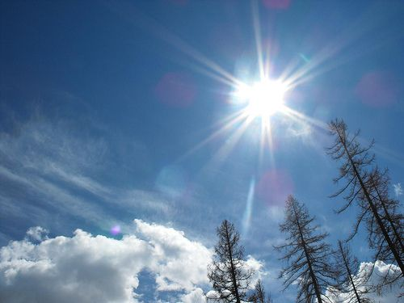
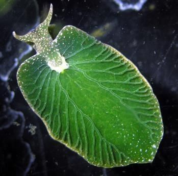
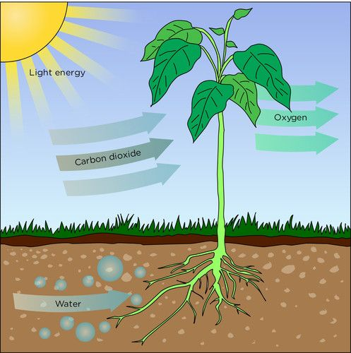
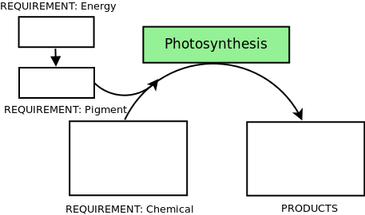
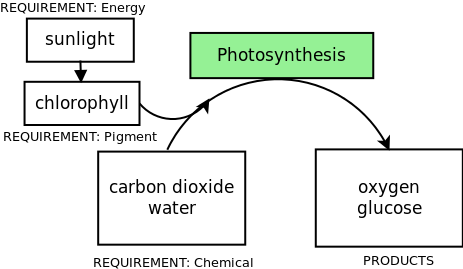
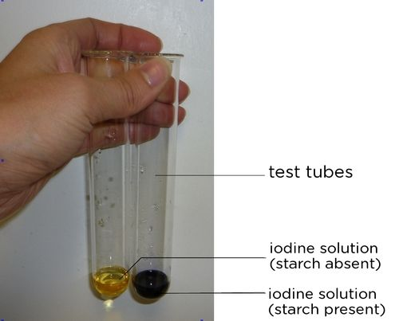
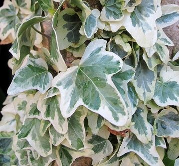
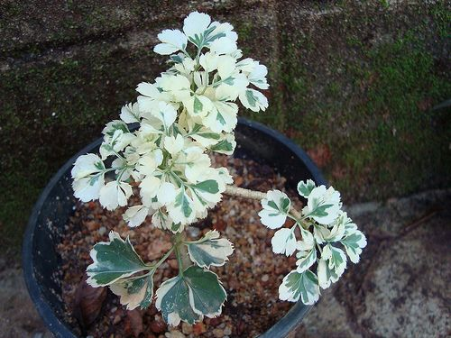
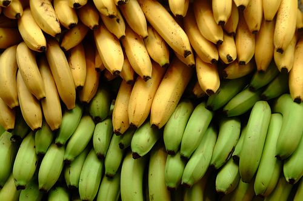

## Photosynthesis

<Callout type="note" title="Note">
- chemical potential energy
- chlorophyll
- chloroplast
- glucose
- photosynthesis
- radiant energy
- respiration
- starch
- soluble
- insoluble
</Callout>

This website has many interesting articles about science and science related jobs. They have been classified according to topics and also provide tips on how to incorporate the articles into your classroom. If you are interested in incorporating real world science into your classroom, this is one website to start looking at: [http://www.sciencenewsforkids.org/news-in-the-classroom/](http://www.sciencenewsforkids.org/news-in-the-classroom/)

<Callout type="note" title="Note">
All the **New words** listed in the boxes in the margin are defined in the glossary at the end of this strand.
</Callout>

### Energy sustains life

All life on Earth depends on energy to sustain the seven life processes.

# The seven life processes

**INSTRUCTIONS:**

2. Do you remember what the seven life processes are? Do you remember using the letters from MRS GREN to help you remember these?
4. Write down the seven life processes below.

M

R

S

G

R

E

N

The seven life processes are: movement (moving), reproduction (reproducing), sense the environment (sensing), growth (growing), respiration, excretion (excreting), nutrition (feeding).

The form of energy that the Sun produces is called **radiant energy**. Although the Sun provides us with both light and warmth, plants only use the light energy from the Sun to photosynthesise.

The Sun provides us with energy in the form of light and heat. [http://www.flickr.com/photos/gr33n3gg/3445868159/](http://www.flickr.com/photos/gr33n3gg/3445868159/)

Most organisms cannot directly use the energy from the sun to perform the seven life processes. For example, a reptile can lie in the Sun to warm up from the heat energy, but this does not provide the necessary energy for that animal to move, reproduce or excrete waste.

Except for a few sea slugs, plants are the only organisms on Earth that can absorb the Sun's radiant energy and convert it into food for themselves and for other living organisms.

### Radiant energy to chemical potential energy

<Callout type="note" title="Note">
The **Visit** boxes in the margins contain links to interesting websites and videos. Simply type the link exactly as it is into the address bar in your browser.
</Callout>

<Callout type="note" title="Note">
- pigment
</Callout>

What is potential energy? Do you remember that we spoke about energy for movement (kinetic energy) and energy that is stored (potential energy) in Energy and Change in Gr. 6 and 7? What are some things that have kinetic energy and some that have potential energy? Remember to take down some notes in the margins of your workbook as you discuss things in class.

Ask your learners this as a revision of what they did in previous grades. Some objects with kinetic energy are a moving car, a bouncing ball, a leaf blowing, a fan blowing, etc. Some objects with potential energy are a book on the table (it has gravitational potential energy as it can fall down to the ground), a bouncing ball when it is at the top of its bounce as it can also fall back down, a batteries, fossil fuels have and food have potential energy.

All living organisms can use energy in the form of **chemical potential energy** for the life processes. This is the energy that is stored in the food that organisms eat. Plants are able to capture the radiant energy from the Sun and transfer it to chemical potential (stored) energy for other organisms to use. They do this through the process of photosynthesis. All organisms release the stored potential energy from the food that they eat to support their life processes. This process is called **respiration**.

<Callout type="note" title="Note">
Find out why plants that photosynthesise are green.
</Callout>

Photosynthesis takes place in small structures called **chloroplasts**, which are inside the cells of the leaves and stems of green plants. Inside the chloroplasts are green **pigments** called **chlorophyll**.This is what gives plants their green colour. Photosynthesis is the process in which chlorophyll molecules absorb the radiant energy from the sun and transfers it into chemical potential energy. The only function of chlorophyll is to trap the sunlight energy; chlorophyll is not produced or used up during photosynthesis.

<Callout type="note" title="Note">
Chloroplasts are a type of organelle found only in plant cells. A cell is the basic unit of all living things. We will learn more about the structure and functioning of cells next year in Gr. 9.
</Callout>

<Callout type="note" title="Note">
Chloroplasts are only present in plants. However some sea slugs have learnt to absorb the chloroplasts from the green algae that they eat into their bodies and can actually photosynthesise themselves!
</Callout>

*Elysia chlorotica*, a sea slug, has evolved to absorb the chloroplasts from the green algae it eats and use them to photosynthesise! This animal can produce its own food and is green. [http://commons.wikimedia.org/wiki/File:Elysia_chlorotica_%281%29.jpg](http://commons.wikimedia.org/wiki/File:Elysia_chlorotica_%281%29.jpg)[http://commons.wikimedia.org/wiki/File:Elysia_chlorotica_%281%29.jpg](http://commons.wikimedia.org/wiki/File:Elysia_chlorotica_%281%29.jpg)

Photosynthesis has other requirements besides light energy from the Sun. What are these? Look at the following diagram which summarises the process of photosynthesis.

Plants use radiant energy from the Sun in a series of chemical reactions to change carbon dioxide from the air and water from the soil into **glucose**. The process releases oxygen.

# Requirements and products of photosynthesis

**INSTRUCTIONS:**

2. Summarise what you have learnt about photosynthesis in the diagram below.
4. Fill in the requirements of photosynthesis in the block on the left and fill in what type of energy is needed and the name of the pigment that absorbs the energy.
6. Fill in the products of photosynthesis in the block on the right.

The learner's diagram should look as follows:

The process of photosynthesis can be presented in the form of an equation:

What happens to the glucose that plants produce during photosynthesis?

### Glucose storage and use

The glucose that a plant produces when it photosynthesises is the food for the plant. The plant can use this glucose directly, and release the energy during its own respiration or it can store the glucose or convert it into other chemical compounds.

Glucose is **soluble** in water. As we learnt in Matter and Materials in Gr. 6, this means that glucose can dissolve in water. This is useful to the plant as it means it can transport the glucose in water to where it is needed elsewhere in the plant. However, in order to store large amounts of glucose, plants need to convert it into compounds which are **insoluble** in water. Therefore the plant converts glucose into **starch**, which is insoluble in water. Why do you think the plant might need to store some glucose?

Discuss this with your learners. The glucose is produced continuously during the day when the Sun is out and is not all used at once by the plant. The plant cannot have large amounts of glucose accumulating as this affects the water potential within the leaves, and so some is converted to starch to be stored until it is needed.

In addition to starch, plants also convert glucose into cellulose. Cellulose is used to support and strengthen plants. Animals do not have cellulose for support. Instead animals have something else to provide support and protect the body. Do you remember what this is?

A skeleton.

Glucose is also converted into other chemical compounds that enable processes in the plant such as reproduction and growth.

<Callout type="note" title="Note">
Plants use sugars (glucose) as a basic molecule from which to make hundreds of other compounds, such as proteins, oils, vitamins, colourful pigments in flowers, strong tasting chemicals (hot chilli plant), sweet tasting nectar and sweet smelling fragrances.
</Callout>

We have now learnt about how plants produce glucose and store it as starch, but how do we know for sure? As young scientists we also need to question whether this explanation of photosynthesis is accurate. Is there an investigation we can do to test for the presence of these compounds? Let's find out!

We have learnt that plants produce glucose during photosynthesis and store this in the form of starch. Therefore, to see if a plant photosynthesises, we can test to see if the plant produced starch.

Study the following properties of starch and glucose with your class. Think of possible tests that can be done to determine whether a plant has produced either starch or glucose. Record some of your discussion points.

Discuss this as a class in the lead up to the investigation.

- Glucose tastes sweet but starch does not taste sweet at all.

Learners could suggest that they taste the substance to see if it is a starch or glucose. It is important that learners be made aware that we do not taste-test **unknown** substances due to the potential for poisoning. This specific point was included to allow teachers to reinforce this rule with learners and that we only ever do a taste test if we are sure that a substance is in fact edible.

- Glucose will dissolve in water while starch will not dissolve in water.

Although this can be used as a fairly simple, physical test, it has several problems. For example, the temperature of the water will affect the rate at which it dissolves, as will the quantities used, etc. In discussing these points facilitate the discussion and lead learners to conclude it is not a very accurate test, although a simple physical one that can give a fairly good indication. This is a good opportunity to discuss kinetic energy and temperature of a solution.

- Iodine changes from brownish-orange to dark blue-black when it comes into contact with starch. Have a look at the following photos which illustrate this.

This is included as an introduction to the subsequent investigation. Teachers should let learners explore the possible ways in which to use this to test for starch.

The left tube contains only diluted iodine solution and the right tube contains diluted iodine solution with starch. [http://www.flickr.com/photos/tessawatson/3216911479/](http://www.flickr.com/photos/tessawatson/3216911479/)

Please emphasise to learners that they should refer to iodine *solution*, and not just iodine (which is a bluish black solid).

<Callout type="note" title="Note">
A video on the starch test.
</Callout>

Now that we know that plants produce glucose and change this into starch, we can find out if all leaves produce the same amount of starch through photosynthesis.

# Which leaves photosynthesise?

You will need variegated and normal leaves for this investigation. Variegated leaves have white patterns (areas lacking chlorophyll) on them. There are many examples of South African plants that have variegated leaves, such as some geraniums, African violets, ivy, etc. You can also take a walk around your school property and surrounds to see if you can find any variegated leaves. Get learners to look at the leaves and discuss the investigation first. They can also do this in groups. This investigation can be done over 2 lessons. You should place one set of pot plants in the cupboard the day before you want to do part 1 of the investigation. After you have done part 1, you can do part 2 in the following lesson. In part 2, learners will need to write up an experimental report. **If you do not have time to do both parts** of the investigation, a suggestion is to get your learners to read through Part 1, and then to conduct Part 2 where they
                    have to write up their own report.

There are two parts to this investigation. First, we want to find out which leaves are able to photosynthesise. We will place some pot plants in the light for a day, and some other pot plants in a dark cupboard for a day, and then perform the investigation on the leaves of plants from both groups.

In the second part of the investigation, we will use what we have learnt to investigate which parts of variegated leaves photosynthesise.

**Part 1: Leaves in light and dark**

**AIM**:

**Problem:**
What do you wish to establish by conducting this investigation?

**Solution:**
Learner-dependent answer

Possible answers include: 'To determine whether leaves photosynthesise in the dark or the light', or 'To investigate whether Light is necessary for Photosynthesis'.

**HYPOTHESIS**:

**Problem:**
What do you think or predict will happen when you conduct this investigation?

**Solution:**
Learner-dependent answer

The leaves in the light will test positive for starch as they photosynthesised, whereas the leaves in the dark will not photosynthesise and will test negative for starch.

**MATERIALS AND APPARATUS**:

- gloves
- a range of pot plants that can be easily moved around
- 100 ml beaker or glass jar in a saucepan with water
- bunsen burner, spirit lamp or a stove
- tweezers
- ethyl alcohol (or methylated spirits)
- glass petri dishes, white saucer or white tile
- stopwatch or timer
- glass pipette or dropper
- iodine solution

**METHOD**:

Before starting this investigation, all plants must be placed in a dark cupboard for up to 48 hours prior to starting the investigation in order to ensure that the plants do not have starch in the leaves before the process begins.

2. Work in groups of three or four.
4. Place half of the plants in the dark for at least 24-48 hours and the others in a well-lit area of the class that is exposed to lots of natural sunlight.
6. After 24 hours, pour 50 ml of the ethyl alcohol into the beaker and place it in the saucepan with water. Heat the saucepan over the bunsen burner or the stove. The water in the saucepan will distribute the heat evenly to warm the ethyl alcohol evenly.

Instead of a saucepan with water and a beaker with alcohol, teachers may use a beaker with water and a test tube with meths or alcohol. As long as the container holding the alcohol is safely contained within the water to prevent it from being directly heated or coming into contact with the flame. Teachers may also feel safer if they demonstrate this experiment.

2. Remove one healthy looking leaf from the pot plants that were in the well-lit area exposed to direct sunlight.
4. Using the tweezers, dip a leaf into the boiling water for 1-2 minutes. This helps to remove the waxy cuticle that covers the leaf and breaks down the cell walls.
6. After this, place the leaf into the beaker with the ethyl alcohol.

**Warning:** The alcohol needs to be heated as well but it cannot be heated directly because it is extremely flammable. It therefore needs to be heated in a water bath.

2. Leave the leaf in the alcohol until all the chlorophyll has been removed from the leaf and the alcohol turns green.
4. Place the leaf into warm water to soften it.
6. Remove the leaf from the warm water and place it on a white tile or a petri dish on top of a white surface.
8. Use the pipette or dropper to carefully drop 2 or 3 drops of iodine solution on the leaf in the petri dish and record your observations.

The amount of iodine solution required to observe a result depends on the leaf tested. Some leaves may need to be flooded with iodine solution. Place the leave in a petri dish and cover the leaf with iodine.

2. Repeat this process for two more leaves that were in the well-lit area.
4. Remove the plants that were in the dark for at least 24 hours. Use the test above to test whether there is starch present in the leaves from the plants that were kept in the dark.
6. Record your observations.

A really good demonstration of the various experiments in this and subsequent sections is found at . It starts off with carbon dioxide through limewater test and then demonstrates the starch test.

**RESULTS AND OBSERVATIONS**:

Keep a record of your observations. Draw a table to record and compare your results.

Learners must draw their own tables to record their observations. This being the first investigation that they will perform in high school, this activity will allow teachers to gauge their level of proficiency and abilities in this regard.

The hot water removes the waxy cuticle and the alcohol dissolves the chlorophyll, releasing the green colour of the leaf. After the leaves are taken from the ethyl alcohol they should be white. The chlorophyll needs to be removed from the leaf so it does not mask the colour change we expect with the iodine solution. When iodine is dropped on the leaf it turns blue-black in the presence of starch.This is an indicator to show that the leaf was photosynthesizing and producing glucose that was turned into starch.

**CONCLUSION**:

**Problem:**
What did you learn from doing this investigation?

**Solution:**
Plants that were given sunlight were able to photosynthesise and therefore tested positive for starch (iodine solution turned blue-black). Those that did not receive radiant energy did not photosynthesise so they tested negative for starch presence (iodine solution remained yellow-brown). Therefore, light is necessary or required for photosynthesis to occur.

**QUESTIONS**:

**Problem:**
Why were some plants placed in a well-lit area with direct sunlight and others in the dark?

**Solution:**
This was done to allow some plants to photosynthesise and the others not. Thus those that were able to photosynthesise could produce starch and those that didn't only had small amounts of starch or no starch.

**Problem:**
Explain what the results of the iodine test indicates.

**Solution:**
If the iodine changes from brownish-orange to dark blue-black that indicates that the leaf or other part of the plant contains starch and must have photosynthesised. If the iodine solution does not change colour then the leaf or other part of the plant does not contain starch and did not photosynthesise.

**Part 2 : Which parts of variegated leaves photosynthesise?**

Learners need to apply what they have learnt in Part 1 to plan their own experiment in part 2 and write up an experimental report.

Have a look at the following photos of different plants. What do you notice about the leaves?

Ivy leaves. [http://www.flickr.com/photos/crabchick/5810139262/](http://www.flickr.com/photos/crabchick/5810139262/)

Geranium leaves. [http://www.flickr.com/photos/yimhafiz/2517494621/](http://www.flickr.com/photos/yimhafiz/2517494621/)

Geranium leaves are an excellent option for this investigation. The ivy has a very thick cuticle and the iodine can't penetrate the leaf easily. Variegated mint-leaf is also very good for this investigation, and is a common plant in Kwa-Zulu Natal.

We call these leaves variegated as they have green and white sections. We want to find out which parts of these leaves photosynthesise in this part of the investigation.

**INSTRUCTIONS:**

2. You need to design this investigation yourself.
4. First decide what question you are trying to answer and the aim of your investigation.
6. Make a hypothesis for your investigation.
8. You then need to think back to part 1 and design the method for your investigation.
10. After conducting the investigation, you need to write up an experimental report of your findings.
12. In your report, you must have the following headings:
   2. Aim
   4. Hypothesis
   6. Materials and apparatus
   8. Method
   10. Results
   12. Discussion
   14. Conclusion
14. In your results section you need to record your observations in a scientific way. You can do this using a table, diagrams or a combination of both. Think carefully about what information you need to record in order to come to conclusions at the end of your experiment.
16. In your discussion, you need to explain your results and what they mean. You also need to evaluate your investigation and explain if there were any unusual results and suggest ways that you could have improved your investigation for future researchers who might want to repeat what you have done.
18. Present your report on separate paper.

This activity may be done in groups or individually. Up until now learners have been provided with a framework in which to write up their results. For this investigation, they need to compile their own reports. Some examples of what learners might produce are included here:

**Aim:** To find out which parts of variegated leaves photosynthesise and store starch.

**Hypothesis:** The green parts of variegated leaves will turn blue-black in iodine solution indicating that they photosynthesise and store starch, whereas the white parts will not turn blue-black (will stay brown).

**Materials and apparatus:** This should be a similar list to what was used in Part 1. Learners must record the items in a bulleted list and take note of measurements.

**Method:** This should also be similar to Part 1. The steps in the method must be numbered. They must be written in full sentences. Learners must take note of what measurements they used.

**Results:** Learners should draw a table to record their results. They should provide headings for the columns and rows and also a heading for the table. Learners must make drawings of their leaves at the start of the experiment, indicating the different coloured regions as boiling in alcohol will remove the colour. They can then indicate the results on the drawings.

**Discussion:** Assess learners ability to explain their results. They should also make reference to the fact that the white parts of the leaves do not contain chlorophyll and therefore they do not photosynthesise. This also shows that chlorophyll is crucial for photosynthesis. Learners should explain anything that they might have improved on in their results.

**Conclusion:** This should be a short statement in which they answer their aim or investigative question.

Leaves are not the only parts of plants that store starch. Starch is also stored in the stems, roots and fruit. Have you ever wondered why fruit becomes sweeter as it ripens? Think of an unripe green banana and a ripe yellow banana. Which one is sweeter? Let's find out why.

# Why do bananas become sweeter as they ripen?

It is not crucial to do this investigation if you do not have time. This is an **optional** extension of the starch test.

In this investigation we will taste the bananas to determine if they have more glucose or more starch. We will also conduct a starch test on the ripe and unripe bananas to see which contain more starch.

Ripe yellow bananas and unripe green bananas. [http://www.flickr.com/photos/design-dog/1249337589/](http://www.flickr.com/photos/design-dog/1249337589/)

**AIM**:

**Problem:**
What do you wish to establish by conducting this investigation?

**Solution:**
Learner-dependent answer

An example of a possible answer is: To investigate the presence of starch in ripe and unripe bananas; To investigate why bananas becomes sweeter as they ripen; etc.

**HYPOTHESIS**:

**Problem:**
What do you think or predict will happen when you conduct this investigation?

**Solution:**
If the unripe banana does not taste so sweet compared to the very sweet tasting ripe banana then perhaps it contains more starch, and less glucose. The starch test might show that the unripe banana contains more starch.

.

**MATERIALS AND APPARATUS**:

- ripe and unripe bananas cut into discs
- petri dish or saucer
- iodine solution
- dropper

**METHOD**:

**Problem:**
Work in groups of three or four. Take a piece of the ripe banana and a piece of the unripe banana and compare the tastes and textures of each. Record your observations in a table. Which banana do you think contains the most starch and the least glucose (a sugar) based on the taste test?

**Solution:**
Learner-dependent answer

Learners should be able to describe the taste and texture of each banana: the ripe one being soft and sweet, and the unripe one being firm and not too sweet. Learners might say that the unripe banana contains more starch and less glucose as it is not as sweet as the ripe banana. But, this is not a very accurate test. The learners might also experience the tastes differently, making the results unreliable.

2. Use the iodine starch test identify which banana, the ripe or the unripe one, contains the most starch. Record your observations in the table.

Learners should be able to quite easily see this based on the speed with which the iodine changes colour in the unripe banana.

2. Compare this test to the results from your taste and texture test to identify which banana contained the most starch.

**OBSERVATIONS:**

**Problem:**
Draw a table to record your observations from the taste and iodine test for starch.

**Solution:**
Learner-dependent answer

Allow learners the freedom to tabulate their results in any way they choose as long as it is easy to interpret and understand. Use this as a teaching opportunity to help those who cannot do this and when everyone is done compare the different methods used in the class.

**QUESTIONS:**

**Problem:**
Compare your observations of ripe and unripe bananas with those of the other learners in the class. Did you all make the same observations?

**Solution:**
Learner-dependent answer.

You should use this comparison to help learners understand that reliability of an experiment rests on the fact that although different people perform the same test they should all reach very similar results.

**Problem:**
What do you conclude from these results? Which method of testing is better to use and why do you say so?

**Solution:**
The conclusion is that unripe bananas contain more starch than ripe bananas. This question was specifically included to introduce learners to the concept of validity and teachers are encouraged to allow learners to debate this issue in the class.

**Problem:**
Explain what you think happens to the starch as the bananas ripen.

**Solution:**
As the bananas ripen, the starch is converted into glucose.

Now that we have looked at how green plants produce their own food, let's find out how all living things release the energy stored in food in order to perform the life processes.
