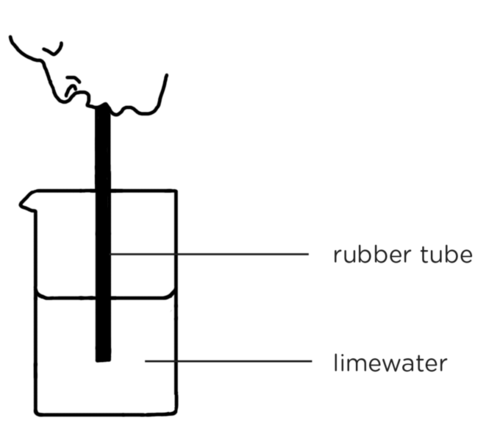
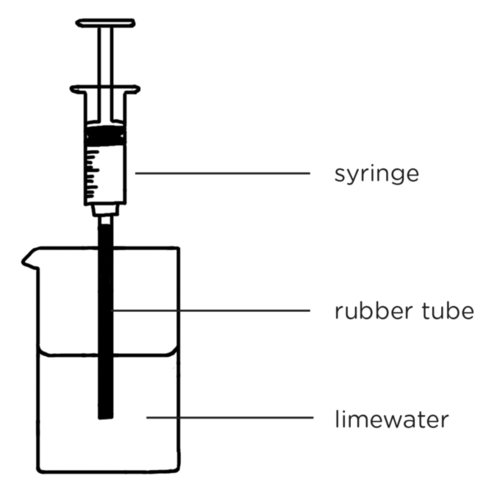
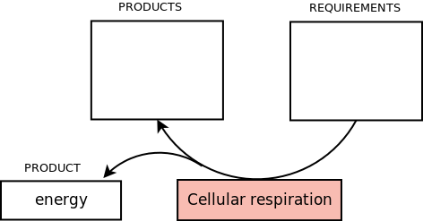
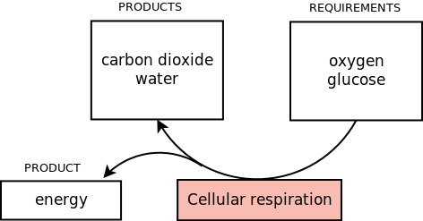

## Respiration

<Callout type="note" title="Note">
- limewater
- respiration
</Callout>

The term respiration can refer to two distinct processes. In **physiology**, respiration refers to the transport of oxygen from the outside air to the cells and the transport of carbon dioxide out of the tissues and into the air. This is often confused with breathing, which is the movement of air in and out of the breathing organs, such as lungs or gills, and does not take place in all organisms, whereas respiration does. At a **biochemical** level, respiration refers to cellular respiration. This is the metabolic process in all organisms where oxygen is combined with glucose to release water and carbon dioxide and energy in the form of ATP (adenosine triphosphate). Cellular respiration takes place in individual cells within the organism whereas physiological respiration involves the bulk transport of gases and other compounds between the organism and the outside air.

In this section, we will be looking specifically at **cellular respiration** as we will be looking at the chemical reactions which release the energy in food. However, learners have not yet learnt about cells and so we will just refer to this as respiration. Should you wish to do so, you can make this distinction to your learners and introduce the term cellular respiration, however, it will only be clear once they have done cells in Gr. 9. They will study physiological respiration in Gr. 9 when they do body systems and also cover the circulatory and respiratory systems in detail.

An idea as introduction and/or conclusion to this section on Respiration is to let learners watch the YouTube video of a song about cell respiration: [bit.ly/1eupZUz](http://bit.ly/1eupZUz). The initial explanation is simple and appropriate for this grade level but it might show some of the more inquisitive learners what actually happens during the 3 stages of respiration.

We have now seen how plants produce food during photosynthesis. The energy from this food needs to be used by plants and by all the animals who eat those plants. In fact, all organisms need to break down food in order to release its chemical potential energy for life processes. So how does this happen? Let's find out.

### Energy from food

Our bodies need energy to move and do work. Where do we get our energy from? The energy is obtained from the food that we and all other organisms eat.

If you think back to the work you did on fuel and energy in previous grades in Energy and Change, you will remember that fuels, such as wood, coal, and oil, contain **chemical potential energy**. When this fuel is burned in the presence of oxygen, the chemical potential energy is transferred into light and heat energy. In the same way, the glucose from the food that you eat is combined with oxygen in a series of chemical reactions to release the energy. The glucose is broken down and the energy is released. This energy is then used to drive all the other processes in your body. This process is called **respiration**. We can define respiration in all living organisms as the process by which energy is released from glucose in a series of chemical reactions.

<Callout type="note" title="Note">
We will learn more about chemical reactions next term in Matter and Materials. You will also learn more about respiration in later grades.
</Callout>

Respiration takes place in all organisms, even plants. However, plants do not need to eat any food as they make their own food during photosynthesis.

Photosynthesis requires sunlight and can only take place during daylight hours. Learners may get confused and think that because photosynthesis occurs during the day, that respiration only occurs during the night. Ensure that learners understand that respiration occurs constantly, during the day and night.

### Products of respiration

Do you remember how we represented photosynthesis as an equation to show what goes in and what comes out? We can represent respiration as an equation in the same way as we did for photosynthesis.

We know what is required for respiration to take place in all organisms. List the two ingredients for respiration.

They are glucose (food) and oxygen. Next term in Matter and Materials, we will look at chemical reactions and define the 'ingredients' as reactants. You can also link back to this example of a chemical reaction (actually a series of reactions), when introducing the topic next term.

We also know that respiration releases energy. This energy is contained in the chemical bonds of ATP molecules. ATP is not energy itself, but instead it *stores* energy. The ATP molecules have chemical potential energy in their bonds. When the ATP molecules are broken down they release the energy in order for other processes to take place.

However, respiration does not only produce energy. It also produces water and carbon dioxide as by-products. We can write an equation for respiration as follows:

**glucose** +** oxygen** → **carbon dioxide** +** water** + **energy**

Unlike photosynthesis, where we place sunlight energy above the arrow and not as one of the reactants in the equation, in respiration, we place energy here as a product. This is because the energy is actually contained within the molecules produced (ATP). However, at this level learners do not need to know this term, and we will only use the word energy in the equation. However, since this has the potential to cause misconceptions later, a note was included about the energy being contained within ATP molecules.

During photosynthesis in plants, oxygen is produced as a by-product. We call it a by-product as it is not the main product that is wanted from the process. In photosynthesis, the main product that is required from the process is glucose. What are the by-products in respiration?

Ask your learners this question to see if they understand the concept. The by-products are carbon dioxide and water.

<Callout type="note" title="Note">
A by-product is also sometimes referred to as a waste product.
</Callout>

The carbon dioxide that is produced in the body of an organism during respiration needs to be removed. In humans, we do this by breathing out carbon dioxide-rich air. We will learn more about the whole respiratory system next year in Gr. 9, and how breathing, our blood circulation system and respiration all work together as one system within our bodies.

<Callout type="note" title="Note">
Do not confuse breathing with respiration! Breathing is the act of inhaling and exhaling air into and out of the lungs. Respiration is the metabolic process that uses oxygen to release energy and releases carbon dioxide as a by-product.
</Callout>

We can test for the products of respiration using our own breath. So how do we test that our breath contains carbon dioxide? It is a colourless gas, so we cannot see it directly.

There is a very well known test for detecting carbon dioxide using clear limewater. To test if a gas contains carbon dioxide, simply bubble the gas through **limewater**. If the clear limewater turns milky, then the gas contains carbon dioxide. Next term in Matter and Materials, we will look at this again and find out about the chemical reaction taking place in the test. For now, let's use this test to show that our breath contains carbon dioxide.

# Does our breath contain carbon dioxide?

<Callout type="note" title="Note">
Watch a video of this activity.
</Callout>

You will need to prepare limewater prior to this activity. Here are instructions on how to do this:

2. Place a few tablespoons of calcium hydroxide, Ca(OH)2, in a clear 500 ml reagent bottle and fill with water. Shake or stir to make a cloudy suspension.
4. Leave the suspension to settle for a few days. The clear liquid above the solid Ca(OH)2 is a saturated solution of Ca(OH)2, also known as clear limewater.
6. Carefully decant as much of this as you need, without stirring up the solid Ca(OH)2 sludge at the bottom.
8. To make more, simply add more water, shake it up and let it settle again. When the sludge dissolves completely, add more solid Ca(OH)2.

**MATERIALS:**

- small beakers (or test tubes)
- rubber tubes or drinking straws

For health reasons, there should be one straw or rubber tube per learner.

- limewater
- 20 ml syringe (or larger if available)

Pharmacies are generally quite helpful and will assist schools in purchasing low cost syringes. Technology teachers at your school might also have syringes for their syringe mechanics lessons. An alternative to a large syringe is to use a bicycle pump or balloon blower. **Safety warning:** remove the needles from the syringes, if there are any, before you hand out the syringes in class.

**INSTRUCTIONS**

2. Work in groups of three.
4. Mark one beaker AIR and the other BREATH.
6. Pour clear limewater into each beaker until they are half full.
8. Blow bubbles through the rubber tube into the beaker marked BREATH, as shown in the diagram. Do this for at least 1 minute. Notice what happens to the clear limewater.

2. Attach a rubber tube to the front of a syringe. Draw air into the syringe from the atmosphere.
4. Place this rubber tube into the beaker marked AIR and push out the air inside the syringe slowly and carefully into the limewater as shown in the diagram. Notice what happens to the clear limewater.

**QUESTIONS**

**Problem:**
Describe what you observed when you blew air from your lungs through the limewater. What does this mean?

**Solution:**
The clear limewater turned cloudy white. This means our breath contains carbon dioxide from respiration.

**Problem:**
Describe what you observed when you used the syringe to bubble air from the atmosphere through clear limewater.

**Solution:**
The clear limewater did not change and remained clear. Some might notice a very slight change, which indicates that there is a small amount of carbon dioxide present in atmospheric air.

**Problem:**
A very small percentage of atmospheric air is carbon dioxide gas (0.03). Why do you think you observed the result you did when you pushed air from the atmosphere through the limewater?

**Solution:**
As air contains such a small percentage of carbon dioxide, there is not enough to cause a noticeable difference in the limewater. Discuss with your learners why they think that the limewater turned cloudy with your breath but not with the air, even though air does contain carbon dioxide. Point out that air from your lungs contains a much higher percentage of carbon dioxide from respiration and so this is able to turn the limewater cloudy in a shorter time than atmospheric air will.

**Problem:**
Think about respiration.

2. What are the requirements for respiration?
4. What are the products of respiration?

**Solution:**
2. Glucose and oxygen.
4. Energy, carbon dioxide and water.

# Requirements and products of respiration

**INSTRUCTIONS:**

2. Summarise what you have learnt about respiration in the summary diagram below.
4. Fill in the requirements of respiration in the block on the right.
6. Fill in the products of respiration in the block on the left.

This is what learners' diagrams should look like:

Have you noticed the **VISIT** boxes in the margins which contain links? You simply need to type this whole link into the address bar in your internet browser, either on your PC, tablet or mobile phone, and press enter, like this:

It will direct you to our website where you can watch the video or visit the webpage online. **Be curious and discover more online at our website!**
