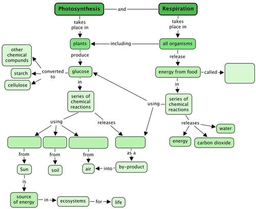
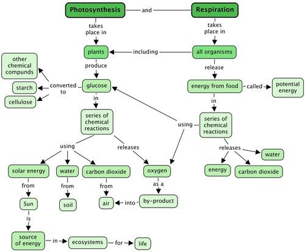

## Summary

<Callout type="note" title="Note">
- The need for energy drives the interactions and interdependence in an ecosystem.
- The Sun provides energy to the Earth in the form of radiant (light) energy and heat energy.
- Photosynthesis is the process whereby green plants use carbon dioxide from the air, water from the soil and radiant energy from the Sun in a series of chemical reactions to produce glucose (food) and oxygen.
- Plants are able to photosynthesise because they contain chlorophyll, a green pigment that can capture light energy from the Sun.
- Plants change the glucose that they produce into starch that can be stored more easily.
- Plants also produce cellulose fibres that give plants strength and support and are important to our digestive systems as roughage.
- The food that a plant produces is used by animals when they eat the plant and by other animals that eat them.
- This food contains chemical potential energy that needs to be released from the food.
- Respiration is the process in all living organisms by which energy is released from glucose in a series of chemical reactions.
- Respiration uses oxygen while carbon dioxide and water are given off as by-products.
</Callout>

**Concept map**

Throughout this year, we are going to develop the skill of designing and making**concept maps** in Natural Sciences. The "Key concepts" listed above is a summary written out in full sentences. A concept map provides another way of representing information (ideas and concepts) in a more visual way. The benefits of a concept map are that it allows one to show the links between different concepts. Often a concept map has a "focus question" from which the other concepts radiate. In these books, the focus question will be the main topic for the chapter. The relationships between different concepts are shown using arrows with linking phrases, such as "results in", "includes", "can be", "used to", "depends on", etc.

As this year progresses, learners will have to start filling in more parts of the concept maps themselves, and then hopefully draw their own ones by the end of the year. This teacher's guide contains the full version of each concept map. Encourage your learners to study the concept maps and make sense of them at the end of each chapter before doing the revision questions. Help your learners to understand and "read" the concept maps by constructing sentences from them. For example in this case you could read: "Respiration takes place in all organisms, releases energy from food".

**Learners need to learn how to learn!** This is one skill which might help them later in their school career where they have a lot more information to ingest and learn and make sense of. Concept mapping is one tool for summarising information and understanding how different concepts link together. Real understanding and knowledge comes from grappling with the subject matter, and not just memorizing facts.

*"Knowledge is real knowledge only when it is acquired by the efforts of your intellect, not by memory."* - Henry David Thoreau

This year in Natural Sciences, we are going to learn more about how to make our own concept maps.

In the summary, we first have the "Key concepts" for this chapter. This is a written summary where the information from this chapter is summarised using words. We can also create a concept map of this chapter. This is a map of how all the concepts (ideas and topics) in this chapter fit together and are linked to each other. A concept map gives us a more visual way of summarizing information.

Different people like to learn and study in different ways; some people like to make written summaries, whilst others like to draw their own concept maps when studying and learning. Others like to make things even more visual, using pictures and diagrams to form their summaries. Figuring out the study method that works best for you, and developing these skills is very useful, especially for later in high school and after school!

Have a look at the concept map below for 'Photosynthesis and Respiration'. Do you see that there are some empty spaces? You need to complete the concept map by filling these in. To do this you need read the map from top to bottom and have a look at the concepts which come before. For example, read the concept map as follows, "Respiration takes place in all organisms. All organisms release energy from food, called …........." What type of energy does food contain? Remember, food is the fuel for our bodies. You also need to fill in the three things that plants use to photosynthesise. You need to look at what concepts link from these in order to know where to put each one. Finally, what does photosynthesis release as a by-product? You also need to fill this in.

Teacher's version.

Below is the complete concept map with the answers filled in. Make sure your learners understand what a concept map is and that they have filled in the correct concepts into the empty spaces. Learners might battle to do this, especially to fill in "Potential energy" as the type of energy in food. Help them by reminding them of the two types of energy, namely kinetic energy and potential energy. You can ask them questions such as, "What do plants get from the Sun which is used for photosynthesis?" (Solar energy), "What do plants get from the soil that they use for photosynthesis?" (water), etc.

