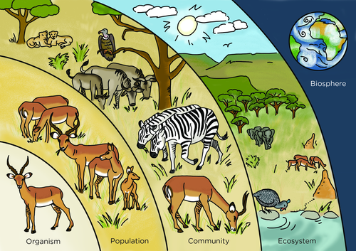
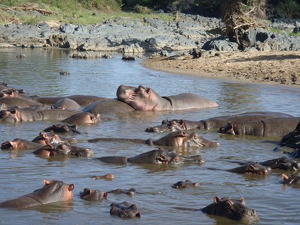
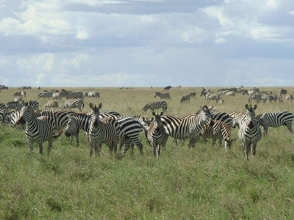
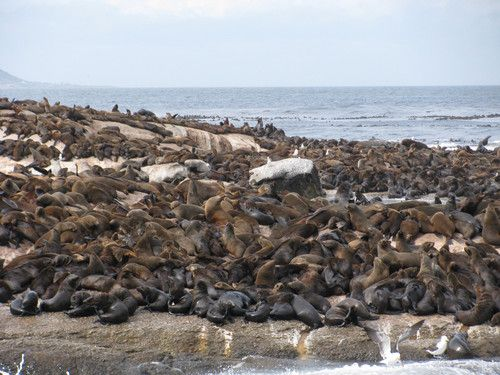
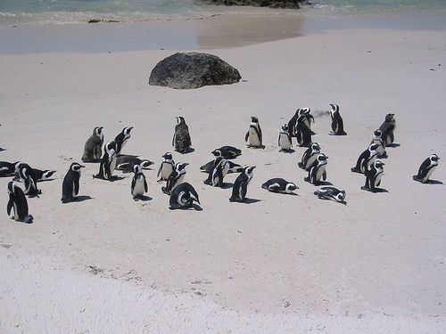
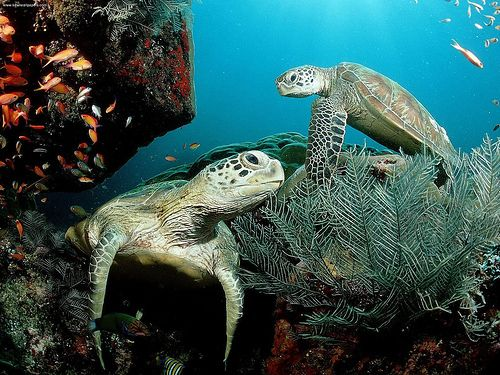
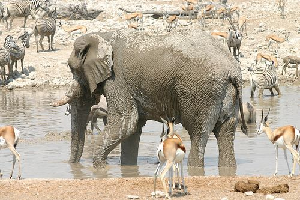
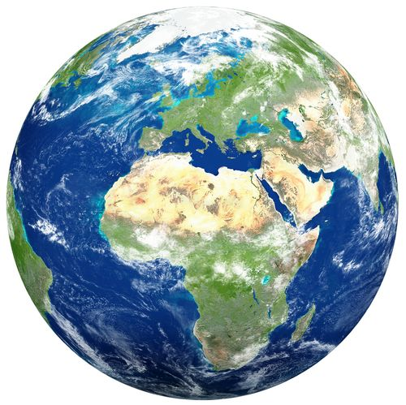

## What is ecology?

Learners have already studied the biosphere in detail in Gr. 7. They have also looked at the concept of an ecosystem in the younger grades. We will now put these different levels together in a hierarchical organisation representing the study of ecology.

<Callout type="note" title="Note">
- biosphere
- community
- ecologist
- ecology
- ecosystem
- interact
- population
- population ecology
- species
</Callout>

<Callout type="note" title="Note">
If you want to check the definitions of a **New word**, check the glossary at the back of this strand.
</Callout>

Every living organism on earth depends on and interacts with other living and non-living things to stay alive. Organisms depend on other organisms for food for example, and also depend on their environment for protection and a place to stay. The particular branch of Science that studies how organisms interact with other organisms and their environment is called **ecology**. Someone who studies these relationships and interactions is called an **ecologist**.

### Ecological interactions

The ecological interactions that take place within a specific area are generally classified into four levels: **populations**, **communities**, **ecosystems** and the **biosphere**.

Look at the following illustration which shows the levels of organisation.

Individuals live together in **populations**. Different populations together make up a **community**. Communities together with the non-living things in their surroundings make up an **ecosystem**. All the ecosystems on Earth make up the **biosphere**.

You may have heard of terms such as the biosphere and ecosystems in previous grades. What about populations and communities? You may have also heard about the population of people in South Africa, or when someone talks about your local community at home. What do we mean when we use these terms in ecology? Let's take a closer look.

#### Population

The website link provided in the visit box for our 'Breathing Earth' provides a very interesting simulation of how the population of the Earth, and also individual countries changes every second. If you have internet access in your classroom and a projector, you could put this website up when you first introduce population and then leave it running during the lesson. At the end of the lesson, bring it up again to see how much the Earth's population has increased in just a short time such as your lesson.

<Callout type="note" title="Note">
A simulation of different real-time changes in Earth's human populations.[http://www.breathingearth.net/](http://www.breathingearth.net/)
</Callout>

In the previous illustration, we can see that the individual impala make up a population in the game reserve. On a large scale, we can also say that the 50 million people in South Africa make up our country's population.

# What is a population?

**INSTRUCTIONS:**

2. Look at the following examples of populations.
4. Answer the questions which follow.

Discuss this with your class first and get their opinions. They should note that all the animals in a population are the same species and they can interact as they live in a specific area.

A population of hippos in the St Lucia estuary (river mouth) in Kwa-Zulu Natal. [http://www.flickr.com/photos/amanderson/4686389576/](http://www.flickr.com/photos/amanderson/4686389576/)

A population of zebra in Kruger National Park. [http://www.flickr.com/photos/amanderson/4685773273/](http://www.flickr.com/photos/amanderson/4685773273/)

A population of seals on Seal Island in False Bay.

A population of penguins at Boulders Beach.

**QUESTIONS:**

Learners might not know the answers to these questions as we have not yet given the definition of a population, but this is meant as a discussion and for them to come to the conclusion of what defines a population without stating the definition up front.

**Problem:**
What do you notice about all the animals that make up a population?

**Solution:**
All the animals are of the same species in a population. They are different ages, there are males and females.

**Problem:**
In each of the photos, the populations of animals are found in a specific area. Do you think the zebra in Kruger National Park and the zebra in Hluhluwe-Umfolozi game reserve in Zululand are from the same population? Why do you say so?

**Solution:**
No, they are not from the same population. Individuals in a population all live in a specific area and they can interact and breed with each other. They are not able to interbreed if they live in different areas.

**Problem:**
How big is a population?

**Solution:**
A population does not have a specific size. Rather, it is defined by the area that you are talking about and whether the individuals can interact.

**Problem:**
Do you think the seals that lived on Seal Island 100 years ago are part of the same population as the seals that live there now in the photo? Why do you say so?

**Solution:**
No, they are not from the same population. A population consists of organisms that live in the same space and at the same time. Individuals in a population interact with each other and are able to interbreed. Since the seals lived at different times, they cannot be part of the same population.

**Problem:**
What do you think would happen to the population of hippos in the estuary at St Lucia if the river dried up? Explain your answer.

**Solution:**
The number of hippos in the population would decrease. They might not necessarily all die, but the numbers would decline. The decline may be due to some individuals of the population migrating to other areas. The population would decrease because the environment cannot support the hippos anymore as there is not enough water in their habitat. (We will look more at balance in an ecosystem later in the chapter.)

**Problem:**
A group of scientists is studying a population of zebra in the Kruger National Park. They notice that over the last 4 years, the population has grown quite rapidly. Why do you think this might be the case? What are some possible reasons for this? Discuss this with your class.

**Solution:**
Some possible reasons include: there are perhaps fewer predators and so less of the zebra are being eaten. There might perhaps be an increase in the number of females that are born and so more are reproducing. There might be an increase in the amount of food available, perhaps other populations of herbivores have decreased or there might have been particularly rainy seasons so there is lots of food (green grass). Disease may have decreased so fewer animals are dying, or the amount of hunting or poaching by humans may have decreased.

Discuss this with your learners and see what they come up with. They have looked at feeding relationships and ecosystems in previous grades and so this also links back to what they have studied before and requires them to apply what they already know to new situations.

**Extension question to ask your learners**: Another group of scientists wants to compare the population of penguins at Boulders Beach in Cape Town with another population in Antarctica. What are some aspects of each population that they could compare?

Discuss this with your learners. You can help them come to the answers by asking leading questions, such as, how would the scientists compare the habitats of the two populations? How would they compare how well the penguins are doing in each population?

Answer: Some aspects that they could compare between the populations are: growth rate of the population, the number of deaths and births in a given time frame, what the penguins in each population eat, what are the natural enemies/ predators of each population of penguins, which other species do the populations of penguins interact with in their environment, how many times per year do they reproduce, do they build shelters, is there any human impact on the penguins etc.

A population is a group of organisms of the same species that live in the same area at a specific point in time and they can interbreed with each other. When a scientist studies a population they might study how the population grows and the factors that affect how the population increases or decreases. They will also look at how the population interacts with the environment.

#### Community

In ecology, a community refers to all the populations of organisms that **interact** in a certain area. Community ecology is the study of how they interact. For example, what feeding relationships occur in the area? What types of grasses do specific herbivores eat and what eats the herbivores? Turn back to the illustration of the wildlife in the game reserve. Which animals make up the community?

Lions, wildebeest, zebra, impala and vulture.

This is a possible extension activity if you would like to do it with your learners. This has only been included in the Teachers Guide as many learners might not be familiar with an underwater environment.

**Identify organisms in a community**

**INSTRUCTIONS:**

2. Study the photo below.
4. Answer the questions that follow.

An underwater community. [http://www.flickr.com/photos/38485387@N02/3580781379/](http://www.flickr.com/photos/38485387@N02/3580781379/)

**QUESTIONS:**

2. Identify the different populations of organisms that make up this underwater community which is part of the ocean.

*Different fish populations, turtles, seaweed, corals, sponges, plankton.*

2. Which other types of organisms would you expect to find in this community, but you cannot see in this photo?

*Some other examples include: crustaceans such as crabs or crayfish, jellyfish, octopus, other fish species, perhaps a reef shark*.

2. How would describe the specific area that this community inhabits?

*It is a coral ree f.*

2. Identify some possible feeding relationships between the different populations of organisms in this community.

*Some types of fish could eat other types of fish, the fish can eat the seaweed, the turtles eat the seaweed, the sponges filter the water for plankton.*

#### Ecosystem

Turn back to the illustration of the wildlife in a game reserve. The different populations interact with each other to form a community. When we look at how the communities interact with the non-living things in their environment, then we are looking at ecology at the ecosystem level.

Think of the different populations of organisms making up a community in Kruger National Park, such as the zebra, elephant, lions, springbok, different trees and grasses. Now look at the photo of some of these populations at a watering hole. In this photo we are studying how the living things interact with the non-living things. For example, the zebra and springbok are drinking water, whilst the elephant is splashing mud over itself to cool down. This is an **ecosystem**.

An ecosystem in the game reserve consist of the living and non-living things interacting with each other. [http://www.flickr.com/photos/34731946@N00/335133573/](http://www.flickr.com/photos/34731946@N00/335133573/)

#### Biosphere

All the ecosystems on Earth combined make up the biosphere. At the biosphere level, we can study how the living and non-living things interact on a much larger scale. This includes climate changes, how the Earth has changed over history and even how the movement of planet Earth affects different ecosystems, wind patterns as well as rock and soil formation.

All the ecosystems on Earth make up the biosphere.

# Check your understanding

This can be done as a short revision task in class or as homework to check what learners understand so far, or you can ask learners the questions orally in class. Suggested answers have been give, but learners must be encouraged to use their own words.

Write your own definitions and explanations for the following terms.

**Problem:**
Ecology:

**Solution:**
The particular branch of science that studies how organisms interact with other organisms and their environment.

**Problem:**
Interaction:

**Solution:**
The process of interacting/influencing each other.

**Problem:**
Organism:

**Solution:**
An individual life form, either a plant, animal, fungus, protist or bacteria.

**Problem:**
Population:

**Solution:**
A group of organisms of the same species that live in the same area at a specific point in time and they can interbreed with each other.

**Problem:**
Community:

**Solution:**
All the populations of organisms that interact in a certain area.

**Problem:**
Ecosystem:

**Solution:**
The different living things interact with the non-living things in their environment to make up an ecosystem.

**Problem:**
Biosphere:

**Solution:**
All the ecosystems on Earth combined make up the biosphere.

Let's now take a closer look at ecosystems.
