## Ecosystems

<Callout type="note" title="Note">
- abiotic
- biotic
- habitat
- migrate
- predator
</Callout>

The living organisms on Earth live and interact in different ecosystems around the planet. Together all these ecosystems make up the Earth's biosphere. An ecosystem consists of the **abiotic** (non-living) environment and the **biotic** (living) organisms.

<Callout type="note" title="Note">
Interested in a career in Green Science? Discover the possibilities here
</Callout>

The article in the visit box is about scientists working in 'Green science', particularly studying the interactions between plants and their environment. A possible enrichment activity, or homework task is to get learners to read the article, and then this webpage has questions that you can ask your learners in an informal discussion: [http://www.sciencenewsforkids.org/teachers-questions-for-cool-jobs-green-science/](http://www.sciencenewsforkids.org/teachers-questions-for-cool-jobs-green-science/ )

### Biotic and abiotic components in an ecosystem

We have looked a lot at the living organisms in different ecosystems in the last section, but what are some of the abiotic things in ecosystems? And how do the biotic things interact with the abiotic environment in a system?

# Abiotic components in a grassland ecosystem

**INSTRUCTIONS:**

2. Look at the following image of a grassland ecosystem.
4. Answer the questions that follow.

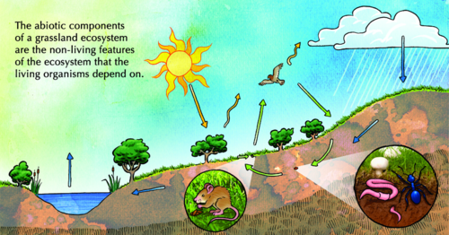

**QUESTIONS:**

**Problem:**
List some of the abiotic things in the grassland ecosystem shown in the image.

**Solution:**
Soil, rocks, water, wind/air, sunlight/temperature, clouds.

**Problem:**
For each of the animals, discuss how you think the organisms below are interacting with the abiotic environment.

2. The eagle
4. The trees and grass
6. The mouse
8. The worm and insect

**Solution:**
2. The eagle uses the wind and air to soar and glide while hunting.
4. The trees and grass are rooted in the soil so that they do not blow over and they can get water and use sunlight and carbon dioxide to make food.
6. The mouse creates its home in the ground/dead stick/grass, it can store seeds and food in the soil and hide from predators.
8. The worm and insect live in the soil.

**Problem:**
In the picture, the blue arrows show the movement of water through the ecosystem. What do we call this movement of water?

**Solution:**
The blue arrows describe the water cycle.

You can revise the water cycle here, namely: The water in the pond/dam evaporates as it changes from a liquid to a gas. The water vapour then condenses to form clouds as fine droplets of water. When the water droplets become big enough, they precipitate as rain. The water runs down the slopes and collects in the lower regions such as the pond.

**Problem:**
Temperature is an abiotic factor in an ecosystem. What can affect the temperature in the grassland ecosystem?

**Solution:**
The time of day will affect the temperature as this will affect how much heat energy the ecosystem receives from the Sun depending on the Earth's position. The time of year will also affect the temperature as the ecosystems distance from the sun changes. Weather conditions will also affect the temperature, for example if there are clouds, wind, or it is raining. The direction the area faces will also affect the temperature, for example if it is on a slope.

**Problem:**
Another abiotic factor which affects ecosystems is the slope of the land. For example, is it flat or are there hills or mountains. How would you describe the land in the grassland ecosystem? How do you think this contour affects the ecosystem?

**Solution:**
This grassland ecosystem has a sloped surface. There is a hill on the right hand side and the ground slopes downwards towards the pond. This shape and slope enables the water to run down when it rains and collect in the pond, thereby providing a collection of water for the ecosystem.

<Callout type="note" title="Note">
Play a game to identify specific habitats on Earth.[http://www.curriculumbits.com/prodimages/details/biology/where-on-earth.html](http://www.curriculumbits.com/prodimages/details/biology/where-on-earth.html)
</Callout>

Apart from the recycling water, biotic and abiotic factors also interact to recycle carbon dioxide and oxygen in ecosystems. Photosynthesis in plants uses carbon dioxide to produce glucose. The plants and animals then break down the sugars and release carbon dioxide again during respiration. Photosynthesis releases oxygen, while plants and animals take it in for respiration. Look at the following illustration which shows how the gases are cycled through a pond ecosystem.

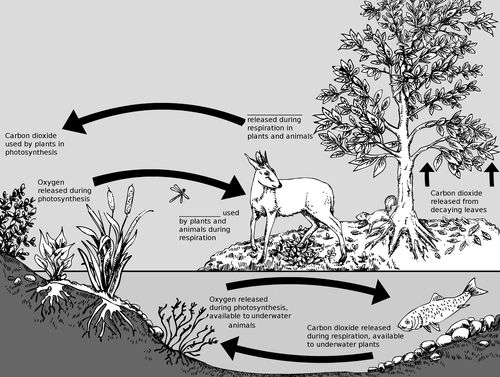

There are two labels missing, but lines have been provided for you to fill them in on the diagram. Discuss this with your class and write them in.

The arrow starting on the right above the buck should read '**Carbon dioxide** released during respiration in plants and animals.' The arrow ending on the right below the buck should read '**Oxygen** used by plants and animals during respiration.'

Now that we know a bit more about the different biotic and abiotic factors in an ecosystem and how they interact, let's study an ecosystem!

<Callout type="note" title="Note">
You can find out lots more online by visiting the links provided in the **Visit** boxes. Be curious and discover the possibilities!
</Callout>

# Studying an ecosystem

This activity may be given to learners as a project. Learners will mark off parts of an ecosystem and must ideally be able to return to it regularly. You as the teacher must pre-visit the area and find a suitable area for marking off and studying, preferably near a stream or shore. Ensure that there is enough space for several classes to study the same area without damaging it. Identify organisms and find possible relationships between them. Show learners before the visit how to use equipment correctly and how to keep records. If you have microscopes, teach them how to use these to study soil samples and small organisms. During the visit, you will have to circulate and check on the groups of learners.

As many of the measurements taken will be new concepts and practices, you should explain the reasons for measuring different environmental conditions in the ecosystem. During the investigations it is also important to walk between groups to ensure that they are applying the newly learnt skills appropriately and taking accurate measurements.

The leaf litter and soil samples may be studied in the field but could also be studied in the class. If teachers have taught learners to use basic light microscopes they should encourage them to study these with the use of a microscope too.

**MATERIALS:**:

- 60 m long string
- pegs or stakes
- measuring tape (10 m long)
- old material for flags on pegs
- thermometer
- rulers
- trowel
- sieve
- insect nets
- large plastic ziploc bags
- marking pens
- forceps
- gloves
- hand lens
- clipboard, paper and pens or pencils
- camera (if possible)

Optional materials are: rain gauge, wire ring, binoculars, field guides.

**INSTRUCTIONS:**

2. Work in groups of five. Your teachers will help you to select a site to study.
4. Stake out a square measuring 10 m x 10 m. Use the 10 m measuring rope and knock the stakes or pegs into the ground to mark the corners of the square. Tie a flag to the stake to make it more visible. (You will use this square to study different things in the next few weeks so make sure that you choose an appropriate site that does not overlap with another group's site.)

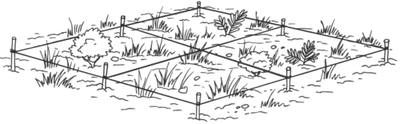

An example of a square with four quadrants.

2. Try to identify as many plants as possible. Use the following space to record your findings about the plants. You can even draw some illustrations.

Learner-dependent answer. If you can find moss or lichen, point out this interaction to learners which shows how a plant grows on a rock (interaction between biotic and abiotic). Similarly, plants (biotic) interact with the soil (abiotic) when they draw mineral salts and water from the soil.

2. Use the net to capture a few small invertebrates. Try to identify them (ask for help if you need it), then release them unharmed. Use the following space to record your observations. You can use illustrations.

Learner-dependent answer. Perhaps there are ants building a nest - point out these interactions to learners.

2. Look for evidence of bigger animals. Are there any dropping, tracks, or birds in the trees? Record what you find.

Learner-dependent answer. Lookout for any interactions between animals and with their abiotic environment and point these out to learners.

2. Measure the temperature.
   2. Measure the air temperature in your square.
   4. Measure the temperature of the soil about 5 cm below the surface.

If you are able to take the temperature several times over the course of a day, use this information to plot a graph to show how the temperature changes over the course of the day.

2. Take a soil sample by putting one scoop of soil into a plastic bag. Determine whether it is sand, loam or clay soil. Compare your sample with those of other groups. The following illustrations give an idea of the different types of soil.

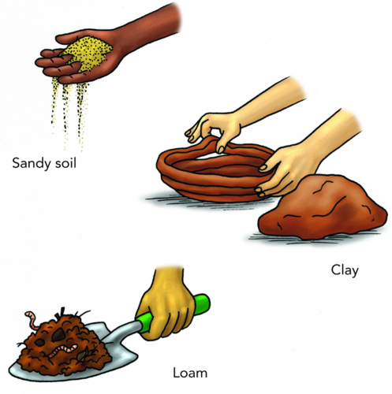

Different soil types.

Learners might have learned about soil types in previous grades in Earth and Beyond. This acts as a revision of what they have learned.

Use the hand lens to see if you can find any plant or animal remains in the soil.

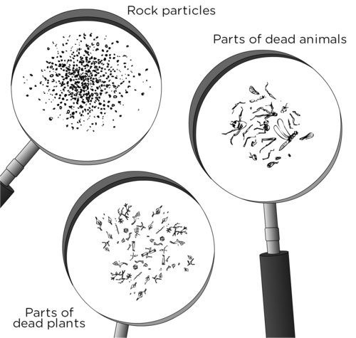

2. Use the following space to write about your observations and draw images. (Optional: Measure the rainfall and wind speed. Measure the rainfall over the next few weeks.)

Learner-dependent answer. You can easily make your own rain gauges by cutting the top off a 2 litre plastic bottle and inverting the top half into the bottom half to form a tunnel. You can use a marker pen to write measurements on the side of the plastic bottle. See this link: [http://www.rain-barrel-world.com/homemade-rain-gauge.html](http://www.rain-barrel-world.com/homemade-rain-gauge.html )

<Callout type="note" title="Note">
Build your own wind meter.[http://www.scientificamerican.com/article.cfm?id=bring-science-home-wind-speed](http://www.scientificamerican.com/article.cfm?id=bring-science-home-wind-speed )
</Callout>

**QUESTIONS:**

**Problem:**
Describe the different habitats in your ecosystem.

**Solution:**
Learner-dependent answer. They may describe the habitats/ecosystem as aquatic, terrestrial, or even a pond, grass, forest, etc.

**Problem:**
Explain how you think the abiotic factors of the ecosystem you studied affect the plants and animals in your ecosystem.

**Solution:**
Learner-dependent answer. Learners should take note of the water resources in their square, the slope of the land, and the type of soil and how this affects the organisms.

**Problem:**
What relationships did you notice between the plants and animals in the area you studied?

**Solution:**
Learner-dependent answer. Learners should take note of any feeding relationships that may exist. We will be studying this in more detail next, but learners would have done this in previous grades.

**Problem:**
In the area that you studied, was there any evidence of human interference? For example, rubbish or a pathway? How did this impact on the living organisms and also the abiotic factors in your square? What suggestions can you make to prevent this kind of interference.

**Solution:**
Learner-dependent answer. Perhaps there is litter which is blocking a stream, or that animals can eat and choke on. Perhaps there is a path that humans walk on, resulting in them trampling the plants so that nothing grows there. Learners could suggest putting some rubbish bins nearby, or perhaps mark off the area so that people have to walk around, etc.

**Problem:**
Do you think that your presence while you made your observations had an influence on the animals or plants in the quadrant that you observed?

**Solution:**
Learner-dependent answer. Learners may observe that insects or other small animals scurried away from them when they approached their quadrant. or perhaps insects were drawn to the stakes and rope that was used to demarcate their area.

You may choose to use this practical activity for learners to submit a written account/ report of their work and to present their findings to the class in the form of a powerpoint presentation. Possible areas to evaluate might include:

- Title and purpose
- Procedures followed by the group (as awarded from observations by the teacher)
- Comparative data similarities to other groups in the class that measured in similar areas.
- Answer to the questions above.
- Oral presentation of their research as presented in their powerpoint slideshow to the class. They could include the different activities that will be conducted throughout this chapter, such as their work on the different food chains and the food web that exists in their marked off ecosystem and work on conservation of their marked off ecosystem.

We studied relatively small ecosystems. How big can an ecosystem be? Does size in an ecosystem matter?

### Ecosystem size

The size of a real ecosystem is not defined in terms of area, but rather by the interactions that occur inside it. It can be as small as a river bank or as large as the Kruger National Park.

### Types of interactions

Within an ecosystem the species living in a particular area can interact in different ways with each other. We can classify the interactions between organisms as follows:

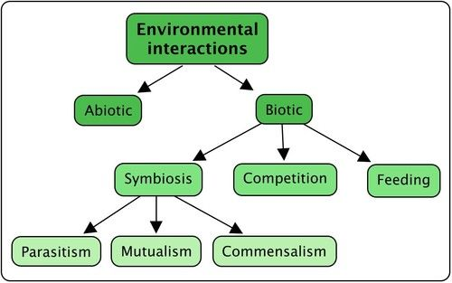

**1. Competition**

When two species in an ecosystem need to share a valuable and often limited resource. such as food or water, they are in competition with each other. The two different species compete with each other for the same resources, especially food.

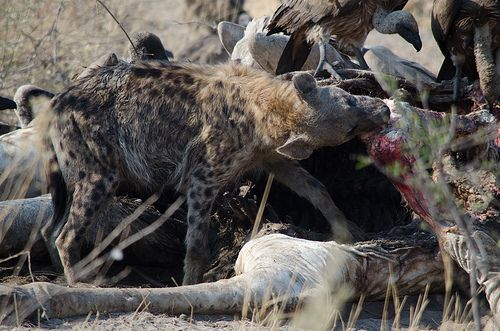

Hyenas and vultures are both scavengers and compete for the same food. [http://www.flickr.com/photos/dalangalma/8197670802/](http://www.flickr.com/photos/dalangalma/8197670802/)

**2 . Symbiosis**

Symbiosis describes the way in which two different species living together in the same community, interact with each other over a long time period. This can occur in the form of parasitism, mutualism or commensalism.

- **Parasitism**: Parasitism is when the one species benefits or gains something from the relationship and the other species is harmed in some way. The host may die in some interactions.

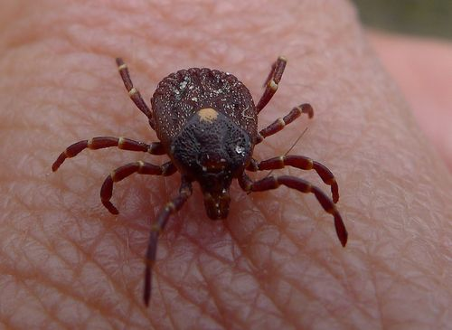

Ticks are parasites and feed off the blood of many animals, for example dogs, cows, buck and humans. [http://www.flickr.com/photos/31031835@N08/6368338667/](http://www.flickr.com/photos/31031835@N08/6368338667/)

- **Mutualism:** Mutualism occurs between any two species where both of the individuals benefit from the interaction. Both species gain something from the other, so we can say it is mutually beneficial.

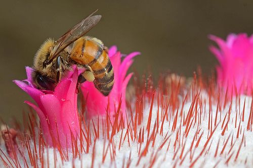

Pollination is an example of mutualism as the bee gets food (nectar) from the flower and the flower is pollinated by the bee so that it can reproduce. [http://www.flickr.com/photos/dejeuxx/6924771739/](http://www.flickr.com/photos/dejeuxx/6924771739/)

<Callout type="note" title="Note">
Some ants have fungi farms that they carefully look after and protect, providing the fungi with organic matter to fertilse it, while the fungi provides the ants with nutrients.
</Callout>

<Callout type="note" title="Note">
A video of leaf cutter ants tending to their fungi farm
</Callout>

- **Commensalism**: In some interactions between individuals from different species, the one species benefits, while the other one is unaffected by the relationship. Unlike parasitism, in commensalism the other species is not harmed or benefited in any way.

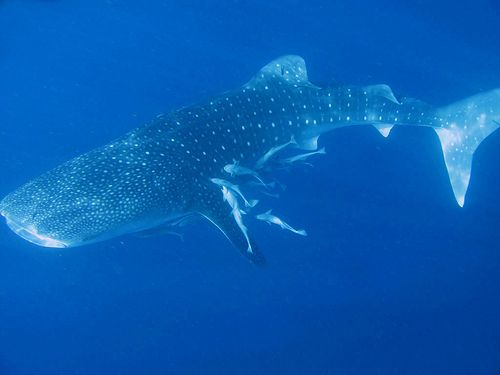

A whale shark with remora fish. The remora fish get scraps of food that fall out of the shark's mouth. The whale shark is unaffected. [http://www.flickr.com/photos/marcelekkel/4803634603/](http://www.flickr.com/photos/marcelekkel/4803634603/)

**3. Feeding:** Different species in an ecosystem are related and interact when one species can use the other species as a food source. For example, in predator-prey relationships, the one species (**predator**) will hunt another species (**prey**).

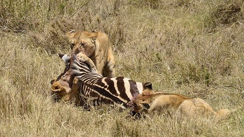

Lions and zebras have a predator-prey relationship. [http://www.flickr.com/photos/thomson-safaris/8377408989/](http://www.flickr.com/photos/thomson-safaris/8377408989/)

# Identify the type of interaction between organisms

This is an optional activity.

**INSTRUCTIONS:**

2. Study the photos and information in the following table.
4. Identify the interdependence in each case and give a reason for your choice.

**Problem:**
|  | Type of interaction | Explain this kind of interaction |
| --- | --- | --- |
| A hummingbird feeding. http://www.flickr.com/photos/mark233/6338069992/ |  |  |
| Plants on a forest floor. http://www.flickr.com/photos/66770481@N02/6741179033/ |  |  |
| Flea bites on a human. |  |  |
| Clownfish in an anemone. |  |  |
| An egret waiting for the rhino to disturb insects to eat. http://www.flickr.com/photos/dkeats/8040036825/ |  |  |

**Solution:**
|  | Type of interaction | Explain this kind of interaction |
| --- | --- | --- |
| A hummingbird feeding. http://www.flickr.com/photos/mark233/6338069992/ | Mutualism | The bird receives nectar from the flower and pollinates the flower at the same time. |
| Plants on a forest floor. http://www.flickr.com/photos/66770481@N02/6741179033/ | Competition | The plants are competing for light, space and water. |
| Flea bites on a human. | Parasitism | The fleas bite the human and feed, and the human is harmed in the process. |
| Clownfish in an anemone. | Mutualism | The sea anemone protects the clown fish from predators, the clown fish feeds on small invertebrates which might harm the anemone and the anemone also gets nutrients from the fish's fecal matter. Teacher note: Discuss this with your class, especially if you do not live by the sea. |
| An egret waiting for the rhino to disturb insects to eat. http://www.flickr.com/photos/dkeats/8040036825/ | Commensalism | The egret benefits as it waits for the rhino to disturb insects in the grass as it moves along feeding. the bird then catches the insects as they fly up. The rhino is not harmed and does not benefit from the relationship. |

Now that we know how organisms interact with each other, we will take a closer look at the feedings relationships between different organisms.
