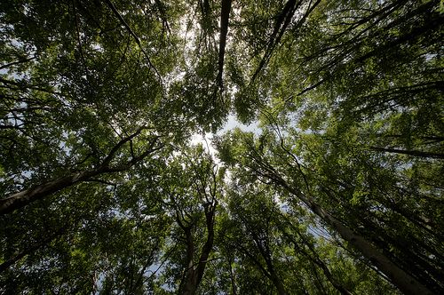
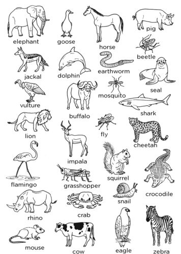
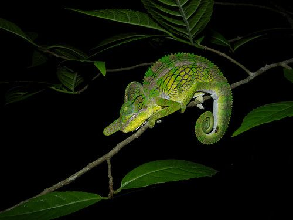
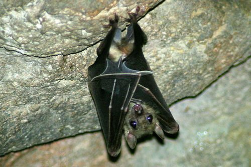
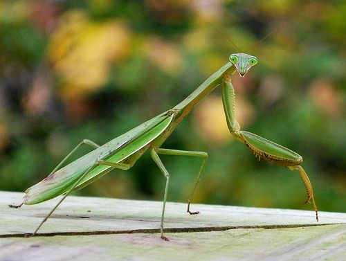
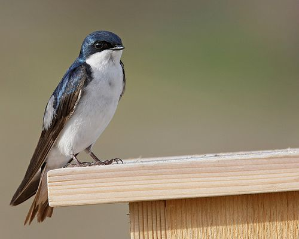
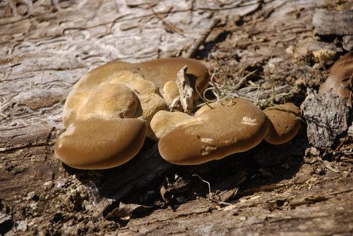
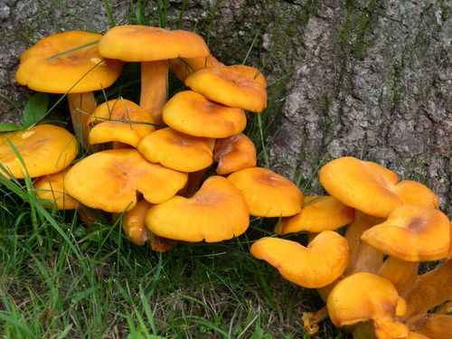
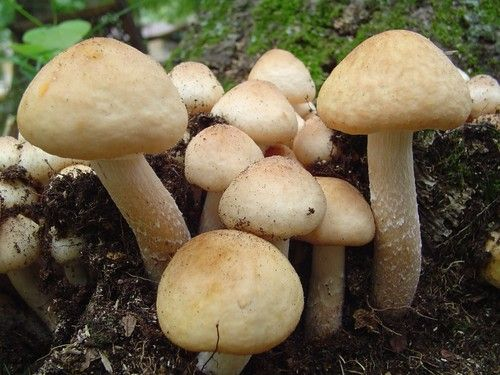
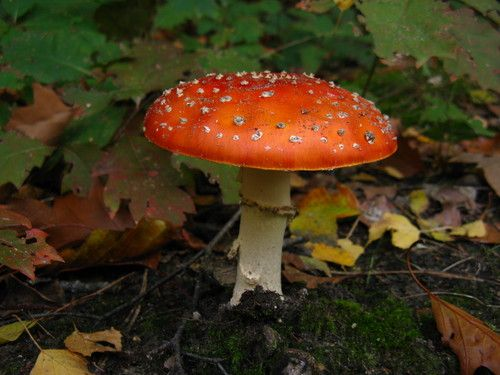

## Feeding relationships

Learners should have learned about food chains and food webs in previous grades. Therefore, some of this content is revision, but the concepts have also been extended to make it more engaging at this level.

<Callout type="note" title="Note">
- carnivore
- consumer
- decomposers
- herbivore
- insectivore
- omnivore
- producer
</Callout>

In the last section we saw how organisms from different species interact within an ecosystem. Let's now take a closer look at how organisms interact through their feeding relationships.

### Feeding types

Living organisms need to feed to be able to perform the other life processes. Some organisms can produce their own food, such as plants, while other organisms cannot do this and need to feed on other organisms to obtain their energy.

We can therefore identify different feeding types in an ecosystem, based on how the organism obtains (gets) its food. There are **producers** and **consumers**.

#### Producers

Producers are organisms that are able to produce their own organic food. They do not need to eat other organisms to do this. Producers are also called **autotrophs**. Which organisms have you come across that can make their own food?

<Callout type="note" title="Note">
The term autotroph comes from the Greek words *autos* meaning 'self' and *trophe* meaning 'nourishing'. So autotroph means 'self-feeding'.
</Callout>

Plants are producers because they make their own food during photosynthesis. What do plants need in order to photosynthesise?

Plants need water from the soil, carbon dioxide from the air, and sunlight energy from the sun.

Plants produce food through photosynthesis. [http://www.flickr.com/photos/mickers/7896129722/](http://www.flickr.com/photos/mickers/7896129722/)

<Callout type="note" title="Note">
In 2011, deep sea researchers discovered mussels living in symbiosis with bacteria that use hydrogen as a fuel source in chemosynthesis. These are the first organisms discovered to do so!
</Callout>

#### Consumers

Organisms which cannot produce their own food need to eat other organisms to get food. These organisms are called consumers. All animals are consumers as they cannot produce their own food. Consumers are also called **heterotrophs.**

<Callout type="note" title="Note">
The term heterotroph comes from the Greek words*heteros* meaning 'different' and *trophe* meaning 'nourishing'. So heterotroph means 'different-feeding' or feeding on different things.
</Callout>

There are many types of consumers and we can classify them into specific groups depending on the food that they consume. These are:

- **herbivores**
- **carnivores**
- **omnivores**
- **decomposers**

# : Different types of consumers

This activity is intended to build on previous knowledge of herbivores, omnivores and carnivores, and introduces concepts of insectivores and scavengers, which learners might have incidental knowledge of but might not have defined themselves. The activity requires that they engage with their existing knowledge and use this to define the terms. Teachers should walk between groups and ensure that they use scientific vocabulary as taught in this and previous sections as well as the New Word List, in their definitions.

**INSTRUCTIONS:**

2. The following image shows a variety of different animals found in South Africa.
4. Study the illustration and then answer the questions that follow.

**QUESTIONS:**

**Problem:**
What is a herbivore? Write a definition below and then give four examples of animals from the images which are herbivores.

**Solution:**
A herbivore is an animal which feeds on plant material. Examples of herbivores are: elephant, duck, horse, buffalo, squirrel, grasshopper, rhino, zebra, cow, mouse, etc.

**Problem:**
What is a carnivore? Write a definition below and then give four examples of animals from the images which are carnivores.

**Solution:**
A carnivore is an animal which eats other animals (living or dead). Examples of carnivores are: lion, jackal, dolphin, crocodile, shark, leopard, mosquito, vulture, crab, seal, etc.

**Problem:**
There are different types of carnivores. Some carnivores hunt other animals. They are called predators. The animals that they hunt are called prey. A lion is an example of a predator. Give three examples from the images of animals which are prey of the lion.

**Solution:**
Buck, zebra, buffalo.

**Problem:**
Other types of carnivores are called scavengers as they eat dead meat, for example a hyena. There are three other scavengers in the images. Identify them and write the names below.

**Solution:**
Vulture, jackal, crab.

**Problem:**
The following animals are also all carnivores. They all have a similar diet. Do you know what they all eat? Find out what these animals eat. Discuss this with your class.

A chameleon. [http://www.flickr.com/photos/42244964@N03/4325982802/](http://www.flickr.com/photos/42244964@N03/4325982802/)

A bat. [http://www.flickr.com/photos/chimothy27/3642531568/](http://www.flickr.com/photos/chimothy27/3642531568/)

A praying mantis. [http://www.flickr.com/photos/twbuckner/4056556245/](http://www.flickr.com/photos/twbuckner/4056556245/)

A swallow. [http://www.flickr.com/photos/j_benson/2545246443/](http://www.flickr.com/photos/j_benson/2545246443/)

**Solution:**

**Problem:**
Write down below what these animals all eat and what we call this type of carnivore.

**Solution:**
These animals all eat insects and other small invertebrates. They are called insectivores.

**Problem:**
What do we call animals that eat both plants and other animals? Give one example from the pictures.

**Solution:**
An animal which eats both plants and other animals is an omnivore. Examples are: pig, flamingo, mouse/rat.

**Problem:**
What would you classify humans as?

**Solution:**
Humans are omnivores.

**Problem:**
The last group of animals that we can discuss from this image are the decomposers. Decomposers break down the remains of dead plants and animals. Give an example of a decomposer from the image.

**Solution:**
An earthworm is a decomposer.

**Problem:**
Refer to the study of an ecosystem in or near your school that you are busy with.

2. List the producers in your ecosystem. Explain how you know they are producers.

**Solution:**
Learner-dependent answer.

**Problem:**
List the herbivores that you found in your ecosystem. Explain how you know they are herbivores.

**Solution:**
Learner-dependent answer.

**Problem:**
Did you find evidence of or find examples of carnivores in your ecosystem? List them below.

**Solution:**
Learner-dependent answer.

**Problem:**
Study the soil again. Use the hand lens to see if there are any decomposers that you can see or see evidence of in your ecosystem. Describe any decomposers that you found below.

**Solution:**
Learner-dependent answer.

They might have seen earthworms or fungi.

In the last activity, we looked at different consumers. The examples that we studied were all different types of animals. But what about the other kingdoms, such as fungi?

You might remember learning about fungi in previous grades. Fungi are not plants. Fungi cannot photosynthesise as they do not have chlorophyll. So where do fungi get their food from?

# Different decomposers

**INSTRUCTIONS:**

2. Look at the following photographs of different fungi.
4. Answer the questions that follow.

**QUESTIONS:**

**Problem:**
What kingdom do the above organisms belong to?

**Solution:**
They are mushrooms so they are part of the Fungi kingdom.

**Problem:**
What do you notice about where these mushrooms are growing? What are they mostly growing on? Is it dead or alive?

**Solution:**
The mushrooms are mostly growing on dead plant matter, such as dead tree logs and humus.

**Problem:**
The mushrooms get their nutrients from what they are growing on. At the same time, they are breaking down this dead matter. What can we therefore call fungi?

**Solution:**
We can call them decomposers.

**Problem:**
When fungi, and other decomposers, break down dead material, they help to return nutrients to the soil. Write a few sentences where you explain why you think decomposers are important in an ecosystem and how they help an ecosystem to function.

**Solution:**
Decomposers break down the matter in dead organisms to release the nutrients such as water and carbon, back into the ecosystem. These nutrients are therefore recycled and made available for other organisms to use. They also help to keep an ecosystem 'clean' as they make sure that dead and decaying material is not left lying around in an ecosystem for an extended period.

We now know that the different organisms in an ecosystem are related by how they feed. There are producers and consumers. We have seen that organisms from one species eat other organisms from another species. How can we link these feeding relationships together to describe how the energy is transferred in an ecosystem from the producers to the consumers?
