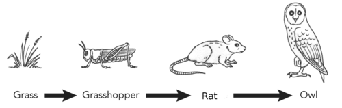
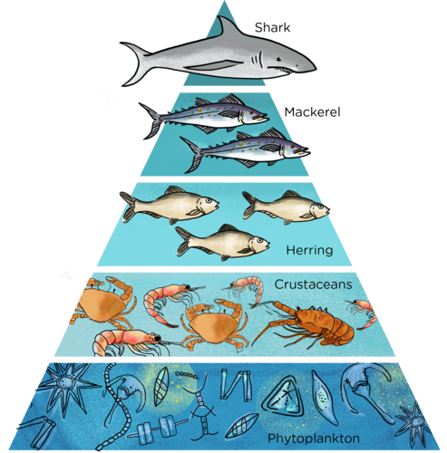
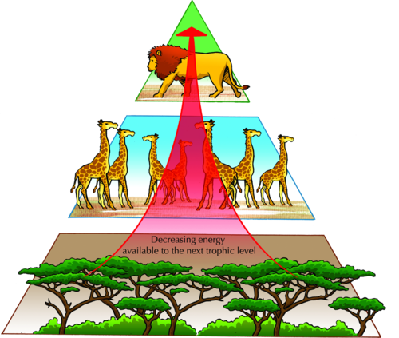
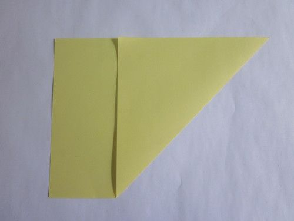
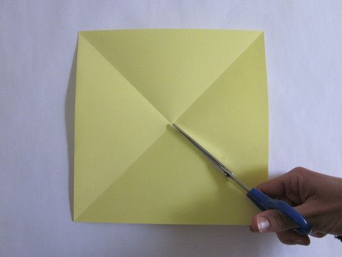
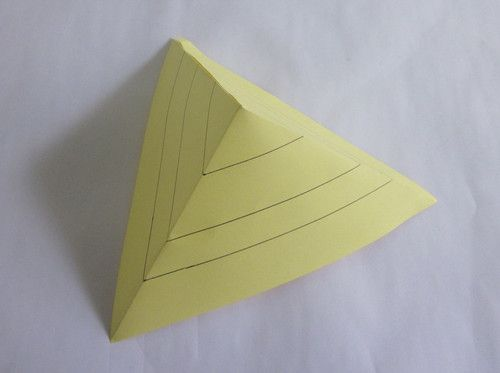
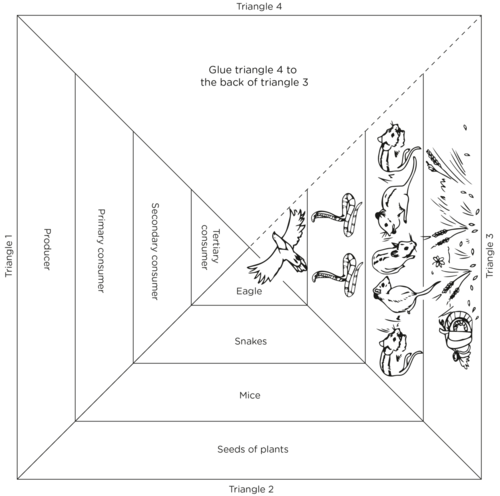
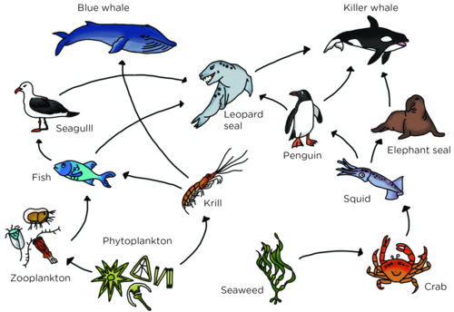

## Energy flow: Food chains and food webs

<Callout type="note" title="Note">
- energy pyramid
- food chain
- food web
- primary consumer
- secondary consumer
- tertiary consumer
- trophic level
</Callout>

The flow of energy from the sun to different organisms in an ecosystem is very important as it supports all the life process of living organisms. In this section we will look more closely at the way in which energy flows from the sun to different organisms in order to support and sustain life on Earth.

### Energy transfer

Energy is vital for organisms to carry out their life processes. All energy in **food webs** comes from the sun. Plants trap sunlight energy during photosynthesis and convert it to chemical potential energy in food compounds, which are available to animals. Herbivores get energy directly from plants, but carnivores and omnivores eat animals for energy. This energy transfer is shown by **food chains**.

<Callout type="note" title="Note">
Play the food chain game
</Callout>

# Energy transfer in an ecosystem

**INSTRUCTIONS:**

2. Study the following diagram which describes the feeding relationships between different organisms in an ecosystem.
4. Answer the questions which follow.

**QUESTIONS:**

**Problem:**
What can we call this diagram?

**Solution:**
It is called a food chain.

**Problem:**
Which organsism is the producer?

**Solution:**
The grass.

**Problem:**
Which organisms are the consumers?

**Solution:**
Consumers are the grasshopper, the mouse and the owl.

**Problem:**
Out of the consumers, identify the herbivore and the carnivores.

**Solution:**
The grasshopper is the herbivore and the mouse and the owl are the carnivores.

**Problem:**
The rat also actually eats seeds and other plants. Therefore, what do we call the rat? Give a reason for your answer.

**Solution:**
The rat is an omnivore as it eats both plants and animals.

**Problem:**
What do the arrows show us?

**Solution:**
The arrows show the transfer of energy from one organism to the next.

**Problem:**
Do you think it makes a difference which way the arrows are pointing? Explain your answer.

**Solution:**
Yes, it does make a difference. The arrows show the direction in which the energy is transferred as one organism eats the other one, always from the producers to the consumers.

**Problem:**
Use the following space to draw three more food chains. Use organisms from the ecosystem that you are studying at or near your school in at least two of the food chains you draw.

**Solution:**
Learner-dependent answer. Learner's food chains must start with a green plant (producer), or part of a green plant, such as a fruit or wheat. Make sure they have used the arrows in the correct direction, and that they have three levels of consumers.

**Problem:**
Where would you place decomposers in a food chain? Why do you say so?

**Solution:**
Learner-dependent answer. They could say that decomposers would come at the end of the food chain as they break down the bodies of the dead organisms. Or they are often put at the side, with many arrows from all levels of the food chain as they break down all the dead organisms at every level.

Can you see how the above food chain describes how the energy is passed along from the producer to the consumers? But, there are three different consumers in this food chain. How can we distinguish between the different consumers?

- Animals that eat plants are **primary consumers**. (Primary means *first*.)
- Animals that eat primary consumers are called **secondary consumers.**
- Animals that eat the secondary consumers (mostly predators) are the **tertiary consumers**.

Identify the different levels of consumers in the food chain in the activity.

Encourage learners to write the levels into the diagram. The grasshopper is the primary consumer, the rat is the secondary consumer and the owl is the tertiary consumer.

Each of these levels in the food chain is called a **trophic level**. The organism uses up to 90% of its food energy itself for its life processes. Only about 10% of the energy goes into new body cells and is available to the next animal when it gets eaten. This loss of energy at each trophic level can be shown by an **energy pyramid**. But, why do we show it in the shape of a pyramid? Let's find out.

<Callout type="note" title="Note">
A video on energy pyramids
</Callout>

# Studying energy pyramids

**MATERIALS:**

- cardboard
- scissors
- glue
- coloured pens and pencils

**INSTRUCTIONS:**

2. Have a look at the following energy pyramid for a marine and a savanna ecosystem. Pay careful attention to the number of organisms in each level.
4. Answer the questions that follow.
6. At the end, you can make your own energy pyramid.

**QUESTIONS:**

**Problem:**
Which organisms are the producers in the marine ecosystem and in the savanna ecosystem?

**Solution:**
The phytoplankton in the marine ecosystem and the trees in the savanna ecosystem.

**Problem:**
Which organisms are the primary consumers in the marine ecosystem and in the savanna ecosystem?

**Solution:**
The crustaceans in the marine ecosystem and the giraffe in the savanna ecosystem.

**Problem:**
90% of the energy is lost and only 10% is made available to the next trophic level. Why do you think this happens? Discuss this in your class and write your answer down below.

**Solution:**
The organisms in each level use most of the energy (\(\text{90}\)%) to sustain their own life processes (such as breathing, moving, reproducing etc). Therefore, only \(\text{10}\)% is available to the next level which feeds on them. Learners might need help with this question, so ask them leading questions such as, what do the organisms in each level need energy for?

**Problem:**
Give possible reasons why you think there needs to be so many producers in these ecosystems.

**Solution:**
Energy flow in an ecosystem is very inefficient and only \(\text{10}\)% of the energy from a trophic level is passed to the next level. Therefore, to provide enough energy for the subsequent trophic levels, there needs to be many plants as primary producers.

**Problem:**
How many trophic levels are there in each of the ecosystems?

**Solution:**
There are 5 in the marine and 3 in the savanna ecosystem.

**Problem:**
Compare the amount of producers with the amount of secondary consumers. Why does there seem to be such a large difference in numbers?

**Solution:**
Since only \(\text{10}\)% of the energy produced by the consumers is passed on to the next level, the primary consumers need to eat a large amount of producers to get enough energy to live. In the same way, each level needs to be supported by a larger population that it feeds on as only \(\text{10}\)% of energy is passed on to each level.

**Problem:**
Read the following quote and draw an energy pyramid with five trophic levels in the space provided:

*"Three hundred fish are needed to support one man for a year. The trout, in turn, must consume 90 000 frogs, that must consume 27 million grasshoppers that live off 1000 tons of grass."*

**Solution:**
Learner-dependent answer

Now let's make our own energy pyramids. Follow the steps:

2. Use an A4 sheet of cardboard and cut out a square. Do this by folding one corner to the opposite side and cutting off the rectangle sticking out.

2. Next, fold the square in half the other way so that you have two folds diagonally across the square.

2. Cut along one fold to the centre.

2. Fold the one of the triangle sides underneath the other one to make a pyramid.

2. Before gluing the two sides together, draw three lines to divide the sides into 4 layers.
4. Now you need to design your energy pyramid. Decide on the organisms that will go into each level. You will need producers, primary consumers, secondary consumers and a tertiary consumer.
6. In one of the triangles, draw images of each of the organisms in the different levels.
8. In another triangle write the names of the organisms.
10. In the last triangle, write whether the organism is the producer or which type of consumer.
12. Now glue the triangle together.
14. Have a look at the following example. You must come up with different organisms!

### Food webs

Consumers have different sources of food in an ecosystem and do not only rely on only one species for their food. If we put all the food chains within an ecosystem together, then we end up with many interconnected food chains. This is called a food web. A food web is very useful to show the many different feeding relationships between different species within an ecosystem

# Identifying food chains and food webs

**INSTRUCTIONS:**

2. Study the food web below.
4. Answer the questions that follow.

<Callout type="note" title="Note">
Plankton is a term to describe organisms that live in the water and can't swim against a current. Phytoplankton are microscopic plant-like organisms and zooplankton are tiny animal-like organisms.
</Callout>

**QUESTIONS:**

**Problem:**
What sort of ecosystem does this food web describe?

**Solution:**
A marine ecosystem.

**Problem:**
Use the following space to write down 4 different food chains from this food web.

**Solution:**
There are several answers. Some examples include:

phytoplankton ⇨ krill ⇨ fish ⇨ penguin ⇨ leopard seal

phytoplankton ⇨ zooplankton ⇨ fish ⇨ sea gull ⇨ leopard seal

phytoplankton ⇨ krill ⇨ blue whale

seaweed ⇨ crab ⇨ squid ⇨ penguin ⇨ leopard seal

seaweed ⇨ crab ⇨ squid ⇨ elephant seal ⇨ killer whale

**Problem:**
What does a food web show?

**Solution:**
It shows how the different food chains are connected.

**Problem:**
Name the producer in this food web.

**Solution:**
Phytoplankton and seaweed

**Problem:**
List the herbivores in this food web.

**Solution:**
Krill, zooplankton and crab

**Problem:**
Name two species in this food web that are top carnivores.

**Solution:**
Killer whale and blue whale.

Refer to the ecosystem that you are currently studying. See if you can identify the food web that is applicable in your marked off ecosystem. Draw it below.

What do you think would happen to the marine ecosystem in the last activity if we removed the phytoplankton? This brings us to the next section.
