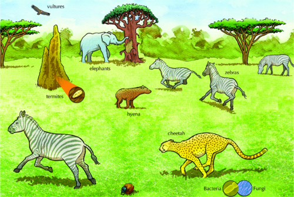
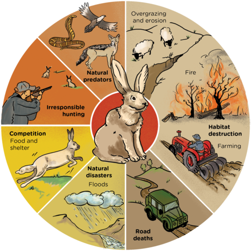
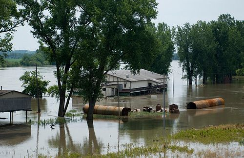
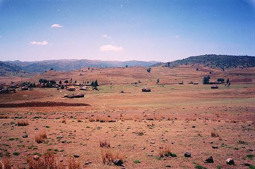
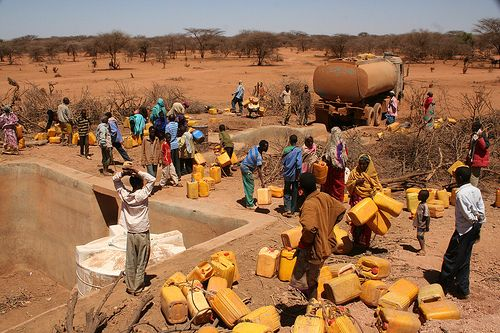
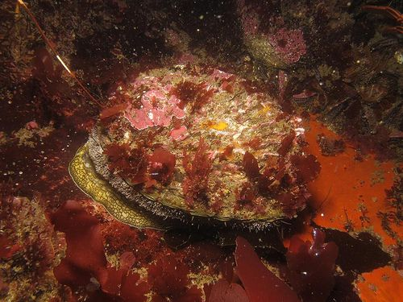
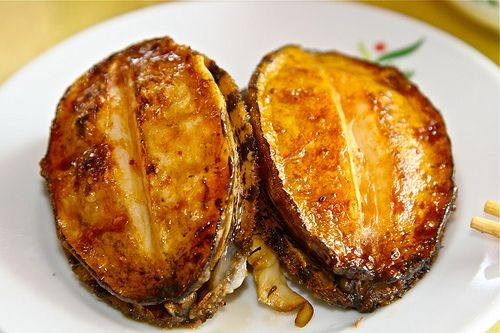
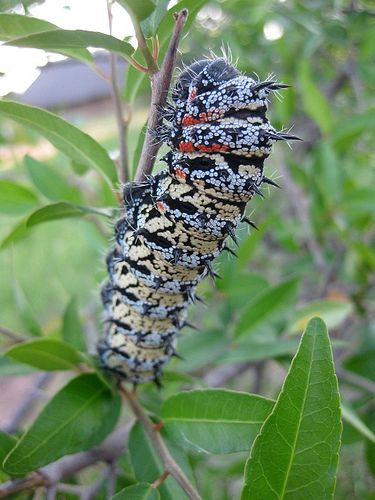
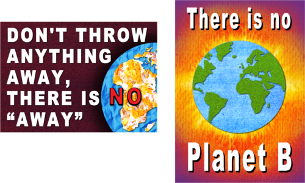

## Balance in an ecosystem

<Callout type="note" title="Note">
- endangered
- extinct
- limit
</Callout>

In this section will examine the balance between the different trophic levels in ecosystems, since all organisms in the ecosystem have to rely on the resources the area can supply. Any area can only support a **limited** number of animals. Look at the ecosystem below and decide which resources the organisms depend on. Remember to take some notes.

Use this as an entry point into this section.The resources that organisms depend on are food, shelter and water. Ask learners questions such as, what would happen if there was a drought and all the grass died, or there was a fire that swept through and burned all the plants, or what happened if all the zebra got a disease and died? The ecosystem would become imbalanced in some way.

A balanced savanna ecosystem.

If all the grass and trees die, what would happen to the zebra and elephants? What would later happen to the cheetah and hyena? Why is this? The balance in an ecosystem refers to how many animals it can support for long periods. If the balance is upset, the whole system could fail.

In Gr. 7 Life and Living, learners studied Biodiversity and Sexual Reproduction in Angiosperms, (including sections on pollination). If there is time, show learners this brief video about the mysterious disappearance of honeybees that has many people worried and alarmed!  Afterwards, lead a class discussion in which you ask the learners what effect the loss of honey bees would have on the ecosystem.

<Callout type="note" title="Note">
Try your hand at balancing a jungle ecosystem
</Callout>

One of the factors that we can look at within an ecosystem to see if it is balanced is the population growth of different species over time.

### Population growth

Over time ecological populations interact and change within a community. All populations change over time and grow. The population growth of a species in the wild is kept in balance by a number of different factors.

Human intervention can sometimes cause serious damage to an animal population, such as the critically **endangered** Riverine Rabbit. There are fewer than 200 individuals left in South Africa. It only eats from a few plant types, so its **habitat** is restricted to where these plants are found, like small areas of the Karroo. During the day, it hides under bushes on the river banks, but many of its home areas have been invaded by humans or destroyed.

# The critically endangered Riverine Rabbit

**INSTRUCTIONS:**

Teachers should if possible download the poster about the Riverine Rabbits and the information leaflet at [http://www.capenature.co.za/resources.htm?sm%5Bp1%5D%5Bcategory%5D=341](http://www.capenature.co.za/resources.htm?sm%5Bp1%5D%5Bcategory%5D=341 ) to discuss in class.

2. Study the diagram that shows the threats to the Riverine Rabbit.

<Callout type="note" title="Note">
Learn more about the Riverine Rabbit[http://www.edgeofexistence.org/mammals/species_info.php?id=3](http://www.edgeofexistence.org/mammals/species_info.php?id=3)
</Callout>

**Problem:**
Explain the different limiting factors on the population growth of the Riverine Rabbit using the information in the diagram.

**Solution:**
- Habitat destruction is one of the main reasons, due to farming, fire and livestock (which may also may cause erosion)
- Other animal species compete for their food
- Floods kill their young and destroy their habitat
- Natural predators kill them
- They are killed in the road and by 4x4 vehicles in river beds
- Hunters accidentally kill them, thinking they eat crops

The main goal of any species is to reproduce and ensure the survival of the species. Factors beyond the control of the species often influence this and limit the growth of the population, as with the Riverine Rabbit. These disruptions cause an imbalance in the ecosystem and can affect the organisms that live there as well as the ecosystem as a whole.

### Factors that disrupt a balanced ecosystem

We can group these factors as:

2. natural factors; and
4. human factors.

We have already discussed this in some detail, but let's take a closer look.

#### Natural factors

Natural disasters like floods or hurricanes can cause severe disruptions to ecosystems, but the ecosystems recover eventually. If the change occurs over long periods, like climate change and global warming, the damage may not be reversible. For example, there are many different theories about why the dinosaurs become **extinct**. One of the main theories is a sudden change in climate. This sudden change, whether it was due to a meteor striking earth or not, disrupted the balance in the ecosystems. It was to such an extent that all the dinosaurs died out.

<Callout type="note" title="Note">
A simulation of a meteor striking Earth (video).
</Callout>

A sudden natural disaster, such as flooding, can disrupt an ecosystem. [http://www.flickr.com/photos/usace-kcd/5846530366/](http://www.flickr.com/photos/usace-kcd/5846530366/)

# Assessing the impacts of a natural disaster

In the 1980s a devastating drought and famine raged in Ethiopia and caused the death of 400 000 people. Many animals, plants and microorganisms also died and species that depend on water for their reproductive cycle, like amphibians, were particularly badly affected.

The dry landscape in Ethiopia. [http://www.flickr.com/photos/ctsnow/95573879/](http://www.flickr.com/photos/ctsnow/95573879/)

People trying to collect water. [http://www.flickr.com/photos/oxfameastafrica/5933226731/](http://www.flickr.com/photos/oxfameastafrica/5933226731/)

**QUESTIONS:**

**Problem:**
What is a drought?

**Solution:**
Drought is water shortage, when there is no rain for a long time.

**Problem:**
What is a famine?

**Solution:**
A famine is a scarcity of food when there is starvation.

**Problem:**
How do you think a drought and famine in a particular area, such as in Ethiopia are linked?

**Solution:**
Drought makes plants die, so animals that eat them also die. This decreases food for humans, as crops and farm animals die as well.

**Problem:**
A famine is often accompanied by the spread of diseases amongst animals and humans. Why do you think this is so?

**Solution:**
Hungry and malnourished animals and humans are too weak to fight off disease.

**Problem:**
Do you think the effects of a drought and famine on an ecosystem are reversible or irreversible? Give a reason for your answer.

**Solution:**
It is usually reversible, but ecosystems can take a very long time to recover from severe droughts.

**Problem:**
Why is a drought more likely to cause an imbalance rather than a month which receives a lower rainfall than usual?

**Solution:**
Droughts last much longer than just one season of low rainfall. Water resources are so low during a drought that most organisms die.

Perhaps discuss this with your learners before they write their answer down. Ecosystems are fairly robust and can cope with fluctuations in climate over the year. However, an imbalance results if the climate changes very suddenly or else changes and remains like that for a long period of time.

#### Human factors

Many years ago, people like the San had little impact on their environment, as they lived in harmony with the land and only took what food they could carry. Modern man has, however, had a huge effect on nature. We clear land to build cities, roads and farms, we pollute the environment and produce waste and litter. Humans also poach endangered animals and over-harvest marine animals, causing lasting damage to ecosystems.

# Poaching in Southern Africa

<Callout type="note" title="Note">
In 2012, 668 rhinos were poached in South Africa for their horns. By late June 2013, only half way through the year, 446 rhinos had already been poached! This is a massive increase since 2000, when only 7 rhinos were poached.
</Callout>

**INSTRUCTIONS:**

2. Read the following newspaper article.
4. Answer the questions that follow.

| Hunting and bushmeat - the road to extinction 19 October 2012 Illegal hunting (poaching) of animals and the killing of wild animals for 'bush meat' in many parts of Southern Africa is of serious concern to environmentalists and is driving some species close to extinction. Poor communities often rely on small wild animals they can trap for food, but removing too many of the smaller animals could force the carnivores (like lions, leopards and wild dogs) that eat them to turn to domestic animals like sheep or cattle for food. For this reason, farmers may go out and shoot even more of them. The carnivores themselves sometimes get caught in the traps. Although hunting and finding bushmeat have been traditional ways of getting food for many generations, the current 'over-hunting' is causing concern. Dr Rene Czudec of FAO commented: "There is an urgent need to look for solutions to ensure the sustainable use of SA's wildlife, while still helping to develop poor communities" |
| --- |

<Callout type="note" title="Note">
For more information on the bushmeat crisis[http://www.bushmeat.org/bushmeat_and_wildlife_trade/what_is_the_bushmeat_crisis](http://www.bushmeat.org/bushmeat_and_wildlife_trade/what_is_the_bushmeat_crisis)
</Callout>

**QUESTIONS:**

**Problem:**
After reading this article, explain what you think bushmeat is.

**Solution:**
Any meat obtained from wild animals that were trapped / snared/ poached, often illegally.

**Problem:**
How did the hunting of the San differ from today's removal of bush meat?

**Solution:**
The San only took what they needed, their traps were well set and their numbers were small. Today's people set traps badly, so the wrong animals are killed and then often not eaten. There are also a lot more people doing it now.

**Problem:**
Why do you think there is a market for bushmeat (people who buy the bushmeat)?

**Solution:**
Many people are poor and cannot afford to buy the more expensive meat in stores so rather buy much cheaper meat from illegal traders.

**Problem:**
Some people from local communities that live on the edge of protected reserves, sneak into the reserves and illegally kill wildlife for food. Do you think this is justified? Discuss this with your class. What do you think some solutions to the problem could be?

**Solution:**
Learner-dependent answer. **Note:** Encourage learners to express their opinion about this and have a debate in class. Some will feel it's wrong to exclude people from traditional food sources, others feel it's more important to protect the animals and find other ways of helping people. Ask for suggestions to solve the problem: quotas / education programmes / help people to grow food or keep animals etc.

**Problem:**
What is poaching?

**Solution:**
The illegal hunting of wild animals in areas for food or money.

**Problem:**
Why do you think poaching causes an imbalance in an ecosystem?

**Solution:**
When animals are poached, they are killed at a faster rate than their population can grow. They may become extinct.

**Problem:**
In the article, wildlife is poached for the meat to be sold as food. What two other animals that are poached in southern African game reserves and why are they poached?

**Solution:**
The rhino is poached for its horn, elephants are poached for their tusks.

**Problem:**
Abalone (Perlemoen) are edible sea snails sold as a delicacy in Asia. Although they are farmed, many are removed illegally by divers, causing a serious decrease in their numbers.

A perlemoen in its natural environment. [http://www.flickr.com/photos/dkeats/5327947094/](http://www.flickr.com/photos/dkeats/5327947094/)

Perlemoen served as a delicacy. [http://www.flickr.com/photos/smwhang/3783672117/](http://www.flickr.com/photos/smwhang/3783672117/)

How do you think the illegal poaching of perlemoen is affecting our marine ecosystems?

**Solution:**
The natural predators of abalone have too little food so other species are eaten instead. this affects other populations too. **Note:** Local people who use Perlemoen as food for their families are also stopped from removing them. Cape gangsters have taken over the illegal Perlemoen trade because of the huge amounts of money involved. It is illegal to buy or sell Perlemoen!

**Problem:**
In the northern provinces in South Africa, Mopani worms are a traditional source of high protein seasonal food found in the area. But. they have also become a favourite of tourists and visitors of the area. Each year, more and more are being eaten so that they are now hard to find. We say they are becoming locally extinct.

A Mopani worm. [http://www.flickr.com/photos/fifikins/4213181845/](http://www.flickr.com/photos/fifikins/4213181845/)

Describe the impact that this could have on the rest of the food chain or food web.

**Solution:**
The secondary consumers that eat them will have less food, so they eat more of other animals, which also become endangered. Secondary consumers that eat only these worms may become extinct directly.

Another way in which humans have a huge impact on the environment and cause disruption to ecosystems is through pollution. There are many different types of pollution. Are you aware of the ways in which you are contributing to pollution?

# Assess your impact on the environment

**QUESTIONS:**

**Problem:**
There are different types of pollution, as listed below. For each one, discuss it with your partner and write a short description of the pollution, where it can come from.

2. Water pollution.
4. Air pollution.
6. Land pollution and refills.

**Solution:**
You can also start this first part of the activity as a class discussion. Ask learners what types of water resources are polluted and how. What pollutes the air? Where does our waste from our homes go? Below are some points for the discussion.

- **Land pollution**: In spite of recycling, much rubbish still goes to landfill sites, where chemicals seep into soil water and poison food chains.
- **Water pollution**: Can be caused by car oil, people washing in rivers or using rivers as toilets. Some municipalities allow raw sewage into rivers / sea, others treat sewage first but still spill chemicals into rivers. Farmers spray crops to kill pests, but this also washes into rivers and damages ecosystems.
- **Air pollution**: Comes from chemicals burnt by factories, coal stoves, car exhausts, insecticide sprays and burning old tyres, etc.

**Problem:**
Assess your own life. Where have you perhaps contributed to the types of pollution mentioned above?

**Solution:**
Learner-dependent answer.

**Problem:**
Brainstorm ways in which you can reduce each of these types of pollution.

**Solution:**
Learner-dependent answer.

**Problem:**
Study the following posters made by a Gr. 8 class.

What do you think they are trying to encourage us to do? What is the message of the posters?

**Solution:**
This links to the last section on conservation of ecosystems.** Note: **Some answers include that the first poster is trying to convince us to think twice before throwing something away. We should rather recycle it or think of how it can be reused. We can also buy things with the minimum packaging and reduce the number of plastic bags we use. The second poster is playing on the words of having a 'plan B'. In this case however, we have no plan B for planet Earth - there is no second Earth or any other planet that we can live on. We only have this planet and we need to look after it.
