## Adaptations

A very important note about this section is to point out the misconception that organisms adapt. This is incorrect as individual organisms do not adapt, it is the populations or species which adapt over time. Individual organisms have adaptations which make them better suited to their environment. The points in CAPS are a misconception and should be reworded as follows:

- Adaptation is the change in structural, functional and behavioural characteristics of organisms in a species. Adaptation usually takes place over many generations.
- Adaptation, over time, allows a species to survive in response to changing conditions in the environment
- Species that are unable to adapt to changes within the environment die out (become extinct)

Be sure to make it clear that it is **species or populations of organisms** that adapt, and not individual organisms.

<Callout type="note" title="Note">
- adapt
- camouflage
- hibernation
- instinct
- migration
- mimicry
- terrestrial environment
</Callout>

Organisms in ecosystems face competition, predation, parasitism and human influence, all of which could affect them negatively, forcing them to **adapt**, move away or die. It is well known that SA has undergone big climatic changes in the past. For example, the dry Karoo was once swampy and the Cango Caves in Oudtshoorn were once under water.

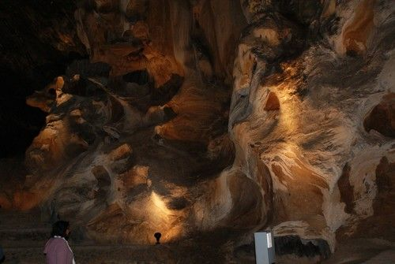

Rock formations inside the Cango Caves show that they were once under water.

<Callout type="note" title="Note">
Cango is a KhoiSan word and means 'Place of deep water'.
</Callout>

### What is adaptation?

When Southern Africa rose out of the sea millions of years ago, organisms that could not adapt to the new, drier **terrestrial environment** became extinct, but individuals that could adapt, survived and formed new populations. These adaptations could be changes in the organism's structure, function or behaviour over very long time periods. Only populations of organisms that happen to have suitable characteristics are able to survive in changing conditions within an environment. They are 'selected by nature' to survive. Those species that do not adapt will die out and become extinct.

As we have said, adaptation in species can occur in three main ways:

2. Structural: the physical characteristics of a species such as having long legs and strong muscles.
4. Functional: a species may have special way of carrying out its life processes such as being able to produce eggs with a hard shell , so that the embryos can grow and hatch even if the climate changes.
6. Behavioural: the species can have special behaviours that are instinctive (which they know by **instinct**) or can be learned such as making safe nests for protecting their babies

These changes take place over a long time period within a species and must be passed on from generation to generation. Over time and over many generations, these adaptations in the individual organisms will allow the species to evolve and adapt to its changing environment. Let's have a look at some of the adaptations of plants and animals.

### Adaptations in animals

Animals have different adaptations which have enabled different species to live and function in different areas. Let's look at some of the animals that live in our country and how they have adapted to live in their environments.

# Distinguish between types of adaptations

**INSTRUCTIONS:**

2. We will work through different adaptations in South African animals that have enabled them to survive in the environment they live in.
4. In each of the examples, say whether you think it is a structural, functional or behavioural adaptation and give a reason for your choice.

**QUESTIONS:**

Record your work in the table below each set of animals.

**Problem:**
**Aardvark: **It has a flexible, tubular tongue up to 30cm long as well as thick skin and short, powerful legs with strong claws for digging into termite mounds, its favourite food. These ants are then collected by the tongue - up to 50 000 in one night! It hides underground in daytime to escape heat and predators.

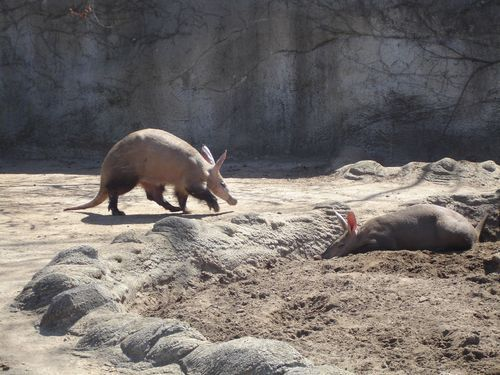

Two aardvarks in an enclosure. [http://commons.wikimedia.org/wiki/File:Porcs_formiguers_%28Orycteropus_afer%29.jpg](http://commons.wikimedia.org/wiki/File:Porcs_formiguers_%28Orycteropus_afer%29.jpg)

| How is the species adapted to life in its habitat? |  |
| --- | --- |
| What type(s) of adaptation is this? |  |

**Solution:**
| How is the species adapted to life in its habitat? | Body adapted to dig and reach into nests to get prey; little hair as lives in hot climate; has shovel-like claws and powerful short limbs, long sticky tongue to pick up and eat the ants. |
| --- | --- |
| What type(s) of adaptation is this? | Structural : longer snout and tongue; thick skin to protect it from termite and ant bites; powerful limbs to dig in any soil Behavioural : nocturnal - hunts at night when cool; hides in tunnels from predators |

**Problem:**
**Desert beetles :**They have ridges on their backs for collecting mist in the Namib Desert at night. Long back legs tilt the body, so mist is collected, condenses and runs via channels and grooves into their mouths.

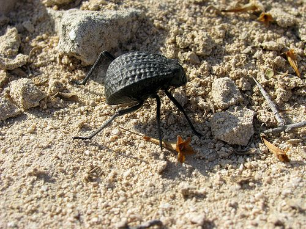

A desert beetle. [http://www.flickr.com/photos/pedronet/3203851713/](http://www.flickr.com/photos/pedronet/3203851713/)

| How is the species adapted to life in its habitat? |  |
| --- | --- |
| What type(s) of adaptation is this? |  |

**Solution:**
| How is the species adapted to life in its habitat? | Body adapted with grooves and ridges to channel tiny droplets to the mouth; the hind legs are longer and stronger to keep the beetle in this position for a long time. |
| --- | --- |
| What type(s) of adaptation is this? | Structural : grooves on body form channels to mouth; strong hind legs Behavioural : nocturnal habits, it stands in the specific position all night while water droplets condense on its body |

**Problem:**
**Gemsbok :**This striking antelope from the Kalahari Desert prefers grass and shrubs, but will dig for roots and tubers if it needs water. They save water by not sweating and sleep in the shade during the day. If they can not find shade, they turn the body's lightest side to the sun.

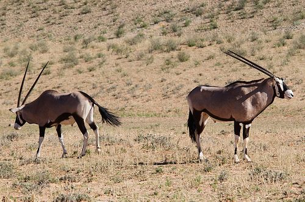

Gemsbok standing in the Kalahari. [http://www.flickr.com/photos/mister-e/3051915461/](http://www.flickr.com/photos/mister-e/3051915461/)

| How is the species adapted to life in its habitat? |  |
| --- | --- |
| What type(s) of adaptation is this? |  |

**Solution:**
| How is the species adapted to life in its habitat? | Body colour pattern help it to blend into surroundings; also lighter colouring can face the fiercest angles from the sun if no shade; can extract water from plants that it eats |
| --- | --- |
| What type(s) of adaptation is this? | Structural : body colouring Functional : extract all available water from plants it eats; does not lose much water or energy as it does notr sweat Behavioural : seeks shade during hottest hours of the day; turns the lightest part of its body to the sun if no shade is available; can change eating patterns if normal diet of grass is not available |

**Problem:**
**Ostrich**: These are the biggest and heaviest birds, but they can't fly. To avoid predators, they fight with strong clawed toes or run away, up to 70km/hr! Ostriches swallow small stones to help digest any food they find. Male ostriches get red beaks in the mating season. The female lays eggs and she sits on them during the day, while the male incubates them at night - examine their colour differences to see why.

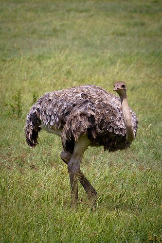

A female ostrich. [http://www.flickr.com/photos/jonasb/6987050666/](http://www.flickr.com/photos/jonasb/6987050666/)

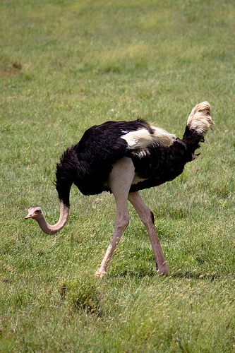

A male ostrich. [http://www.flickr.com/photos/jonasb/6987048092/](http://www.flickr.com/photos/jonasb/6987048092/)

| How is the species adapted to life in its habitat? |  |
| --- | --- |
| What type(s) of adaptation is this? |  |

**Solution:**
| How is the species adapted to life in its habitat? | Ostriches have a long toe and claw to fight predators and escape; eggs remain dormant until heat of breeding male and female's bodies starts their development. Male and female share nesting duties. Their bodies are specially camouflaged: male has black feathers to be camouflaged at night when it is on the nest; female has speckled dusty coloured feathers to be camouflaged during the day when she is on the nest. |
| --- | --- |
| What type(s) of adaptation is this? | Structural : strong toe and leg muscles help it to run fast; male beak turns red to signal female that it is ready to breed. Behavioural : male sits on nest at night and female on nest during day as they take turns to nest; ostriches eat pebbles to help digestion as they do not have teeth; female lays just enough eggs to cover with body |

**Problem:**
**Stick and leaf in sect:**These insects look like leaves or sticks to avoid predators - this is called**mimicry**. They feed on plant materials at night and move very slowly to avoid being seen. Female stick insects can reproduce without mating.

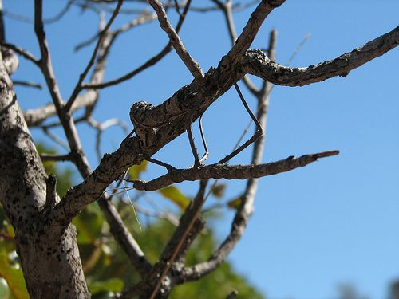

A stick insect. [http://www.flickr.com/photos/nh53/6061103659/](http://www.flickr.com/photos/nh53/6061103659/)

| How is it adapted to life in its habitat? |  |
| --- | --- |
| What type(s) of adaptation is this? |  |

**Solution:**
| How is it adapted to life in its habitat? | Body adapted to mimic leaf or stick; moves very slowly to seem like a branch or leaf moving; nocturnal to avoid being seen in daylight by predators; stick insects can reproduce without male insects |
| --- | --- |
| What type(s) of adaptation is this? | Structural : body structured to resemble leaf or stick Behavioural : nocturnal as it feeds under cover of darkness; moves slowly to not attract predators |

#### Other behavioural adaptations

Many species of animals display an interesting behavioural adaptation called **migration**. This occurs when an animal or a group of animals move between different areas at different times or periods.

# Why do animals migrate?

**INSTRUCTIONS:**

2. Have a look at the following animals.
4. Think of reasons why they would want to **migrate** from their present habitat.

| Animals | Description | Reason to migrate |
| --- | --- | --- |
| Wildebeest migrating in the Masai Mara. http://www.flickr.com/photos/scubagirl66/7929201230/ | Wildebeest migrate long distances each year which coincides with the pattern of rainfall and grass growth. |  |
| The sardine run as sardines migrate along the South African coastline. http://www.flickr.com/photos/tanaka_juuyoh/1775405862/ | The sardine run occurs along the African coast during May to July each year when billions of sardines migrate to the north east coast of South Africa. |  |

**Problem:**

**Solution:**
| Animals | Description | Reason to migrate |
| --- | --- | --- |
| Wildebeest migrating in the Masai Mara. @@BY http://www.flickr.com/photos/scubagirl66/7929201230/ | Wildebeest migrate long distances each year which coincides with the pattern of rainfall and grass growth. | Find where the grass is growing and there are water sources |
| The sardine run as sardines migrate along the South African coastline. @@BY http://www.flickr.com/photos/tanaka_juuyoh/1775405862/ | The sardine run occurs along the African coast during May to July each year when billions of sardines migrate to the north east coast of South Africa. | There are actually many theories about why the sardine run occurs, and it is still poorly understood. The most likely reason is that it is a seasonal reproductive migration. |

<Callout type="note" title="Note">
Watch underwater footage of the amazing sardine run that occurs each year from May to July
</Callout>

<Callout type="note" title="Note">
A video on wildebeest migration.[http://education.nationalgeographic.com/education/media/wildebeest-migration/?ar_a=1](http://education.nationalgeographic.com/education/media/wildebeest-migration/?ar_a=1)
</Callout>

Animals that don't migrate sometimes go into an inactive state called **hibernation** in winter. Some of them sleep through a whole winter, while some frogs hibernate by burrowing into the mud when the pond dries up, until the rains return.

<Callout type="note" title="Note">
Frogs have a special chemical in their bodies that prevents their blood from freezing completely - a kind of natural antifreeze!
</Callout>

### Adaptations in plants

Several local plants are also adapted to their environment.

The umbrella thorn in the African savannah can survive temperatures ranging from 50°C to below freezing. Its deep roots reach ground water easily and the small leaves prevent dehydration, while still being well exposed to light due to the umbrella shape of the tree. Why does it need light?

The more exposure to sunlight, the higher the rate of photosynthesis. Encourage your learners to take notes when you discuss topics in class.

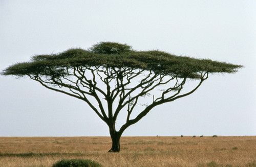

An umbrella thorn acacia.

The Baobab tree survives in dry areas, since it stores water in the thick trunk and spongy wood. The smooth bark reflects heat, making it cooler, but also helps protect the fruits from monkeys. How can it do this?

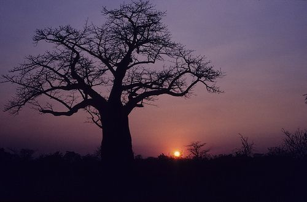

The sun setting behind a baobab tree. [http://www.flickr.com/photos/dkeats/5643928782/](http://www.flickr.com/photos/dkeats/5643928782/)

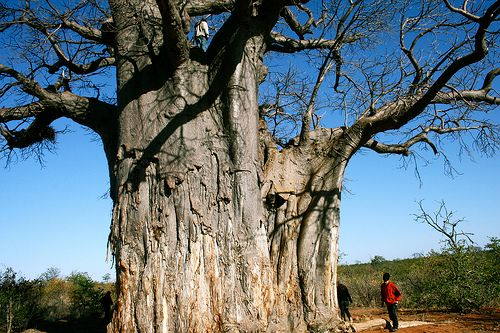

This baoba is over 3000 years old! Take note of its width and the reflective bark. [http://www.flickr.com/photos/kelsiedipernaphotography/3800104410/](http://www.flickr.com/photos/kelsiedipernaphotography/3800104410/)

The slippery surface also helps prevent monkeys and other small animals from climbing up and eating its leaves and fruit!

The flowers smell like rotting meat to attract bats, flies and moths at night. Why do you think the baobab tree needs to attract these animals to its flowers?

The fruit bats come to feed on the flowers and the nectar and in turn they pollinate the baobab flowers.

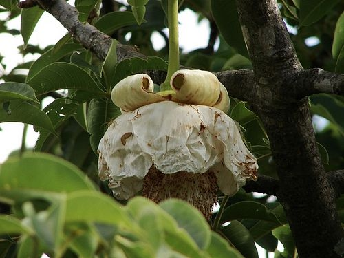

A baobab flower which smells like rotting meat. [http://www.flickr.com/photos/tgerus/3613267071/](http://www.flickr.com/photos/tgerus/3613267071/)

We are now going to look at some very unique plants, which are only found in South Africa.

# Living stones

**INSTRUCTIONS:**

2. Study the following photographs. They show different types of plants. These plants actually look like pebbles. They are from the genus *Lithops* and they succulent plants, meaning they have parts that can store water*.*
4. Answer the questions which follow.

<Callout type="note" title="Note">
The name '*Lithops*' comes from two Ancient Greek words *lithos* meaning 'stone' and *ops* meaning 'face'. So, *Lithops* means 'stone-faced'!
</Callout>

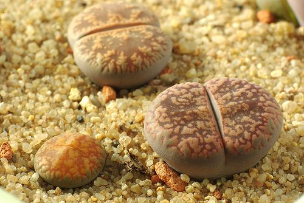

*Lithops* plants growing in dry rocky ground. [http://www.flickr.com/photos/yellowcloud/3862534417/](http://www.flickr.com/photos/yellowcloud/3862534417/)

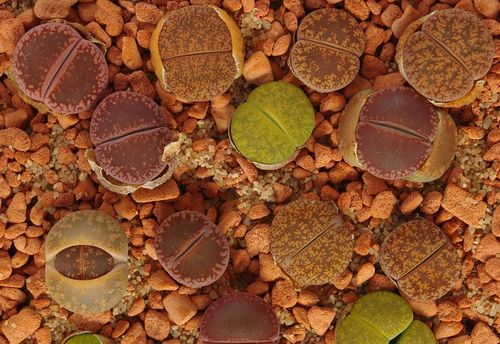

Different patterned*Lithops* plants. [http://www.flickr.com/photos/yellowcloud/4673616905/](http://www.flickr.com/photos/yellowcloud/4673616905/)

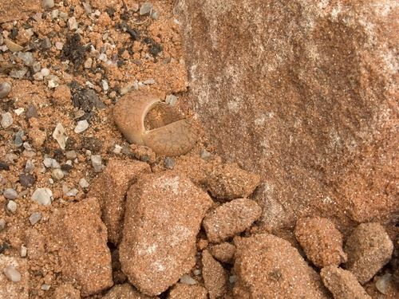

A very camouflaged*Lithops* plant. Can you see it?

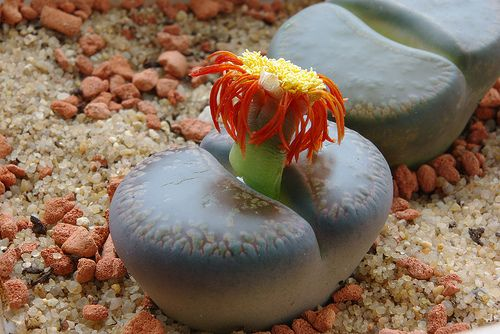

A flowering*Lithops.* [http://www.flickr.com/photos/yellowcloud/4239972017/](http://www.flickr.com/photos/yellowcloud/4239972017/)

**QUESTIONS:**

**Problem:**
Why do you think these plants are commonly referred to as 'living stones' or 'pebble plants'?

**Solution:**
This is because they are plants but they are camouflaged to look like stones or pebbles.

**Problem:**
Why do you think the plants have such different patterns on their surfaces? How does this help them to survive in their environment?

**Solution:**
The *Lithops* plants are camouflaged to look like stones and blend in with their rocky soil that they grow in. The patterns look like different rocks/pebbles. They are therefore not usually seen by herbivores which might eat them. This adaptation protects them from being eaten.

**Problem:**
*Lithops* plants are classified as succulents. What does this mean? What type of environment are succulents adapted to live in?

**Solution:**
Succulents are plants which are adapted to live in hot, arid environments and they have thickened, fleshy leaves and stems to store water.

**Problem:**
*Lithops* leaves are fleshy and mainly underground, and the stem is short. Flowers grow between the leaves, which shrink to below ground level during drought. How does this help the plant survive?

**Solution:**
The fact that the leaves are mostly underground helps the plant to conserve water because as little as possible is exposed to the hot environment so this reduces water loss. During drought, the leaves shrink even further underground to try to conserve water even more.

**Problem:**
If the leaves are reddish-brown and mainly underground, where is the chlorophyll? Examine these dug-up stone plants.

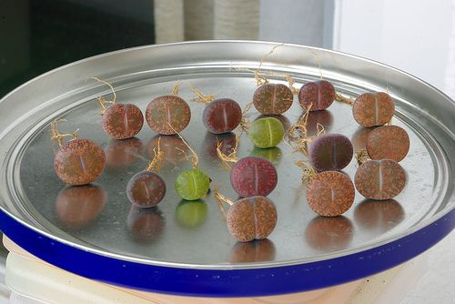

The upper surfaces of*Lithops* plants. [http://www.flickr.com/photos/yellowcloud/4240758668/](http://www.flickr.com/photos/yellowcloud/4240758668/)

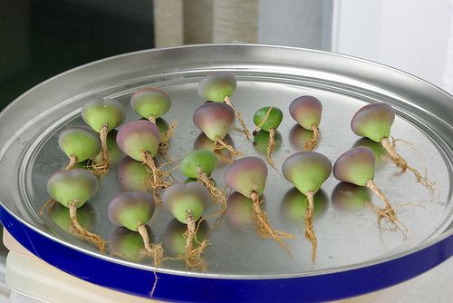

The underneath surfaces of the*Lithops* plants. [http://www.flickr.com/photos/yellowcloud/4239988271/](http://www.flickr.com/photos/yellowcloud/4239988271/)

Where is most of the green part of the plant located?.

**Solution:**
Most of the leaf and hence the green chlorophyll is located on the underneath side of the plant underground.

**Problem:**
This is a thin section of a stone plant under a hand lens. Draw a diagram of it and label the top of the leaves, the split between the leaves and the stem. Indicate where the soil level would be. What is stored in the clear area of the leaves?

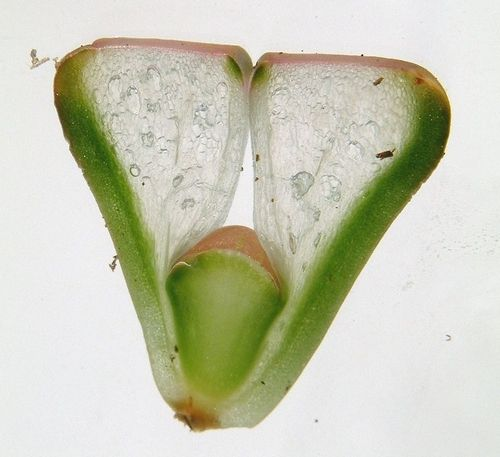

A cross section of a*Lithops* plant viewed under a microscope. [http://commons.wikimedia.org/wiki/File:Dissected_Lithops_0133_%283137859955%29.jpg](http://commons.wikimedia.org/wiki/File:Dissected_Lithops_0133_%283137859955%29.jpg)

**Solution:**
Learner-dependent answer

The labelled micrograph should look something like this:

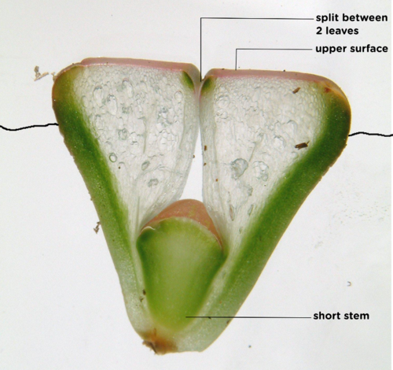

**Problem:**
The upper patterned surface acts as a window. Can you see the clear, fleshy middle parts of the leaves? Do you think light can travel through this? How does this allow the plant to photosynthesise?

**Solution:**
The upper part of the leaves acts as window and lets light through. As the interior of the leaves is transparent, the sunlight can travel through to the bottom parts of the leaves which are underground and contain the chlorophyll in order to photosynthesise. This allows the plant to have a coloured, patterned upper surface to camouflage it from herbivores, but still allows that sunlight to travel through for photosynthesis.
