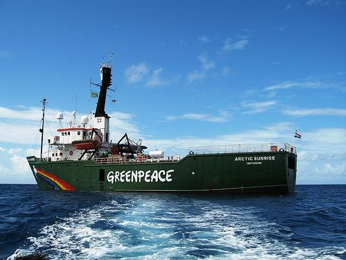
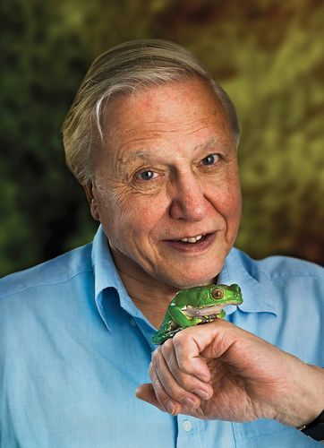
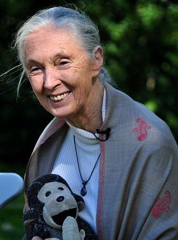
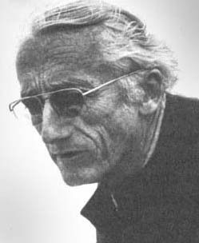
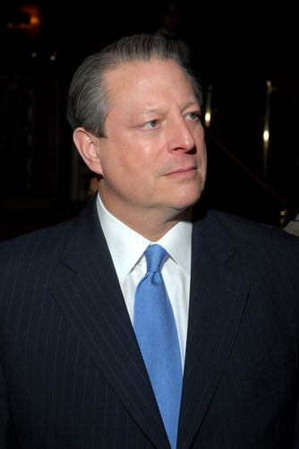

## Conservation of the ecosystem

Our country is one of the most naturally diverse in the world. This means that we have many different species and habitats and ecosystems here, more than most other places in the world.

Our country's natural beauty and diversity attract thousands of tourists each year, but it is under severe threat from poaching, pollution and other human influence. Ecosystems are able to naturally recycle materials like water, carbon dioxide and other gases and the remains of organisms, if they are left alone. But ecosystems cannot do this effectively if we interfere. These human interferences include:

- Habitat destruction like deforestation and burning
- Pollution causing global warming
- Alien invasive plants taking over ecosystems
- Hunting, poaching and other killing of wildlife

These pressures have caused great loss in biodiversity. Some ecosystems are under strain and others have already collapsed.

<Callout type="note" title="Note">
Video on rhino poaching in South Africa.
</Callout>

<Callout type="note" title="Note">
For more information on how you can get involved in the efforts against rhino poaching[http://www.stoprhinopoaching.com](http://www.stoprhinopoaching.com )
</Callout>

### Why should we care?

There are many reasons why it is important for humans to care about the environment. As we have learnt, everything in an ecosystem is connected. Therefore harming one component of the ecosystem will have a ripple effect that can damage all the other systems.

# Finding solutions to environmental problems

**INSTRUCTIONS:**

2. The following table is a list of environmental issues.
4. Do some research on air pollution, water pollution, landfills and climate change.

**INSTRUCTIONS:**

**Problem:**
Write down the effect (consequence) of this issue on the ecosystem (or on humans). Write down a possible solution or a simple action that you can take to help.

| Environmental Issue | Consequence | Action |
| --- | --- | --- |
| Inappropriate waste disposal: Air pollution |  |  |
| Inappropriate waste disposal: Water pollution |  |  |
| Inappropriate waste disposal: Landfills and littering |  |  |
| Carbon emissions and climate change |  |  |

**Solution:**
There are many possible answers in this activity. Learners may be incredibly specific or they may prefer to answer generally. They can be creative with their suggestions. Below are some example answers, but learners may come up with many more.

| Environmental Issue | Consequence | Action |
| --- | --- | --- |
| Inappropriate waste disposal: Air pollution | 1) Harmful chemicals in the air cause a range of allergic and degenerative lung diseases as well as cardiovascular disease and many cancers. 2) Air pollution can also cause acid rain, which can destroy forests and poison lakes. | Support companies and products that use cleaner production methods. Do not use products known to cause pollution. Develop cleaner technologies. |
| Inappropriate waste disposal: Water pollution | Water pollution can be cause by factories or farms allowing their waste to run off into streams or water sources, or it can be caused by the accumulation of many people discarding their waste into rivers. This may cause the spread of disease or poison aquatic plants and animals. | Do not throw harmful chemicals down the drain or into rivers and streams. Support companies that dispose of their waste responsibly. |
| Inappropriate waste disposal: Landfills and littering | Litter builds up and can take many thousands of years to degrade. Due to inappropriate waste disposal, plastic is ending up in the oceans, and in many animals habitats. Animals who mistake litter for food often end up choking and dying. | Reduce, reuse and recycle wherever possible. Do not throw litter onto the ground. Look after your belongings so that they last longer. Purchase responsibly- don't buy packaging that does not degrade (like polystyrene). |
| Carbon emissions and climate change | Excessive burning of fossil fuels is a type of air pollution that contributes to global warming and climate change. Climate change has an effect on habitats as animals and plants cannot adapt fast enough to the rapid changes in their habitats. This may result in many species going extinct. | Try to limit your use of electricity- switch off lights, put on more clothes instead of using a heater, turn off the geyser for some hours each day. Don't overfill the kettle. Use public transport. Share lifts and carpool. Don't drive excessively. Walk when you can. Use less plastic. |

Some people and organisations like Greenpeace, fight for environmental conservation. There may be groups in your local area that also promote environmental conservation - do not think that you can not make a difference if you are just one person!

The Greenpeace ship,*Arctic Sunrise,* which is used in many environmental awareness campaigns and research. [http://www.flickr.com/photos/jemanlin/1417937089/](http://www.flickr.com/photos/jemanlin/1417937089/)

# Why should we care?

This is an optional, extension activity.

**INSTRUCTIONS:**

2. Divide the class into two teams. One group supports environmental conservation and the other believes we should use all earth's resources as we like.
4. Both groups must research their topics beforehand and gather relevant points.
6. The teacher can lead the debate and ensure it proceeds in an orderly way.

**QUESTIONS:**

**Problem:**
After the debate, write down 3 points about each viewpoint that you can remember.

**Solution:**
Learner-dependent answer.

Below is some extra information on the types of individuals who are actively involved in conservation, if you wish to discuss this further with your learners:

- Park rangers and conservationists work to save the environment. Research scientists inform park managers about conservation and investigate how climate change affects populations.
- Economists and scientists are trying to work out the 'costs' of big cities on the environment and how to sustain healthy ecosystems so that we and all living things can enjoy the benefits of healthy food, clean water and air.
- Other groups remove alien plants or track down poachers, especially regarding cycad and rhino poaching, which is escalating. You can help!
- Some people run campaigns to raise awareness about different environmental concerns, for example the poaching of endangered animals, or the drive to recycle cans, paper, bottles and plastic. Get involved!
- Climate change activists inform the public about global warming and the damages we are causing to our world by deforestation and pollution.

<Callout type="note" title="Note">
Learn about actions that you can take at home to help the environment. YOU can make a difference[http://www.wwf.org.za/act_now/green_living/at_home/](http://www.wwf.org.za/act_now/green_living/at_home/)
</Callout>

<Callout type="note" title="Note">
Your photos can help scientists to map where mammals are in South Africa and help guide their conservation efforts[http://mammalmap.adu.org.za/index.php?serial=1](http://mammalmap.adu.org.za/index.php?serial=1 )
</Callout>

There are all ordinary people who feel passionate about saving the only world we have. It takes the combined work of many concerned people to maintain healthy ecosystems - you can also make a difference!

# Individuals who make a difference

This is an **optional, extension activity** to create awareness about what other individuals have done. If you do not have time to do it in class, learners could do it as a homework exercise.

**INSTRUCTIONS:**

2. Below are some photos of various individuals who have contributed to environmental conservation and awareness in some way.
4. Research what each individual has done.
6. Then, chose one who you find most inspiring and write about them, identifying what is is you admire.
8. You do not have to stick to the people who have been identified here. You can write about someone else too who you have identified with.
10. Lastly, reflect on how you can make a difference in your own life and what you could do to conserve you own local environment. Write about this too.

Sir David Attenborough. [http://www.flickr.com/photos/jrscientist/4379034881/](http://www.flickr.com/photos/jrscientist/4379034881/)

Jane Goodall. [http://www.flickr.com/photos/nickstep/5072666287/](http://www.flickr.com/photos/nickstep/5072666287/)

Jacques Cousteau.

Al Gore. [http://commons.wikimedia.org/wiki/File:Al_Gore.jpg](http://commons.wikimedia.org/wiki/File:Al_Gore.jpg)

**Some other people to research include:**

- Wangari Mathai
- Lawrence Anthony
- Steve Irwin
- Diane Wilson
- Dian Fossey
- Ian Player

<Callout type="note" title="Note">
A short tribute film on Wangari Mathai.
</Callout>
