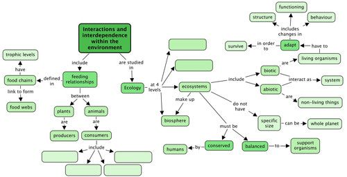
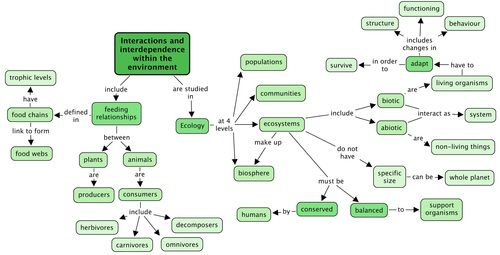

## Summary

<Callout type="note" title="Note">
**Ecosystems**

- Ecology is the study of interactions of organisms with one another and with the physical and chemical environment.
- The study of ecological interactions is conducted at four levels:
  - populations
  - communities
  - ecosystems
  - biosphere(s)
- All ecosystems combined make up the biosphere.
- An ecosystem consists of a community that includes all living organisms (biotic) such as plants and animals, together with the non-living (abiotic) environment and climatic conditions such as temperature, air and wind, water, interacting as a system.
- An ecosystem can refer to a specific area on Earth or the entire biosphere can be regarded as one large ecosystem.
- The survival of populations and species depends on whether enough individuals are suited to the environmental conditions at the time. As conditions do change over time only those better suited to the changed environment will be able to continue the species. And so over time species adapt.

**Feeding relationships**

- Plants are *producers*. They make their own food.
- Animals are *consumers*. They obtain food from plants either directly (such as herbivores) or indirectly (such as carnivores).
- *Herbivores* feed on plants.
- *Carnivores* feed on other animals (living or dead). This group includes:
  - *Predators* hunt other animals, their *prey*, for example lions and leopards.
  - *Scavengers* that eat dead animals, for example hyenas and vultures.
  - *Insectivores* that eat insects and other small invertebrates such as worms
- *Omnivores* feed on plants and animals. Humans are generally omnivores.
- *Decomposers* break down (decompose) the remains of dead plants and animals. They recycle important nutrients in the environment.

**Energy flow: food chains and food webs**

- Plants and some algae play a very important role in the ecosystem because they capture the radiant energy from the Sun and use it in the process of photosynthesis to produce glucose that the plant and other animals can use to gain energy.
- This energy is passed along a food chain from producers to consumers; decomposers are the last link in this transfer of energy. They release energy as heat to the environment.
- Each stage of a food chain is called a *trophic level*.
- Energy transfer and energy loss occur at each trophic level.
- Interlinked food chains together form food webs.

**Balance in an ecosystem**

- An ecosystem can only accommodate as many organisms as its resources (food, water and shelter) can carry.
- The balance can be disturbed by natural or human factors:
  - natural factors include extreme changes in patterns of weather and climate, such as floods, drought, extreme and sudden changes in temperature.
  - human factors include removing organisms from the ecosystem (such as poaching), human-induced pollution.
- These factors can contribute to an imbalance in an ecosystem, seriously impacting on its components and altering its nature.

**Adaptations**

- Adaptation is the change in the structural, functional or behavioural characteristics of a species over many generations.
- Adaptation allows the species to survive as it adapts to changing conditions within the environment.
- Species and populations of organisms that are unable to adapt to changes in the environment will die out and become extinct.

**Conservations of ecosystems**

- People can work towards managing and sustaining natural ecosystems.
- Individuals can contribute to conservation in various ways such as appropriate waste disposal (including recycling and reusing).
</Callout>

**Concept map**

This concept map shows how the concepts in this chapter on the 'Interactions and interdependence within the environment' link together. Complete the concept map by filling in the 2 levels which are missing for the study of ecology. Also, fill in the 4 types of consumers that you have learned about in this chapter.

Can you see how the arrows show the direction in which you must 'read' the concept map?

Teacher's version

Remember that concept maps are different to mind maps in that concept maps have a hierarchical structure and show how concepts link together using arrows and linking words. Whereas mindmaps generally contain a central topic and individual branches coming out which do not necessarily link together. Mindmaps can also be a useful way of summarizing information and studying, however, we are using concept maps as they help to show linkages, which is very important in science. Help your learners to 'read' the concept map by showing them that the arrows show the direction in which concepts progress and are linked to each other. Learners might battle to find the other 2 levels in which we study ecology - help them by reminding them of the 4 levels, namely; populations, communities, ecosystems and the biosphere.

