## Types of microorganisms

<Callout type="note" title="Note">
- bacteria
- disease
- fungi
- infect
- protist
- virus
</Callout>

<Callout type="note" title="Note">
Bacter*ium* is singular and bacter*ia* is plural.
</Callout>

<Callout type="note" title="Note">
The prefix 'micro' comes from the Greek word *mikros* meaning small. How many words can you think of which contain the prefix micro? What do they all have in common?
</Callout>

Microorganisms are extremely small living organisms. People did not even know they existed until the invention of microscopes in the 1600s! We say that we cannot see microorganisms with the 'naked eye'. We have to view them under a microscope.

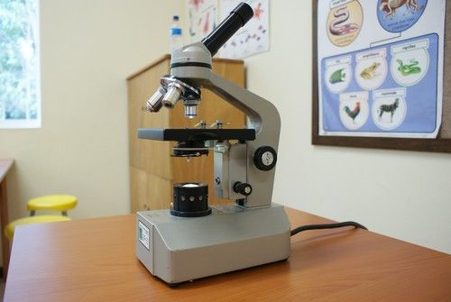

A basic light microscope.

Antonie van Leeuwenhoek designed and built his own microscopes. In 1674 he became the first person to see and describe microscopic organisms like **bacteria**, yeast and many other microorganisms.

Antonie van Leeuwenhoek is considered to be the first microbiologist.

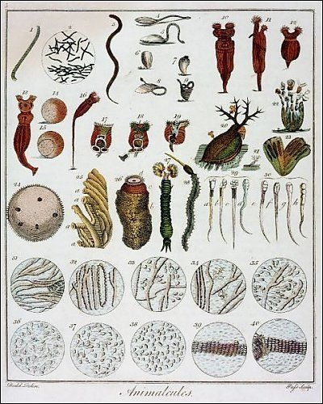

Some of the microorganisms which van Leeuwenhoek observed and first described. He called them 'animalcules'.

<Callout type="note" title="Note">
Someone who studies microorganisms is a*micro*biologist.
</Callout>

# What does 'microscopic' mean?

The intention of this short activity is to familiarise learners with the idea of microscopic objects and what this means. To be microscopic means that they need to be viewed under a microscope. The purpose is to show learners that many objects can be viewed under a microscope to see the detail, and there are many objects which can only be viewed under a microscope in order to be seen at all.

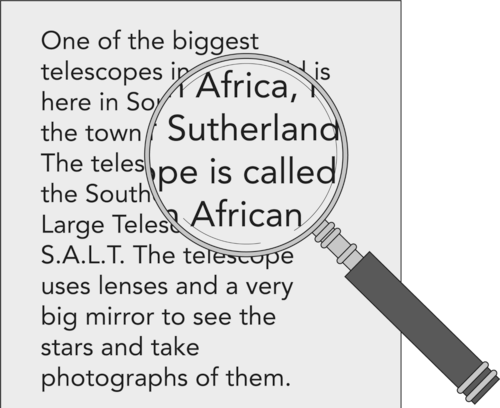

**MATERIALS:**

- hand lens or magnifying glass
- newspaper print
- other small objects with detail

Provide learners with a range of different objects with fine detail, for example, newspaper, a cloth to view the individual threads, and if possible, grow some bread mould by leaving out a damp piece of bread in an enclosed container for a couple days prior to starting this activity.

**INSTRUCTIONS:**

2. Your teachers will provide you with a range of different objects to view.
4. First observe the objects with your naked eye.
6. Then use the hand lens to view the objects again.
8. Take note of the differences in the detail you can observe.

**QUESTIONS:**

The use of corrective glasses or contact lenses still constitutes 'naked eye' as it merely corrects vision to normal human accuracy. Make sure that learners requiring corrective glasses or contact lenses understand that they may keep their glasses on and it will still constitute a 'naked eye' observation.

**Problem:**
What do we mean by the term 'naked eye'?

**Solution:**
It means viewing something using only your eyes; with nothing in front of your eyes to help you view something.

**Problem:**
Describe some of the differences when you viewed the objects using just your eyes and when you used a hand lens.

**Solution:**
Learners should note that they were able to view more detail when viewing something using a hand lens and that things looked bigger.

2. The following images show different views of the same object. One image shows what we would see with our naked eye. We call this the **macroscopic** view. The other photo shows what we would see if we viewed the object under a microscope. This is called the **microscopic** view. For each object, identify which is the microscopic view and which is the macroscopic view.
   **Problem:**
   **Beetle**
   | http://www.flickr.com/photos/dullhunk/5517978496/ | http://www.flickr.com/photos/dluogs/5048733301/ |
   | --- | --- |
   **Solution:**
   | http://www.flickr.com/photos/dullhunk/5517978496/ | http://www.flickr.com/photos/dluogs/5048733301/ |
   | --- | --- |
   | Microscopic | Macroscopic |
   **Problem:**
   **White bread**
   | http://www.flickr.com/photos/nsalt/3116061949/ | http://www.flickr.com/photos/core-materials/4419088363/ |
   | --- | --- |
   **Solution:**
   | http://www.flickr.com/photos/nsalt/3116061949/ | http://www.flickr.com/photos/core-materials/4419088363/ |
   | --- | --- |
   | Macroscopic | Microscopic |
   **Problem:**
   **Onion skin**
   | http://www.flickr.com/photos/dottiemae/5188013294/ | http://www.flickr.com/photos/austinevan/5288918276/ |
   | --- | --- |
   **Solution:**
   | http://www.flickr.com/photos/dottiemae/5188013294/ | http://www.flickr.com/photos/austinevan/5288918276/ |
   | --- | --- |
   | Macroscopic | Microscopic |
   **Problem:**
   **Cotton**
   | http://www.flickr.com/photos/core-materials/4419087937/ | http://www.flickr.com/photos/bptakoma/3019741976/ |
   | --- | --- |
   **Solution:**
   | http://www.flickr.com/photos/core-materials/4419087937/ | http://www.flickr.com/photos/bptakoma/3019741976/ |
   | --- | --- |
   | Microscopic | Macroscopic |

In the last activity we saw that you can view objects under a microscope allowing you to see much more detail than if you just viewed them with your naked eyes. There are many organisms on Earth however, which we cannot see at all with our naked eye. We can only see them when we look under a microscope. These are **microorganisms**.

The living organisms on Earth can be grouped in many ways. You have learnt about classification before. Let's revise our classification system for all organisms on Earth.

# Classifying organisms

This is optional revision of what learners have already covered in Gr. 7 on Biodiversity, and briefly mentioned in Chapter 2 this term.

**INSTRUCTIONS:**

2. Study the following diagram showing how we classify organisms on Earth.
4. Answer the questions that follow.

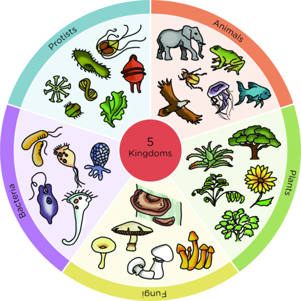

**QUESTIONS: **

**Problem:**
Do you see that the organisms in the diagram are divided into five groups? What do we call these five groups?

**Solution:**
Kingdoms.

**Problem:**
Write the names of these five groups in the spaces on the diagram.

**Solution:**
The five kingdoms are: Animals, Plants, Bacteria, Fungi and Protists.

**Problem:**
Which groups do you think contain organisms which can be classified as microorganisms?

**Solution:**
Bacteria, Fungi and Protists.

**Problem:**
Do you think microorganisms are living or non-living? Give a reason for your answer.

**Solution:**
They are living. They perform all seven life processes (moving, respiring, sensing, growing, reproducing, excreting, feeding).

As discussed in this chapter, viruses are also microorganisms. There is much debate as to whether viruses are living or non-living. Viruses do not perform all seven life processes so they are not included in one of the five kingdoms.

Microorganisms include **viruses**, bacteria, **protists** and some types of **fungi** (although many fungi can be seen without the use of a microscope). Let's have a closer look at the different types of microorganisms, before looking at how they can impact our lives in a positive or negative way.

Bacteria are a large kingdom of microorganisms. Many bacteria are responsible for causing diseases in humans, however some are also useful as we will see later. Viruses are also tiny organisms, much smaller than bacteria even. They can **infect** all types of organisms, such as plants, animals and also bacteria. Viruses need to infect other organisms in order to replicate (reproduce).

<Callout type="note" title="Note">
There is much debate amongst scientists about whether we can classify viruses as living or not!
</Callout>

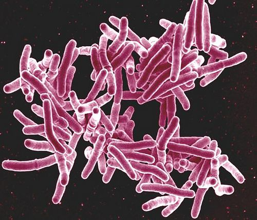

Mycobacterium tuberculosis bacteria which cause Tuberculosis (TB) in people. [http://www.flickr.com/photos/niaid/5149398656/](http://www.flickr.com/photos/niaid/5149398656/)

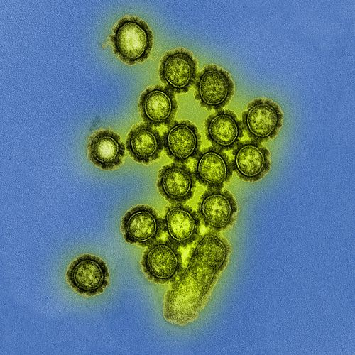

H1N1 influenza virus particles which cause flu symptoms in people. [http://www.flickr.com/photos/niaid/8411599236/](http://www.flickr.com/photos/niaid/8411599236/)

Fungi are also one of the five kingdoms of organisms. Many different varieties of fungi exist. Some are large enough for us to see without the help of a microscope, like mushrooms and bread mould. They are macroscopic. There are others which are microscopic and can only be seen under a microscope, for example yeast.

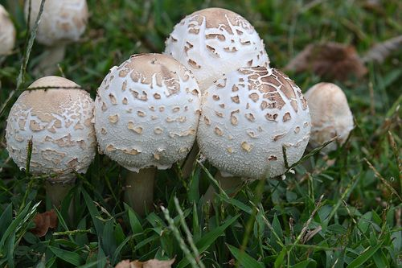

Not all fungi are microscopic, such as mushrooms. [http://www.flickr.com/photos/78428166@N00/6107931302/](http://www.flickr.com/photos/78428166@N00/6107931302/)

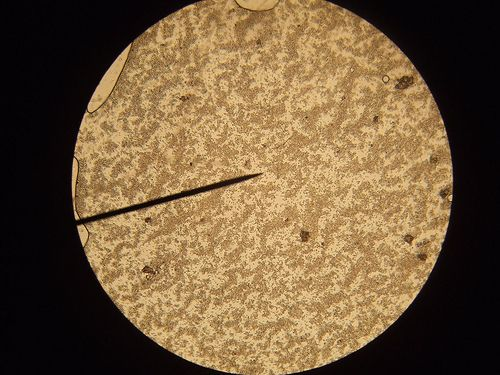

Millions of yeast cells viewed under the microscope. [http://www.flickr.com/photos/tessawatson/384591931/](http://www.flickr.com/photos/tessawatson/384591931/)

<Callout type="note" title="Note">
Watch how yeast reproduce
</Callout>

Protists are a very diverse group of microorganisms. The organisms in this kingdom do not fit easily into any of the other four kingdoms, namely animals, plants, fungi or bacteria. However, some protists are plant-like and others are animal-like. Most protists are microscopic and live in water. The only macroscopic members are the algae or seaweeds.

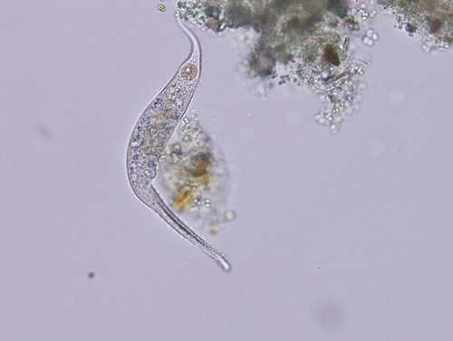

A protists living in freshwater.

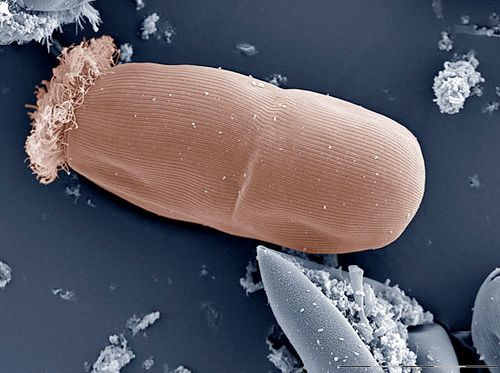

A protist found in the gut of many animals.

As you might have noticed from some of the microorganisms mentioned here, some of them can be harmful to humans and other organisms as they cause **diseases** and illnesses.

# Calculating the size of an organism using a scale bar

How do you know the size of a microorganism? You will notice that many pictures of microorganisms have a **scale bar**. A scale bar is a very useful tool that allows us to calculate the actual size of objects. Follow the instructions below to figure out the length of this *Oxytricha trifallax* protist*.*

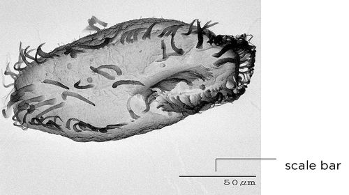

A micrograph of*Oxytricha trifallax.*

**INSTRUCTIONS:**

**Problem:**
Measure the length of *Oxytricha trifallax* using your ruler. (Express your answer in mm.)

**Solution:**
Learner-dependent answer.

**Note:** The answer will depend on the format in which the image is viewed (printed, photocopied, online, etc.) and the exact point that learners choose for the start and end of the organism. A small amount of variability is expected.

**Problem:**
Measure the length of the scale bar with your ruler. (Express your answer in mm.)

**Solution:**
Learner-dependent answer

**Note:** This will depend on the format in which the image is viewed (printed, photocopied, online, etc.)

**Problem:**
Divide the size of the object (in mm) by the size of the scale bar (in mm) and round off. Your answer will be a ratio and will not have units, since you divided mm by mm.

**Solution:**
The answer should be approximately 3.

**Note:** The ratio should be constant no matter what size the image was printed! This is the power of using a scale bar. Encourage learners to round-off their answers to one decimal point in order to make their calculations easier. You can discuss with the class why learners may have slightly different answers.

**Problem:**
To find the actual size of the organisms, take your answer and multiply it by the number on the scale bar. The units on the scale bar are in μm and so your answer must be in μm. How big is *Oxytricha trifallax?*

**Solution:**
The length of the organism is approximately 150μm.

**Note:** teachers should accept any answers that are within the range of 120 -180 μm. Learner's answers may differ. You may use this opportunity to discuss with learners why they think there is variation in their answers. Ask them to compare the length they measured to the length of their friends. Maybe some learners measured from the tips of the cilia and have a larger answer than others who chose not to include the cilia in their measurements.

**Problem:**
How many μm are there in a mm?

**Solution:**
There are 1000 μm in 1 mm.

**Problem:**
How many *Oxytricha trifallax* could lie end to end in 1 mm?

**Solution:**
Approximately 6.67 *Oxytricha trifallax* could lie end to end.

**Note:** The answer is arrived at by dividing 1000 by the size of one *Oxytricha trifallax.* Teachers should accept answers between 6 and 8.

2. Using the same method you practised before, calculate the size of the following organisms:
   **Problem:**
   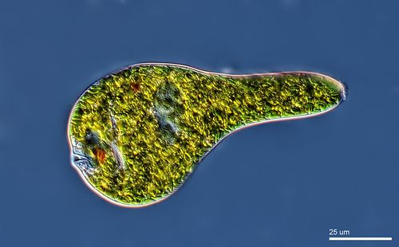
   A*Euglena*
   **Solution:**
   Approximately 110 μm
   **Note:** Accept answers between 100 and 120 μm
   **Problem:**
   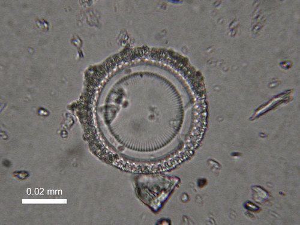
   A fossilised diatom.
   **Solution:**
   Approximately 57 μm (0.057 mm)
   **Note:** Accept answers between 50-60 μm

<Callout type="note" title="Note">
Scientists know what size to make the scale bar because they know what magnification they are using on their microscopes. You will learn about magnification, field of view and how to create your own scale bar if you continue with Life Sciences in Gr. 10.
</Callout>
