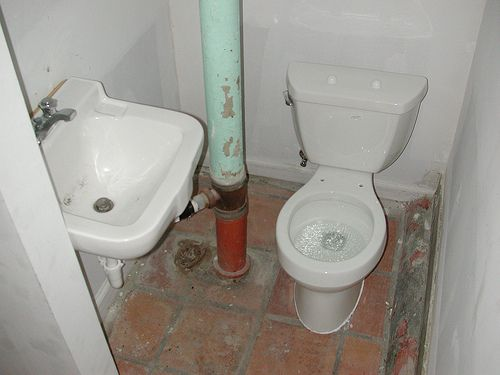
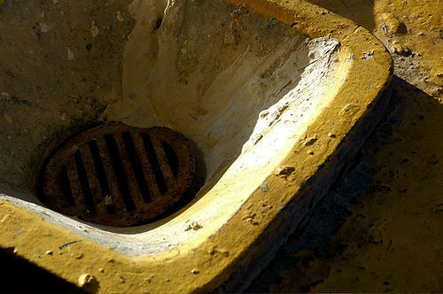
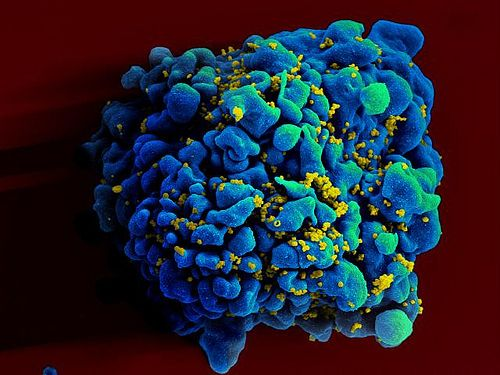
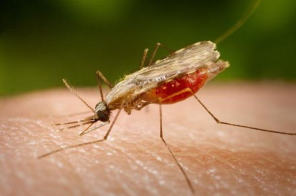
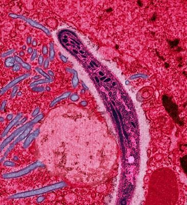
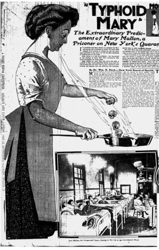
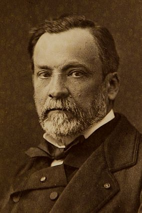

## Harmful microorganisms

<Callout type="note" title="Note">
- contaminate
- fever
- immune system
- pathogen
- transmitted
</Callout>

Some microorganisms cause diseases which may result in death. Microorganisms that cause diseases are called **pathogens.** These pathogens infect other organisms and cause various signs and symptoms in the organism.

# Where are pathogens found?

**INSTRUCTIONS:**

2. Discuss the question asked in the title of this activity with your group or class.
4. Use the following photos in your discussion.

A handrail. [http://www.flickr.com/photos/lunchtimemama/99886586/](http://www.flickr.com/photos/lunchtimemama/99886586/)

Public pay phones. [http://www.flickr.com/photos/v1ctor/7805728128/](http://www.flickr.com/photos/v1ctor/7805728128/)

A basin and toilet. [http://www.flickr.com/photos/editor/2084672070/](http://www.flickr.com/photos/editor/2084672070/)

An ATM keypad. [http://www.flickr.com/photos/redspotted/272104/](http://www.flickr.com/photos/redspotted/272104/)

Rubbish. [http://www.flickr.com/photos/creativecomputer/415482865/in/photostream/](http://www.flickr.com/photos/creativecomputer/415482865/in/photostream/)

Drains and pipes. [http://www.flickr.com/photos/tauntingpanda/6240242/](http://www.flickr.com/photos/tauntingpanda/6240242/)

**QUESTIONS:**

**Problem:**
What can you conclude about where disease-causing microorganisms are found?

**Solution:**
Microorganisms that cause disease are found on many surfaces which come into contact with humans regularly, such as handrails, public keypads, etc. They are also found in places which are unclean. Learners should be able to see that disease-causing microorganisms are found almost everywhere.

**Problem:**
How do you think diseases spread from one person to the next?

**Solution:**
Learners need to come up with their own answers here based on the discussion about where pathogens are mostly found. They could conclude that they spread by humans coming into contact with surfaces and objects which have the pathogens on them.

**Problem:**
Find out what it means to 'sterilise' an object, and write your own definition.

**Solution:**
To sterilise something means to make something very clean so that any microorganisms on the surface of an object or in a fluid are removed or killed.

### Transmission of infectious diseases

<Callout type="note" title="Note">
These diseases are called **infectious** diseases as they can be passed from one organisms to the next.
</Callout>

We can come into contact with various dangerous microorganisms each and every day, whether it is when you open the door handle of a toilet or use a trolley at the shopping centre. Pathogens can spread between humans and other organisms in many different ways, for example:

2. **In droplets from the air that we breathe:** When an infected person sneezes or coughs, the pathogen travels in the drops of spit or mucus to another person.
4. **In untreated and contaminated water:** The pathogen is **transmitted** in **contaminated** water, especially if it has been in contact with human sewage. These diseases are called waterborne diseases, such as cholera and typhoid, and cause diarrhoea.
6. **In contaminated food:** Sometimes people prepare food without washing and disinfecting their hands properly and the food can become contaminated.
8. **Through cuts or wounds:** Many pathogens enter our bodies via cuts or wounds. For example, tetanus bacteria live in the soil and when someone hurts themselves on a piece of rusty metal, this pathogen can infect the person.
10. **Through bites from animals:** Some pathogens can spread via bites from infected animals. For example, the rabies virus from infected animals and malaria is transmitted to humans through mosquitoes.

One of the best ways to prevent the spread of harmful pathogens is by washing your hands regularly with soap and warm water.

# How easily do viruses spread?

This is an**optional** activity, but it is suggested if you have time in class.

This activity develops from the previous text about the spread of diseases. We will be looking at how viruses spread, and in particular sexually transmitted diseases (STD's). The aim of this activity is to open up discussion about choices of protection to prevent STD's, and importantly the freedom to say "no" and mean "no". Once the activity is completed it is very important to have a detailed discussion about the wider issues involved and the importance of learners having a clear concept of what they want before embarking in sexual activity. It provides the opportunity to discuss the issues and realities of both STD's and preventing unwanted pregnancies.

Birth control or contraception are methods or devices used to prevent pregnancy. However, some contraceptives (pills) may not prevent STDs, whereas some (condoms) may also PROTECT individuals from contracting STDs.

You are using acid to track the spread of STD's - the acid represents a microorganism that causes an STD. One person will be passing acid in the form of vinegar, as the children share their water. The water should be shared by pouring water into each other's cups, not by drinking! If they have been acidified they will pass the acid on to whoever they share their water with. By the end of the activity only those who do not accept from others will remain "disease free". This can either be related to abstinence, or could equally represent people who had safe sex and used protection to prevent the exchange of bodily fluids that may contain the microorganisms which cause STDs.

We are going to have a look at how some viruses spread by acting it out.

**MATERIALS:**

- paper cups or beakers (one per learner)
- white vinegar (dilute)
- water
- dropper
- liquid indicator

If possible, use a universal indicator

**INSTRUCTIONS:**

2. Your teacher will divide your class into three groups: A, B and C.
4. Each group will be given specific instructions. You must obey the instruction that your teacher gives to your group for the activity.
6. After the activity, answer the questions.

**Instructions for the activity:**

2. Divide the class into three groups: A, B and C. Each group will be given different instructions to carry out.
4. Brief each of the groups in private as follows (the other groups must not be able to hear the instructions given):
   2. **Group A**: Instruct them that no matter who offers to share their water with them, they must be very firm and polite but say** "No".** However, they should offer their water to people they want to give some to. They must NOT let anyone give them water.
   4. **Group B**: Instruct them they can share their water with whoever they want and they can choose if they wish to receive water from other members of the class. They can say **yes or no**.
   6. **Group C**: Instruct them that if anybody offers them water they should say** "Yes".** They must also try very hard to give a little of their
                                  water to as many people as they can. They
                                  must try to convince those that say no they should have some. (They are not allowed to give water if the person is definite about "no".)
   8. **All groups should be encouraged to try to share a little water with as many people as they can but if someone is very firm about "no" they have to respect this.**
6. You (the teacher) must also take part in the activity. Your cup must have acidified water (vinegar) in it. Make sure you get as many pupils as possible to have some, or target pupils you know have strong persuasive skills.
8. Once everyone has their instructions and a cup of water, go outside or in an open space to perform the activity.
10. Allow everyone to sensibly walk round, mingling all groups, offering to share their water.
12. After about 10 minutes ask the groups to gather into their designated groups A, B or C again. Place the cups in groups (A, B, C) on a table keeping the groups separate.
14. Now carefully add a few drops of indicator to every person's cup.
16. Get your class to observe patterns in colour and discuss what each group's secret instructions were.
18. What you should find is all those in group A should turn green if you used universal indicator. (If someone was persuaded to share you may have the odd red cup, this is really useful because it shows even more clearly the power of NO). Group B will have a mix of red and green liquid in cups depending if they said yes to some or no to everybody. All of group C should be red, i.e. contaminated with acid.

**QUESTIONS:**

At this point, discuss what the different colours mean. You can use the following questions to guide the discussion, or else learners can answer them by themselves or in small groups.

Point out that only one person had the disease to start with but now everyone who has red liquid in their cup has it. Encourage discussion about how even your best friend may have slept with someone else and thus could pass the disease on to you. Therefore the only safe way to prevent getting a STD is to abstain from sexual intercourse or from the use of male condoms and female condoms. It is useful to stress that girls have as much, if not even more right, to protect themselves from disease and pregnancy, and that it should be their choice as well, which must be equally respected.

You will get a lot of laughter but it is a really dynamic way to generate discussion around this very important topic. Stress the importance of each person's right to choose whether they do or don't want to take part in sex at school age. Stress the benefits of waiting but also balance it with the sensible option of protected sex not just to prevent pregnancy. It is also important to stress that even if a girl is on contraception pills, these will not provide protection against STD's - only a condom will do this.

**Problem:**
Which group had the most cups with red liquid? What does this mean?

**Solution:**
Group C should have the most red cups. This means that they were contaminated. They did not say 'No'.

**Problem:**
The activity that you just acted out can be used to describe the spread of one of the most devastating viruses in the world today, especially Southern Africa. Which virus is this?

**Solution:**
The Human Immunodeficiency Virus (HIV).

**Note:** Learners must not say AIDS here. AIDS is not a virus- it is a syndrome that can result from infection with HIV.

**Problem:**
How does this virus spread? What action did you do in the activity to represent this?

**Solution:**
HIV spreads by sexual intercourse without protection or by coming into contact with an infected person's blood through an open wound. In the activity this was represented by mixing water with someone else.

**Note:** HIV can also be transmitted from mother to child during pregnancy.

**Problem:**
How can you prevent the spread of this virus? Discuss this with your class.

**Solution:**
The virus can be prevented from spreading by abstinence (saying "No") or by using male or female condoms.

The Human Immunodeficiency Virus (HIV) is one of the most devastating viruses in our world today. The HI virus causes Acquired Immunodeficiency Syndrome (AIDS) in humans. It is a condition where the **immune system** starts to fail and is ultimately life-threatening. HIV infects white blood cells in the human immune system.

White blood cell (stained blue) infected with tiny HI viruses (stained yellow). [http://www.flickr.com/photos/niaid/5613410125/](http://www.flickr.com/photos/niaid/5613410125/)

# HIV Research

This can be done as a homework activity and then learners can report back to the class. A suggestion is to get different learners to research the different questions and then report back to the class and have a class discussion.

You must warn your learners to be sensitive about this topic. Encourage the use of scientific terms, great sensitivity to each other, and they must not laugh at what anyone says.

**INSTRUCTIONS:**

2. Below is a list of questions about HIV. You will be allocated a question to research.
4. Write your findings in the space provided and then you will report back to the class in a discussion.

**QUESTIONS:**

2. What organism causes HIV/AIDS?
4. What are the symptoms of the disease?
6. What are the dangers of having many sexual partners and unprotected sex?
8. How can the spread of the virus be prevented/minimised?
10. What is the current treatment for this condition?
12. How is mother-to-child infection prevented?
14. Why is pre- and post- natal treatment and monitoring important for pregnant mothers?

Write about what you found in the following space.

<Callout type="note" title="Note">
South Africa is one of the world leaders in the treatment of HIV/AIDS and better ways of living with the syndrome are being developed all the time. You must continue to do your own reading about the latest developments.
</Callout>

As we saw, the spread of HIV can be prevented by abstinence and having protected sex. HIV can also spread if one uses an infected needle, for example. This is why it is very important that doctors always use sterilised needles and equipment in their practise. Other diseases spread in different ways.

# Preventing the spread of diseases

<Callout type="note" title="Note">
The Anopheles mosquitoes that cause malaria have their abdomens pointing up, whereas normal mosquitoes have their abdomens pointing down?
</Callout>

Malaria is a disease caused by a protist. The protist enters the human body via the bloodstream when an infected female Anopheles mosquito bites a person. The protist travels to the liver of the person and starts to reproduce. Malaria causes high fever and severe headaches, and can lead to a coma and death.

The Anopheles mosquito which spreads the protist that causes malaria in humans. [http://www.flickr.com/photos/prep4md/3029599900/](http://www.flickr.com/photos/prep4md/3029599900/) [http://www.flickr.com/photos/prep4md/3029599900/](http://www.flickr.com/photos/prep4md/3029599900/)

The protist (purple) that causes malaria is moving through the gut of the mosquito in this image.

**QUESTIONS:**

**Problem:**
Find out how the spread of malaria can be prevented. Write about this in the space below and what you should do if you are travelling to an area where there is a high risk of malaria.

**Solution:**
There are various ways to prevent malaria. Several different medicines are available which can be taken before going to a high-risk area, which prevents someone from contracting the disease. One way to prevent the spread is to also minimise the bites that you are likely to get by using mosquito repellents and sleeping underneath mosquito nets at night. Another method is to actually eradicate the infected mosquitoes, for example by spraying breeding grounds. You can also regularly empty out containers that could could collect rain water and allow mosquitoes to breed.

**Problem:**
Airborne diseases such as tuberculosis (TB) caused by a bacteria, and influenza (flu) caused by a virus, can spread very easily. How do these disease spread and how can we reduce the transmission of these diseases?

**Solution:**
The symptoms of these diseases include coughing and sneezing. So, when an infected person coughs or speaks, they spray out drops which can carry the microorganisms and spread them to another person. the infected person could wipe their mouth or eyes and then wipe another surface, thus also spreading the disease. Ways to prevent the spread are to cover your mouth when coughing or sneezing, washing your hands, and there are also various vaccinations available to prevent one from getting these diseases.

<Callout type="note" title="Note">
Watch what happens inside you when a mosquito bites.[http://phenomena.nationalgeographic.com/2013/08/06/heres-what-happens-inside-you-when-a-mosquito-bites/](http://phenomena.nationalgeographic.com/2013/08/06/heres-what-happens-inside-you-when-a-mosquito-bites/)
</Callout>

# Typhoid Mary

This can be done as an extension activity if you have time or else as a homework task.

Typhoid is a disease caused by a bacterial infection. Some people can have these bacteria inside their bodies without realising it, and without ever getting ill from it. They are called 'carriers'. This was the case with Mary Mallon or Typhoid Mary who was a carrier of the disease.

**INSTRUCTIONS:**

**Problem:**
Research typhoid. Find out what causes the disease and what its symptoms are, and find out about treatment.

**Solution:**
Learners should include: typhoid is generally spread through food and water that is contaminated with the faeces of an infected person, that contains *Salmonella* bacteria. It is a life-threatening illness that causes high fevers, weakness, stomach pains and headaches, and a loss of appetite; with a red rash in some patients. The only way to know for sure whether someone has typhoid is to test their blood or faeces for the bacteria *Salmonella typhi*. Typhoid is treated with antibiotics and there is a vaccine against it.

**Problem:**
Share your research with the class.

**Solution:**

**Problem:**
Read Mary's story below and then answer the questions that follow.

**Solution:**

**Typhoid Mary**

Mary Mallon emigrated from Ireland to America at the age of 15. When she arrived she became a servant, and soon discovered a talent for cooking. Since the cook in households earned a higher salary, she was happy to change from a simple servant to this role. She worked in 8 households from 1900-1907 as the cook, leaving a trail of 51 people seriously ill with typhoid, one of whom, a small girl, died of the disease.

When she was eventually identified as the cause of the many illnesses, authorities at first tried to persuade her to volunteer samples of her faeces, blood and urine to be tested. She refused, although she did admit that she seldom washed her hands when working with food. She didn't think it was necessary. Eventually, after putting up a tremendous fight, she was taken with the help of 5 policemen, to the nearby hospital where the samples were removed. These proved that she was in fact infected with typhoid although she was not sick at all. The authorities sent her to a small island near the city where she was kept away from others for fear of infecting them too. Apart from a short 'parole period', she remained on this island, in full health, until her death.

Mary Mallon. also known as 'Typhoid Mary', was a carrier of typhoid without knowing it.

**QUESTIONS:**

**Problem:**
Why do you think the newspaper article from more than 100 years ago shows Mary breaking skulls into a frying pan?

**Solution:**
They were showing how each time she made a meal she was transmitting typhoid to the family and people who would eat the food, and could potentially die from the disease.

**Problem:**
Explain how you think the disease was most probably spread from Mary to the people in the home where she worked? Tip: We know that handwashing was not a common practice at this time.

**Solution:**
She might not have washed her hands after going to the toilet and might in this way have spread the disease to the food she was preparing. The people eating the food would then have contracted the illness.

**Problem:**
Do you think Mary believed the accusations against her? What could have been her reasons for this?

**Solution:**
Learner-dependent answer but could include: No, she did not show any symptoms so she probably thought that they were accusing her of something that was not true. Yes, she did because she saw so many people getting sick around her but she was afraid to admit it.

**Problem:**
Imagine being Mary and refusing to give authorities samples of your faeces, urine and blood. Why would you not want to give these?

**Solution:**
If she did not believe the accusations then she probably thought that they were on a witchhunt and wanted to make her look guilty, so she refused. If she thought that she was in fact making people sick she might have been really scared that the truth would come out and she would have caused all the people to be sick. Either way she knew that they would use the results to take action against her, banishing her to a quarantine colony.

**Problem:**
Do you think authorities acted against Mary's basic human rights? Explain your answer.

**Solution:**
Yes and no. Yes they could have taken more care in explaining the dangers and getting her to understand the problem of her 'carrier status' (she carried the disease without getting sick), and No, she was infecting many others and making them sick so they were right to protect these people. The authorities had to weigh up Mary's basic right to privacy against those of all the other people who could potentially be harmed by her.

**Problem:**
If you were the doctor in charge of the investigation against Mary, how would you have acted in the same situation? Explain why you would have done this.

**Solution:**
Learner-dependent answer.

**Note:** This question was included to allow learners to think how they would have managed the situation differently and requires them to think about the ethical issues of the case.

**Problem:**
Discuss with your class possible alternative courses of action that we, as a society, can take when faced with such a dangerous microorganism that can potentially kill millions of people.

**Solution:**
Learner-dependent answer.

As we have seen, many microorganisms can be harmful and cause dangerous diseases around the world.

# Research an infectious disease

To make sure that all learners do not research the same diseases, a suggestion is to put everyone's names in a hat and then draw them out and assign the names to the various diseases as you go down the list. Learners can either prepare a written report, a poster or an oral presentation for this task. Learners may work in groups of 2-3 for this task.

**INSTRUCTIONS:**

**Problem:**
Your teacher will assign the following viruses, bacteria, protist or fungal diseases to different learners in the class.

**Solution:**

**Problem:**
Use sources from the library, the internet and interviews with healthcare professionals, to find out more the diseases. Remember to list your sources in a bibliography.

**Solution:**

**Problem:**
Write a report, prepare a poster or oral depending on your teacher's instruction on the disease.

**Solution:**

2. You must include information on:
   **Problem:**
   The causes of the disease
   **Solution:**
   **Problem:**
   Symptoms of the disease
   **Solution:**
   At least 3-4 major symptoms.
   **Problem:**
   Treatment of the disease
   **Solution:**
   Tell learners that they do not need to know the exact names or dosages of medications.
   **Problem:**
   How communities react to people with the disease
   **Solution:**

| Diseases or illnesses caused by viruses | Diseases or illnesses caused by bacteria | Diseases from fungi and/or protist |
| --- | --- | --- |
| chicken pox or shingles colds genital herpes infectious hepatitis influenza (flu) measles meningitis mumps pneumonia rabies rubella (German measles) smallpox yellow fever Marburg Virus Disease (MVD) poliomyelitis | anthrax bubonic plague cholera diphtheria some strains of dysentery gonorrhea leprosy mastitis meningitis pneumonia syphilis tetanus tuberculosis typhoid fever whooping cough | malaria African sleeping sickness giardiasis amoebic dysentery diarrhoea candidiasis ringworm athlete's foot |

Note that pneumonia appears in both the viral and bacterial column as the infection can be caused either by virus or bacterial infections.

Many scientists around the world are continually doing research to find and develop cures or vaccinations for infectious diseases, as well as ways to prevent the spread and transmission. One of the most important scientists in medical microbiology was Louis Pasteur. He was a French chemist and microbiologist. He discovered a way to reduce death rate in many diseases and also created the first vaccines for rabies and anthrax.

Louis Pasteur (1822 - 1895), a famous French microbiologist.

Would you like to make a difference to the lives of people in the world? Perhaps you also want to contribute to the research going on to find cures for some of the devastating infectious diseases, such as HIV/AIDS? Or develop a vaccine against a certain strain of influenza? If so, find out what subjects you need to do in Gr. 10 and what and where you can study after school! Be curious and discover the possibilities!
