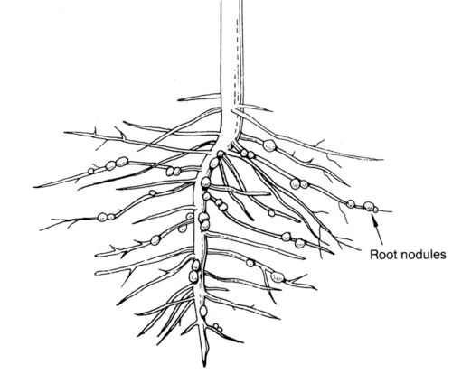
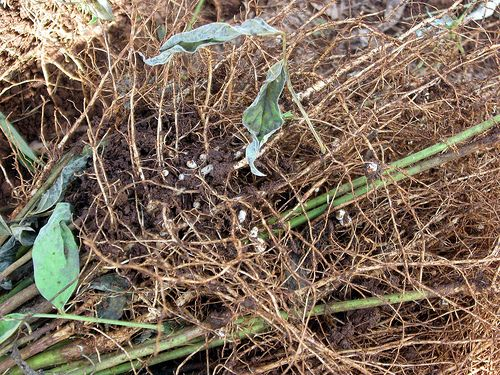
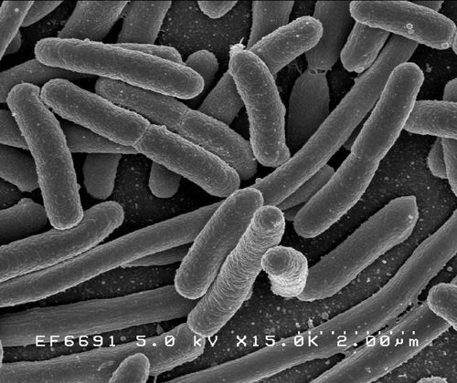
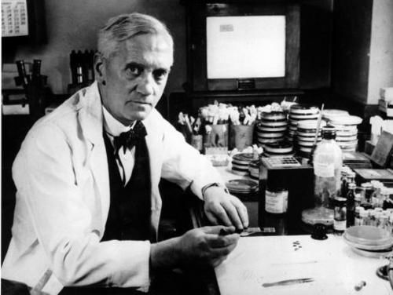

## Useful microorganisms

<Callout type="note" title="Note">
- antibiotic
- fermentation
- fixed
- legumes
- nitrogen
</Callout>

In Chapter 2 we looked at the interactions and interdependence of organisms within an ecosystem. Do you remember discussing food chains and decomposers? What was the role of decomposers in the environment?

Decomposers break down dead, organic matter so that it does not clutter up an ecosystem and cause diseases, and in the process they recycle (return) nutrients to the ecosystem.

Many decomposers are microorganisms. These microorganisms play a very important role in ecosystems as they break down dead plant and animal matter. They help to return the nutrients to the soil so that they are recycled. Some bacteria remove **nitrogen** (N2) from the air and convert it to nitrogen compounds that animals and plants can use. In plants such as** legumes**, the roots actually contain nodules with the bacteria inside of them. These nitrogen-fixing bacteria, called Rhizobia, cannot live independently and need a plant host. The bacteria get glucose from the plant and the plant benefits by getting the nitrogen compounds which the bacteria **fixed** from the soil. What is this kind of symbiotic relationship called?

It is a mutualistic symbiotic relationship as both organisms benefit from the relationship. This links back to what learners covered in Chapter 2 and acts as a revision. Learners must be encouraged to take notes in class for these kinds of discussions.

Nitrogen-fixing bacteria form root nodules in some plants, such as legumes. [http://www.flickr.com/photos/ricephotos/8566704879/](http://www.flickr.com/photos/ricephotos/8566704879/)

Can you see the white root nodules on these roots, which contain*Rhizobia* bacteria? [http://www.flickr.com/photos/plant-trees/4833252601/](http://www.flickr.com/photos/plant-trees/4833252601/)

We also have bacteria which live inside of us and help the functioning of our bodies! *Escherichia coli* is found in the lower intestine of many warm-blooded animals. They are part of the natural flora of the gut. They can actually help the animal by producing vitamin K2 and also help prevent other harmful bacteria from growing in the gut.

<Callout type="note" title="Note">
An interesting article on a newly discovered species of microorganism that lives in symbiosis in the digestive tract of termites. [http://www.huffingtonpost.com/2013/04/06/cthulhu-microbes-termite_n_3022887.html](http://www.huffingtonpost.com/2013/04/06/cthulhu-microbes-termite_n_3022887.html)
</Callout>

*Escherichia coli* bacteria found in the gut of many warm-blooded animals.

Humans have also found ways to use microorganisms to do things for us. This dates back throughout our history. Let's find out!

### Microorganisms used by people

You might be surprised at how many of our day to day experiences are somehow due to microorganisms.

Have you ever seen the side of a yoghurt container which says it contains 'live cultures'? This refers to the bacteria inside the yoghurt. People use microorganisms for processing foods, such as when brewing beer, making wine, baking bread and pickling food. Microorganisms are also used in the **fermentation** process when producing dairy products, such as yoghurt and cheese.

Yeast is one of the microorganisms humans have used for food-processing. The most common uses of yeast are in producing alcoholic beverages, such as beer and wine, and in baking, as yeast is used to make dough rise.

<Callout type="note" title="Note">
The first records of using of yeast to make bread dates back to Ancient Egypt.
</Callout>

Yeast grows under specific conditions. As it grows it uses sugar for energy and converts it into carbon dioxide and alcohol. This process is called fermentation. We can measure the amount of carbon dioxide that is produced to see how well the process works.

What are the best conditions for this to take place? Is there an optimal amount of sugar and what about the best temperature? These are all questions which curious people have asked over time! Let's do an investigation to find out.

<Callout type="note" title="Note">
We will look more at fermentation next term in Matter and Materials when we do chemical reactions.
</Callout>

# Investigating the growth of yeast

You will conduct two separate investigations to determine the optimal conditions for yeast to grow. The first will measure what sugar concentrations are necessary for yeast to grow best. You will receive some guidance and help with this part. The second part will require that you set up your own investigation to determine at what temperature the yeast will grow best. You will be required to plan, conduct and collect data from the investigation on your own.

Learners will investigate the conditions necessary for optimal yeast growth or fermentation. As learners have been exposed to similar investigations in this strand it is less guided as previous investigations.

- This investigation should run over two periods. There should be at least 2 / 3 days between these periods.
- The investigation will be done according to the scientific method
- The activity works well with packets of dry yeast that are readily available from supermarkets.
- The first part of the investigation will determine the sugar concentration needed for the yeast to grow and learners will receive more guidance.
- The second part will require learners to plan and execute their own investigation to determine the optimal temperature at which the yeast will grow.
- Teachers may therefore choose to use this for an informal practical assessment mark.
- This lesson may be used for a cooperative learning task where the two pairs of learners within the team of 4 could be tasked to work independently to complete different tasks and complete the mass and volume measurements. Teachers should if possible encourage this as it also minimises the use of apparatus and scales.
- If overflow pans are not available you can also use cake pans or foil pans that are readily available from supermarkets.

Before the investigation it might help learners to watch
                     to see what happens when yeast and sugar are mixed.

**Part 1: Yeast growth in different sugar concentrations**

**AIM:**

To determine the effect of different concentrations of sugar on the rate at which yeast grows.

**INVESTIGATIVE QUESTION:**

Which concentration of sugar is best for yeast growth?

**HYPOTHESIS: **

Learners should be able to explain that the yeast will use the sugar as a food source and produce carbon dioxide.

**MATERIALS AND APPARATUS**:

- 6 balloons
- 14 grams (2 packets) of dry yeast
- white sugar
- mass scale
- funnel
- 6 x 50 cm string
- 2 - 50 ml graduated cylinders
- 600 ml beaker
- overflow pan
- permanent markers
- ice packs

<Callout type="note" title="Note">
There are different kinds of yeasts. The one we are using breaks down sugar in dough. Others break down wood and corn stalks and produce ethanol (alcohol) while another breaks down the sugar in fruits, nectar, molasses or sorghum.
</Callout>

**METHOD:**

2. Work in groups of four.
4. Use the permanent marker to label each balloon A, B, C, D, E and F.
6. Each balloon will need to be filled with 2 g of yeast and a different quantity of sugar. Balloon A will need to get 2 g of sugar, B will get 3 g of sugar, C will get 4 g of sugar and so on. (See the table below.) Use a plastic spoon or spatula to place the yeast and sugar into the balloon.
8. Use a funnel and pour 50 ml lukewarm tap water into each balloon.
10. One person should hold the balloon and funnel while the other pours in the water.
12. As soon as the balloon has been filled, take a piece of string and tie off the balloon as close as possible to the level of the water without trapping any air.
14. Knot the balloon's rubber neck to ensure that no air can get in or water can get out.
16. Place each prepared balloon on ice to prevent the fermentation process from starting.
18. Before you allow the fermentation process to start, you need to determine the starting mass and volume of each balloon.
20. MASS: Determine the mass of the tied balloon to the nearest 2 decimal places. Return it to the ice.
22. VOLUME: Use the water displacement method to determine the volume of the balloon.
   2. Place water in a large jug level with the top of the jug.
   4. Completely submerge the balloon under the water in the jug: push the balloon and allow the water to flow over the sides into the overflow pan. You should stop when your fingers touch the water.
   6. The water in the overflow plan is therefore the volume of water that the balloon displaced.
   8. Carefully measure the water in the overflow pan. Record your measurements in the table below.
   10. Return the balloon to the ice as soon as possible.
24. PREPARE FOAM COOLER BOX: You are going to place the balloons inside a foam cooler box with warm water in (the box should keep the water warm). Pour 40 oC water into the cooler box (as it normally cools down quite quickly).
26. FERMENTATION INCUBATION: You are now ready to start the process of incubating the yeast.
   2. Place each balloon into the warm water.
   4. Record which balloons sink and which float.
   6. Leave the balloons in the warm water for 20 - 30 minutes during which time the yeast will ferment the sugar.
   8. Record the exact time that you used for incubation: _____ minutes.
28. AFTER INCUBATION: Use a paper towel to dry the balloons.
   2. Determine the volume of each balloon.
   4. Determine the mass of each balloon.

Tip: It is really important that you work fast and accurately at this point. Your team should really consider letting one pair determine the mass and the other the volume of each balloon.

2. Calculate what changes (if any) occurred during incubation to the mass and volume of each balloon.
4. Hang your balloon on a clothesline or hanger in the class to dry.
6. Clean up your work area and wash, dry and pack away all equipment that you used.

It would be an excellent data management activity to have learners record the different groups' data on the board in order to determine the mean (class average) for the class' balloon mass and volumes.

2. THREE DAYS LATER: remove your balloons from the clothes line / hanger. Record all observations that you can make - remember to use ALL your senses.
4. Use the same methods to determine the mass and volume of each balloon and record this on the table.
6. AFTER measuring the mass and volume of each balloon, carefully cut it open. Make careful notes to describe your observations of the contents of each balloon.
8. Use your table of measurements to draw a graph.

**RESULTS AND OBSERVATIONS:**

Complete the table with the correct information obtained from your work.

| Balloon | Amount of yeast (g) | Amount of sugar (g) | Balloon mass before ferment ation (g) | Balloon volume before ferment ation (g) | Sink/ Float | Balloon volume after fermentat ion (g) | Balloon mass after fermentat ion (g) |
| --- | --- | --- | --- | --- | --- | --- | --- |
| A | 2 | 2 |  |  |  |  |  |
| B | 2 | 3 |  |  |  |  |  |
| C | 2 | 4 |  |  |  |  |  |
| D | 2 |  |  |  |  |  |  |
| E | 2 |  |  |  |  |  |  |
| F | 2 |  |  |  |  |  |  |

**ANALYSIS:**

Present the data you collected on a graph in the space below.

**QUESTIONS:**

**Problem:**
Describe the changes that you observed happening in your balloons from the start to the end of the incubation period.

**Solution:**
The answer would depend on the results from the investigation but learners should be able to say that the balloons filled up and became bigger (some more than others).

**Problem:**
Were the changes the same in each balloon?

**Solution:**
The answer would depend on the results from the investigation but they should be able to observe that the balloons with the small amount of sugar only increased a little bit but the ones with more sugar in increased more in size.

**Problem:**
Explain why you think these changes occurred differently in the contents of each of your balloons.

**Solution:**
The answer would depend on the results from the investigation but learners should be able to say that the balloons with a greater concentration sugar were able to ferment more quickly or for a longer time than the ones with a smaller concentration of sugar.

**Problem:**
How did you expect the balloons to react after 3 days?

**Solution:**
Learner-dependent answer. Learners might indicate that they thought the balloons would just continue blowing up / increasing in size, or they may have hypothesised that once the sugar was used up the balloons would stay the same size (or even decrease).

**Problem:**
Describe how each of the balloons actually looked after the 3 days.

**Solution:**
The answer would depend on the results from the investigation but in most cases the balloons should have decreased in size.

**Problem:**
Provide a possible explanation for your observations. Think for instance of what could possibly have been lost from the balloons.

**Solution:**
The answer would depend on the results from the investigation but learners should be able to conclude that the sugar in the solution has all been used, so no new carbon dioxide was being made, and the carbon dioxide in the balloons slowly began to escape through the walls of the balloon.

**Problem:**
At the start you added yeast, sugar granules and water. Describe how the contents of each of the balloons looked at the end of the investigation.

**Solution:**
The answer would depend on the results from the investigation but learners should be able to describe the light brown fizzy contents that has a distinct sour smell and flavour.

**CONCLUSION:**

**Problem:**
What did you learn from doing this investigation?

**Solution:**
Learners may conclude that the more sugar was added the more gas was produced.

** A simplified version** of this investigation can also be done:

- Provide learners with 4 bottles.
- Dissolve half a packet of instant yeast into each of the 4 bottles.
- Mark the bottles A - D.
- Bottle A should have normal tap water with only the yeast dissolved in it. Stretch a balloon over the top of the bottle.
- Bottle B should have the yeast dissolved in lukewarm water (not too hot). Stretch a balloon over the top.
- Bottle C should have normal tap water with 10 ml of sugar dissolved with the 7 g (half a packet) of yeast. Stretch a balloon over the top.
- Bottle D should have 40 degree C water with 10 ml of sugar dissolved with the 7 g (half a packet) of yeast. Stretch a balloon over the top.
- The balloons will of course fill with carbon dioxide - with Bottle D filling the fastest as the conditions are most perfect for this in that bottle.

**Part 2: Yeast growth at different temperatures**

Conduct this investigation again, but this time you need to find out the best temperature for yeast growth. A suggestion is to use 10 ml of sugar for each of the balloons and 7 g of instant yeast (or 2 teaspoons of sugar and 1 teaspoon of yeast). Why do you need to add the same amount of yeast and sugar to all containers? You will need to change the temperature of the water however to measure the optimum temperature for yeast to ferment.

Write an experimental report, using the headings of AIM, HYPOTHESIS, MATERIALS, METHOD, RESULTS AND OBSERVATIONS, DISCUSSION and CONCLUSION.

Remember to evaluate your results and discuss any difficulties you might have had or ways to improve your experimental design. In your discussion, you will also need to do some extra research about the applications of this process and include this information. Do not forget to reference your sources in a bibliography at the end.

Besides the use of microorganisms in food and food-making processes, there are also other processes for which we use microorganisms. Specific microorganisms are used in water treatment, like when treating sewage on a large scale.

In biotechnology research, microorganisms are being used to produce alternative, renewable energy, for example, biogas and biofuels.

<Callout type="note" title="Note">
Learn more about biofuels from microorganisms.[http://news.nationalgeographic.com/news/energy/2013/06/130617-electrofuels-using-microbes-to-make-biofuel/](http://news.nationalgeographic.com/news/energy/2013/06/130617-electrofuels-using-microbes-to-make-biofuel/)
</Callout>

Microorganisms are used in the development of various medicines, for example, **antibiotics**. Penicillin is a group of antibiotics which come from *Penicillium* fungi. The discovery of penicillin and its uses to treat certain bacterial infections happened by chance. This was due to the curiosity of a scientist, Alexander Fleming, and this led to the discovery of many more antibiotics.

Sir Alexander Fleming, who discovered penicillin in 1928.

Microorganisms are also used in many fields of science and medical research. Scientists use yeast to learn more about many other types of organisms. The use of viruses is also currently being explored in many universities around the world to actually help with cures for various conditions, even cancer! The possibilities for discovery are endless!

<Callout type="note" title="Note">
An article on how a virus could potentially help to cure melanomas, a type of cancer.[http://news.yale.edu/2013/06/14/fast-acting-virus-targets-melanoma-mice](http://news.yale.edu/2013/06/14/fast-acting-virus-targets-melanoma-mice )
</Callout>

# Careers as a natural scientist

This is a suggested CAPS activity, but it is not for assessment purposes. Learners should start to learn about and explore various careers within the Natural Sciences. A variety of career options are suggested by this activity. Ideally all of the careers in the list should be represented by at least one student. This is a good chance for learners to explore their interests, so those who already have well-developed passions and interests should be encouraged to explore them further with this activity. If a learner has a career not on this list that is related to Natural Sciences they may talk about their choice instead.

**INSTRUCTIONS:**

2. Examine the list of careers below and select one career that interests you.
   | Environmental Scientist | Nature conservationist | Gameranger | Zoologist | Botanist |
   | --- | --- | --- | --- | --- |
   | Ecologist | Veterinarian | Microbiologist | Food Scientist | Farmer |
   | Doctor | Nurse | Entomologist | Geneticist | Agronomist |
4. Do some research about the career you have selected.
6. Pretend it is 14 years in the future and you are about to attend your 10-year high school reunion!
8. Break into groups and have a discussion as 28-30 year-olds!
10. Use the questions below to guide your discussions.

**QUESTIONS**

**Problem:**
What subjects did you take in Gr. 10?

**Solution:**
Learner-dependent answer

**Problem:**
Which university did you go to? What did you study?

**Solution:**
Learner-dependent answer

**Problem:**
Where do you live?

**Solution:**
Learner-dependent answer

**Problem:**
What does your "typical day" involve?

**Solution:**
Learner-dependent answer

**Problem:**
What is the best part of you job?

**Solution:**
Learner-dependent answer

**Problem:**
What is the worst part of your job?

**Solution:**
Learner-dependent answer

<Callout type="note" title="Note">
10 reasons to love science (video).
</Callout>
