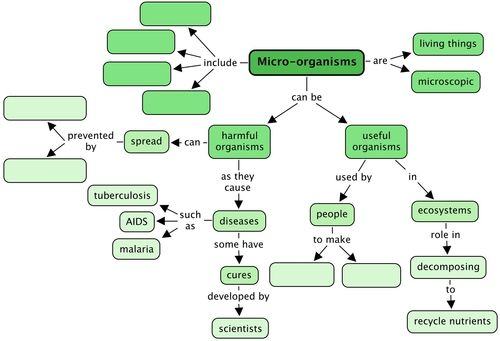
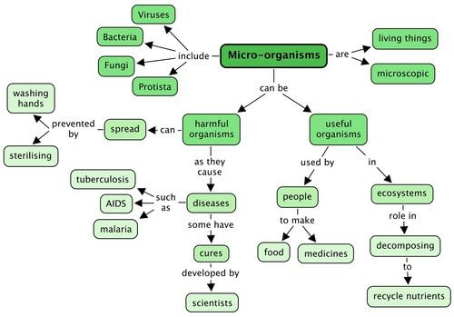

## Summary

<Callout type="note" title="Note">
- Microorganisms are living things.
- They are too small to see with the naked eye and can only be seen under a microscope.
- There is a variety of microorganisms, including viruses, bacteria, protists and fungi.
- Microorganisms can be harmful or useful.
- **Harmful microorganisms:**
  - Harmful microorganisms causes disease such as TB, HIV, malaria and food poisoning.
  - Disease-causing organisms are found almost everywhere - ATMs, handrails, toilets, etc.
  - Waterborne diseases such as cholera and dysentery cause diarrhoea resulting in many childhood deaths.
  - Effective methods of preventing the spread of diseases caused by microorganisms including washing hands and sterilising equipment and utensils.
  - Modern scientists such as Louis Pasteur play an important role in identifying and developing cures for some diseases.
- **Useful microorganisms:**
  - Some microorganisms play an essential role in ecosystems, such as decomposing dead plant and animal matter, thereby recycling nutrients in the soil.
  - Some microorganisms are used by people for making certain foods (like yoghurt and bread) and medicines (like penicillin)
</Callout>

**Concept map**

This concept map shows all that we have learnt about Microorganisms in this chapter. What types of microorganisms are there? Fill these into the 4 spaces below. How can we prevent the spread of harmful microorganisms? Fill in 2 of these actions in the spaces provided. In this chapter we learnt about useful microorganisms - what are two products we make using microorganisms? Fill these in.

Teacher's version

