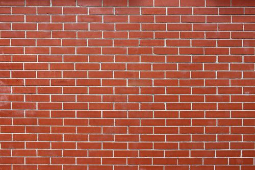
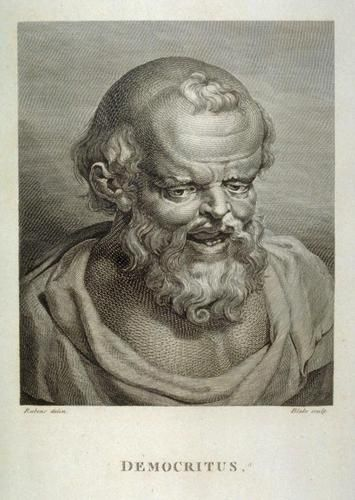
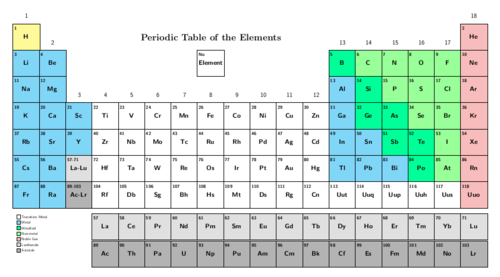
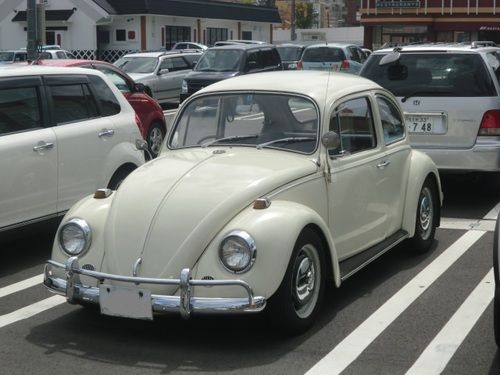
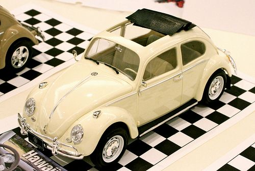
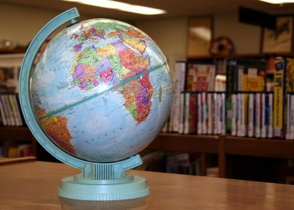
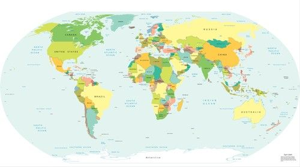

## The building blocks of matter

<Callout type="note" title="Note">
- atoms
- element
- scientific model
- postulate
</Callout>

What is matter? The traditional definition says matter is anything that has mass and occupies volume (takes up space).

We could say that matter is 'stuff', but that would not be very specific. To understand matter in a scientific way, we need to imagine what it is made of.

All the different types of matter that exist on Earth are made up of one or more chemical **elements**. You were introduced to some of the elements in Gr. 7 Matter and Materials. Before reading further, stop and see how much you can remember about the elements. Write down what you remember or say it out loud.

There are more than 100 known elements and scientists are still looking for more. We also learnt that each element has a unique name, chemical symbol and atomic number that represents it, along with a fixed place on the Periodic Table of elements.

The title of this section is 'The building blocks of matter'. For this reason, we will start our discovery by imagining a wall that has been built of bricks, like the one in the following picture. Can you see how the wall is made of many identical bricks?

A brick wall.

This is synonymous with an element where all the atoms are identical (they are of the same kind).

Similarly, we can think of most forms of matter as being made up of many, many small particles. These small particles are called **atoms**.

### What are atoms?

The early Greek philosophers proposed that all matter is made up of incredibly small but discrete units (like the bricks in our wall example). Democritus (460 - 370 BC) was the first to call these units *atomos*. From this phrase came the term *atom* that we use today.

<Callout type="note" title="Note">
*Atomos* is a Greek phrase which means 'not cut' or 'that which is indivisible'.
</Callout>

Democritus first used the term*atomos*more than 2000 years ago to describe the smallest particle that matter is made of.

It took a very long time (more than 2000 years!) for the ideas of Democritus to be accepted by scientists. Why do you think it took so long? Discuss this in your class.

Get learners to discuss this in class for a few minutes. You could steer the discussion with the following questions:

- Do you believe in vampires? (Fairies, zombies, the Easter Bunny, Thokoloshe, etc.)
- Do you think they really exist?
- When do we know something really exists? (When we have hard evidence for its existence.)
- Could it be that scientists did not believe in the existence of atoms because they could find no hard evidence for their existence?
- Why do you think scientists could not find evidence for the existence of atoms?
- Could it be because atoms are so incredibly small that they cannot be seen by the naked eye?

<Callout type="note" title="Note">
Atoms are so small that until recently, it was impossible to see them, even using the strongest microscope. Nowadays there are microscopes connected to sophisticated computer software, which make it possible for scientists to actually 'see' atoms.
</Callout>

<Callout type="note" title="Note">
Find out more about these microscopes which enable people to 'see' atoms[http://myscienceacademy.org/2013/04/03/have-you-ever-seen-an-atom/](http://myscienceacademy.org/2013/04/03/have-you-ever-seen-an-atom/)
</Callout>

Can you imagine how difficult it must have been to convince those early scientists that matter consists of really, really small particles that no-one has ever seen?

<Callout type="note" title="Note">
Atoms are so small that a glass of water contains more atoms than there are glasses of water in the Atlantic Ocean.
</Callout>

How small are atoms really? Well, about 5 000 000 000 000 000 000 of them would fit inside the full stop at the end of this sentence. Of course different atoms have different sizes, so this is just an approximate number. Wait... atoms have different sizes? How does that work? In the next section, we will find out.

<Callout type="note" title="Note">
The world's smallest movie made with atoms and how the scientists made it
</Callout>

*
**What are elements?**
*

Democritus' ideas about matter were ignored and forgotten for more than 2000 years, until an Englishman by the name of John Dalton reintroduced them to the scientific world in 1803. Dalton made five claims about atoms that are still largely accepted as the truth today. Three of these claims, or **postulates** as they are more commonly called, tell us how to understand elements. We will get to the remaining two postulates later. Here is what Dalton taught us about elements:

2. **Each element consists of indivisible, minute particles called atoms.**
4. **All atoms of a given element are identical.**
6. **Atoms of different elements have different masses.**

This ties in with what we learnt about the elements in Gr. 7 Matter and Materials. Let us revise what we already know:

- The Periodic Table of elements was originally made to represent the patterns observed in the chemical properties of the elements.
- Each element has a fixed position on the Periodic Table.
- The elements are arranged in order of increasing atomic number.

<Callout type="note" title="Note">
The only letter that does not appear on the Periodic Table is the letter 'J'.
</Callout>

The elements are arranged in order of increasing atomic number.

<Callout type="note" title="Note">
You can find a larger version of the Periodic Table on the inside cover of your book for easy reference.
</Callout>

# A quick revision of the Periodic Table of Elements

This will help revise some of the concepts taught in Gr. 7 about elements and the Periodic Table.

**QUESTIONS:**

**Problem:**
In your own words, explain what you think the Periodic Table is.

**Solution:**
This is an open-ended question for learners to show what they understand at this point about the Periodic Table, They may write explanations such as:

- The Periodic Table lists all the elements that we know about on earth.
- The Periodic Table classifies all the elements on earth.
- The Periodic Table gives us information about the elements, such as their names, symbols and atomic numbers.
- We can see patterns in the Periodic Table in terms of chemical and physical properties.

**Problem:**
Where do we find metals and where do we find non-metals on the Periodic Table?

**Solution:**
Metals are found on the left and non-metals are found on the right.

**Problem:**
What is the third class of elements called that we have learned about and where are they found.

**Solution:**
These are the semi-metals and they are found in between the metals and non-metals in a jagged line.

**Problem:**
Give the symbols of two examples of metals and two examples of non-metals.

**Solution:**
Any of the metals on the left hand side of the table, such as Li, Na, K, Ca, Mg, etc. and any of the non-metals on the right hand side, such as C, N, O, Cl, I, He, S, etc.

**Problem:**
Complete the following sentence: The elements are arranged in order of increasing _____.

**Solution:**
atomic number.

**Problem:**
What is the atomic number of hydrogen and what is the atomic number of carbon?

**Solution:**
Hydrogen is 1 and Carbon is 6.

**Problem:**
Complete the following table by supplying either the name or symbol for the elements listed, and whether it is a metal, non-metal, or semi-metal.

| Name | Symbol | Metal or non-metal? |
| --- | --- | --- |
| Hydrogen |  |  |
|  | Li |  |
|  | Na |  |
| Carbon |  |  |
|  | Si |  |
| Magnesium |  |  |
|  | O |  |
|  | Cl |  |
| Potassium |  |  |
| Boron |  |  |
|  | Cu |  |

**Solution:**
| Name | Symbol | Metal or non-metal? |
| --- | --- | --- |
| Hydrogen | H | Non-metal |
| Lithium | Li | Metal |
| Sodium | Na | Metal |
| Carbon | C | Non-metal |
| Silicon | Si | Semi-metal |
| Magnesium | Mg | Metal |
| Oxygen | O | Non-metal |
| Chlorine | Cl | Non-metal |
| Potassium | K | Metal |
| Boron | B | Semi-metal |
| Copper | Cu | Metal |

Are atoms really the smallest particles? Dalton thought so! He also postulated that:

**4. Atoms can neither be created nor destroyed during chemical reactions .**

Dalton was correct in saying that atoms cannot be created or destroyed in chemical reactions. Does that mean atoms are the smallest particles of matter? Not exactly. Scientists have since discovered that atoms themselves are made up of even smaller particles. We call these sub-atomic particles.

We will learn about the sub-atomic particles that make up atoms shortly, but first we need to talk briefly about **scientific models**. Do you know what a model car is?

Here we mention that atoms cannot be destroyed in **chemical reactions**. This refers to the conservation of mass during a chemical reaction. Atoms can however, be 'smashed' apart or split into smaller parts when enough kinetic energy is present, for example, in an atomic bomb. Although the name 'atom' is derived from the Greek word meaning 'indivisible', they are not truly indivisible.

This is a photograph of a real car. It is about 2.5 m long. [http://commons.wikimedia.org/wiki/File:Kind_of_Volkswagen_Beetle.jpg](http://commons.wikimedia.org/wiki/File:Kind_of_Volkswagen_Beetle.jpg)

This is a photograph of a model car. It is about 25 cm long. [http://www.flickr.com/photos/puuikibeach/8589310784/](http://www.flickr.com/photos/puuikibeach/8589310784/)

Scientists use models to help them understand the real world and how it works.

### Scientific models

Have you ever seen a geographical globe? The globe in the next picture is a model of the Earth. What do you think it can be used for? Do you think we could learn more from a globe than from a map of the Earth?

Get the learners to discuss this in class. Guide them towards the following ideas:

Ask them to look at the map of Earth and work out what is exactly on the other side of the Earth from South Africa. If it was possible to make a tunnel through the centre of the Earth, where would the exit of the tunnel be? This is very difficult to do with a map, but with a globe one can easily see which part of the world lies opposite South Africa on the other side of the Earth.

A globe of the world.

A map of the world.

Globes are the best representations we have of our planet; because they are three-dimensional. Can you think of some of the things we can learn about the Earth from a globe?

Here are some things to help learners think about:

- A globe can show us the positions of the continents relative to each other much more realistically than any map ever could.
- a globe is more accurate than a flat map in terms of relative sizes of countries.
- A globe can also teach us about the movement of the Earth, how it spins on its own axis to create night and day.
- A globe can also show how the Earth moves around the Sun to create the seasons.
- We can also learn about latitude and longitude from a globe.

Sometimes a model can be an idea or a set of ideas; a simplified representation of difficult concepts or phenomena. A scientific model is a set of ideas that tells a story about something in the world around us, in the same way that the globe tells us a story about Earth.

### A model of the atom

Atoms cannot be seen with the naked eye, only with very powerful microscopes. However, scientists have a good idea of how they behave in different situations. Based on these ideas, they have developed a model of what the atom looks like, to help us understand atoms better.

The modern model of the atom teaches us that all atoms are made up of sub-atomic particles. Sub-atomic means 'smaller than the atom'. In the next section, we are going to learn more about these interesting little particles.

<Callout type="note" title="Note">
Build an atom.[http://www.keithcom.com/atoms/index.php](http://www.keithcom.com/atoms/index.php)
</Callout>

The 'Build an atom' link takes you to a website that draws a representative image of the atom, starting with hydrogen, the first element on the Periodic Table, and allows you to click through all the elements, or jump to a specific element. You could show it to the learners to introduce the next section on sub-atomic particles and then return again later to wrap up the section and reinforce all the new information.
