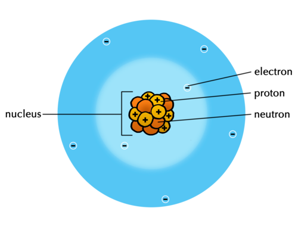
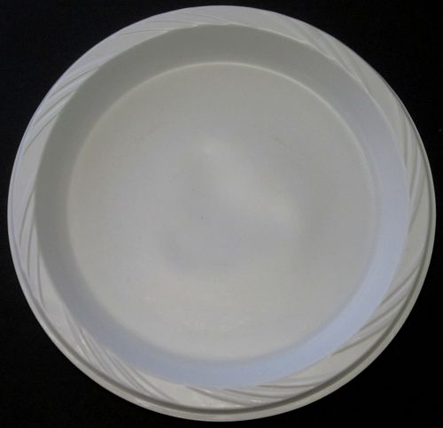
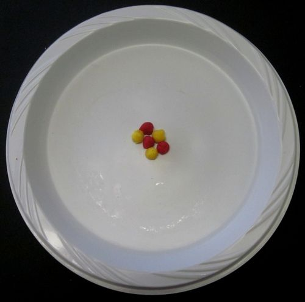
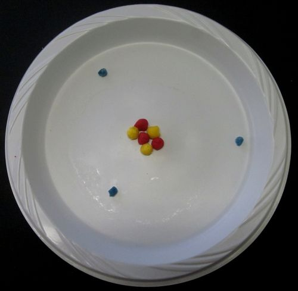
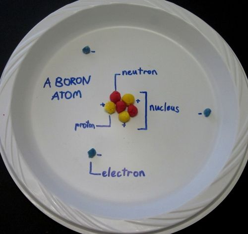

## Sub-atomic particles

<Callout type="note" title="Note">
- atomic nucleus
- sub-atomic particle
- electrons
- neutrons
- protons
</Callout>

After many decades of studying atoms, scientists discovered that all atoms are made up of three different kinds of **sub-atomic particles**. They are called:

- electrons
- protons
- neutrons

<Callout type="note" title="Note">
Video about what an atom is:
</Callout>

The following picture of the atom shows how they all fit together.

Neutrons, protons and electrons are sub-atomic particles that make up an atom.

These three sub-atomic particles form the basis of our modern-day understanding of what atoms look like on the inside. Let's look at what is known about each particle in turn.

<Callout type="note" title="Note">
The branch of physics that studies sub-atomic particles is called particle physics. Do you know the name of the particle that was discovered during 2012? It was a major scientific discovery for physics!
</Callout>

In response to the "Did you know" margin box, the Higgs boson or Higgs particle was discovered in 2012. It was a huge scientific discovery. In short, the Higgs boson is a fundamental particle which plays a role in giving other particles its mass. The existence of the particle was first proposed in 1964 by a group of 6 physicists, one being Peter Higgs. Scientists searched for evidence of its existence for 50 years and eventually in July 2012 with the use of the Large Hadron Collider at CERN, they identified a particle which they thought was the Higgs boson, and have since confirmed this. Here are two sites if you would like to explore this further, either for your own interest or with your class: [http://www.kuriositas.com/2013/05/what-is-higgs-boson-animation.html](http://www.kuriositas.com/2013/05/what-is-higgs-boson-animation.html) and [http://home.web.cern.ch/about/updates/2013/05/basics-higgs-boson](http://home.web.cern.ch/about/updates/2013/05/basics-higgs-boson).

### Protons

The protons are deep inside the atom, in a zone called the **nucleus**. The protons are said to be positively charged. What does this mean?

To answer this question, think about the following phenomena that have been discovered by scientists:

- When two protons get near each other, they push each other away.
- When an electron gets near a proton, they attract each other.
- Two electrons will also push each other away.

What causes this? There must be some property of electrons and protons that make them apply these forces. Scientists use the word 'charge' to represent the property these particles have. We observe that:

- like charges repel (meaning the same charges push each other away)
- opposite charges attract

Regarding the "take note": it is important to note that the elements are arranged by the order of increasing **atomic number** and NOT the increasing **atomic mass number**(even though the general trend is evident). Learners might infer that with each additional proton, elements further down the Periodic Table are heavier than those higher up, or towards the left. Atomic number and atomic mass number (not on their Periodic Tables) are only really dealt with in Gr. 10 so it is difficult to explain the difference. You could point out exceptions, disproving their assumption, for example, Argon - Potassium, Cobalt - Nickel, Tellerium - Iodine.

### Neutrons

Neutrons are particles that are neither positively nor negatively charged. They are neutral. The neutrons together with protons form the tightly packed nucleus at the centre of the atom.

<Callout type="note" title="Note">
The nucleus is very dense. That means the protons and neutrons are tightly packed and are very heavy for their size. If the nucleus was scaled up to the size of a full stop, it would weigh as much as a fully loaded minibus taxi, or 2,5 tonnes!
</Callout>

### Electrons

Electrons are the smallest of the three sub-atomic particles. Electrons are about 2000 times smaller than protons and neutrons. The electrons move in a zone around the **atomic nucleus** at extremely high speeds, forming an electron cloud that is much larger than the nucleus. Have a look again at the drawing which shows a model of the atom to see this.

<Callout type="note" title="Note">
If we could enlarge the size of the nucleus to the size of the full stop at the end of this sentence, the outer edges of the electron cloud surrounding it would be between 3 and 5 meters away.
</Callout>

These three sub-atomic particles help us understand what atoms look like on the inside.

# Make your own model of an atom

You can use many different materials for this activity, such as playdough balls, beads, dried lentils or peas, pasta shells, etc. Assign learners different elements so that they will have different numbers of protons, neutrons and electrons to work with. They should choose one colour or type of object to represent each of the three types of sub-atomic particles. They must show the same number of each sub-atomic particle as they are dealing with neutral atoms (ie. the number of electrons equals the number of protons), and not with isotopes which have different numbers of neutrons.

Do you remember Dalton's 3 postulates from the beginning of the chapter? They are:

2. **Each element consists of indivisible, minute particles called atoms.**
4. **All atoms of a given element are identical.**
6. **Atoms of different elements have different masses.**

So, each element on the Periodic Table has its own type of atom. The atoms of different elements are different as they have different numbers of protons. Do you remember that we said the **atomic number** of an element is the number of protons in an atom of that element?

**Problem:**
So, if we wanted to make a model of a nitrogen atom, how many protons would we need?

**Solution:**
7 protons

**Problem:**
If we wanted to make a model of a sulfur atom, how many protons would we need?

**Solution:**
16 protons

In most atoms of an element, the number of neutrons in the nucleus is the same as the number of protons. The number of electrons can change, but for now we are going to make models of neutral atoms. So, there must be the same number of electrons as protons.

Learners should also be encouraged to take into account the size of the particles. So the objects they use for the protons and neutrons should be of a similar size, and the objects they use for electrons should be smaller.

Here are some photos to assist you in guiding the learners to construct their models. This example if for a boron atom as there are 3 protons.

Start with a blank paper plate.

Add the protons and neutrons in the centre.

Add the electrons in the surrounding space.

Add in the labels.

**MATERIALS :**

- glue
- paper plate
- playdough, beads, dried lentils or peas, etc

**INSTRUCTIONS:**

**Problem:**
After reading the information about atoms, your teacher will give you an element of which you have to build a model. What is the name of your element?

**Solution:**
Learner-dependent answer.

**Problem:**
What is the atomic number of your element?

**Solution:**
Learner-dependent answer.

**Problem:**
How many protons will you need to make for your atom?

**Solution:**
Learner-dependent answer. This must be the same as the atomic number.

**Problem:**
Now decide what objects you will use to create the subatomic particles in your model.

**Solution:**

**Problem:**
Stick these onto the paper plate and provide labels.

**Solution:**
Learners must label the element they are doing, as well as the electrons, protons, neutrons and the nucleus.

**Problem:**
After you have built your model, draw a model of your atom below. Provide labels. These are both models of your atom!

**Solution:**

<Callout type="note" title="Note">
Build an atom with this simulation.[http://phet.colorado.edu/en/simulation/build-an-atom](http://phet.colorado.edu/en/simulation/build-an-atom)
</Callout>

Here is some general information on how to use simulations in the classroom: [http://phet.colorado.edu/en/for-teachers/classroom-use](http://phet.colorado.edu/en/for-teachers/classroom-use). And this pdf contains more specific information for the teacher about the '*Build an atom*' simulation [http://phet.colorado.edu/files/teachers-guide/build-an-atom-guide.pdf](http://phet.colorado.edu/files/teachers-guide/build-an-atom-guide.pdf)

Can you remember learning about mixtures in Gr. 7? You may remember that a mixture consists of two or more substances mixed together. The next section is NOT about mixtures. It is about substances that are not mixed with anything and consists of only one type of matter throughout. Such substances are called **pure substances**. In this sense, 'pure' simply means: not mixed with any other substances.

<Callout type="note" title="Note">
Just how small is an atom? (video)
</Callout>

The 'Just how small is an atom?' video is a nice animation that attempts to put the size of an atom and its sub-atomic particles into perspective by comparing it to real life objects like fruit, houses and cars. It is fast-paced and uses many metaphors, so could potentially be confusing and too abstract. You may want to watch it first and decide whether your learners would benefit from it.
