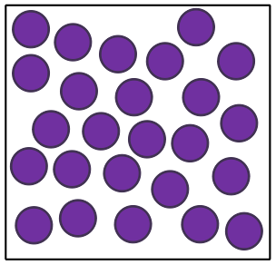
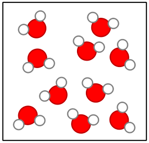
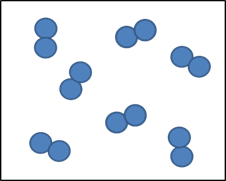
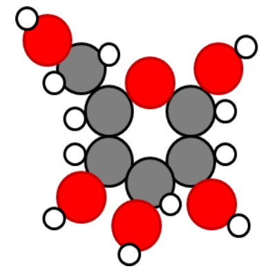
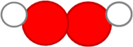
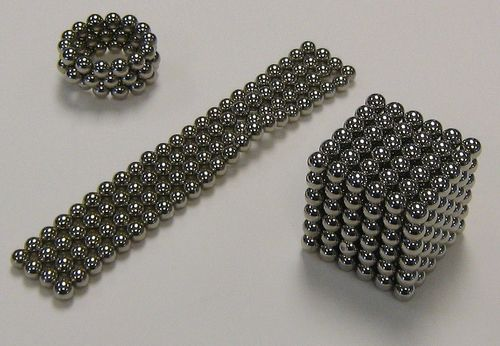
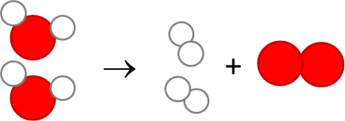

## Pure substances

<Callout type="note" title="Note">
- pure substance
- compound
- chemical bond
- molecule
- chemical formula
- chemical reaction
- decomposition reaction
</Callout>

**Important note:** In the previous section we used coloured circles/beads/balls/beans, etc to represent the different sub-atomic particles and to show how they are arranged in atoms. However, in this section as well as in the last chapter on chemical reactions, we will be using coloured circles/beads/balls/beans to represent whole atoms and the different colours and sizes will show different atoms in compounds and elements. It is important that learners realise at what scale you are working at when you draw different diagrams on the board or talk about the diagrams in this workbook.

<Callout type="note" title="Note">
Here in these diagrams, the different coloured circles represent different**atoms**.
</Callout>

There are only two classes of pure substances, namely **elements** and **compounds**. To understand the difference between the two, look at the two diagrams below.

An element consists of atoms that are all the same kind.

A compound consists of two or more kinds of atoms in a fixed ratio.

The diagram on the left represents an element. Can you see that all the atoms are of the same kind? An element is a material that is made up of atoms of only one kind.

Now look at the diagram on the right representing a compound. This diagram shows two important things about compounds:

- The compound consists of atoms, but there are more than one kind.
- The different atoms are combined in little clusters and the clusters are all exactly the same.

A compound is a material that is made up of two or more kinds of atoms that are chemically bonded together.

We are now going to explore each of these classes on their own and discuss some examples of each.

### Elements

We have just learnt that an element is made up of atoms of the same kind. This means that if we had a piece of the metal copper, it would be made up entirely of copper atoms. Likewise, a piece of silver would be made up entirely of silver atoms. Copper and silver look different and have different properties, because they are made up of different atoms. Have a look at the following table which illustrates the sub-microscopic image of the atoms and also a piece of jewellery made from each of the different metals.

| Copper | Silver |
| --- | --- |
| Sub-microscopic structure of copper The element copper (Cu) consists of only copper atoms. | Sub-microscopic structure of silver The element silver (Ag) consists of only silver atoms. |
|  | Earrings made of silver. @@BY http://www.flickr.com/photos/bellecouleurjewelry/5669764986/ |

# Studying representations of atoms and elements

**QUESTIONS:**

**Problem:**
Why are the silver atoms bigger than the copper atoms in the previous diagrams? Hint: Find the two elements on the Periodic Table and compare their positions.

**Solution:**
Silver lies below copper on the Periodic Table, which means the atoms of silver are bigger than those of copper.

2. Do you think the substance represented in the following diagram is an element? To help you answer the question, go through the questions below the diagram.
   
   **Problem:**
   First write down what you see in the picture.
   **Solution:**
   Learners may say they see pairs of atoms stuck together.
   **Problem:**
   Are the clusters tightly packed or far apart?
   **Solution:**
   They are relatively far apart.
   **Problem:**
   What does that mean? Do you think the substance is a solid, a liquid or a gas?
   **Solution:**
   The substance is a gas.
   **Problem:**
   Do you think it is a mixture of substances or a pure substance? Why do you think so?
   **Solution:**
   It is a pure substance because all the molecules look the same.
   **Problem:**
   Are the atoms all of the same kind?
   **Solution:**
   Yes, they are.
   **Problem:**
   What class of substances is made up of only one kind of atom?
   **Solution:**
   The elements.
   **Problem:**
   Is the substance an element? Why?
   **Solution:**
   The substance is an element because it is made of only kind of atom.
   **Note:** This actually represents the diatomic elements, such as oxygen (O2), nitrogen (N2), hydrogen (H2), which exist as diatomic (two atoms) molecules at room temperature.
   **Problem:**
   Can elements be made up of molecules?
   **Solution:**
   Yes, they can.

It is not important that learners answer this; it is meant to introduce the notion that both elements AND compounds can exist as molecules, but that the molecules of elements are fundamentally different from the molecules of compounds.

The clusters of atoms in the previous example are called molecules. **Molecule** is a very important word in chemistry. A molecule is two or more atoms that have chemically bonded with each other.

The atoms in a molecule can be of the same kind (in which case it would be a molecule of an element), or they can be of different kinds (in which case it would be a molecule of a compound).

Not all elements have molecules. The metals on the left hand side and the middle part of the Periodic Table are solids at room temperature and so they exist as tightly packed arrays of atoms like the previous examples of silver and copper.

Many of the non-metals on the right hand side of the Periodic Table are gases at room temperature that exist as molecules made up of two atoms each. These are called **diatomic molecules**. The picture of the element that we discussed earlier shows what diatomic molecules look like. Oxygen (O2), nitrogen (N2), hydrogen (H2), chlorine (Cl2) and some other elements from the non-metals all form diatomic molecules.

Draw a picture of one of these diatomic molecules in the space below.

Learners must draw two circles joint to each other that are of the same size and colour. A suggestion is to get learners to create some of the diatomic molecules using the beads, playdough balls, etc. make sure that they know that the beads now represent whole atoms, and not sub-atomic particles.

<Callout type="note" title="Note">
**Diatomic** refers to a molecule made of two of the same atoms bonded together, as in oxygen (O2). 'Di' means two. **Triatomic** refers to a molecule made up of three of the same atoms bonded together, like ozone (O3).
</Callout>

# Atoms and molecules

This is a quick revision of what learners have just covered about atoms and molecules and being able to differentiate between the two.

Let's make sure we understand the difference between atoms and molecules.

**QUESTIONS:**

**Problem:**
Look at the following diagrams. Decide whether each represents an atom or a molecule. If it is a molecule, state how many atoms make up the molecule.

| Diagram | Atom or molecule? |
| --- | --- |

**Solution:**
| Diagram | Atom or molecule? |
| --- | --- |
|  | An atom |
|  | A molecule of 2 atoms |
|  | A molecule of 4 atoms |
|  | An atom |
|  | A molecule of 9 atoms |

2. Look at the following complex molecule.
   
   **Problem:**
   How many atoms make up this molecule?
   **Solution:**
   24 atoms.
   **Problem:**
   How many different types of atoms make up this molecule?
   **Solution:**
   3 different types of atoms make up this molecule.
   **Problem:**
   What holds the atoms together in this molecule?
   **Solution:**
   There are chemical bonds between the atoms.

Now let's think about this: if compounds consist of two or more kinds of atoms, that would mean that compounds are made of two or more different elements that have combined.

### Compounds

As you are going through this content, get learners to make their own molecules using beads or playdough on the desk in front of them.

There are at least 118 elements in our known universe. They can form compounds by bonding in millions of different combinations - far too many to discuss here! We will look at a few simple combinations of elements to illustrate the idea.

Since water is such an important compound for organisms living on Earth, we will use that as our first example. Scientists know that a water molecule is made up of one oxygen atom and two hydrogen atoms. If we could see them, all water molecules would look a little bit like this diagram of a water molecule.

A water molecule representation.

<Callout type="note" title="Note">
The International Union of Pure and Applied Chemistry (IUPAC) name for water is dihydrogen monoxide.
</Callout>

All water molecules are exactly the same. We say the atoms are bonded in a *fixed ratio*: two hydrogen atoms for every one oxygen atom. The atoms in the molecule are held together by a special force that we call a '**chemical bond**'.

These bonds are known as covalent bonds but learners are not required to know this yet. You could also remind learners at this point that diagrams of molecules are just representations and we use different colours to distinguish between atoms of different elements. Oxygen atoms are not really red.

#### Chemical formulae

Can you remember that each element has its own unique chemical symbol? We can combine these symbols into a chemical formula for water. The **chemical formula** is another very important concept in chemistry.

The chemical formula for water is H2O. It shows the ratio of hydrogen atoms (two) to oxygen atoms (one) in one molecule of water. What do you think the chemical formula CO2 tells us?

It tells us that one carbon (C) atom is bonded to two oxygen (O) atoms in CO2. At this point, a suggestion is to write some chemical formulae up on the board and get learners to explain to you what they each tell you. Get learners to take notes in the side margins of their workbooks as you are discussing this in class. This will serve as an introduction to the next activity. For example, you can also write:

- H2 for hydrogen gas, meaning there are two hydrogen atoms bonded together. It is a diatomic molecule.
- NaCl for sodium chloride (table salt), meaning one sodium atom is bonded to one chlorine atom.
- KMnO4 is potassium permanganate. This could be slightly more challenging, but highlights that a molecule can consist of more than two different elements. Here one potassium, one manganese, one nitrogen and four oxygen atoms bonded together forming one molecule.

In the next activity we are going to practice writing and understanding chemical formulae. It is always a good idea to think about a new concept in many different ways. For this reason, we are also going to build models of the molecules we are writing formulae for.

# Writing and understanding simple chemical formulae

**MATERIALS:**

- play dough or plasticine clay in different colours

**INSTRUCTIONS:**

2. In the following table, the names of some pure substances are given in the left-hand column. Fill in all the empty blocks in the table.
4. Build a model of one molecule of each of the compounds on the table. Your atoms should be roughly pea-sized. It may help you to build the model before drawing the molecule in the right-hand column. When you are done, show your teacher.

To help you do this, here are some guidelines:

- Each row in the table contains enough information that you can fill all the empty blocks.
- The first row has been filled in for you, so that you have an example:
  - Column 1 contains the name: water
  - Column 2 contains the formula: H2O
  - Column 3: The formula of water (in column 2) contains all the information we need to fill in the block in the 'What is it made of?' column. When we read the formula H2O, the subscript '2' tells us there are two H atoms. Since O does not have a subscript, it means there is only one O atom.
  - Column 4: The model of a water molecule must reflect that there is one O atom and two H atoms. How do we know that O must be in the middle? For now, it is enough to know that the atom that we have the least of, is usually in the middle.

At this stage it is not important that learners get the exact angles between the atoms correct, such as the angle between the hydrogen atoms in the water molecule, as they will only learn about what influences this later in Gr. 10-12.

**Problem:**
| Name of substance | Chemical formula | What it is made of? | What would a molecule of this compound look like (if we could see it)? |
| --- | --- | --- | --- |
| Water | H 2 O | Two H atoms and one O atom |  |
| Carbon dioxide | CO 2 |  |  |
| Sulfur dioxide |  |  |  |
| Dihydrogen sulfide | H 2 S |  |  |
| Ammonia |  | One N atom and three H atoms |  |
| Oxygen gas |  | Two O atoms |  |
| Nitrogen gas | N 2 |  |  |
| Chlorine gas |  |  |  |
| Hydrogen gas |  | Two H atoms |  |

**Solution:**
The completed table should look as follows.

| Name of substance | Chemical formula | What it is made of? | What would a molecule of this compound look like (if we could see it)? |
| --- | --- | --- | --- |
| Water | H 2 O | Two H atoms and one O atom |  |
| Carbon dioxide | CO 2 | Two O atoms and one C atom |  |
| Sulfur dioxide | SO 2 | Two O atoms and one S atom |  |
| Dihydrogen sulfide | H 2 S | Two H atoms and one S atom |  |
| Ammonia | NH 3 | One N atom and three H atoms |  |
| Oxygen gas | O 2 | Two O atoms |  |
| Nitrogen gas | N 2 | Two N atoms |  |
| Chlorine gas | Cl 2 | Two Cl atoms |  |
| Hydrogen gas | H 2 | Two H atoms |  |

**QUESTIONS:**

**Problem:**
List all the substances from the table that are elements. Write their names and formulae.

**Solution:**
Hydrogen, H2

Oxygen, O2

Chlorine, Cl2

Nitrogen, N2

**Problem:**
List all the substances from the table that are compounds. Write their names and formulae.

**Solution:**
Water, H2O

Carbon dioxide, CO2

Sulfur dioxide, SO2

Sodium chloride, NaCl

Hydrogen sulfide, H2S

Ammonia, NH3

How did you know which of the substances in the table were compounds and not elements?

You probably looked to see which ones were made up of more than just one kind of atom. A compound is a material that consists of atoms of two or more different elements. The elements are not just physically mixed, but chemically bonded together at the atomic level.

Water (H2O), carbon dioxide (CO2) and salt or sodium chloride (NaCl) are examples of compounds, while oxygen gas (O2), hydrogen gas (H2) and nitrogen gas (N2) are examples of elements.

The compound with the formula H2O2 also consists of hydrogen atoms and oxygen atoms. The formula tells us that one molecule of this substance is made up of two atoms of hydrogen and two atoms of oxygen. Is H2O2 the same as water? What do you think?

Do not confuse H2O2 with H2O! H2O2 is a compound called hydrogen peroxide. Hydrogen peroxide is similar to water in that it is a clear, colourless liquid at room temperature (25°C) though not as runny, but it is different in many ways. The following properties of hydrogen peroxide may convince you that it is not the same as water:

- Hydrogen peroxide has a boiling point of 150°C and it is a very effective bleach for clothes and hair.
- Concentrated hydrogen peroxide is so reactive that it is used as a component in rocket fuel!
- Hydrogen peroxide is extremely corrosive.
- We can drink water, but hydrogen peroxide is very hazardous and harmful.

<Callout type="note" title="Note">
Corrosive substances are substances that cause damage to metal or other materials through a chemical process. Think of rainwater causing rust that eats away at metal.
</Callout>

If this doesn't convince you, let us compare what the hydrogen peroxide molecule looks like next to water:

Hydrogen peroxide.

Water.

Even though they are made up of exactly the same elements, the two compounds are very different and should never be confused with one another.

The purpose of the comparison of hydrogen peroxide and water above was to show you that the atoms in a given compound are always combined in a fixed ratio. In all water molecules in the universe, there will always be one O atom and two H atoms bonded together.

This was the fifth of Dalton's postulates:

**5. Atoms chemically combine in fixed ratios to form compounds.**

How do atoms 'combine'? What makes them stick together to form molecules?

#### Chemical bonds

Look at the photo with the different arrangements of metal balls. These balls are magnetic and this allows you to make different patterns by sticking them together. What makes magnets stick together?

Learners may say that magnets stick together because they attract each other. Point out to them that magnets will indeed attract each other if they are lined up correctly. Magnets can also repel each other if they are lined up differently. Learners will look more at magnetic forces in Gr. 9 Energy and Change.

These balls are magnetic. [http://www.flickr.com/photos/uscpsc/6331652875/](http://www.flickr.com/photos/uscpsc/6331652875/)

Magnets attract (or repel) each other because of a magnetic force between them (you will learn more about magnets in Gr. 9). When atoms combine, they do so because they also experience an attractive force. The force is slightly more complex than the force between magnets, but it works in the same way: The force holds atoms together as if they are stuck together with glue. The forces that hold atoms together are called **chemical bonds**.

In the water molecule, chemical bonds between O and the two H atoms hold the whole molecule together. How many chemical bonds in each water molecule? Look at the diagram below if you are not sure:

Two bonds. If you want to stretch the learners beyond curriculum requirements at this point, you could give a brief explanation of electron sharing. The details of this will only be explored in Gr. 10. These strong chemical bonds, called covalent bonds, are formed when atoms share their electrons. It explains why after a decomposition reaction atoms immediately reform into something else: the electron sharing requirement that resulted in the original bond is still there, they just share electrons with a different atom.

The water molecule has two identical O-H bonds. What would happen if we had enough energy to break those bonds?

If we had enough energy to break the O-H bonds, we would be able to separate the atoms from each other.

What would we have if we separated water molecules into their atoms? Theoretically, we would have hydrogen and oxygen atoms. What actually happens is that the hydrogen atoms immediately combine to form H2 and the oxygen atoms immediately combine to form O2.

When atoms separate from each other and recombine into different combinations of atoms, we say a **chemical reaction** has occurred.

In the above chemical reaction, the water has decomposed (broken up) and recombined into smaller molecules. We say that water has undergone a **decomposition reaction** in the example above. Of course, not all chemical reactions are decomposition reactions. There are many different kinds of chemical reactions and we are going to investigate some examples in the next section.

#### Chemical reactions

Two important events happen in all chemical reactions:

- chemical bonds break
- new chemical bonds form

This means that, in **all** chemical reactions, the atoms in the molecules rearrange themselves to form new molecules.

In the next activity, we are going to simulate the decomposition reaction of water using clay or play dough balls to represent the different atoms.

# Imagining the decomposition of water at the scale of molecules

This is an optional extension. Learners will look more at chemical reactions later in the term.

**MATERIALS:**

- play dough or plasticine clay in two different colours

**INSTRUCTIONS:**

2. Build two water molecules from the clay or play dough. Look at the previous pictures to remind you what a water molecule looks like. You may use any colour clay to build yours.
4. Now break all the bonds holding the molecules together, separating them into individual atoms.
6. Answer the following questions:
   **Problem:**
   How many hydrogen (H) atoms do you have?
   **Solution:**
   Four H atoms.
   **Problem:**
   How many oxygen (O) atoms do you have?
   **Solution:**
   Two O atoms.

2. Combine the hydrogen and oxygen atoms into hydrogen molecules (H2) and oxygen molecules (O2).
4. Answer the following questions:
   **Problem:**
   How many hydrogen molecules could you build from the H atoms?
   **Solution:**
   Two hydrogen molecules (H2) could be made from four H atoms.
   **Problem:**
   How many oxygen molecules could you build from the O atoms?
   **Solution:**
   One oxygen molecule (O2) could be made from two O atoms.

**Problem:**
Can you write a chemical equation for the reaction that you have just built with the clay models? Look at the diagram for inspiration:

**Solution:**
2 H2O \(\rightarrow\) 2 H2 + O2

Chemical equations will be properly introduced in the final chapter of Gr. 8 Matter and Materials, but this may be a good place to start sensitising the learners to it. You could explain that when there is just one molecule of a certain kind (the O2 in the above example) we do not write a number in front of it in the chemical reaction. Balancing equations is not a requirement at this stage.

Let us look at another example of a chemical reaction: the reaction when carbon (in coal) reacts with oxygen (in the air) to form carbon dioxide:

You can use the play dough balls to simulate this reaction.

**Problem:**
Try to write a chemical equation for the reaction when carbon and oxygen combine to form carbon dioxide. (Hint: Use the diagram to guide you.)

**Solution:**
C + O2 \(\rightarrow\) CO2

**Problem:**
How do the atoms in coal and oxygen rearrange to form carbon dioxide? Which bond breaks?

**Solution:**
The bond between the two oxygen atoms breaks.

**Problem:**
What new bonds form?

**Solution:**
Two new carbon-oxygen bonds form when carbon dioxide is made.

Next, your teacher will demonstrate two chemical reactions to the class. Your job is to watch carefully and write down your observations, which is what you can see happening.

# The decomposition of copper chloride

We suggest doing this as a demonstration, or else setting up a few experiments around the class which different groups of learners can observe. The video in the visit box contains a simple demonstration of electrolysis using copper sulfate, instead of copper chloride. But, the observations will be the same - namely that copper metals coats the cathode, and you can observe the bubbles of gas at the anode (in the video this is oxygen gas, and not chlorine gas as in the investigation here in the workbook.

<Callout type="note" title="Note">
A video showing a similar reaction using copper sulfate.
</Callout>

**AIM:** To determine whether it is possible to decompose copper chloride using electrical energy.

**MATERIALS AND APPARATUS:**

- beaker
- cardboard disk large enough to cover the top of the beaker
- two graphite electrodes
- 2 bits of wire
- copper chloride solutions
- 9 volt battery

Instead of graphite electrodes you can also obtain carbon electrodes from used torch cells.

Wire lengths with crocodile clips at both ends are ideal. You will need these to construct an electrical circuit. Including a switch in the circuit is optional.

Copper chloride solution can be made by dissolving two teaspoons of copper(II) chloride in a cup of tap water.

Make the following observations before starting:

**Problem:**
What colour is the copper chloride solution?

**Solution:**
Blue.

**Problem:**
What colour are the graphite electrodes?

**Solution:**
Dark grey or black.

**METHOD:**

2. Pour the copper chloride solution into the beaker.
4. Make two small holes in the cardboard disk and push the electrodes through the holes as shown on the following diagram.
6. Place the disk over the beaker, so that the greater part of each electrode is under the surface of the solution.
8. Connect the tops of the electrodes to the ends of the battery using the wire lengths. Have a look at the diagram of the experimental set-up.
10. Allow the reaction to proceed for a few minutes and observe what happens.
12. When the reaction has proceeded for approximately 10 minutes, the wires can be disconnected and the set-up disassembled.

The demonstration that your teacher sets up might look something like this.

**OBSERVATIONS:**

**Problem:**
After the reaction had proceeded for a few minutes, what do you observe on the surface of the two electrodes?

**Solution:**
The one electrode is covered in small bubbles, and the other is turning brown.

**Problem:**
At the end of the experiment, what colour was the copper chloride?

**Solution:**
The solution is still blue.

If you have saved some of the original solution, the learners could compare the solution before and after the experiment. They may notice that the 'after' solution is not as blue as the 'before' solution. Get the learners to speculate why this might be. This is due to two reasons:

- the copper ions are coming out of solution as they accept electrons and become solid copper which precipitates reddish-brown on the cathode. (Learners don't know about ions or electron sharing yet so they might guess that copper atoms/particles come out of solution and accumulate on the electrode.)
- chloride ions form chlorine gas, Cl2, at the anode. (Learners can observe that gas bubbles form on the other electrode and possibly infer that this is chloride coming out of solution as chlorine gas.)

*Therefore*, the concentration of the copper chloride solution is becoming weaker causing it to become slightly less blue.

**Problem:**
How did the appearance of the graphite electrodes change?

**Solution:**
One electrode is still dark grey or black. The other electrode is covered in a reddish-brown layer.

You could point out that the electrode that remained gray-black was the one that had bubbles on earlier. Get some of the learners to smell this electrode. They may be able to smell 'bleach', which is the smell of chlorine gas, Cl2, forming. Ask learners to compare the colour of the layer with that of a copper coin. Could the deposit on the second electrode be copper? Yes, it is.

Learners do not need to understand what is happening in the solution on an ionic level. The emphasis here is on demonstrating that a compound can be broken down into elements. However, an explanation of the electrolysis of copper(II) chloride solution is provided here for background and if you would like to extend your learners knowledge :

- When the electrodes are attached to a power supply, the electrons move causing the electrode attached to the positive end of the battery to become positive. This is called the **anode**. The negatively charged chloride ions in solution are then attracted to the positive anode. The chloride ions give up their electrons and form chlorine gas, which is observed as bubbles.
- The electrode that is attached to the negative end of the battery becomes negative. It is called the **cathode**. At the cathode, the positively charged copper ions in solution are attracted to the negative electrode. At the cathode, the copper ions gain electrons forming copper metal which deposits on the cathode. This is the brown coating which is observed.

(You can get learners to draw in the positive and negative signs and label the electrodes on the diagrams in their workbooks as an extension.)

<Callout type="note" title="Note">
The electrode attached to the positive side of the battery is the positive electrode and called the**anode**. The electrode attached to the negative side of the battery is the negative electrode and called the **cathode**.
</Callout>

Summarise your experimental observations in the following table.

|  | The copper chloride solution | Electrode 1 (called the anode) | Electrode 2 (called the cathode) |
| --- | --- | --- | --- |
| Before the experiment |  |  |  |
| After the experiment |  |  |  |

|  | The copper chloride solution | Electrode 1 (called the anode) | Electrode 2 (called the cathode) |
| --- | --- | --- | --- |
| Before the experiment | The solution had an intense blue colour. | Dark grey surface. | Dark grey surface. |
| After the experiment | The solution was still blue, but the colour was less intense. | Dark grey surface but with a faint smell of bleach. During the reaction bubbles were observed. | Reddish-brown coating on the surface. |

**ANALYSIS AND DISCUSSION:**

**Problem:**
What gave the copper chloride solution its intense blue colour?

**Solution:**
The copper chloride that was dissolved in it.

**Problem:**
Do you think that some of the copper chloride may have changed into something else during the reaction? Explain why you think so.

**Solution:**
The copper chloride solution became less blue. That tells us that some of the copper chloride turned into something else.

**Problem:**
How would you explain the bubbles on the surface of the first electrode? Do you have any idea what they might have been? Hint: what did the electrode smell like afterwards?

**Solution:**
Bubbles mean that a gas formed on the surface of the electrode. It smelled like bleach. Chlorine gas also smells like bleach, so it is possible that the gas we saw forming at the electrode may have been chlorine gas.

**Note:** Chlorine is actually the active ingredient in bleach.

**Problem:**
Do you know what the reddish-brown coating on the second electrode is? Hint: Which metal has that same characteristic reddish-brown colour?

**Solution:**
It is possible that the reddish-brown coating is copper.

**Problem:**
How do we know that a chemical reaction has occurred?

**Solution:**
The atoms in copper chloride were rearranged to make different materials: copper (Cu) and chlorine (Cl2).

**CONCLUSION:**

**Problem:**
Write a conclusion for the investigation. In your conclusion you should rewrite the aim of the investigation into a statement about the findings of your investigation.

**Solution:**
Learner's conclusion should contain at least two of the following:

- It is possible to decompose copper chloride solution using electrical energy.
- The compound copper chloride will decompose into copper metal (Cu) and chlorine gas (Cl2).
- Both new materials are elements.

Do you think it would have been possible to separate the copper chloride into copper and chlorine by any of the physical separation methods that we learnt about in Gr. 7 Matter and Materials, such as sieving, filtering, evaporation, distillation or chromatography? Here is a hint: None of those methods are able to break the bonds between atoms in a substance.

The answer is no. Copper and chlorine are chemically bonded in copper chloride. We know this from its chemical formula: CuCl2. Physical separation methods can only be used to separate **mixtures** into the substances they are made up of.

We have learnt about atoms, molecules, elements and compounds so far. These are sometimes confusing concepts because they describe things that are too small to see and sometimes difficult to imagine. In the next section we are going to return to the idea of mixtures and see how everything we have learnt so far can be placed into a scheme for classifying matter and materials.
