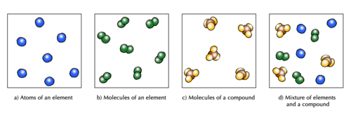
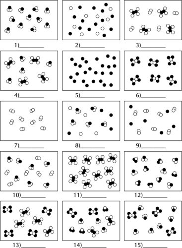
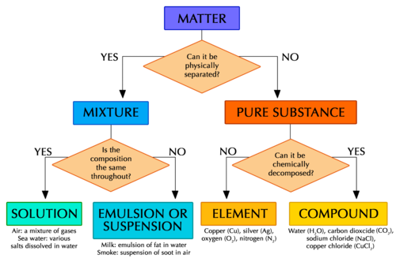

## Mixtures of elements and compounds

<Callout type="note" title="Note">
- mixture
- distinction
</Callout>

In Gr. 7 Matter and Materials we learnt that a mixture is a combination of two or more materials. In this chapter we learnt about pure substances. Pure substances always consist of one type of matter throughout. That matter can be an element or a compound and we have learnt how to distinguish between them by looking at the different kinds of atoms they are made up of:

- elements are made up of just one kind of atom, and
- compounds are made up of more than one kind of atom, but always combined in a fixed ratio.

All material can be classified as either a pure substance (in other words, just one substance throughout), or a mixture of substances. Let's look at some diagrams to help us understand this **distinction** a little better.

Diagrams to show the difference between elements, compounds and mixtures.

The two diagrams on the left (a and b) summarise what we know about the particles in elements, namely that an element can consist of atoms or molecules, but that the atoms in a certain element are always of only one kind.

What special name do we give to the molecules of elements which consist of two atoms bonded together?

Diatomic molecules.

Diagram (c) shows that the molecules of a compound consist of two or more different kinds of atoms, but in a given compound they will always be bonded in the same fixed ratio. Think of the example of water (H2O) and hydrogen peroxide (H2O2) that we saw earlier.

Diagram (d) shows how elements and compounds are different from mixtures. Elements and compounds are both pure substances (they have the same kinds of particles throughout) whilst mixtures always have more than one kind of particle.

We find mixtures of elements and compounds in many places in the natural world, such as in the air, sea water, in rocks, and in living organisms.

In the next activity, let's see if we can apply these principles to distinguish between different possibilities.

# Distinguishing between elements, compounds and mixtures

**INSTRUCTIONS:**

**Problem:**
Each of the 15 blocks contains a diagram representing atoms and molecules of matter.

**Solution:**

**Problem:**
You must classify the matter in each block using only the letters A to E to identify the categories:

- A = element
- B = compound
- C = mixture of elements
- D = mixture of compounds
- E = mixture of elements and compounds

**Solution:**
The classifications are as follows:

2. B
4. C
6. E
8. D
10. A
12. B
14. A
16. E
18. C
20. E
22. B
24. D
26. D
28. D
30. D

You may find the following chart useful to help you understand how all these concepts fit together.

This flow diagram brings together all the different classes of matter we learnt about in this chapter. It puts them all into a scheme that helps us see how the different classes are related to each other.
