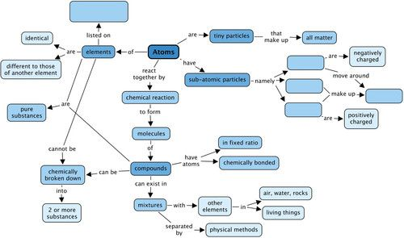
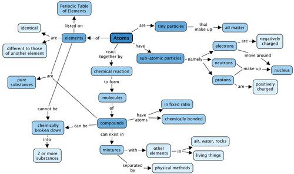

## Summary

<Callout type="note" title="Note">
**Atoms**

- All matter is made up of tiny particles called atoms.
- The atoms of each element are unique and essentially identical to each other.
- All the known elements are listed on the Periodic Table.

**Sub-atomic particles**

- The three main sub-atomic particles that determine the structure of the atom are protons, neutrons and electrons.
- Protons are positively charged and are found in the nucleus, deep in the centre of the atom.
- Neutrons are similar to protons in size and mass, but they do not carry any charge (they are neutral). They are also found in the atomic nucleus.
- Electrons are negatively charged particles, much smaller than protons and neutrons. A cloud of fast-moving electrons surrounds the atomic nucleus.
- In a neutral atom, the number of protons always equals the number of electrons; hence the atom is neutral.

**Pure substances**

- All matter can be classified as mixtures of substances or pure substances.
- Pure substances can be further classified as elements or compounds.

**Elements**

- All the atoms in an element are of the same kind. That means that an element cannot be changed into other elements by any physical or chemical process.
- Elements can be built up of individual atoms, or as bonded pairs of atoms called diatomic molecules.
- When elements combine, they form compounds.

**Compounds**

- In a compound, atoms of two or more different kinds are chemically bonded in some fixed ratio.
- The atoms that make up a molecule are held together by special attractions called chemical bonds.
- Compounds can be formed and broken down in chemical reactions.
- A chemical reaction in which a compound is broken down into simpler compounds and even elements, is called a decomposition reaction.
- Compounds cannot be separated by physical processes, but they can be separated into their elements (or simpler compounds) by chemical processes.

**Mixtures**

- Mixtures are combinations of two or more elements and/or compounds.
- The components in a mixture can be separated by physical separation methods, such as sieving, filtration, evaporation, distillation and chromatography.
</Callout>

**Concept map**

The concept map summarizes all that we have learnt in this chapter about atoms, elements, compounds and mixtures. You need to complete the concept map by filling in the name of the table that lists all the elements, and the names of the three sub-atomic particles. You need to look at the concepts which come afterwards to determine which sub-atomic particle must be placed in which space.

Teachers' version

