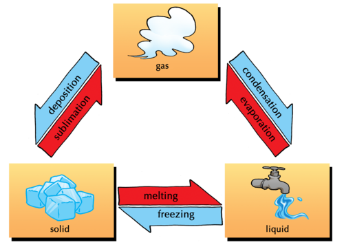

## What is the particle model of matter?

<Callout type="note" title="Note">
- scientific theory
- phenomenon
- disordered
- uniform
- random
- reverse
- controlled experiment
</Callout>

In the previous chapter we learnt that scientists use models when they want to describe things that are difficult to understand. We discussed a model of the atom that helped us to imagine what atoms look like.

This model of the atom shows us where the different sub-atomic particles can be found. The sub-atomic particles shown here are the proton, neutron and electron.

Theories are similar to models. They explain scientific **phenomena** (things and events that can be described and explained in scientific terms) using pictures and words.

### What does the particle model of matter teach us?

The particle model describes matter in a very specific way. It describes four important aspects of matter:

- All matter is made up of particles that are incredibly small - much too small to see with the naked eye. The particles can be atoms or combinations of atoms that are bonded.
- There are forces between the particles.
- The particles in matter are always moving. The more energy they have, the faster they move.

This links back to Gr. 6 Energy and Change where the topics of stored energy and movement energy were covered. In Term 3, Energy and Change, these concepts will be defined more formally as kinetic energy (movement energy) and potential energy (stored energy).

- The spaces between the particles in matter are empty. You might assume that the spaces between particles are filled with air, but this is not the case. They contain nothing at all.

It is very important to note the misconception here that there is 'air' in between the particles. This is NOT true. The spaces between the particles are empty - called a vacuum. Take note to make sure you do not introduce this misconception.

<Callout type="note" title="Note">
If you need to, turn back to chapter 1 to revise the terms atom, element, compound and molecule and how they relate.
</Callout>

### Why is the particle model of matter so useful?

The particle model of matter is one of the most useful scientific models because it describes matter in all three states. Understanding how the particles of matter behave is vital if we hope to understand science!

The model also helps us to understand what happens to the particles when matter changes from one state to another.

The following diagram shows different changes of state, as well as which processes are the **reverse** of each other. Melting and freezing are the reverse processes of each other and so are evaporation (boiling) and condensation.

<Callout type="note" title="Note">
Under special circumstances, a solid can change directly into a gas without melting first. This process is known as**sublimation** and its reverse (when a gas changes directly into a solid without condensing first) is called **deposition**.
</Callout>

The change of states

# Changes of state revision

**INSTRUCTIONS:**

2. Refer to the previous diagram.
4. Check that you remember some of the concepts you learnt about in previous grades by going through these quick questions.

**QUESTIONS:**

**Problem:**
What is the name of the process when a solid turns into a liquid?

**Solution:**
The process is called melting.

**Problem:**
What is the reverse process to melting?

**Solution:**
Freezing.

**Problem:**
What can we do to make ice melt quickly?

**Solution:**
We can put it in a warm spot, or heat it in some other way.

**Problem:**
Explain the steps that a solid must go through to become a gas.

**Solution:**
It must first melt to become a liquid and then evaporate to become a gas.

**Problem:**
What is the reverse process of evaporation?

**Solution:**
Condensation.

**Problem:**
When we heat something, are we adding energy to it, or taking energy away?

**Solution:**
Heating is adding energy.

**Problem:**
How do you think the particles in a substance behave when we give them more energy?

**Solution:**
They vibrate or move faster.

This is because they now have more kinetic energy. This introduces the next topic and how we explain the changes of state using the particle model of matter.

We will use the model to look at each of these changes more closely. But first, we will look at how the model describes each state of matter.
