## Solids, liquids and gases

<Callout type="note" title="Note">
- compress
- collide
- diffuse
- rate
- constant motion
- observation
- forces of attraction
- regular arrangement
- vibrate
</Callout>

We can use the particle model to help us understand the behaviour of each of the states of matter. We are going to look at each state in turn.

There is one very important thing to remember when we consider the different states of matter. For any matter, the individual particles of that matter are exactly the same in all three states, solid, liquid and gas. It is the *behaviour* of the particles that changes in each state.

<Callout type="note" title="Note">
This video shows us the different ways that particles behave in the solid, liquid and gaseous states.
</Callout>

### The solid state

Solids keep their shape and cannot be **compressed**. Let us see if the particle model can help us understand why solids behave in this way.

In a solid, the particles are packed close to each other in fixed positions. They are locked into place, and this explains why solids have a fixed shape. Look at the following images of sodium chloride (table salt). Do you remember the formula for sodium chloride?

Sodium chloride is NaCl. Ask learners why they think the chloride atoms are the bigger purple atoms and the sodium atoms are the smaller yellow ones in the submicroscopic view in the table. The colour does not make a difference, as long as all the same atoms are the same colour. However, the sizes show that chloride atoms are bigger than sodium atoms as can be seen from their arrangement on the Periodic Table. Point this out to learners if you have a Periodic Table stuck up in the class or they can turn to the front of their books to look at the table there.

| Macroscopic view of sodium chloride | Submicroscopic view of sodium chloride |
| --- | --- |
| Table salt crystals are hard and have a fixed shape. | Can you see how the chloride atoms (purple) alternate with the sodium atoms (yellow) in a fixed arrangement? |

Take a good look at the picture of the particles in a solid (table salt) above. You will see that they are packed in a ***regular* arrangement**. There are very small spaces between the particles in a solid.

Particles are held together by **forces of attraction**. In solids, these forces are strong enough to hold the particles firmly in position.

Does that mean the particles in a solid do not move at all? No. The particles in a solid move a little bit. They **vibrate** in their fixed positions. The more energy the particles have, the faster and more strongly they vibrate.

Do you see how we have used the particle model of matter to explain the properties of solids that we can **observe**? For example, the particles in solids are closely packed and have strong forces between them explains why solids have a fixed shape and you cannot compress them.

### The liquid state

An important characteristic of liquids is that they flow. They fill containers they are poured into. Liquids are also not very compressible. How can these properties be explained?

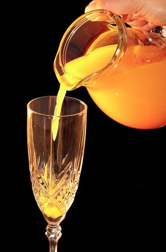

Orange juice is a liquid, which can be poured.

In the liquid state, particles do not have fixed positions. They move about freely, but they stay close together because the forces of attraction between them are quite strong, but not as strong as in solids.

Have you noticed how a liquid always takes the shape of the container it is in? Within the liquid, the particles slip and slide past each other. This is why liquid flows. Their particles are free to move around, filling the spaces left by other particles. Look at the image of the juice being poured. Let's zoom in and have a look at what the particles are doing as the juice is poured.

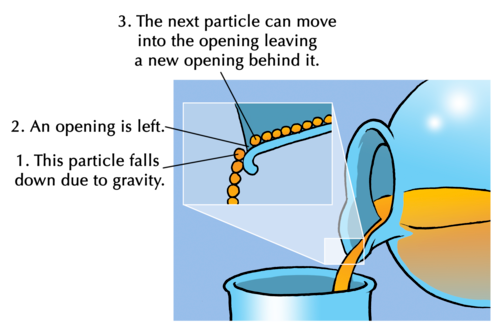

The particles in a liquid have small spaces between them, but not as small as in solids. The particles in a liquid are loosely arranged which means they do not have a fixed shape like solids, but they rather take the shape of the container they are in.

The speed at which the particles move around inside the liquid depends on the energy of the particles. When we heat a liquid, we are giving the particles more energy and speeding them up.

In gases, the particles move at even greater speeds.

### The gaseous state

Gases spread out quickly to fill all the space available to them. Think of when you blow up a balloon. The air that you blow into the balloon fills up the whole balloon. A gas will fill the entire space that is available to it. This is because the particles in a gas have no particular arrangement.

Gases do not have a fixed shape. Think about the balloon again: the gas fills the entire space inside the balloon. You can squeeze the balloon, changing the shape.

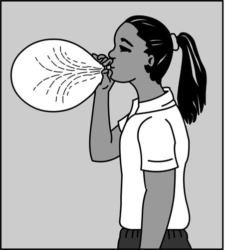

Gases fill the space available to them.

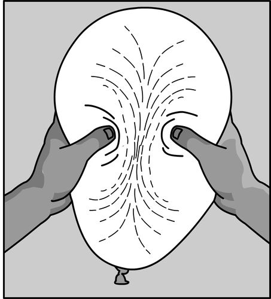

Gases do not have a fixed shape.

Gas particles move very fast, much faster than in solids and liquids. The particles in a gas possess a lot of energy.

Have you ever tried to compress the gas in a syringe or in a bicycle pump? Why do you think you can compress the gas?

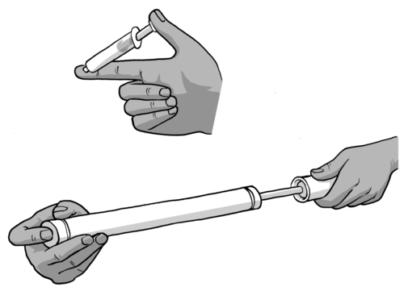

This is a good demonstration for learners to try. Syringes are cheap and available at most pharmacies. Give each learner three syringes. Let them fill on with sand, one with water and one with air. They then close the nozzle of each syringe tightly with rubber or their finger and squeeze the plunger. Let them observe and try to explain their observations.

In gases, the forces between particles are very weak. This explains why the particles in gases are not neatly arranged. They are not held together tightly and there are large spaces between them. These spaces are much larger than in the solid and liquid state.

Gases can be compressed, because their particles can be forced closer together. Look at the photo of a scuba diver underwater. Do you see the tank on his back? He uses this tank to breathe underwater. A scuba diver can stay underwater for almost an hour. How do you think he can get enough air to breathe for a whole hour from a small tank like that? Discuss this with your class.

The answer is that the air is compressed so that a lot more air fits into the tank than if the air were not compressed. The scuba diver therefore has enough air to last up to an hour.

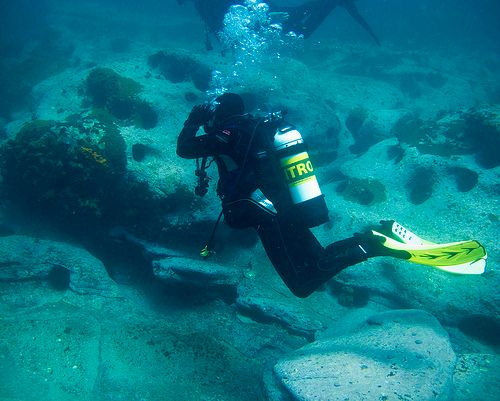

A scuba diver underwater with a tank of air. [http://www.flickr.com/photos/57527070@N06/5337280707/](http://www.flickr.com/photos/57527070@N06/5337280707/)

Let's summarize what we have learned about what the particle model of matter tells us about solids, liquids and gases.

# Comparing solids, liquids and gases

**INSTRUCTIONS:**

**Problem:**
Use the images of the different states to help you, and go back over the text in your workbook.

|  | Solid | Liquid | Gas |
| --- | --- | --- | --- |
| Arrangement of particles |  |  |  |
| Movement of particles |  |  |  |
| Forces between particles |  |  |  |
| Spaces between particles |  |  |  |

**Solution:**
|  | Solid | Liquid | Gas |
| --- | --- | --- | --- |
| Arrangement of particles | Closely packed in a regular arrangement | Loosely arranged, but still close together | No particular arrangement |
| Movement of particles | Do not move; only vibrate | Can move quite fast and slide past each other | Move very fast |
| Forces between particles | Very strong forces between them | Strong forces, but weaker than in the solid state | Very, very weak forces between the particles |
| Spaces between particles | Very small spaces | Small spaces | Very big spaces |

**QUESTIONS:**

These are extension questions to make sure learners can use what they have learned about the particle model of matter to explain the observable properties of solids, liquids and gases.

**Problem:**
Use the particle model of matter to explain why solids have a fixed shape, but gases fill the shape of the container they are in.

**Solution:**
Solids have a fixed shape as their particles are arranged in a regular, fixed arrangement and they have strong forces holding them together, so the shape of the solid remains fixed. The particles in a gas do not have any particular arrangement and there are very, very weak forces between them. So, the particles in a gas can easily move around and fill the shape of the container they are in, meaning they have no fixed shape.

**Problem:**
Use the particle model of matter to explain why you can compress a gas easily, but you cannot compress a liquid very easily.

**Solution:**
The particles in a gas have very large spaces between them, so the particles can be 'squashed' closer together, meaning the gas can easily be compressed to take up a smaller volume. Liquids have very small spaces between the particles and so it is much harder to 'squash' them together, so they are not easily compressed.

**Problem:**
Think of a bag of cake flour. You can pour the cake flour out of the bag and into a mixing bowl. Does this mean the flour is a liquid? Explain whether you think the cake flour (and all powders) are solids or liquids.

**Solution:**
The cake flour is not a liquid, but a solid. Flour, and all powders, are solids made of very fine grains which are able to flow freely when they container is tilted or shaken. But these grains are solid.

This is a tricky question and you should discuss it in class. A common misconception among learners is that powders are liquids as you can 'pour' them and they take the shape of the container they are in. They are NOT liquids. Point out to learners that you cannot evaporate a powder, as you can with a liquid, the powder does not make your fingers wet when you touch it.

<Callout type="note" title="Note">
A video explaining the difference between the solid, liquid and gaseous states of matter.
</Callout>

### Diffusion

Have you ever noticed how quickly smells travel? Perhaps you have walked past a rubbish bin, and smelled the garbage.

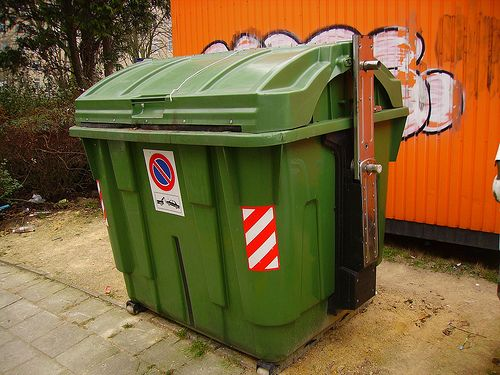

You can often smell garbage bins when you walk past them. [http://www.flickr.com/photos/bermarte/3290093273/](http://www.flickr.com/photos/bermarte/3290093273/)

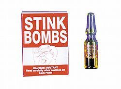

Has anyone ever set off a stink bomb near you?!

Have you ever smelled a stink bomb? When you smell these things, how do the 'stink bomb' or 'garbage' particles reach your nose?

Get learners to briefly discuss what stink bombs are for. They may say a stink bomb can be used to play a prank on someone. The smelly particles mix with the air and when we breathe the air, we smell them.

Most smells travel fast, because their particles mix with air and get into our noses when we breathe. We say that the particles **diffuse** through the air.

In Gr. 7 we learnt about different kinds of mixtures. In the next investigation we are going to explore whether particles mix faster when they are in the liquid state or in the gas state. This is called the **rate of diffusion**. What would your prediction be?

<Callout type="note" title="Note">
When we talk about a **rate**, we are measuring how something changes in relation to another factor, such as time. Another example is speed measured in km/h - this is a rate of how distance in kilometres changes over a period of time (hours).
</Callout>

# Comparing the diffusion of particles in a gas and in a liquid

**INVESTIGATIVE QUESTIONS:**

2. Do particles diffuse (mix) faster when they are in the liquid state or in the gaseous state? Which particles will mix more quickly: gases or liquids?
4. Do particles diffuse faster with or without mixing?

At this level, it is sufficient to compare the diffusion rates of liquids and gases qualitatively. We will not perform a controlled quantitative comparison of the diffusion rates. It would be possible to turn the investigation into a controlled experiment, if one used identical containers for comparing the rates of diffusion, and compared gases and liquids that have particles of similar size. It would also be necessary then to choose a gas that is coloured (e.g. bromine gas) so that learners can see the diffusion process inside the container as it progresses. It is important to note that bromine is a hazardous gas and is not freely available. It would only be advisable to use this example if you have the facilities and training to work safely with bromine. An alternative substance which will effectively demonstrate the diffusion of gases is hydrogen sulfide (H2S). A few drops of hydrochloric acid on iron sulfide or sodium sulfide in a conical flask will produce H2S. This
                    can be used instead of the vanilla essence. It is important to note that H2S has a very strong, pungent odour (characteristic rotten egg smell). It is not toxic at low concentrations, but it is important to make sure the room is well ventilated and that the windows are open. It may not be ideal to use H2S as an example if the classroom is very small or crowded. You could also light a 'smoke bomb' (available from toy shops) outside the classroom if this is permitted at your school. The smoke mixing with air is an effective analogy of gases mixing, even though the smoke actually contains fine solid soot particles and is not strictly a gas.

If there is time it is recommended that you repeat the experiment in which gases are mixed (using vanilla essence in a saucer), but on a different day. During the repeat experiments, learners should be allowed to wave the odour particles towards the back of the classroom with their arms. Do this on a different day, to allow the vanilla smell to escape from the classroom, and from learners sensory receptors, between experiments.

**HYPOTHESIS:**

What are your predictions? Do you expect liquids to mix more quickly than gases, or the other way around? Will stirring influence the speed at which gases mix? Write down your hypothesis below.

**IDENTIFY VARIABLES:**

This is not a **controlled experiment** as we are not measuring the rates of mixing of the liquids and gases under exactly the same conditions. We will make a simple comparison of the mixing rates, by seeing how long it takes each to mix under two different sets of conditions.

**MATERIALS AND APPARATUS:**

- large glass beaker or other large clear glass container
- dropper
- food colouring or ink
- tap water
- vanilla essence
- shallow dish or saucer

**METHOD:**

**Part 1: How fast do liquids mix?**

2. Fill a large, clear container with tap water and place it where everyone can see it.
4. Use a dropper to place one or two drops of the food colouring in the water.
6. Record the time at which the colouring is added to the water.
8. Look carefully at the two liquids mixing, and write your observations below. Allow the liquids to mix without any stirring.
10. Record the time when the liquids are fully mixed, in other words, when the colour is uniformly spread throughout the water.

Liquids mix relatively slowly when they are not stirred. It is quite possible that the liquids will not be fully mixed by the end of the lesson, and then learners should note this as an observation. Remind them to check again the following day to see if the colour has spread uniformly through the water.

**Part 2: How fast do gases mix?**

This experiment should be performed with the windows closed.

Instruct the learners to smell the air and as soon as they can smell the vanilla essence they should quietly put up their hand (without waving it about). Ask the learners beforehand why they should not move while the vanilla essence particles are moving around the classroom. Answer: that would be the same as stirring the mixture, which would make it mix more quickly. It would therefore not be a fair test.

One learner could be tasked with writing the times on the board.

2. Pour some vanilla essence into the saucer.
4. Record the time when the vanilla essence is poured out.
6. Record the time when the first learner puts up his/her hand to indicate that they can smell the vanilla essence.
8. Record the time when roughly half of the learners in the class have their hands up, indicating that they can smell the vanilla essence.
10. Record the time when the learners at the back of the class first smell the vanilla essence.
12. If there is enough time during your next Natural Sciences lesson, repeat steps 1-5. You should do everything exactly the same, but this time, you should move your arms and try to 'wave' the air towards the back of the class.

This is an opportunity for learners to see how the mixing time is influenced when they actively mix the air and vanilla essence particles. Get them to predict whether or not the smell will travel faster or more slowly and to discuss possible reasons for this.

**RESULTS AND OBSERVATIONS:**

**Problem:**
What did you observe in the container immediately after the liquids were mixed?

**Solution:**
Learners should write down what they see. These are possible observations:

- It takes a long time for the two liquids to mix;
- It looks as if the food colouring swirls around in the water.
- At first, some parts of the water are more intensely coloured than others.

**Problem:**
How long did it take for the liquids to be fully mixed, until the colour was uniformly spread throughout the water?

**Solution:**
If the liquids are not fully mixed by the end of the lesson learners should note this as an observation.

**Problem:**
When the air was NOT mixed during the experiment:

2. How long did it take until the first learners smelled the vanilla essence molecules?
4. How long did it take until the last learners smelled the vanilla essence?

**Solution:**
Learner/class dependent answers.

**Problem:**
When the air WAS mixed during the experiment:

2. How long did it take until the first learners smelled the vanilla essence molecules?
4. How long did it take until the last learners smelled the vanilla essence?

**Solution:**
Learner/class dependent answers.

**Problem:**
Draw a table with your results for the vanilla essence experiment. You can choose your own column and row headings. Remember to give your table a heading.

**Solution:**
An example of the type of table that learners could draw is given below.

Table to show the observations to smell vanilla essence with and without mixing the air.

| Event | Time measured without mixing (minutes) | Time measured with mixing (minutes) |
| --- | --- | --- |
| The first learner smelled the vanilla |  |  |
| Approximately half the class smelled the vanilla |  |  |
| Learners at the back of the class smelled the vanilla. |  |  |

**ANALYSIS AND EVALUATION:**

**Problem:**
Did anything go wrong during the experiment?

**Solution:**
Learner-dependent answer.

**Problem:**
Can you think of anything that could have improved this experiment?

**Solution:**
Learner-dependent answer.

**CONCLUSIONS:**

What are your conclusions? (What are your answers to the investigative questions?)

Learners should be able to conclude that gases diffuse more quickly than liquids, and that if you mix or stir the air or liquid, then you speed up the rate of diffusion.

In this investigation we explored the rates at which particles diffuse. What do you think happens at the particle level when two substances mix?

Get learners to discuss this briefly in small groups. Remind them of their observations when the food colouring was mixed with the water. Some ideas to mention are:

- When substances mix their particles intermingle.
- The process is not immediate but it takes time, because it means the particles have to travel from one point to another. (Ask learners if they think particles will travel in a straight line. What will happen if a gas particle collides with an air 'particle'?)

<Callout type="note" title="Note">
An interesting video that explains what diffusion is and how it occurs.
</Callout>

In the photos, we see a yellow liquid being added to a colourless one. Notice how the yellow liquid swirls and spreads out as the yellow particles mix with the colourless particles. Of course we cannot see the particles, but we can make a macroscopic observation (something we can see with the naked eye) of the process.

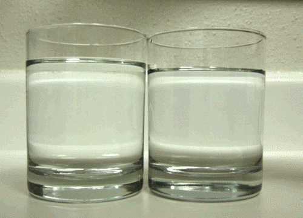

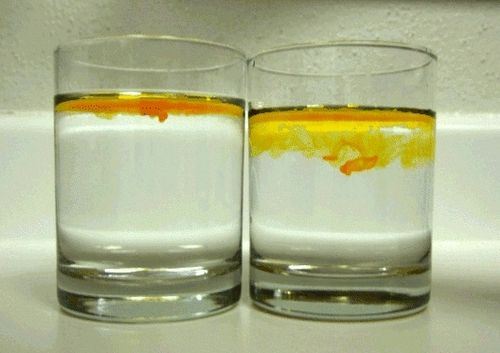

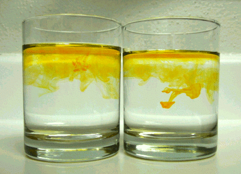

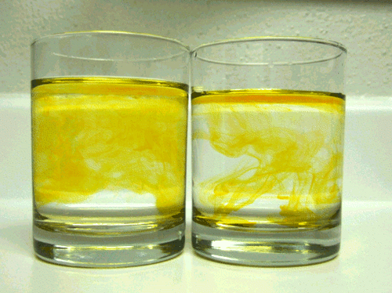

What will the mixture look like when the coloured particles are uniformly spread out amongst the water molecules?

The mixture will have the same colour throughout. The last photo is almost like this, but not quite.

What will the mixing process look like on particle level? The following diagram represents one of the glasses pictured above, containing a colourless liquid (represented by the blue circles) to which a yellow liquid (represented by the yellow circles) is added. The glass on the left shows the particles in the mixture directly after the yellow liquid was added to the colourless liquid. The glass on the right is empty. You must draw the particles in the mixture after the yellow liquid has spread **uniformly** throughout the colourless liquid.

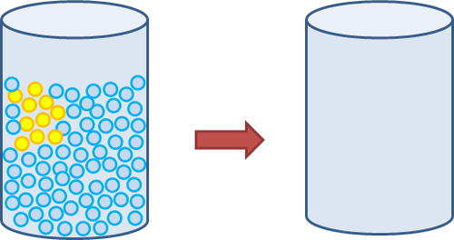

Here is what the final drawing should look like. Note that there should be 10 yellow particles in the final container. They should be spread more or less evenly amongst the colourless particles.

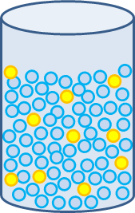

When you were watching the coloured liquid mix with the water in the last investigation, was it possible to predict the direction in which the colour would swirl? What made the two liquids mix?

No, it is not possible to predict how the food colouring/coloured liquid will swirl.

#### Random movement of particles

The particles in liquids and gases are constantly moving. Their movements are unpredictable: we say the particles move **randomly**. It is the random movement of the particles that allow liquid and gaseous substances to diffuse.

The following zigzag diagram explains what is meant by 'random' movement. When a gas particle travels from point A to point B, it will collide with many other gas particles along the way - up to eight billion collisions every second! Only a few of those collisions are shown in the diagram. Each time the particle collides, it will change direction. This means the actual distance travelled by the particle is much further than the direct distance between points A and B.

Here we have to be careful not to use words that will leave learners with the impression that the particle has 'will' or moves 'with purpose'. Particles move randomly. If there was just one particle, it might actually follow a random path right out the window! It is because there are so many particles, moving in all directions, that some of them will reach our nose, or the other end of the classroom, over time.

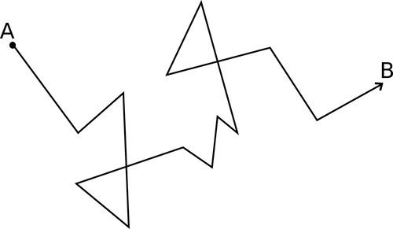

The process responsible for the mixing and spread of particles in a gas and liquid is called diffusion. We can define diffusion as the random movement of liquid or gas particles from a high concentration to a low concentration to spread evenly. The following diagram illustrates the idea in a very simple way: it shows the particles in a gas spreading out over time to fill all the space that is available to it.

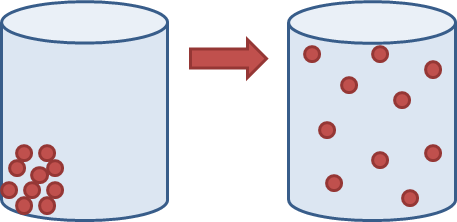

In the diagram on the left some particles were placed into an empty container. At first they were close together (at high concentration), but over time they spread out to fill the entire container.

#### Factors that affect the rate at which particles diffuse

The speed at which particles diffuse depends on several factors, namely:

- The mass of the particles: lighter particles will diffuse faster, because on average they move faster.
- The state of the particles: the particles in a gas are always moving fast; we say their average speed is high. The particles in a liquid travel more slowly.
- The temperature of the particles: temperature is a measure of the kinetic energy of the particles. The higher the temperature, the more energy the particles have and the faster they will move and diffuse.
- The size of the spaces between particles: If there are large spaces between the particles of one substance, the particles of another substance can move into those spaces easily.

Particles diffuse because they are in **constant motion**. We found that gas particles diffused much more quickly than the liquid particles in the last investigation. Can we explain that result using the factors listed above?

You can do a practical demonstration of this in class with your learners. Get a group of learners to stand in the middle of an open space. First let them simulate the particles in a liquid, so they should be fairly close together, but still moving around. Then get other learners to move through the crowd of learners in the middle. Get a couple of learners to do this so everyone has a chance. Then get the learners in the middle to simulate the particles in a gas by spreading much further apart and moving around a lot more. They can also bump into each other. The other learners must now also move through the crowd, which should now be much easier and quicker for them to do.

Think of it in this way: imagine you are trying to move through a crowd of people. The closer they are together, the more often you are going to have to change direction to make it through the crowd and the longer it will take to get to your destination.

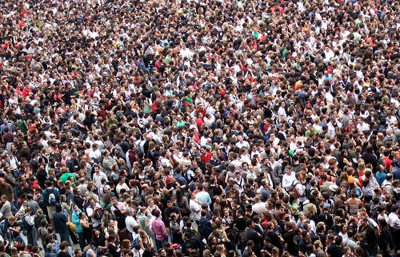

Imagine walking through this crowd of people. This is similar to diffusion through a liquid. [http://www.flickr.com/photos/jamescridland/613445810/](http://www.flickr.com/photos/jamescridland/613445810/)

A particle in a liquid cannot travel very far before colliding with another particle, because the particles are so close together. That means the liquid particles are constantly colliding and are sent into a new direction with each collision. This means the rate of diffusion is much slower in liquids than in gases, because the particles of a gas are further apart and collide much less. Gas particles can travel further without being sent in a different direction by a collision. This is why gases diffuse more quickly.

The following table shows similar zigzag drawings as you saw before, but now you can see the difference between the random movement of a particle through a liquid and through a gas. It will take the particle much longer to travel from A to B in the liquid than in the gas.

| Liquid | Gas |
| --- | --- |

Now that we have a better idea of the behaviour of particles in the different states of matter, we are ready to look at how particles behave when matter changes its state.
