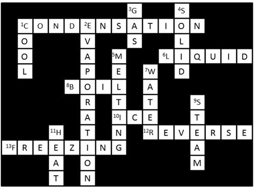
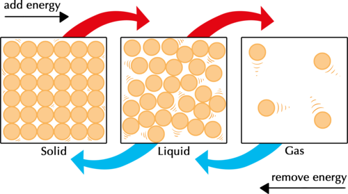
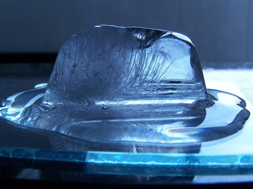
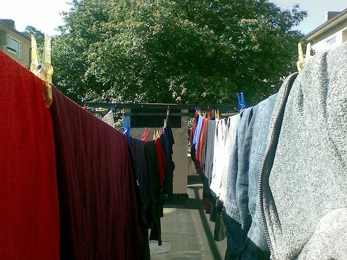
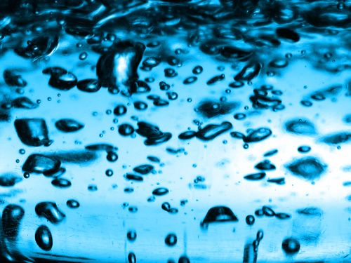
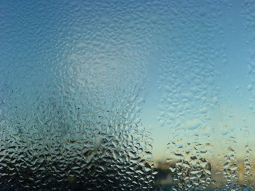
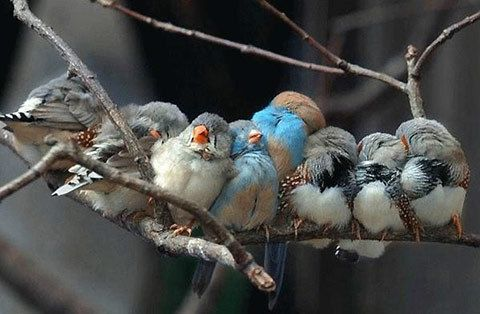
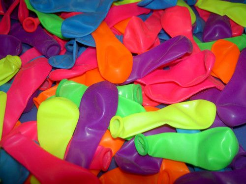

## Changes of state

<Callout type="note" title="Note">
- vapour
- vigorous
- energetic
- transformation
- condensation
- evaporation
</Callout>

In science, a change of state refers to a change in physical state (e.g. when a liquid changes to a solid). What is this process is called?

Freezing

It is always a good idea to learn new things in terms of what we already know. We are going to start this section with a crossword puzzle to revise what we already know about changes of state.

# Changes of state

This is an optional revision activity of what learners should have covered in previous grades.

**INSTRUCTIONS:**

2. The crossword puzzle below can be completed by following the clues given below.
4. The 'Down' clues are for the vertical words in the puzzle and the 'Across' clues are for the horizontal words in the puzzle.
6. All the clues have to do with changes of state of materials, and the first letter of every word has been filled in to help you.

**Here are the clues:**

Down:

1. If we want to turn steam into water we have to _____ it. (4 letters)

2. The process of turning a liquid into a gas is called _____. (11 letters)

3. The particles of a _____ have large spaces between them. (3 letters)

4. The particles of a _____ are locked in position by strong forces. (5 letters)

5. A solid will change into the liquid state at its _____ point. (7 letters)

7. The liquid state of ice is called _____. (5 letters)

9. The gaseous state of ice is called _____. (5 letters)

11. If we want to turn water into steam we have to _____ it. (4 letters)

Across:

1. The process of turning a gas into a liquid is called _____. (12 letters)

6. The particles of a _____ are close together but they can flow and slide over each other. (6 letters)

8. The boiling point of a liquid is the temperature at which that liquid will start to _____. (4 letters)

10. The solid state of water is called _____. (3 letters)

12. Freezing and melting are the _____ of each other. (7 letters)

13. _____ water turns it into ice. (8 letters)

Here is the completed crossword puzzle.

How can we change matter from one state to another?

Get the learners to come up with some ideas in class. You should eventually guide them to realise that all changes of state involve changes in energy.

<Callout type="note" title="Note">
Misconceptions about temperature (video).
</Callout>

### Changes of state involve energy

For matter to change from one state to another, its particles must gain or lose energy. The following diagram shows us that to change the state of a substance, it must either be heated or cooled.

Melting and evaporation are processes that require heating; condensation and freezing are processes that require cooling.

In the figure above, ask learners what they think the little lines around the particles represent. The lines get bigger and further apart as the particles go from solid to liquid to gas. This represent the amount of movement in the particles, as we will discuss in the following content. The kinetic energy of the particles increases as you add energy, and decreases as you remove energy.

First, let us look at what happens to particles when they are heated.

### Melting and evaporation

<Callout type="note" title="Note">
- boiling
- melting
- evaporation
- melting point
- boiling point
</Callout>

A suggestion is to bring some ice to class and let it melt in a dish for learners to observe. Once the ice has melted, you can then leave the dish out in a hot place so that the next state change can take place and the water evaporates.

When a solid is heated to reach its melting point, it will change into a liquid. This is a process that we are all familiar with, because we have seen how ice melts.

A melting ice cube.

For a solid to change into a liquid state, the particles in the solid need to be freed from their fixed positions in the solid state. How could that occur?

Imagine you are holding hands with a group of other learners. Everyone is jumping in place, much like a solid particle vibrating in a fixed position. The more **energetically** and randomly everyone jumps, the more difficult it will be for everyone to keep holding hands.

A suggestion is to do this quick and simple demonstration with your learners. Get groups to stand and hold hands. They can start off by swaying and moving their feet. Then they can start jumping. Then they can start jumping higher and swinging and twisting their bodies until they cannot hold each other's hands anymore. These kinds of fun, interactive learning activities make class more engaging and help concepts to stick in learners' minds. When they are standing in one spot but swaying and slightly moving their bodies while holding hands, this represents the solid state. When they are no longer holding hands and are able to move around, this represents the liquid state. Finally, to show evaporation: learners start running/moving around, one at a time. Let them run faster and faster, then break off from the swaying/jumping/moving learners in the central group - this represents a particle that has evaporated and is now in the gaseous state.

When a substance is heated, the particles are given more energy. By giving the vibrating particles in a solid more energy, their vibrations will become more and more **vigorous**, until the solid particles are able to shake themselves loose from their fixed positions. The forces between the particles are no longer able to hold them together tightly, and the solid **melts**.

What will happen if we add even more energy to the particles? The particles (which are now in the liquid state) will whizz around faster and faster as they heat up. Soon some of the particles near the surface will have enough energy to escape out of the liquid. Once they are free from the forces that hold them together in the liquid state, they enter the gas (or gaseous) state. The gaseous state is sometimes called the **vapour** phase, which forms when a liquid **evaporates**. This is why the gaseous state of water is sometimes called water vapour.

The higher the temperature of the liquid, the faster it will evaporate. A puddle of water will evaporate much faster from the hot pavement than it would from a cool kitchen floor! Why do you think we hang washing outside in the sunshine to dry?

Discuss this with your class. They may simply answer that the sunshine dries the laundry faster, but ask them why they think this happens. It is because the heat from the Sun warms the molecules of the water that is in the wet clothing. When the water molecules are heated, the molecules gain enough energy to escape from their liquid state and the water evaporates. This evaporation will happen much faster outside, in the sunshine, than inside. Encourage them to take down notes as you discuss things in class.

Clothes hanging outside. [http://www.flickr.com/photos/eiriknewth/529362962/](http://www.flickr.com/photos/eiriknewth/529362962/)

Is there a difference between evaporation and boiling?

Evaporation takes place at all temperatures, while boiling occurs at a specific temperature, called the **boiling point**. When a liquid is heated to its boiling point, bubbles form in the liquid and rise up to the surface. When this happens, we say the liquid is boiling. Evaporation occurs only on the surface of the liquid, while boiling occurs throughout the entire liquid. Can you remember learning about boiling points in Gr. 7? What is the boiling point of water at sea level?

100°C

Boiling water.

Look carefully at the picture of the boiling water above. What do you think is inside the bubbles?

Learners may say that the bubbles are full of gas. Ask them to say which gas. The bubbles are filled with water molecules in the vapour (or gaseous) state. Learners often believe that the water molecules break up into hydrogen gas and oxygen gas when water boils. This is a very common misconception. This section presents an opportunity for learners to recognise that changes of state are *physical* changes. The molecules (particles) of a substance do not change their composition (that would represent a chemical change) during changes of state. The particles before and after the change of state are exactly the same, they are just in a different state.

Next, we will look at the changes of state that can happen when we cool a substance.

### Condensation and solidifying

<Callout type="note" title="Note">
- condensation
- solidifying
</Callout>

When a gas changes to a liquid, the state change is called **condensation.** Condensation is the opposite of evaporation. Have you noticed the little droplets of water that form on the outside of a cold glass of water? They are formed by condensation.

Water vapour in the air has condensed on the cold surface of this glass window. [http://www.flickr.com/photos/mary_hutchison/5234833498/](http://www.flickr.com/photos/mary_hutchison/5234833498/)

When the temperature of a gas is lowered, it takes energy away from the gas particles. The movement of gas particles slows down as their energy decreases and they will start to experience attractive forces. These forces cause them to move closer to each other and they eventually return to the liquid state.

What do groups of people, animals, or birds do when they get cold? They huddle together! In the same way gas particles that are cooled down condense and come together to form water droplets.

Birds and animals in groups tend to huddle together when they get cold.

What would happen if we cooled the liquid even more? By cooling the liquid, we would be removing energy from it. As the liquid particles lose energy, their movement slows down even more. As their movements become slower and slower, the attractive forces between become stronger. The particles eventually 'lock' into position in the solid state. They can no longer move freely and are only able to vibrate in their fixed positions. We say the liquid has **solidified**.

<Callout type="note" title="Note">
The volume of water expands about 9% when it freezes into ice.
</Callout>

# What happens when we heat and then cool candle wax?

This is a relatively short investigation to do in class. Learners should be able to predict what will happen. The skills to focus on here are writing a method for an investigation and recording observations.

This can also be done as a demonstration in front of the class and they must observe the changes of state and record their observations. Learners must write the method themselves. They can either do this in groups and plan how they are going to do the investigation, or if you perform it as a demonstration in front of the class, then they can write the method for themselves afterwards.

You can also use ice in this investigation.

**AIM:** What is your aim for this investigation?

To observe and record the changes of state when candle wax is heated and when it is cooled.

**HYPOTHESIS:** What do you propose will happen in this investigation? This is your hypothesis.

A possible hypothesis is: The candle wax will melt when it is heated, and solidify when it is cooled again.

**MATERIALS AND APPARATUS:**

- empty tin can or foil pie dish
- bunsen burner or spirit lamp
- tripod stand
- wire gauze
- candle wax
- matches

**METHOD:**

**Problem:**
You need to write the method for this investigation. you will either plan this in a group, or your teacher might do the investigation as a demonstration. You must write down the steps for the investigation. They must be clear and allow someone else to repeat your investigation.

**Solution:**
A possible method which learners might come up with, and which you can follow in class, is as follows: (The steps in a method must be numbered)

- Place a piece of candle wax in the tin/foil dish
- Place the wire gauze on the tripod stand with the tin/foil dish in top of the gauze.
- Place the bunsen burner/spirit lamp underneath the tripod stand.
- Light the bunsen burner and allow the tin to heat up.
- Observe the change in state at the candle wax heats up.
- Turn of the bunsen burner and allow the wax to cool down again.
- Record the change of state.

2. Draw a diagram of your setup for the investigation in the following space. Remember to give your diagram a heading and to provide labels.

Learners must draw neat diagrams and label all the equipment used. The label lines must be parallel and drawn with a ruler.

**RESULTS AND OBSERVATIONS:**

**Problem:**
What state of matter is the candle wax in at room temperature (at the start of the investigation)?

**Solution:**
It is a solid at room temperature.

**Problem:**
What happened when you heated the candle wax?

**Solution:**
It melted.

**Problem:**
What happened when you cooled the candle wax?

**Solution:**
It solidified.

**Problem:**
Would you say the melting point of candle wax is higher or lower than room temperature?

**Solution:**
The melting point of wax is higher than room temperature as it is a solid at room temperature and needs to be heated in order to melt.

**CONCLUSION:**

Write a conclusion for this investigation. You must make reference to the particle model of matter in explaining the changes of state that occurred.

A possible conclusion is: When candle wax is heated, energy is added and the particles start to vibrate faster and faster until they break free of their fixed positions in the solid state and enter the liquid state, resulting in the wax melting. When the wax is cooled again, energy is removed and the particles slow down and move slower and slower until the forces between them are strong enough to fix the particles into fixed positions in the solid state and the wax solidifies.

In the next activity we are going to have some fun with water balloons, but not in the usual way. We are going to blow up a balloon without blowing into it and we will make it rain inside the balloon! Sounds like magic? No, just science!

# Hot water balloon

This is an optional activity. You need to be aware of the safety precautions and the fact that learners are working with hot, boiling materials.

For this activity you would need access to a microwave oven. If you do not have one at school or at home, learners could do this activity as a homework assignment if they have microwave ovens at home. An alternative would be to place the balloon in a pot with boiling water for a few minutes.

Let's have some fun with balloons!

**MATERIALS:**

- large party balloon (plus spares)
- 2 teaspoons of tap water
- microwave oven
- oven gloves
- safety goggles
- large bowl of ice cold water

**INSTRUCTIONS:**

**Problem:**
Before you begin, put on your safety goggles.

**Solution:**

**Problem:**
Pour water into the balloon and squeeze out all the air before tying a knot in the neck of the balloon.

**Solution:**

**Problem:**
Place the balloon in the microwave oven and heat on full power until you see the balloon starting to expand. Only a few seconds of heating should be enough for the balloon to reach its full size (if you heat it for too long it might pop). What do you observe?

**Solution:**
The balloon expands.

**Problem:**
Remove the heated balloon with the oven glove. Shake it gently. If you are very quiet you will hear something happening inside the balloon. What does it sound like?

**Solution:**
It sounds as if it is raining inside the balloon.

**Problem:**
Place the balloon in the bowl of cold water. What do you observe?

**Solution:**
The balloon shrinks.

**QUESTIONS:**

**Problem:**
Did the balloon have any air inside it at the start of the experiment?

**Solution:**
No, the balloon did not have any air inside it because all the air was squeezed out before we started to heat it.

**Problem:**
What made the balloon expand?

**Solution:**
The balloon expanded because the water inside evaporated, filling it with vapour (gas).

**Problem:**
What is the name of the gas that made the balloon expand?

**Solution:**
Water vapour or steam.

**Note:** Here is another opportunity to address the misconception that water decomposes into hydrogen and oxygen gas when it boils.

**Problem:**
What did you hear inside the balloon when it started to cool down?

**Solution:**
It sounded as if it was raining inside the balloon.

**Problem:**
What caused the sound?

**Solution:**
Water droplets falling inside the balloon.

**Problem:**
Where did the water droplets inside the balloon come from?

**Solution:**
The water vapour condensed inside the balloon to form droplets of liquid water.

**Problem:**
What happened to the balloon when it was cooled down in the cold water?

**Solution:**
It shrank back to its original size.

**Problem:**
Which changes of state did the water undergo in this experiment?

**Solution:**
Evaporation and condensation.

Next, we are going to look at three important properties of matter that are useful to scientists, namely density, mass and volume. These three properties are all related to each other.
