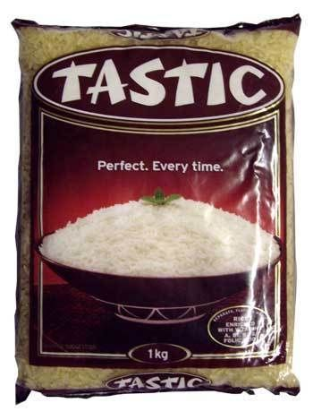
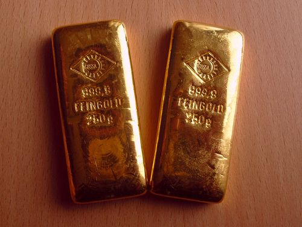
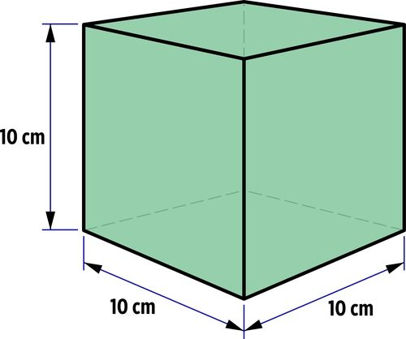
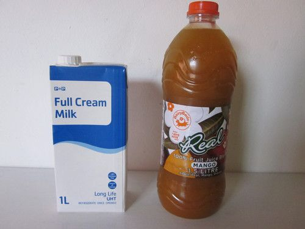
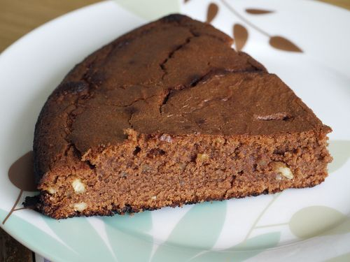
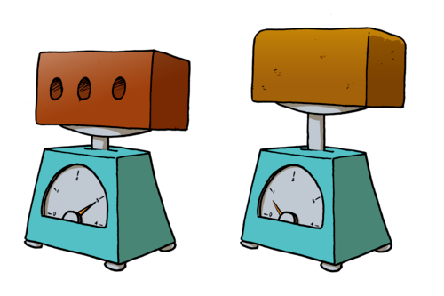

## Density, mass and volume

<Callout type="note" title="Note">
- mass
- volume
- density
- physical quantity
</Callout>

You have probably heard the terms **mass** and **volume** before in Natural Sciences and Mathematics. But what about **density?** Have you ever used this word before? Perhaps you have heard someone describe a cake as very dense? What does this mean?

This section introduces us to **physical quantities** that are important when we study science. Two of these quantities, namely mass and volume, are fundamental properties of matter. We are going to discuss them first, then we will introduce density. Density is another property of matter that is very closely related to the first two.

### Mass tells us 'how much' matter we have

<Callout type="note" title="Note">
An interesting video on how to define a kilogram (by using the world's roundest object!)
</Callout>

Look at the picture of a bag of rice. How much rice is in the bag?

1 kg of rice

The mass of an object or a substance tells us how much matter it consists of. The greater the mass of an object, the more matter it contains.

Mass is measured in kilograms (kg). When we measure the mass of small objects or small amounts of matter we often measure in grams (g) or even milligrams (mg).

One kilogram is the same as 1000 grams.

One gram is the same as 1000 milligrams.

How many milligrams are in one kilogram?

Do this calculation on the board. Learners need to be able to interchange between the units. 1000 x 1000 = 1 000 000 milligrams in a kilogram. You can also do some more examples, such as ask how many grams in 1.25 kg (1250 g), how many milligrams in 12.5 grams (12 500 mg)?

If one gold bar has twice the mass of another gold bar, then it contains twice as many gold atoms. The mass of an object stays the same, no matter where it is. Unless a piece of it is cut off, the same gold bar will have the same number of gold atoms whether it is in Gauteng, Bloemfontein, London, or the Moon. That means the mass will always remain constant.

This is fundamentally different to weight, which is dependent on gravity, so the weight of an object will change when we are on Earth or on the Moon. Everyday language confuses the terms mass and weight, especially when talking about body 'weight'.

Gold bars each with a mass of 250 g. How much is this in kg? [http://www.flickr.com/photos/investingingold/7361342500/](http://www.flickr.com/photos/investingingold/7361342500/)

250 g = 0.25 kg.

### Volume tells us 'how much space' matter takes up

The amount of space that an object occupies is called its volume. Volume is measured in litres and is calculated by multiplying the length, width and height of an object. A litre is the space inside a cube that is 10 cm wide, 10 cm long and 10 cm deep.

<Callout type="note" title="Note">
When calculating volume, 1 cm x 1 cm x 1 cm = 1 cm3. This is the same as 1 ml. That means that 10 cm x 10 cm x 10 cm = 1000 cm3 which equals 1000 ml or 1 litre.
</Callout>

This cube has a volume of 1 litre.

What is the volume of milk in the carton and the volume of juice in the bottle in the following photo?

Milk is 1 litre and juice is 1.5 litres.

A carton of milk and a bottle of juice.

When we measure small volumes we use millilitres (ml) as the volume unit. 1000 millilitres is the same as one litre.

### Density tells us how 'tightly packed' a material is

Density is a measure of how much mass of a material fits into a given volume. We say density is the ratio of mass to volume. We can write a mathematical relationship to show this ratio as follows: *density = mass/volume*

<Callout type="note" title="Note">
We can also use symbols for density (*D*), mass (*m*) and volume (*V*), so the equation **to calculate** density can be written as *D = m/V*.
</Callout>

If we have two materials with the same volume, the material with a higher mass will be more dense. It will have a higher density. We can think of density as the 'lightness' or 'heaviness' of objects of the same size.

Think back to the slice of cake that we spoke about as being dense. This is how we can use the word density in everyday language. A piece of cake that is described as dense will feel heavy.

A dense piece of cake.

In the next activity we are going to compare different materials that have the same size (or volume), but different densities.

# Which material is more dense?

This activity is included now to first introduce the concept of density. We will also look again at the densities of different materials. Learners will have to conduct their own investigation so going through this kind of activity will help them in thinking about the design for the investigation in the section on 'Densities of different materials.'

**MATERIALS:**

A variety of objects that have the same size (volume) but different densities: sponge, polystyrene, wood, metal, brick or stone.

If you battle to find objects that are the same size, you can start off with some containers that are of equal volume and fill them with different substances. For example, you can use matchboxes (which will all have the same volume), and fill them with different substances such as sand, flour, sugar, cotton wool, etc.

If you do have access to a triple beam balance, do step 3 below and actually measure the mass of each object after arranging them in order of increasing density. This will help to consolidate the relationship between mass and density.

**INSTRUCTIONS:**

2. Handle all the different materials and compare their masses. You do not have to measure their masses on a scale. You can just feel how heavy they are in your hand.
4. Arrange them in order of increasing density. Do this activity as a group and discuss why some materials are more dense than others.
6. If you do have access to a triple beam balance, measure the masses of each of the objects.

Encourage the learners to discuss the following: Why is sponge so light? Are there any similarities between the way sponge looks, and the way bread looks on the inside? Could this explain why a loaf of bread would be much lighter than a brick of the same size? Learners should be encouraged to notice similarities in the texture of substances of similar density. For instance, bread and sponge have holes or air pockets within the solid material. This means these substances would have less mass per unit volume than materials without holes.

**QUESTIONS**:

You could bring a brick and a loaf of bread to class so learners can test this out for themselves by handling the two objects.

**Problem:**
Imagine a brick and a loaf of bread that are the same size. Would the brick or the bread have a greater volume?

**Solution:**
If they are the same size, it means they have the same volume.

**Problem:**
Which one, the brick or the bread, has more mass?

**Solution:**
The brick has more mass.

**Problem:**
Which one, the brick or the bread, would have the greater density? Explain your answer.

**Solution:**
The brick would have the greater density. If we compare two objects of the same size, the one that is heavier (has more mass) has the greater density.

<Callout type="note" title="Note">
Learn more about density with this simulation[http://phet.colorado.edu/en/simulation/density](http://phet.colorado.edu/en/simulation/density)
</Callout>

Here are some tips for teachers for the density simulation [http://phet.colorado.edu/files/teachers-guide/density-guide.pdf](http://phet.colorado.edu/files/teachers-guide/density-guide.pdf)
