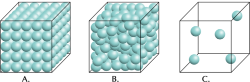
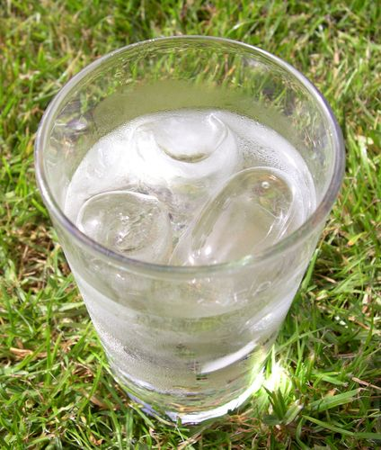
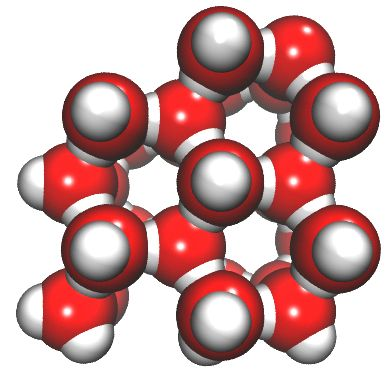
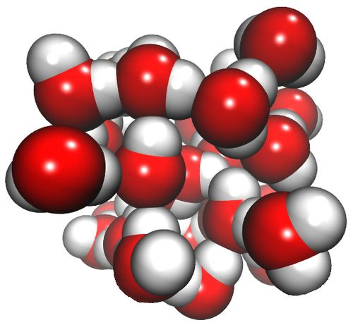
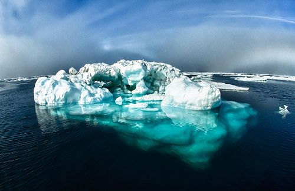

## Density and states of matter

We have now learnt about the three states of matter and the properties of each. We know one of the ways in which solids, liquids and gases are different from each other has to do with the distances between the particles in each respective state. The particles in gases are much further apart than the particles in liquids or solids.

Does this mean the different states of matter have different densities? We will find out in the next activity.

# Which has the highest density: a solid, a liquid or a gas?

This activity is used to explain the general property that solids are more dense than liquids which are more dense than gases. It is mentioned that the boxes contain the 'same material', which is important. Water, is specifically not mentioned in this activity, as it is an exception which will be discussed later. Water does not behave as other materials as the solid phase is actually less dense than the liquid phase in water. Make sure to not refer to water when going through this activity.

**INSTRUCTIONS:**

2. Compare the three identical containers below.
4. They all have the **same volume** and contain the **same material**
6. Container A contains a solid material, container B contains the liquid state of that material and container C the gaseous state of the same material.
8. Answer the questions that follow.

**QUESTIONS**:

**Problem:**
Which container (A, B or C) contains the greatest number of particles? Which container contains the smallest number of particles?

**Solution:**
Container A contains the most particles and C the least.

**Note:** If learners are unsure, they can do a rough count or estimate of the number of particles in the containers. They must keep in mind that in reality, the number of particles would be impossible to count. It is important that they realise that the density of a gas is significantly lower than the densities of the other two phases.

**Problem:**
Which container (A, B or C) contains the material with the greatest mass? Which container has the smallest mass? Why do you say so?

**Solution:**
The container with the most particles would contain the greatest mass; therefore A contains the greatest mass and C the smallest.

**Problem:**
Which state has the highest density: solid (in container A), liquid (in container B) or gas (in container C)? Which state has the lowest density? Why do you say so?

**Solution:**
The solid has the highest density because it has the greatest mass. The gas has the lowest density because it has the smallest mass in the same volume.

We have just performed a conceptual activity (a 'thinking' activity) in which we compared the densities of the three states of the same material.

<Callout type="note" title="Note">
Light ice, heavy water! (video)
</Callout>

If possible, play the video 'Light ice, heavy water' by Steve Spangler Science for your learners and ask them why the ice cube floats and the water sinks after watching the video. You can read about the explanation here:[http://www.stevespanglerscience.com/experiment/light-ice-cube-heavy-water](http://www.stevespanglerscience.com/experiment/light-ice-cube-heavy-water)[http://www.stevespanglerscience.com/experiment/light-ice-cube-heavy-water](http://www.stevespanglerscience.com/experiment/light-ice-cube-heavy-water)

You could do the demonstration in the video yourself, in class. Do not tell the learners that the 'mystery liquid' is vegetable oil but rather let them try to identify it.

The high density of a solid material explains why it cannot be compressed. The particles in a solid are tightly packed and cannot be squeezed closer together into a smaller volume.

Liquids are also very dense. The density of a liquid is roughly the same as the density of the solid state of the same substance. This is because their particles are close together, even though they are not locked into fixed positions. Most liquids cannot be compressed into smaller volumes.

Liquids are slightly less dense than their solid states but water is an important exception. Have you ever wondered why your ice cubes float on top of the water in your glass?

Ice blocks floating in a glass of water.

The solid state of water (ice) is less dense than the liquid, because in ice the water molecules are packed in a unique way. The image below on the left shows shows that water molecules in ice are packed in such a way that there are open spaces between them. On the right, the same water molecules are shown in the liquid state.

Water molecules in the solid state (ice).

Water molecules in the liquid state.

Do you see how there are bigger spaces between the water molecules in a solid than in a liquid? This also helps to explain why icebergs are able to float in the sea.

A big floating iceberg in the Arctic. [http://www.flickr.com/photos/usoceangov/8290528771/](http://www.flickr.com/photos/usoceangov/8290528771/)

Have you ever seen a frozen bottle of water with the ice pushed up out of the bottle? Why did the water push out of the bottle when it turned to ice?

When the water freezes the particles have larger spaces between them. (Remind them this is a unique and unusual property of ice, that does not extend to all solids.) Once frozen, the same mass of water now occupies more volume. Water (liquid) is more dense than ice. The particles in water are packed closer together. This means more of them will fit into a given volume.

Gases are not very dense at all because of the large spaces between the gas particles. That means they contain a small number of particles in a large volume. This why gases can be compressed: their particles can be squeezed closer together to fit into a smaller volume. Think back to the air that is compressed to fit inside a gas tank for a scuba diver.

In the activity 'Which has the highest density, a solid, a liquid or a gas?'we compared the densities of different states of the same material. This is an easy comparison because the particles in the different states are identical. By comparing the number of particles in the same volume of each state, we can determine the density of each state.

The densities of different materials are slightly more difficult to compare, because different materials consist of particles with differing masses.
