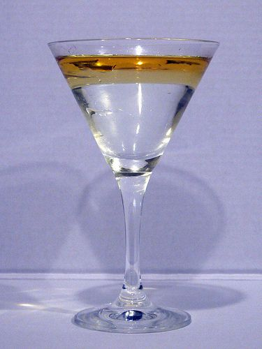
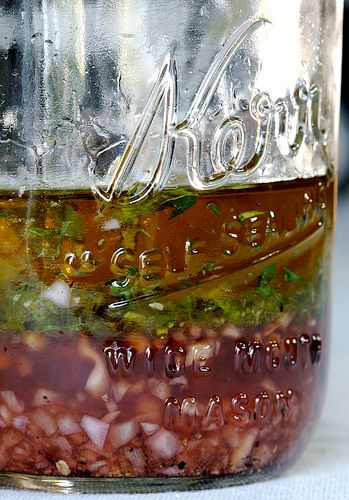
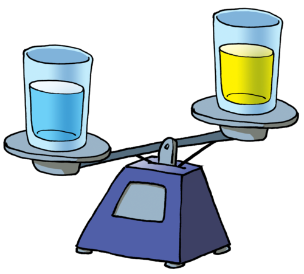
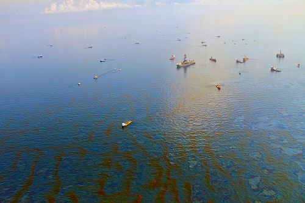
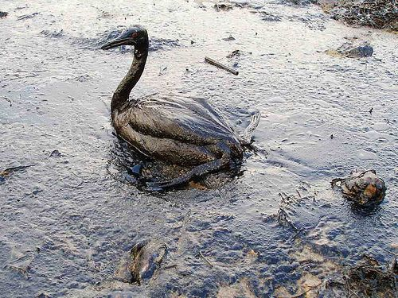
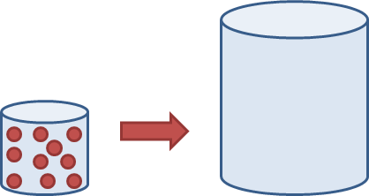
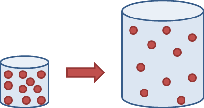

## Density of different materials

<Callout type="note" title="Note">
- cluster
- impact
- immiscible
</Callout>

The SI unit for density is kg/m3. If you chose to do the density calculations in this section, we will mostly be using g/mL and kg/L as the units of measurement for density as the learners will be working with volumes that they measure in millilitres and litres. These are also accepted units of measurement for density.

We are now going to do a practical activity (a 'doing' activity) to compare the densities of a solid, a liquid and a gas. It would be quite difficult to compare the three states of the same material, as the material would have to be at three different temperatures to be in three different states! For this reason we will compare three different materials: sand, water and air.

# Comparing the densities of sand, flour, water and air

**INVESTIGATIVE QUESTION:**

Which material has the highest density: sand, flour, water or air?

Learners must design this investigation themselves. They can work in groups to do this. They should first discuss how they are going to do the investigation and write down their method in their notebook or on scrap paper. After completing the investigation they should then write up the method in the space provided here.

The list of materials should provide some guidance in terms of a possible procedure. Since density is mass divided by volume, learners could measure the mass of identical cups filled with sand, water and air, and calculate the approximate densities of each material. If you do not have access to a scale, then learners can just compare the densities of each material by holding the cups in their hands.

**HYPOTHESIS:**

What do you predict: Which material has the highest density: sand, flour, water or air?

**IDENTIFY VARIABLES:**

**Problem:**
Which variables must be kept constant to make this a fair test?

**Solution:**
If a fixed volume (same size cup) of each material is used, then volume is the constant or fixed variable. The cups must all be made of the same material so that they have the same masses.

**Problem:**
What is the independent variable? (what is it that you have control over to change in this investigation?)

**Solution:**
The independent variable is the type of material.

**Problem:**
What are the dependent variables? (Which variables will you be measuring?)

**Solution:**
Mass is measured and used to calculate density.

**MATERIALS AND APPARATUS:**

- four identical cups (paper or plastic)
- sand
- flour
- tap water
- triple beam balance or scale

**METHOD:**

You will be designing this investigation yourself. If you are working in groups, you need to first discuss how you are going to conduct (carry out) this investigation. This is the planning. Write down your proposed method in your notebook or on scrap paper. Discuss this with your teacher. Remember to also think about how you are going to record your results. After you have conducted the investigation, write down your method on the lines provided here. Summarise each step in sequence and number the steps.

Learners must write the steps for their investigation in a numbered sequence. If you have access to a scale or triple beam balance, then they must measure the mass of each cup and use this to calculate the density. They will need to know the volume of the cups to do this. The volume might be written on the cups, but if not, ask them how they are going to determine the volume. A suggestion is to fill the cup with water, then pour this water into a container which has measurement (such as a beaker or measuring cylinder) and then record what the volume is.

**RESULTS AND OBSERVATIONS:**

What were the results of your investigation? Summarise them below. You can draw a table. If you were able to measure the mass of each cup, show your calculations for the density of each material.

If learners were able to measure the masses of the cups containing different materials, then they must calculate the densities using the equation\(D = m/V\).

An example of a calculation might look like this:

Mass of cup of flour = \(\text{150}\) g

Volume of cup = \(\text{250}\) mL

\(D = m/V\)

= 150/250

= \(\text{0,6}\) g/mL

**ANALYSIS AND EVALUATION:**

**Problem:**
Did anything go wrong during the experiment? If so, what?

**Solution:**
Learner-dependent answer.

**Problem:**
Can you think of anything that could have improved this experiment?

**Solution:**
Learner-dependent answer.

**Problem:**
What steps did you include to ensure fair testing?

**Solution:**
Learner-dependent answer. They should include something about using the same cup for each measurement.

**CONCLUSION:**

What is your conclusion? (What is your answer to the investigative question?)

This investigation should show that equal volumes of these different materials have different masses and therefore different densities. You can also point out that they also compared materials in different states, and they also compared two solids, namely sand and flour.

In the last investigation we saw that two solids, namely sand and flour have different densities as they are different materials. But what about liquids? Do all liquids have the same density or does the type of material of the liquid affect the density?

Have you ever noticed that oil floats on water?

Oil floats on water. [http://www.flickr.com/photos/yortw/5470226807/in/photostream/](http://www.flickr.com/photos/yortw/5470226807/in/photostream/)

When you mix oil and water, as in the picture of the salad dressing below, the two materials will eventually separate because they do not mix well. They are **immiscible**. When they separate, the oil will always float on top. The two separate layers of water and oil are referred to as 'phases', the oil phase and the water phase.

<Callout type="note" title="Note">
Create your own fluid simulation of oil and water.[http://www.escapemotions.com/experiments/fluid_water_3/](http://www.escapemotions.com/experiments/fluid_water_3/)
</Callout>

Bring cooking oil to class and demonstrate this by pouring some oil into a glass of water. Stir it to 'mix' the oil and the water and then allow them to separate out again into the different layers. The simulation link given in the visit box is quite fun for learners to experiment with and see what happens on a particle level when you mix oil, water and foam, and they can watch them separate out again.

This homemade salad dressing contains oil that floats on top. [http://www.flickr.com/photos/jackson3/3894097289/](http://www.flickr.com/photos/jackson3/3894097289/)

Oil floats on water for two reasons:

- A cup of oil has less mass than a cup of water. The oil is less dense than water. This makes oil float on water, like a cork or an air-filled rubber duck floats on the surface of the water.

- Oil does not dissolve in water. The oil molecules **cluster** together and float on the surface. If a large amount of oil is poured into water, the oil will spread out and form a layer on the surface of the water. Oil that is spilled into the ocean or a lake spreads over a huge area. It poisons many animals, birds, fish and plants and is very expensive to clean up. That is why oil pollution has an extremely negative **impact** on our environment.

Oil pollution forms a thin layer on the surface of the sea water. The oil can spread out over a huge area as the layer is thin and it floats on top of the water. [http://www.flickr.com/photos/76145908@N08/7085032489/](http://www.flickr.com/photos/76145908@N08/7085032489/)

A sea bird trapped in the oil from a spill. The oil gets in between the bird's feathers, sticking them together and preventing the bird from flying. [http://www.flickr.com/photos/19378856@N04/2037098785/](http://www.flickr.com/photos/19378856@N04/2037098785/)

When two substances are in the same container, but not mixed (like oil and water for instance), they will form two layers. In a certain sense, water and ice also form two 'layers'. Which layer will be on top: the one which is more dense or the one which is less dense?

The layer which is less dense will float on top of the layer that is more dense.

In the next activity we look at how we can layer different liquids on top of each other depending on the densities!

# Rainbow density column

This activity can be done as a fun demonstration for of the class. It gives a very clear illustration of the differences in density of different liquids. You do not have to use all of the items in the list of materials given below, as long as you have a few of different densities. Watch this Steve Spangler Science video in the visit box before doing this demonstration in class to get a good idea of how to demonstrate it correctly.

<Callout type="note" title="Note">
A video showing how to make a rainbow density column.
</Callout>

**MATERIALS:**

- large glass vase or one litre glass measuring cylinder
- plastic cups
- honey
- golden syrup
- whole milk
- dish washing liquid
- water (can be coloured with food colouring, blue for example)
- vegetable oil
- rubbing alcohol (can be coloured with food colouring, red for example)
- a bolt
- a popcorn kernel
- a cherry tomato
- some plastic beads
- a ping pong ball/polystyrene ball

**INSTRUCTIONS:**

If you have equal volumes of each liquid, the mass and density will be related and the heaviest liquids will be the most dense. Draw a table on the board to record the masses of each liquid.

If you are using the suggested liquids in the list given, the order to pour them in is as follows: honey, golden syrup, milk, dish washing liquid, water, vegetable oil, rubbing alcohol.

2. Use the same amount of each liquid. The amount will be determined by the height of the vase or measuring cylinder. Pour equal volumes of each liquid into the cups.
4. If you have access to a scale, measure the mass of each cup with a different liquid. Arrange them in order from heaviest to lightest.
6. Start with the heaviest liquid (honey) and pour it into the container first. Be careful not to let any of it touch the sides of the container.
8. Next pour in the next heaviest until you have poured all the liquids into the container. If you have a pipette, use it to carefully layer the liquids.
10. Stand the column on a desk and carefully drop in the bolt, popcorn kernel, cherry tomato and beads. Take note of where each object settles in the density column.
12. Finally, drop the ping pong/polystyrene ball on top.

**QUESTIONS:**

**Problem:**
Use the space provided to make a drawing of the density column that you made in class. Use coloured pencils if you have them. Label each layer. If you measured the mass of each liquid, write the mass in brackets after each label. Draw in the different objects to show where they dropped to in the density column.

**Solution:**

**Problem:**
Which liquid is the most dense and which is the least dense? Explain your answer.

**Solution:**
The honey is the most dense as it is at the bottom; the rubbing alcohol is the least dense as it floats on top of the other layers.

**Problem:**
Do you notice any relationship between the mass and density of the different liquids?

**Solution:**
Yes, there is a relationship. In equal volumes of the liquids, the liquid that is the heaviest is the most dense.

**Note:** This introduces the idea of equations to explain scientific phenomena (density = mass/volume). If the volume remains the same and the mass increases, then the density must also increase. Learners do not need to do calculations at this level, but if you would like to extend the exercise, you could work out the densities of each liquid using the measured mass and the volume for each liquid.

**Problem:**
Arrange the objects from most dense to least dense. Explain how you did this.

**Solution:**
Dependent on objects used. If the suggested ones are used, the order would be: bolt, popcorn kernel, cherry tomato, beads, ping pong ball. The most dense objects will be at the bottom and the least dense at the top.

**Problem:**
Why do you think the objects dropped to different levels in the liquid?

**Solution:**
The objects drop to the different levels depending on their densities. The metal bolt is more dense than any of the liquids so it sinks to the bottom. The other objects will sink to the layer at which their density is equal to that of the liquid.

**Note:** Learners might battle with this, but you can give them an example. For example, the plastic beads are less dense than water and the liquids below that, but they are more dense than the vegetable oil and the liquids above that. So, the beads will float on top of the water layer.

**Problem:**
Which objects are more dense than water? Which objects are less dense than water?

**Solution:**
Depending on the objects used, but from the suggested list, those less dense than water are the ping pong ball and plastic beads, those more dense than water are the cherry tomato, popcorn kernels and bolt.

# Some density calculations

This is an optional extension activity if you would like to do some density calculations. Calculations will become an important part of physical sciences in Gr. 10-12 and so it is helpful if learners start using some of the more simple equations now.

**INSTRUCTIONS:**

2. Below is a table with some different substances and their densities. Use this information to do the following calculations.
4. Show how you worked out each answer and do not forget to include the units in your answer.

| Material | density (g/mL) |
| --- | --- |
| water (liquid) | 1 |
| ice | 0.917 |
| glass | 2.6 |
| salt | 2.2 |
| chalk | 2.36 |
| coal | 1.5 |
| cork | 0.25 |

**QUESTIONS:**

**Problem:**
You have a 500g block of butter at home. You found out that its volume is 555mL. What is the density of the butter?

**Solution:**
\(D = m/V\)

= 500/555

= 0.9 g/mL

**Problem:**
Which is more dense, salt or chalk?

**Solution:**
Chalk is more dense.

**Problem:**
You have a large glass marble and you want to find out what its volume is. You measure the mass and find it to be 50 g. What is its volume?

**Solution:**
Density of glass = 2.6 g/mL.

\(D = m/V\)

\(V = m/D\)

= 50/2.6

= 19.2 mL

**Problem:**
You have a piece of coal and a piece of cork which are exactly the same size. They have the same volume of 100 mL. Which one will have the greater mass? Calculate the exact mass of each piece.

**Solution:**
The coal will have the greater mass as it has a higher density.

Mass of coal:

\(m = DV\)

= 1.5 x 100

= 150 g

Mass of cork:

\(m = DV\)

= 0.25 x 100

= 25 g.

We have learnt that the density of a material depends on how tightly packed the particles inside the material are. The more tightly packed they are, the more dense we say they are.

The following diagram represents a container (on the left) that contains a small amount of gas. Imagine that all the gas from the small container is moved into the empty container on the right. Draw the gas particles in the container on the right.

The learner's sketch should show 10 particles, spread out evenly to fill the larger container. Note that the particles should have the same size as before.

A gas will expand to fill whatever space it is in. In the larger container we will still have the same number of gas particles, but now they are filling a much larger space.

If we take a certain amount of gas from one container and place it into another, larger container, the gas expandsto fill the larger container. The same mass of gas is now in a larger volume, the gas now has a lower density.

Solids and liquids cannot behave in this way. Their densities will remain more or less constant no matter in which container they are placed. This is because their particles are relatively close together with strong forces between them. But what happens when we heat them? We have learnt that this is the same as giving them extra energy. How will heating them affect the packing of the particles and the density?

Get learners to discuss this question. They have learnt that particles move faster at higher temperatures. How would this affect the spaces between particles? Most solids and liquids tend to become less dense as they warm up. The learners do not need to come to any conclusions at this point. The question will, however, help to introduce the concepts of contraction and expansion.

In the next section we are going to look more closely at what happens to the particles inside materials when they expand. We are also going to look at the opposite of expansion, namely contraction.
