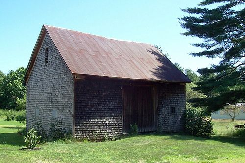
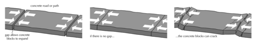
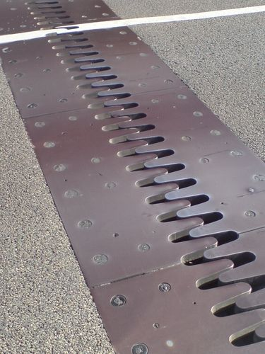
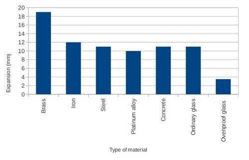
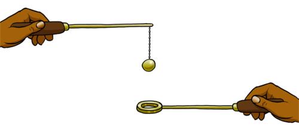
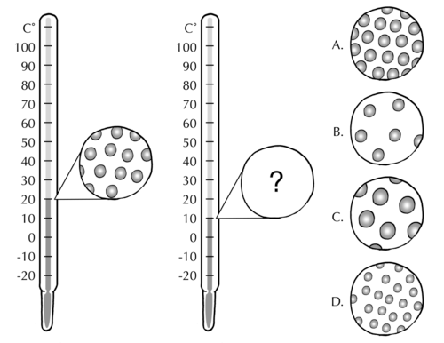
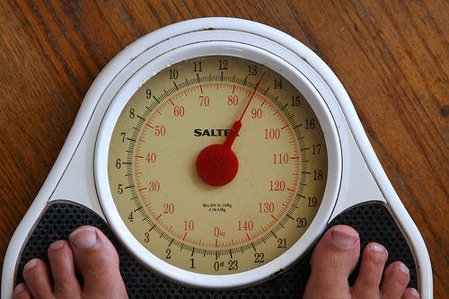

## Expansion and contraction of materials

<Callout type="note" title="Note">
- expand
- contract
- reinforce
</Callout>

Have you ever been inside a tin-roofed house? On a hot days, you often hear the metal roof panels groan and creak. Do you know why this happens?

A house with a tin roof. [http://www.flickr.com/photos/nhoulihan/3653411697/](http://www.flickr.com/photos/nhoulihan/3653411697/)

Some materials become slightly larger when they are heated. We say they **expand**. Materials can also shrink slightly when they are cooled. We say they **contract**.

The metal roof panels expand and contract as the outside temperature changes. When this happens, the panels scrape against each other and against the nails that keep them in place. The scraping of metal against metal causes the creaky, groaning noises.

How is it possible for materials to contract and expand? Can you think of an explanation?

Get learners to question the possibility of new atoms forming inside the material as an explanation for the phenomenon of expansion. Guide them to the law of conservation of mass: matter cannot be created or destroyed. Materials expand and contract due to particles moving further apart or closer together, not because the number of particles increases or decreases.

To understand this phenomenon, we will look at some examples of expansion. We will then try to explain expansion in terms of the particle model.

Some solids expand more than others. When we choose materials for a new job, it is important to know how much they will expand. This way we can allow for expansion when the materials get hot.

In the following diagram, the picture on the left shows a concrete path or road surface. How have the engineers who built the road allowed for expansion?

The road was built in segments, with small gaps between segments to allow for expansion.

Expansion can create forces strong enough to damage materials.

The picture on the right shows what could happen if no allowance is made for the expansion of the concrete blocks. The forces created by the expansion of the concrete are so strong that the road surface has cracked!

This is a very important principle to remember when building bridges. When engineers design a bridge, they must allow for contraction and expansion of the materials used to build the bridge. Have a look at the following photo showing a close-up of the gap between the two road surfaces of a bridge. Can you see the interlocking 'teeth'? These allow the bridge to expand and contract while the teeth slide past each other.

The expansion joint in a bridge.

# How much longer?

In this activity we will compare the expansion of different solid materials by drawing a graph. You will need the following information for your graph:

| Material | How far a 100 metre length of the material will expand when the temperature increases by 10°C |
| --- | --- |
| Brass | 19 mm |
| Iron | 12 mm |
| Steel | 11 mm |
| Platinum alloy | 10 mm |
| Concrete | 11 mm |
| Ordinary glass | 11 mm |
| Ovenproof glass | 3,5 mm |

Draw a bar graph with 'Expansion' on the y-axis and 'Materials' as categories on the x-axis. Choose an appropriate title for you graph.

Here is the bar graph that learners must draw. Any appropriate title will do, for instance: Expansion of different materials when temperature is increased by 10°C (per 100 meters of material).

**Q UESTIONS:**

**Problem:**
Which material expands the most upon heating?

**Solution:**
Brass

**Problem:**
Which material expands the least?

**Solution:**
Ovenproof glass

**Problem:**
Which solid would be the best material to **reinforce** concrete? (Hint: the reinforcing material should expand as much as the concrete, otherwise it will damage the concrete during expansion.)

**Solution:**
Steel. It expands the same amount as concrete.

**Problem:**
A man builds a house with large windows set in beautiful frames made of brass. The house is in a region where it gets very hot during summer. Imagine that the owner of the house has a problem: the windows of the house look beautiful in their shiny brass frames but they keep falling out during the summer months. As a scientist, how would you explain this and what would your advice to the owner of the house be? Should the frames be replaced? If so, with which material? What other solutions can you suggest?

**Solution:**
From the graph and the data in the table, we can see that brass expands much more than ordinary glass. When the weather is really hot, the brass expands so much that the window glass does not fit properly anymore and falls out. You could advise the owner to try the following:

- Replace the brass frames with steel. Steels expands by the same amount as glass so the glass should stay in place.
- Replace the large windows with smaller windows. Smaller items expand less because there is less matter that can expand.

**Note:** In addition to the type of material, the amount of expansion also depends on how much material there is. This is why expansion is difficult to see in relatively small items. e.g. cooking pots. A key will still fit in a lock, even if the key has been lying in the hot sun, because expansion is not that noticeable in small items.

**Problem:**
The following diagram shows a metal ball and ring apparatus. The ring and ball are both made of brass. At room temperature, the ball is just the right size to pass through the ring.

Do you think the ball will still fit through the ring when the ball has been heated?

**Solution:**
The ball does not fit through the ring when the ball has been heated.

**Note:** This is a great way to demonstrate contraction and expansion if you have one of these at your school.

If you are doing a practical demonstration, get the learners to make a prediction before continuing with the demonstration. You can heat the ball in the flame of a Bunsen burner.

**Problem:**
Do you think the brass ball will have more mass when it has expanded? Explain your answer.

**Solution:**
No, the brass ball cannot have a greater mass because it has not gained any mass.

**Note:** We know this because matter cannot be created (or destroyed).

**Problem:**
What will happen to the brass ball when its temperature drops back to room temperature? Will it be larger than, smaller than, or the same size as before it was heated? Explain your answer.

**Solution:**
The ball will contract to the same size as before because it has not gained or lost any mass.

**Note:** If doing the practical demonstration, get the learners to make a prediction in the time that it takes for the ball to cool down.

Now that we have seen that materials can expand, how can we explain expansion of a material in terms of the behaviour of the particles in that material?

Get learners to discuss this for a few minutes. Guide the discussion with the following questions: What are we adding to matter when we heat it? (Energy.) What do particles do when they are given more energy? (They move faster.) What happens to the spaces between the particles when they start to move faster and bump against each other with more force? (The spaces get bigger as the particles start moving apart.) Learners should be encouraged to take notes in discussions.

We have learnt that when matter is heated, the particles of that matter will move faster and push further apart from each other. What happens to the particles in matter when it is cooled?

Get learners to discuss this for a few minutes. Guide the discussion with the following questions: What are we taking away from matter when we cool it? (Energy.) What happens to particles when they lose energy? (They move more slowly.) What happens to the spaces between the particles when they start to move more slowly? (The spaces get smaller as the particles start moving closer together.)

When a substance cools (energy is removed), the particles in that substance will slow down and move closer together. That is why most materials contract when they are cooled.

### Expansion and contraction in a thermometer

Let's look at a thermometer to understand expansion and contraction.

# How does a thermometer work?

In Gr. 7 Matter and Materials, learners were introduced to the bulb thermometer and the idea that materials expand and contract due to changes in kinetic energy of the particles (the size and number of particles remains the same, only the spaces between the particles increase or decrease). If you have access to a Gr. 7 workbook, you can look at what they did. You can also download the PDFs of these books from the website and view the content online. In this activity these ideas are revisited and expanded upon, with the particle model as frame. Important links are established between expansion and contraction and their effects on the properties volume and density.

The common glass thermometer is called a bulb thermometer. All bulb thermometers have a fairly large bulb that is connected to a long, thin tube. The thermometer has a brightly coloured liquid on the inside. Some thermometers contain mercury as it expands and contracts quite a lot when heated or cooled.

<Callout type="note" title="Note">
Mercury is the only metal that is a liquid at room temperature.
</Callout>

Look carefully at the following set of diagrams. They represent the same thermometer at two different temperatures.

**QUESTIONS:**

**Problem:**
The drawings represent the particles in the liquid inside a thermometer. What is the temperature measured on the thermometer on the left?

**Solution:**
20°C

**Problem:**
The drawing on the right is of the same thermometer, but slightly different. Can you tell the difference?

**Solution:**
The temperature reading on the thermometer on the right is 10°C.

**Problem:**
Which of the circles (A, B, C, or D) is the best representation of the liquid in the thermometer on the right? Why did you choose this one?

**Solution:**
Circle A is the correct one. The lower temperature has made the liquid inside the thermometer contract, so the particles are closer together.

**Note:** This question provides an opportunity to identify learner misconceptions about expansion and contraction:

- Answer B is incorrect because the particles are further apart than in the diagram on the left. The learner may be confusing the two concepts expansion and contraction.
- Answer C is incorrect because the particles in the diagram appear to have grown larger. This is not possible since particles cannot gain mass (matter cannot be created or destroyed), nor can they gain volume. Their mass and volume are fixed, and expansion means they move further apart; the spaces between them get bigger.
- Answer D is incorrect because the particles in the diagram appear to have grown smaller. For the same reasons as just mentioned, this is a misconception. The spaces between particles get smaller when a material contracts.

**Problem:**
Does a material have less mass when it has contracted? Explain.

**Solution:**
No, the material cannot have less mass because it still has the same number of atoms as before and their mass is constant.

**Note:** This is a good time to remind learners that matter cannot be created or destroyed.

**Problem:**
If the temperature was raised and the thermometer read 30°C, which circle would now best represent the particles in the liquid of the thermometer? Why?

**Solution:**
Answer B would now represent the thermometer at a higher temperature of 30°C as the particles have gained more energy and therefore moving at greater speeds so they move further apart and the liquid expands.

**Problem:**
How does the volume change when a material is heated? Why?

**Solution:**
The volume of the material increases, because the particles move further apart. The material expands.

**Problem:**
How does the density change when a material is heated? Why?

**Solution:**
The mass does not change but the volume increases, therefore the density must decrease.

**Note:** It may help to refer back to the formula: density = mass/volume.

<Callout type="note" title="Note">
When a material is heated, its particles move further apart. When the material cools down, the particles move closer again. Heating and cooling cause the volume of the material to change.
</Callout>

We have learnt that thinking about matter in terms of the particles inside it can help us to understand many interesting phenomena: the physical properties of the different states of matter, changes from one state of matter to another, density, and expansion and contraction.

How can we measure how much of a liquid or a solid we have? If we want to know how much of a material we have, we can measure its mass. What instrument do we use to measure mass?

A scale or a balance.

We can use a scale to measure the mass of a person or any other object. [http://www.flickr.com/photos/puuikibeach/4263292347/](http://www.flickr.com/photos/puuikibeach/4263292347/)

Think back to the investigation comparing the densities of sand, water, flour and air. How did you measure the mass of the air in a cup?

Most likely, the learners were unable to measure the mass of the air. If they managed to do so, it would probably have required quite a complicated process. They should be reminded that the air is not without mass, but that the mass of the air inside the cup is so small. (It is actually not possible to measure the mass of air when it is surrounded by more air. One way to measure the weight of air would be to do so in a vacuum. But this is beyond the scope of this discussion here for the learners.)The purpose of this short discussion is to prepare learners for the section about pressure. Measuring the pressure of a gas is one way to 'measure' how much gas we have.

We are now going to shift our focus to gases. Gases have much lower densities compared to solids and liquids. That means a large volume of gas will have a small mass. Small masses can be difficult to measure without a special, super-sensitive scale. Scientists have devised a different way of measuring how much of a gas they have.
