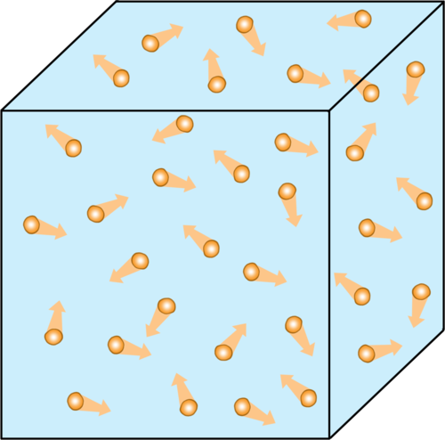
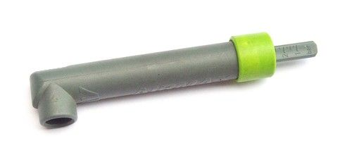
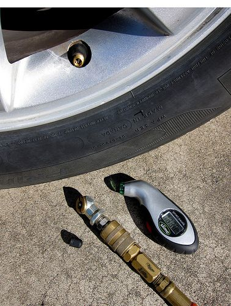
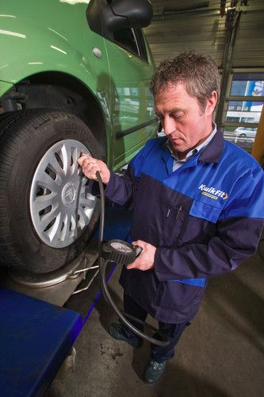
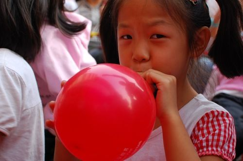
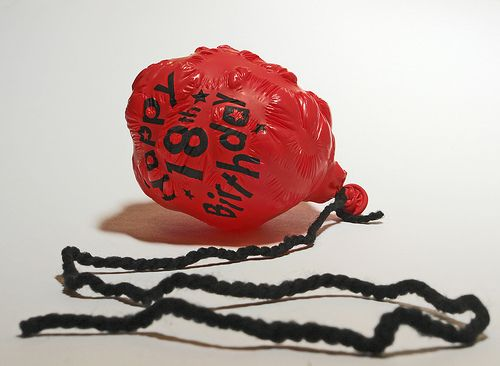
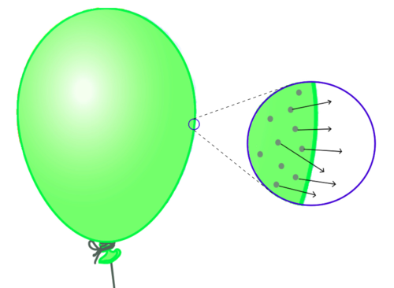
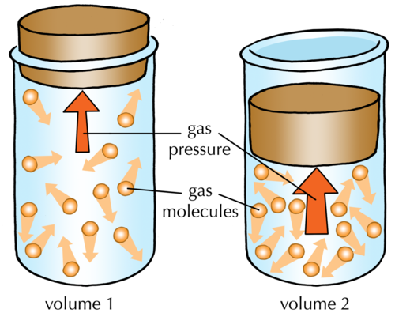

## Pressure

<Callout type="note" title="Note">
- pressure gauge
- air valve
</Callout>

### What is gas pressure?

We have learnt that gases contain millions of fast-moving particles. The following picture represents gas particles inside a container.

Gas particles in constant motion, inside a container. They collide with each other and with the inside of the container.

As the particles whizz around, they bump and bounce off each other. They also bump against the inside of the container. The force of the particles bumping against the sides of the container cause a phenomenon called gas pressure. The number of bumps (or collisions) will depend on the number of gas particles in the container. More particles inside the container means more collisions, and more collisions mean a higher pressure.

If we can measure the pressure of the gas, we will have an idea of how much gas is inside the container.

<Callout type="note" title="Note">
Wind is simply moving air! The movement of the air is caused by differences in pressure between one area of the Earth's atmosphere and another. When the wind blows, it is the atmosphere equaling out uneven pressures by moving air from a high pressure area to a low pressure area.
</Callout>

### How can gas pressure be measured?

Have you ever seen anyone check the pressure in a car tyre? You may have seen them use a device like those in the photo below. It is called a tyre **pressure gauge** and it is specially designed to measure the air pressure inside a tyre.

A simple tyre pressure gauge.

The round end of the gauge should be pressed against the **air valve** of the tyre. This opens the valve and lets some of the air from the tyre escape into the gauge. The air particles bump against a disc inside the gauge. The force generated by many gas molecule collisions pushes out a bar at the back of the gauge. Can you see it in the picture? For this particular pressure gauge, the pressure inside the tyre is indicated by how far back the bar is pushed out of the back of the gauge. Note the numbers along the bar which allow us to measure the pressure.

<Callout type="note" title="Note">
How to check tyre air pressure:[http://www.howstuffworks.com/pressure-gauge.htm](http://www.howstuffworks.com/pressure-gauge.htm)
</Callout>

Other, more complicated pressure gauges all work in a similar way.

Two more complicated types of tyre pressure gauges for measuring the air pressure inside car tyres. The right one is a digital gauge. [http://www.flickr.com/photos/29233640@N07/5714502617/](http://www.flickr.com/photos/29233640@N07/5714502617/)

Measuring the pressure inside a tyre using a pressure gauge.

How could we increase or reduce the amount of gas in a container? In the next activity we are going to see if we can understand gas pressure in terms of the particle model of matter.

By blowing air into the balloon, the girl is forcing air particles into it. [http://commons.wikimedia.org/wiki/File:Girl_inflating_a_red_balloon.jpg](http://commons.wikimedia.org/wiki/File:Girl_inflating_a_red_balloon.jpg)

# Understanding gas pressure

One of the learners could bring their bicycle and pump to class to demonstrate the final activity.

**MATERIALS:**

- brown paper bags (medium size)
- balloons
- empty plastic cold drink or water bottles (2-litre bottles are preferable)
- bicycle pump and tyre

**INSTRUCTIONS:**

**Problem:**
This step requires a brown paper bag.

2. Blow up a brown paper bag until it is fully inflated.
4. Try blowing it up even more. See if you can make it pop by blowing into it.
6. Write two or three sentences to describe what it feels like to blow into the bag when it is 'empty', compared to when it is 'full' of air. Does it feel different? Is it more difficult to blow into the bag when it is already full?

**Solution:**
It is easier to blow into the bag when it is 'empty', or when there is not much air in it and becomes increasingly more difficult to blow into as it fills with air.

**Note:** If the bag is strong it may not be possible to pop it by blowing into it, because humans cannot blow with much force. A 'weak' bag may come apart at the seams or start to leak when the learners continue to force air into it beyond its capacity. Ask them to think about why this happens.

2. This step requires a balloon.
   **Problem:**
   Blow up the balloon until it is the size of an orange. Pinch it closed but do not tie a knot in the top.
   **Solution:**
   **Problem:**
   Now blow up the balloon as large as you can.
   **Solution:**
   **Problem:**
   Try blowing it up even more. See if you can make it pop by blowing into it.
   **Solution:**
   **Problem:**
   Write two or three sentences to describe what it feels like to blow into the balloon when it is 'empty', compared to when it is 'full' of air. Does it feel different? Is it more difficult to blow into the balloon when it is already full?
   **Solution:**
   The balloon is difficult to blow into at first. Thereafter it becomes more easy to blow air into the balloon. When the balloon becomes stretched 'to capacity' with air, it becomes more and more difficult to blow more air into it.
   **Note:** The balloon is difficult to blow into at first because the material (rubber) that the balloon is made of is still very tight. It can be relaxed somewhat by stretching the balloon before blowing into it, but the first one or two 'blows' will require some effort.
   **Problem:**
   Tie a knot in the top of an inflated balloon. Leave the balloon in the classroom and examine it again after one week. Does it look the same as when you inflated it a week ago? Perhaps it looks a bit like this balloon in the following photo:
   
   A deflated birthday balloon. [http://www.flickr.com/photos/robbophotos/2095823996/](http://www.flickr.com/photos/robbophotos/2095823996/)
   **Solution:**
   **Problem:**
   Remember to write your observations below.
   **Solution:**
   **Note:** After one week the balloon has become wrinkled and it is smaller than it was originally.

2. This step requires a balloon and an empty plastic bottle.
   **Problem:**
   Stretch the balloon over the top of the bottle, with the balloon hanging down into the bottle.
   **Solution:**
   **Problem:**
   Blow into the balloon. What do you observe? Can you blow up the balloon?
   **Solution:**
   It is impossible to blow up the balloon.
   **Problem:**
   Now make a small hole in the bottom of the bottle. Blow into the balloon again. What do you observe now?
   **Solution:**
   The balloon swells up and fills the inside of the bottle.

2. This step requires a bicycle tyre and pump.
   **Problem:**
   Use the pump to pump air into the tyre. Continue to pump until it becomes too difficult to pump any more air into the tyre.
   **Solution:**
   **Problem:**
   Write 1 or 2 sentences about your observations.
   **Solution:**
   At first it is easy to pump air into the tyre but, the more you pump, the more difficult it becomes.

**QUESTIONS:**

Try to answer the following questions by explaining what is happening to the air particles in each case. Use the words 'particles', 'collisions' and 'pressure' in your answers.

**Problem:**
What happens when you blow up a paper bag or a balloon, or when you pump air into a tyre?

**Solution:**
Air particles are forced into the bag, balloon or tyre. The more you blow, the more particles are pushed into the bag, balloon or tyre. If there are more particles, there will be more collisions, and that means the pressure will be greater.

**Problem:**
When you blow into a paper bag, why does the bag pop or start to leak air after a while?

**Solution:**
When the bag contains as many particles as it possibly can and we try to force even more particles into the bag, the force of the collisions of the particles against the inside of the bag becomes too much and the bag breaks.

**Problem:**
When you blow into a balloon that is fully inflated, why does the balloon pop?

**Solution:**
When the balloon contains as many particles as it possibly can, it will be stretched to its maximum size. If we try to force even more particles into the balloon, the force of the collisions of the particles against the inside of the balloon becomes too much and the balloon pops.

**Note:** Actually the polymer strands of the balloon tear apart as a result of the applied force.

**Problem:**
Why do you think the balloon became smaller when it was left for a week? The following diagram should provide a hint:

**Solution:**
Air particles escaped through tiny openings in the material of the balloon. There are now fewer particles inside the balloon so there are fewer collisions against the inside. The force pushing against the inside of the balloon is smaller, therefore the pressure inside the balloon is smaller.

**Note:** Learners may answer that the air inside the balloon has contracted and while this may be part of the explanation, there is another factor that contributes much more significantly to the shrinkage over time: air particles will slowly escape from the balloon over a period of time because the balloon polymer has tiny holes. These holes are much too small to see with the naked eye, but they are large enough for the air molecules to escape through.

**Problem:**
Explain why you think it was impossible to blow up the balloon inside the bottle? Why was it possible to blow up the balloon when there was a hole in the bottle?

**Solution:**
The balloon does not inflate much because the bottle is already filled with air. There is no room for the balloon to expand inside the bottle. The air particles inside the bottle push back against the air particles inside the balloon. When the bottle has a hole in it, the air particles inside the bottle can be pushed out through the hole, as the balloon fills the space inside the bottle.

**Problem:**
Why does it become more and more difficult to pump air into the bicycle tyre?

**Solution:**
The more you pump, the more particles are pushed into the tyre. If there are more particles, there will be more collisions, and that means the pressure will be greater. The tyre will stretch to accommodate more air particles, but it will become more and more difficult (require more and more force) to stretch the tyre material.

The following two paragraphs are not required by CAPS but may be included as enrichment. This introduces some concepts to be dealt with in the later grades.

### How does heating or cooling a gas change its pressure?

If the gas is heated, the particles will move faster as they gain more energy. That means they will collide with the inside of the container more often and with more force. This causes an increase in pressure.

If the gas is cooled, the particles will move more slowly, because they will have less energy. The gas pressure will decrease, because the particles will bounce against the inside of the container less frequently and with less force. Look at the following table which illustrates this.

| Cool gas | Hot gas |
| --- | --- |
| Fewer and less energetic collisions. | More and more energetic collisions. |

### How does changing the volume of a gas change its pressure?

When a gas is squeezed into a smaller volume, the particles have less space to move. This is shown in the diagram below. Have you noticed that when people are squashed into small spaces, they bump into things more often? In the same way, the gas particles will collide more often with each other and with the inside of the container if they have less space to move in. More collisions means increased pressure!

We have learnt that a gas will expand to fill all the available space. So, what will happen if we take a certain amount of gas out of one container and place it into another container that is twice as large?

The gas will expand, filling the larger container.

We still have the same number of gas particles, but now they are inside a much larger volume. There is twice as much space between the molecules as there was in the smaller container.

What has happened to the density of the gas? Has it increased, decreased or stayed the same?

The density has decreased because the volume increased.

In this chapter, we learnt how many different physical properties of matter can be better understood when we think in terms of the behaviour of the particles in the matter.
