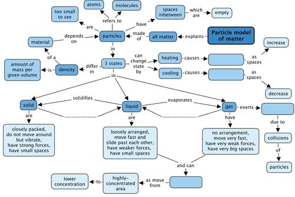
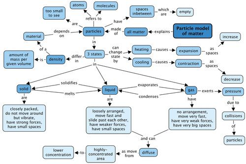

## Summary

<Callout type="note" title="Note">
- All matter can be described in terms of the particles it consists of, and how they are arranged. These extremely small particles are called atoms or molecules, depending on the type of material.
- The theory that describes matter in terms of particles is called the particle model of matter. It helps us to understand the macroscopic properties of a material in terms of the behaviour of the particles in that material.
- The particle model describes the particles in **solids** as follows:
  - They are closely and regularly packed and locked into position;
  - The only movement they are allowed is vibration;
  - They are held together by strong forces; and
  - The spaces between them are very small.
- The particle model describes the particles in **liquids** as follows:
  - They are close together but not locked in position;
  - They are in constant motion and slide past each other;
  - They are held together by moderately strong forces; and
  - The spaces between them are very small (in most cases only slightly larger than the spaces between solid particles).
- The particle model describes the particles in **gases** as follows:
  - They are in constant fast motion;
  - They are not arranged in any way but free to move;
  - The forces between them are weak; and
  - They are far apart with large empty spaces between them.
- Since the particles of liquids and gases are in constant motion they are able to diffuse. Diffusion is a process in which particles spread out, through random movement from high to low concentration, until they are evenly distributed.
- When two substances mix, their particles intermingle until their composition is uniform throughout. This is also called diffusion, and the process is much faster in gases than in liquids, because the particles in gases are further apart.
- Changes of state are usually the result of heating or cooling:
  - When a solid is heated it will change to a liquid (in a process called melting) and, when heated further, the liquid will change to a gas (in a process called evaporation).
  - When a gas is cooled it will change to a liquid (in a process called condensation) and, when cooled even further, the liquid will change to a solid (in a process called freezing).
- The density of a material is a measure of its 'relative heaviness'. Denser materials have a greater mass in relation to their size; that is why they feel 'heavy'.
- The density of a material depends on two things:
  - the mass of the individual particles of that materials - the larger the mass, the denser the material; and
  - the size of the spaces between the particles in the material - the larger the spaces, the less dense the material.
  - These explain how to calculate density, namely density = mass/volume
- Materials with a loose texture (like bread and sponge, for example) have empty spaces or holes inside them, which means they have less mass in relation to their volume. These materials tend to be less dense.
- Materials that are less dense always float on materials that are more dense.
- The particles of matter are constantly moving. In solids these movements are limited to vibrations, but in liquids and gases the particles have more freedom.
- Most materials will expand when they are heated and contract when they are cooled. This is because heating makes the particles move further apart and cooling makes them move closer together.
- When we want to know how much of a gas we have, we can measure its pressure.
- The 'pressure' of a gas is caused by the particles of the gas colliding with the inside of a container and with each other.
- More gas particles inside the container will mean more collisions against the sides, and therefore, more pressure.
</Callout>

Concept map

Have a look at the concept map that shows how the many concepts relating to the particle model of matter fit together. There are 4 empty blocks which you need to fill in.

Teacher's version

