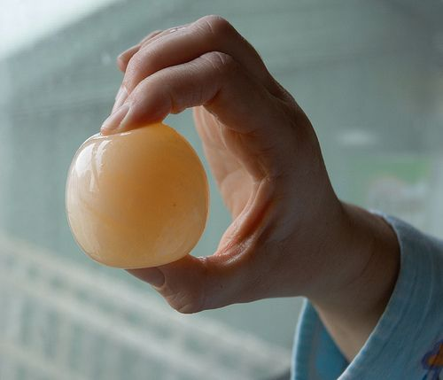

## How do we know a chemical reaction has taken place?

<Callout type="note" title="Note">
- chemical reaction
- reaction flask or reaction vessel
</Callout>

During a chemical reaction, one or more substances are changed into new substances. Do you know of any chemical reactions? Can you mention one or two examples?

Learners may remember that the rusting of iron is a chemical reaction, or they may cite some of the reactions from Chapter 1 as examples. Learners may also cite 'change of state' as a reaction. However, this is NOT a chemical reaction or change. Explain to your learners that it is only a physical change taking place not a chemical change.

How will we know when a chemical reaction is taking place? What are the signs?

Get learners to discuss this in small groups for a few minutes. Make a list on the board of all their suggestions which may include:

- The mixture may change and appear different. (In what way? There may be a colour change and bubbles or 'crystals' may form.)
- There may be an explosion.
- The mixture may change temperature, heating up or cooling down. This is NOT to be confused with physical changes during heating and cooling when a substance melts or solidifies for example.

We can tell if a chemical reaction has taken place when one or more of the following things happen:

- There has been a colour change inside the **reaction flask**.
- A gas has formed. Usually we know a gas has formed when we can see bubbles. This should not be confused with boiling, which only happens when a liquid is heated to its boiling point.
- A solid has formed. Usually we know that some solid material has formed when we can see a sludgy or cloudy deposit, or crystals forming.

Most practical manuals for introductory chemistry list only the three visual cues above as signs that a reaction has taken place. However, the non-visual signs below are also worth including here.

All the signs listed above are visual, or recorded by sight. That means we can see them. Our other senses can also help us to say whether or not there was a chemical reaction:

- Sometimes chemical changes can be smelled, for instance when a new material, that has a strong smell, is formed.
- Other chemical changes can be felt, e.g when the reaction produces heat.
- Some chemical changes can be heard, e.g. when an explosion takes place.

<Callout type="note" title="Note">
Video on physical and chemical changes.
</Callout>

# The difference between physical and chemical changes

This is a short activity to make sure that learners understand the difference between chemical and physical changes, and uses examples from everyday life.

**INSTRUCTIONS:**

**Problem:**
Below is a table with some different chemical and physical changes listed.

**Solution:**

**Problem:**
You need to decide whether the change is physical or chemical and write the answer in the last column.

| Change | Is it a physical or chemical change? |
| --- | --- |
| Cutting up potatoes into cubes |  |
| Boiling water in a pot on the stove |  |
| Frying eggs in a pan |  |
| Whipping egg whites |  |
| Dissolving sugar in water |  |
| Burning gas in a gas cooker |  |
| Your ice cream melts in the sun |  |
| Milk turning sour |  |
| An iron gate outside rusts |  |

**Solution:**
Here are the answers. Learners only need to state physical or chemical - some explanations have been provided as background for the teacher and if you wish to explain the changes further to your learners.

| Change | Is it a physical or chemical change? |
| --- | --- |
| Cutting up potatoes into cubes | Physical |
| Boiling water in a pot on the stove | Physical |
| Frying eggs in a pan | Chemical (the egg proteins undergo a chemical change and crosslink to form a network) |
| Whipping egg whites | Physical (air is forced into the liquid but no new substance is made) |
| Dissolving sugar in water | Physical (the sugar grains are dispersed within the water, but the individual sugar molecules are unchanged) |
| Burning gas in a gas cooker | Chemical (water vapour and carbon dioxide form) |
| Your ice cream melts in the sun | Physical |
| Milk turning sour | Chemical (lactic acid is produced) |
| An iron gate outside rusts | Chemical (iron oxide forms - this will be discussed in more detail in Gr. 9) |

We will now put our checklist into practice by looking at a reaction safe enough to try at home. Have you ever wondered what a raw egg would look like without its shell? We are going to use a chemical reaction to strip away the shell of an egg, without breaking the egg!

# Can we use a chemical reaction to see inside an egg?

How can we make an egg look like this?[http://www.flickr.com/photos/gemsling/2687069763/](http://www.flickr.com/photos/gemsling/2687069763/)

Start with this activity as soon as possible, because it takes a few days for the eggshell to dissolve completely. It is probably worthwhile to do the reaction in duplicate in case something goes wrong with the experiment. The egg is very delicate without its shell and may break and then it would be good to have a 'backup' egg.

<Callout type="note" title="Note">
Video on the naked egg experiment
</Callout>

**MATERIALS:**

- eggs
- a glass
- white vinegar

**INSTRUCTIONS:**

**Problem:**
Carefully place the egg in the glass. Be careful not to crack the shell.

**Solution:**

**Problem:**
Cover the egg with vinegar. Wait a few minutes. Can you see anything happening on the surface of the eggshell?

2. Write your observations below.
4. What is this observation a sign of?

**Solution:**
2. The eggshell gradually becomes covered in bubbles.
4. The bubbles are a sign of a chemical reaction taking place.

**Problem:**
Leave the egg in the vinegar for 4 - 5 days. You should complete the rest of the activity after this.

**Solution:**
**Note:** It may be necessary to top up the vinegar if the reaction starts to slow down. Remember to return to the activity at the end of the week, when the eggshell has dissolved completely.

**Problem:**
After 4 to 5 days, look at the egg in the vinegar and write down your observations.

**Solution:**
There is a foamy, brown layer floating on the vinegar.

**Problem:**
Carefully scoop the egg out of the vinegar with a large spoon. Touch the surface of the egg. Write your observations below. What has happened to the shell?

**Solution:**
The egg feels soft and wobbly. The shell disappeared because it has dissolved. In its place is a powdery coating.

**Problem:**
Rub the powdery coating off the egg and place it in some clean water. What does it look like now?

**Solution:**
The egg has lost its shell and we can see the egg white and the yolk inside.

**Problem:**
Draw and label pictures of what the contents of the glass looked like before and after the reaction took place.

**Solution:**
The learners must draw pictures of the experiment at the beginning and at the end. The first picture should show an intact egg in a glass, covered with clear liquid vinegar. The second picture should show a transparent egg, with the white and the yolk clearly annotated, submerged in clear liquid vinegar with a brown layer floating on top.

**QUESTIONS:**

**Problem:**
What signs did you see that told you a chemical reaction had taken place?

**Solution:**
The egg looks different. We also saw bubbles on the eggshell and afterwards there was a foamy, scummy layer floating on top of the vinegar.

**Problem:**
Write a short paragraph to explain what happened to the eggshell.

**Solution:**
The learner's paragraph should contain at least the following ideas:

- The eggshell reacted with the vinegar and was 'eaten away'.
- The eggshell dissolved in the vinegar.
- The materials in the eggshell underwent a chemical change. They have changed into different materials.

<Callout type="note" title="Note">
Bones, teeth and pearls will all dissolve in vinegar, just like the eggshell did, even though these may take much longer.
</Callout>

How is it possible to change one compound into another? What happens to the particles when compounds react? In the next section we are going to answer these questions.
