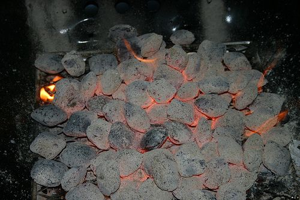
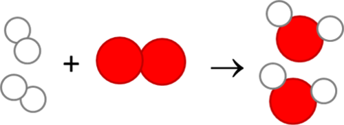
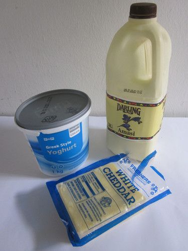
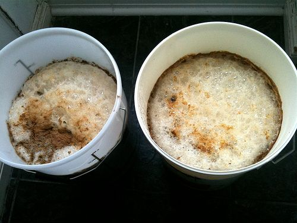
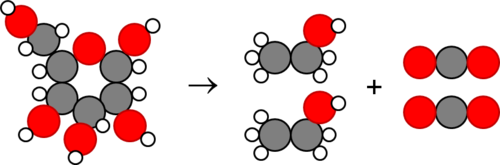
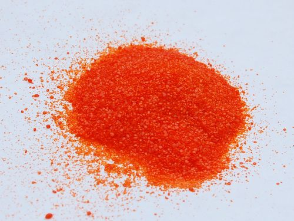
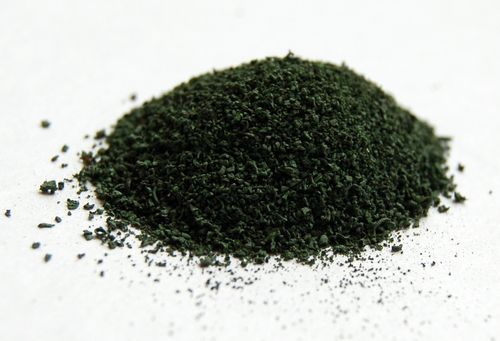
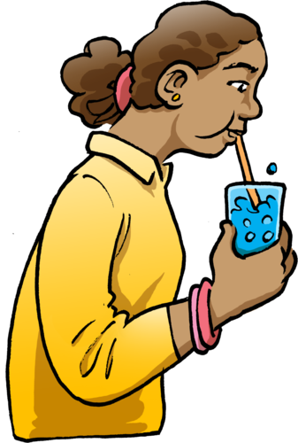
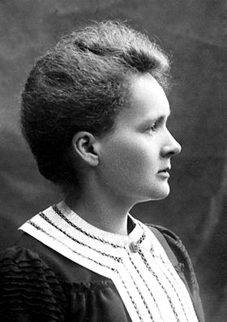

## Reactants and products

<Callout type="note" title="Note">
- reactant
- product
- chemical equation
- coefficients
- fermentation
</Callout>

In Chapter 1 we learnt that compounds are formed by chemical reactions. Can you remember what a compound is? Write a definition here.

A compound is a material that consists of atoms of two or more elements that are chemically bonded together in a fixed ratio. Encourage your learners to make a note of this in the margin of their workbook.

Write down the formulae of three different compounds.

Learner dependent answer. H2O, CO2, NaCl, etc.

# Analysing the eggshell experiment

In the eggshell activity the calcium carbonate in the eggshell reacted with acetic acid and formed calcium acetate, carbon dioxide and water.

We can write this **chemical equation** as follows:

eggshell + vinegar → calcium acetate + carbon dioxide + water

**QUESTIONS:**

**Problem:**
There are two starting substances **before** this chemical reaction takes place. What are they?

**Solution:**
The eggshell (calcium carbonate) and vinegar (acetic acid).

**Problem:**
There are three substances present **after** the reaction. What are these?

**Solution:**
They are calcium acetate, carbon dioxide and water.

**Problem:**
What are the chemical formulae for the compounds water and carbon dioxide?

**Solution:**
Water is H2O and carbon dioxide is CO2.

**Problem:**
We call the substances that are present before the chemical reaction has taken place, the **reactants**. What are the reactants of the eggshell experiment?

**Solution:**
The eggshell (calcium carbonate) and vinegar (acetic acid).

**Problem:**
What do you think happened to the reactants during the chemical reactions?

**Solution:**
Use this to assess learner's understanding so far. They should mention that the reactants are used to make the products.

**Problem:**
We call the substances that are produced during the chemical reaction, the **products**. What are the products of the eggshell experiment?

**Solution:**
They are calcium acetate, carbon dioxide and water.

During a chemical reaction, the reactants are used to make the products. The atoms in the reactants have been rearranged into new compounds (the products).

<Callout type="note" title="Note">
A simulation about reactants, products and leftovers[http://phet.colorado.edu/en/simulation/reactants-products-and-leftovers](http://phet.colorado.edu/en/simulation/reactants-products-and-leftovers)
</Callout>

Teacher's guide for the PhET simulation in the visit box. [http://phet.colorado.edu/files/teachers-guide/reactants-products-and-leftovers-guide.pdf](http://phet.colorado.edu/files/teachers-guide/reactants-products-and-leftovers-guide.pdf) Simulations are a powerful tool and we encourage you to use them if you have access to the internet or encourage your learners to experiment with them outside of class. Learners can also access the site over their mobile phones by typing the bit.ly link into their address bar.

### A chemical reaction is a rearrangement of atoms

Get your learners to do these reactions themselves on their desks in front of them using beads/peas/lentils/balls and rearrange the atoms to make the products.

In order to change a compound into a different compound, we need to change the way in which the atoms in the compound are arranged. This is exactly what a chemical reaction is: a rearrangement of atoms to turn one or more compounds into new compounds.

Any time atoms separate from each other and recombine into different combinations of atoms, we say a chemical reaction has occurred.

We are going to use coloured circles to represent the atoms in the compounds which take place in chemical reactions. If you still have your beads or playdough from previously, you can also make these reactions yourself on your desk. Look at the following diagram.

We have carbon and oxygen on the left of the arrow reacting to make carbon dioxide on the right of the arrow.

To the left of the arrow, we have the 'before' situation. This side represents the substances we have before the reaction takes place. They are called the **reactants**.

To the right of the arrow we have the 'after' situation. This side represents the substances that we have after the reaction has taken place. They are called the **products.**

REACTANTS (before the reaction) → PRODUCTS (after the reaction)

Do you see how the atoms have rearranged? This means a chemical reaction has taken place. Label the diagram with 'reactants' and 'product'.

The reaction between carbon and oxygen takes place when we burn coal. Coal is carbon and when it burns in oxygen gas, carbon dioxide is formed.

Burning coal. [http://www.flickr.com/photos/cote/66570391/](http://www.flickr.com/photos/cote/66570391/)

The diagram below represents another chemical reaction. We have oxygen (red molecules) reacting with hydrogen (white molecule) to produce water.

What are the reactants in this reaction?

Oxygen and hydrogen.

What is the product in this reaction?

Water.

Why do you think hydrogen and oxygen are represented as two atoms joined together?

This links back to what learners covered in Chapter 1 about diatomic molecules. These elements exist as diatomic molecules so they have two atoms joined together.

Do you remember when we spoke about **chemical bonds** between atoms in a molecule in Chapter 1? A chemical bond is a force which holds the atoms together. Therefore, during a chemical reaction, the bonds between atoms have to break so that the atoms can rearrange to form the products. New bonds form between the atoms in the product.

Next we will look at a chemical reaction that has been used by humankind for centuries.

### Fermentation is a chemical reaction

Have you ever forgotten some milk or juice in a bottle, to find that it has 'gone off' a few days later? If you accidentally tasted it, it may have tasted sour and, in the case of the juice, a bit fizzy as well. Your senses may have warned you not to drink any more of it. Do you remember learning in Gr. 7 that our sense of taste protects us from food that has spoiled?

The sour taste of the milk or juice is caused by the products of **fermentation**. Which compounds have a sour taste?

Acids taste sour.

Fermentation does not only produce unwanted products. Yoghurt, buttermilk and cheese are all fermented milk products. In these examples, the fermentation process creates acids that give these foods a sour taste.

Different dairy products which are made using fermentation.

Fermentation is also the process by which a variety of fruits, vegetables and grains can be used to make alcohol. In many cultures the brewing of alcoholic drinks is part of their indigenous knowledge.

Two buckets of ginger beer fermenting.[http://www.flickr.com/photos/nikonvscanon/4231775258/](http://www.flickr.com/photos/nikonvscanon/4231775258/)

<Callout type="note" title="Note">
How fermentation works
</Callout>

The video on how fermentation works (5:39) is short and fun. The first two minutes give a brief description. During the rest of the video, the presenter demonstrates how to make your own ginger beer.

# Studying the fermentation reaction

The basic reaction in the fermentation process can be summarised as follows:

glucose → alcohol + carbon dioxide

What are the reactants and products in this reaction?

Glucose is the reactant and alcohol and carbon dioxide are the products.

We can draw pictures of the molecules to show how the atoms are rearranged during the reaction:

In the diagram above, the grey atoms are carbon (C), the red atoms are oxygen (O) and the small, white ones are hydrogen (H). Write in the names of the compounds in this reaction.

Learners must write glucose on the left and alcohol and then carbon dioxide on the right.

Glucose does not change into alcohol and carbon dioxide by itself! Microorganisms like yeast and bacteria actively ferment glucose.

<Callout type="note" title="Note">
Yeast produce special chemicals called enzymes that can break down the bonds in sugars such as glucose to form smaller molecules like alcohol and carbon dioxide.
</Callout>

Learners would have first encountered bacteria in Gr. 7 Life and Living when studying biodiversity and the classification of organisms. They will look at microorganisms in more detail in Gr. 9 Life and Living.

In South Africa, a popular drink is ginger or pineapple beer! The fizzy bubbles in the ginger beer or pineapple beer are bubbles of carbon dioxide produced by the yeast during fermentation. Let's make some ginger beer!

This is an extension activity and can be performed if you have time in class. It may also be done as a **project.** We will also look at fermentation again in Matter and Materials next term. In fermentation, the glucose is incompletely broken down, so it yields less energy (in the form of ATP) than respiration. Fermentation is also anaerobic meaning it does not require oxygen, whereas respiration requires oxygen. Alcohol is produced during fermentation. However, **ginger beer is non-alcoholic**. Although it is called 'beer', it is not alcoholic because it is not fermented for long enough.

**INSTRUCTIONS:**

2. You need to research how to make traditional South African ginger beer.
4. Identify the different ingredients you will need.
6. Once you have done so, you can decide as a class about the best recipe you will use. You can then make ginger beer in class with your teacher.
8. Answer the questions that follow.

A recipe for ginger beer is provided here. Learner must also research their own recipe in groups and write out the best recipe that they have. You can then either choose one of their recipes to use, or use this one, or you can test different recipes to see which one works best.

A step-by-step guide on making ginger beer. [http://whatsforsupper-juno.blogspot.com/2007/06/old-fashioned-home-made-ginger-beer.html](http://whatsforsupper-juno.blogspot.com/2007/06/old-fashioned-home-made-ginger-beer.html)

**MATERIALS:**

- 6 - 8 medium size lemons
  - grated rind of 2 lemons
  - 250 ml (1 cup) of freshly squeezed lemon juice (from about 6 lemons)
- 2 thumb-size pieces of fresh ginger
- 2 teaspoons of dried powder ginger
- 6 raisins
- 750 ml (3 cups) white sugar
- 5 litres of water
- 1 x 10 g sachet of instant (active dry) yeast
- grater
- lemon squeezer
- container or bucket
- wooden spoon
- large bottle
- several smaller bottles with lids
- balloons
- rubber bands

**INSTRUCTIONS:**

2. Grate the lemon rind from 2 lemons into a large container or bucket.
4. Grate the fresh ginger as well using the coarse teeth of the grater.
6. Squeeze out the juice from about 6 lemons. You will need 250 ml. Add the juice to the mixture.
8. Add the dried ginger, raisins and sugar.
10. Add 1 litre of hot water (not boiling) and stir for about 3 minutes until the sugar has completely dissolved.
12. Add another 4 litres of warm water. Make sure the water is cool enough for you to hold a finger in it comfortably (otherwise the yeast will die!).
14. Sprinkle the sachet of dried yeast over the top of the water and leave it for a few minutes.
16. Stir everything with a wooden spoon.
18. Pour the liquid into a large bottle and attach a balloon over the neck of the bottle. Secure the balloon to the neck with a thick rubber band.
20. Place the bottle in a warm place but not in direct sunlight.
22. Let it stand for approximately 4 - 5 hours.
24. When the raisins float to the top the ginger beer is ready to drink.
26. Strain the liquid through a sieve. Make sure you work over a basin or similar area.
28. Pour the ginger beer into clean clear glass bottles and add a raisin to each bottle. Make sure that you do not fill the bottles completely but leave at least 7 - 10 cm between the liquid and the top of the bottle's neck.
30. Attach a balloon to the necks of half of the bottles and secure these with rubber bands.
32. Screw the lids onto the other half of the bottles.
34. Store the bottles away from heat or sunlight. (They do not need to be in a warm place.)
36. Leave it to stand overnight for at least 8 hours.
38. Gentle unscrew the caps. The gas inside will want to escape so do this slowly and carefully.

**QUESTIONS:**

**Problem:**
What are the reactants in the reaction to make ginger beer?

**Solution:**
The chemical reaction occurs between sugar and fermenting fruit and the yeast. So the reactants are the sugar and fruit (ginger and raisins).

**Problem:**
What is the product in the reaction taking place in the ginger beer?

**Solution:**
The product is carbon dioxide (and a very small amount of alcohol).

**Problem:**
Why are there fizzy bubbles in the ginger beer?

**Solution:**
It is the carbon dioxide gas that is was trapped in the liquid.

**Problem:**
Where do you think the gas came from?

**Solution:**
It is a result of the chemical reaction between the yeast, the sugar and the fermenting fruit.

**Problem:**
Another example of where we see a chemical reaction taking place is when we burn wood in a fire, either in our homes or to cook food. The wood burns and produces carbon dioxide gas and water vapour. What are the products and reactants in this reactions?

**Solution:**
The reactants are the wood and oxygen, and the products are the carbon dioxide and water.

### Chemical reactions can help us to detect certain substances

Some chemical reactions can produce results that are unique and even spectacular! Have you ever seen the volcano experiment? This experiment is shown in the video link in the visit box.

<Callout type="note" title="Note">
A video showing the ammonium dichromate volcano
</Callout>

When ammonium dichromate burns in oxygen, the reaction produces bright orange sparks. The reaction forms nitrogen gas (N2), water and a dark-green compound called chromium oxide as products. This reaction is unique. Only ammonium dichromate reacts with oxygen to form these particular products with these particular visual effects.

Ammonium dichromate before it is burned in oxygen.

Chromium oxide is the product.

When two substances react in a unique and characteristic way when they are mixed, one of them can be used to *detect* the other.

# Some chemical reactions from Life and Living

This activity reinforces some concepts learned in the beginning of the year in Life and Living about respiration and photosynthesis. CAPS suggests doing the experiment again where you blow bubbles through lime water. We did this in Chapter 1 this year as an activity, but you can repeat it briefly here to show the results again if learners do not remember it well.

**Problem:**
Do you remember we used clear lime water to detect carbon dioxide in our breath in Chapter 1 in Life and Living? What colour did the clear lime water turn when we blew bubbles through it?

**Solution:**
It turned a milky white colour.

**Problem:**
Limewater is a solution of calcium hydroxide in water. A reaction occurs between the lime water and the carbon dioxide to produce a white substance in the water called calcium carbonate. What are the reactants and products in this reaction?

**Solution:**
The reactants are limewater (calcium hydroxide) and carbon dioxide and the products are calcium carbonate and water.

**Problem:**
We say that we used the colour change of the lime water to detect the carbon dioxide in our breath. Carbon dioxide is the by-product of the chemical reaction that takes place during respiration in all organisms. Write a word equation for respiration.

**Solution:**
glucose + oxygen → energy + carbon dioxide + water

**Problem:**
In Life and Living we spoke about the ingredients of respiration as we had not yet learned the terms reactant and product. What are the reactants and what are the products in respiration?

**Solution:**
The reactants are glucose and oxygen. The products are energy, carbon dioxide and water.

**Problem:**
What are the reactants and products in photosynthesis?

**Solution:**
The reactants are carbon dioxide and water, the products are glucose and oxygen.

We have also learnt that chemical reactions are simply rearrangements of atoms in molecules, to make different molecules. That is what many chemists do for a living! They find ways of rearranging atoms in order to make new compounds.

### Careers in chemistry

This section is not for assessment purposes, and you may be inclined to leave it out. However, we strongly encourage you to give your learners the opportunity to discover the applications of what they are learning in class in the world around them, even if it as a homework exercise. It is very important for learners to realise that what they learn in class extends far beyond the walls of your classroom. Encourage them to be curious!

Natural sciences is all about discovery! We want to show you how the things you study in class are useful in the real world. This subject is much too big for us to learn everything about it in school. There are many different careers based in science that you can choose. Be curious about the world around you and explore it with your growing science knowledge!

<Callout type="note" title="Note">
Next year you will choose the subjects that you will be studying until Grade 12. Will you choose Physical Sciences, Life Sciences and Mathematics? Before you decide which subjects to take, explore what you can do with each of them after school.
</Callout>

Let's find out a bit more about the possibilities of fields related to what we have been studying in Matter and Materials.

<Callout type="note" title="Note">
Science is awesome[http://io9.com/5815053/science-is-awesome](http://io9.com/5815053/science-is-awesome)
</Callout>

Marie Curie (1867 - 1934) was a famous chemist and physicist, honoured specifically for her research on radioactivity. She was the first woman to win a Nobel Prize, the only woman to win in two fields and the only person yet to win a Nobel Prize in multiple sciences!

Many learners might wonder, what is the difference between a chemist and a chemical engineer?

A **chemist** studies the composition and properties of matter. They use the knowledge they gain to develop new compounds, products and processes to improve our daily lives. A chemist requires an extensive knowledge of chemistry and must be competent in a laboratory. Chemists often research chemical reactions to be able to produce new materials and compounds. These could be new medicines, innovative building materials, new fuels that do not harm the environment, and many others. Researching new chemical reactions is complicated. The work is often researched in teams with other scientists and engineers.

A **chemical engineer** is usually involved in developing ways to produce the new compounds developed by the chemist on a large scale or to find ways of lowering the cost of producing those compounds. A chemical engineer needs a general knowledge of chemistry but also needs to know a lot about processes and what drives them.

A researcher works to discover something new, or a new way of doing things, while an engineer optimises a known process or figures out the best way to make a known compound.

**Invite a chemist/engineer:** Do you know someone who is a chemist or a chemical engineer? Perhaps you live near a university? If you do, you could invite a chemist or engineer to come to your school and talk to your class about the work that chemists do. Alternatively, you could visit the chemist or engineer at their workplace and ask them to show you around. You could get your learners to prepare a few questions beforehand: you could ask them about their work, their training and what they think are the qualities needed if one wanted to become a chemist. Just remember to make an appointment first! This activity could be turned into a small group project. Learners could be required to write a short report on the information they have gathered. It is not for assessment purposes.

There are many, many applications and uses of chemistry, and many different careers make use of chemistry in some way. Let's find out.

# Careers in chemistry

<Callout type="note" title="Note">
A useful site to find out more about some chemistry-related careers.[http://portal.acs.org/portal/acs/corg/content?_nfpb=true&_pageLabel=PP_SUPERARTICLE&node_id=1188&use_sec=false&sec_url_var=region1&__uuid=964e0712-eaa0-4f2a-a03d-689d0a3cd62c](http://portal.acs.org/portal/acs/corg/content?_nfpb=true&_pageLabel=PP_SUPERARTICLE&node_id=1188&use_sec=false&sec_url_var=region1&__uuid=964e0712-eaa0-4f2a-a03d-689d0a3cd62c)
</Callout>

**INSTRUCTIONS:**

2. Below is a list of different careers that all use chemistry in some way. Have a look through the list and then select the five careers you find most interesting.
4. Do an internet search to find out what each career is.
6. Write a one line description of this career.
8. If there is a career that really interests you, draw a smiley face next to it and be sure to do some extra reading around the topic and where chemistry might take you! Find out what level of chemistry you will need for this particular career.
10. There are many other careers besides the ones listed here which use chemistry in some way, so if you know of something else which is not listed here and it interests you, follow your curiosity and discover the possibilities!

**Some careers involving chemistry:**

- Agricultural chemistry
- Biochemistry
- Biotechnology
- Chemical education/teaching
- Chemistry researcher
- Environmental chemistry
- Forensic science
- Food science/technology
- Geneticist
- Geochemistry
- Materials science
- Medicine and medicinal chemistry
- Oil and petroleum industry
- Organic chemistry
- Oceanography
- Patent law
- Pharmaceuticals
- Space exploration
- Zoology

**Your descriptions of the careers you are interested in:**
