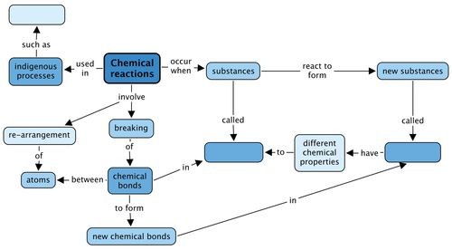
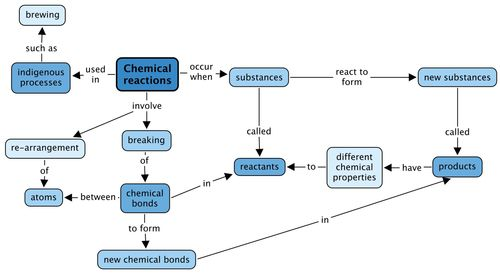

## Summary

<Callout type="note" title="Note">
- During chemical reactions, materials are changed into new materials with new chemical and physical properties.
- The materials we start with are called reactants and the new materials that form are called products.
- During chemical reactions, atoms are rearranged. This requires that chemical bonds in the reactants are broken and that new bonds are formed, resulting in product formation.
- Fermentation in brewing is an example of a chemical reaction that is also part of indigenous knowledge.
</Callout>

**Concept map**

