## Friction and static electricity

<Callout type="note" title="Note">
- friction
- static electricity
- electrostatic charge
- attract: to pull something closer
- repel: to push something away
- neutral
- discharge
- earth
- earthing
</Callout>

The effects of **static electricity** are all around us, but we do not always recognise it when we see or feel them. Or perhaps you have, but you never realised what was causing it. For example, have you ever felt a slight shock when you put a jersey over your head on a cold day, or perhaps you have observed your hair stand on end when you touch certain objects? Let's do a quick activity to demonstrate static electricity.

<Callout type="note" title="Note">
Watch this video about static electricty to understand why your hair stands on ends when you brush it or rub it against a balloon
</Callout>

# Sticky balloons

You can also do this activity using a plastic comb rather than balloons. Or else you can use pieces of paper instead of a learner's hair as not all hair will behave in the following way if it has product in it. You can then rather rub the balloon on a jersey and pick up pieces of paper.

**MATERIALS:**

- balloons (or a plastic comb)
- small pieces of paper

**INSTRUCTIONS:**

**Problem:**
Work in pairs.

**Solution:**

**Problem:**
Blow up a balloon and tie it closed so that the air does not escape.

**Solution:**

**Problem:**
Hold the balloon a short distance away from your hair or pieces of paper. What do you notice?

**Solution:**
Nothing happens.

**Problem:**
Rub your hair with the balloon.

**Solution:**

**Problem:**
Now hold the balloon a short distance away from your hair or pieces of paper. What do you see?

**Solution:**
The hair should "rise" and stick to the balloon, or the pieces of paper will stick to the balloon.

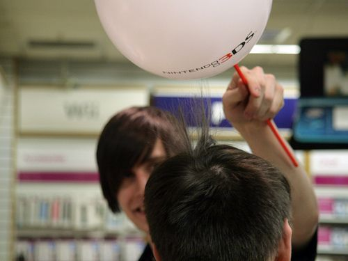

Did you see your hair 'rise' like this?!

**QUESTION:**

**Problem:**
What did you do to make your hair or the pieces of paper stick to the balloon?

**Solution:**
Rubbed it vigorously with the balloon.

Let's look at an everyday example of static electricity. Sometimes when you comb your hair with a plastic comb your hair stands on end and makes crackling sounds. How does this happen?

You have dragged the surface of the plastic comb against the surfaces of your hair. When two surfaces are rubbed together there is **friction** between them. Friction is a resistance against the movement of an object as a result of its contact with another object. This means that when you rubbed the plastic comb along your hair, your hair resisted the movement of the comb and slowed it down.

The friction between two surfaces can cause electrons to be transferred from one surface to the other.

In order to understand how electrons can be transferred, we need to remember what we learned about the structure of an atom last term in Matter and Materials.

All atoms have a nucleus which contains protons and neutrons. The nucleus is held together by a very strong force, which means that the protons within a nucleus can be considered to be fixed there. The atom also contains electrons. Where are the electrons arranged in the atom?

The electrons are arranged in the space around the nucleus.

What is the charge on a proton?

Positive charge.

What is the charge on an electron?

Negative charge.

What is the charge on a neutron?

Neutrons are not charged. They are neutral.

The atom is held together by the **electrostatic attraction**between the positively charged nucleus and the negatively charged electrons. Within an atom, the electrons closest to the nucleus are the most strongly held, whilst those further away experience a weaker attraction.

Normally, atoms contain the same number of protons and electrons. This means that atoms are normally **neutral** because they have the same number of positive charges as negative charges, so the charges balance each other out. All objects are made up of atoms and since atoms are normally neutral, objects are also usually neutral.

However, when we rub two surfaces together, like when you comb your hair or rub a balloon against your hair, the friction can cause electrons to be transferred from one object to another. Remember, the protons are fixed in place in the nucleus and so they cannot be transferred between atoms, it is only electrons that are able to be transferred to another surface. Some objects give up electrons more easily than other objects. Look at the following diagram which explains how this happens.

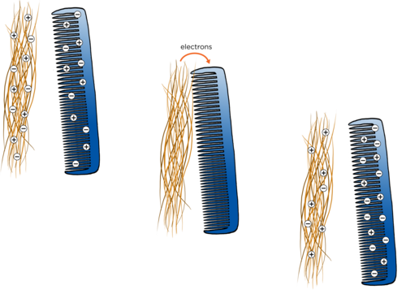

Which object gave up some of its electrons in the diagram?

The hair.

Does this object now have more positive or more negative charges?

It has more positive charges.

Which object gained electrons in the diagram?

The comb.

Does this object now have more positive or more negative charges?

It has more negative charges.

When an object has more electrons than protons overall, then we say that the object is **negatively charged**.

When an object has fewer electrons than protons overall, then we say that the object is **positively charged**.

Have a look at the following diagram which illustrates this.

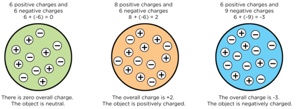

So, we now understand the transfer of electrons that takes place as a result of friction between objects. But, how did that result in your hair rising when you brought the charged balloon close to your hair in the last activity? Let's look at what happens when oppositely charged objects are brought together.

# Turning the wheel

This is a fun demonstration of how like charges repel each other and unlike charges attract each other. If you have enough materials, allow the learners to try this themselves. If you don't have enough materials, do this as a demonstration but give the learners a chance to play a bit.

Practise this activity a few times first to make sure that you have the method right. Remember that it is quite easy to accidently earth the rods so work with care. This will work best on a dry day. This will be dependent on the area which you live in.

At a brainstorming workshop with volunteer teachers and academics at the beginning of 2013, we filmed a quick demonstration of this task when the group was discussing it. You can view this short clip here:

**MATERIALS:**

- 2 curved watch glasses
- 2 perspex rods
- cloth: wool or nylon
- plastic rod
- small pieces of torn paper

**INSTRUCTIONS:**

**Problem:**
Place a watch glass upside down on the table.

**Solution:**

**Problem:**
Balance the second watch glass upright on the first watch glass.

**Solution:**

**Problem:**
Rub one of the perspex rods vigorously with the cloth.

**Solution:**

**Problem:**
Balance the perspex rod across the top of the watch glass.

**Solution:**

**Problem:**
Rub the second perspex rod vigorously with the same cloth.

**Solution:**

**Problem:**
Bring the second perspex rod close to the first perspex rod. What do you see happening?

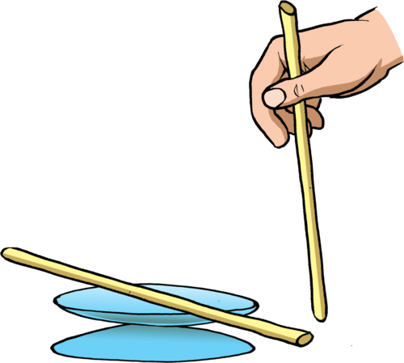

**Solution:**
The second perspex rod should repel the first one as they have like charges, so learners should see the second rod 'pushing' the first one around in a circle.

You might need to rub the first perspex rod again, in between attempts, as the charge does dissipate.

**Problem:**
Repeat the activity but instead of the second perspex rod, use the plastic rod. What do you see happening?

**Solution:**
The rods now have opposite charges and so the second rod should be seen to 'pull' the other rod around in a circle.

**Problem:**
Next, bring a rod that you have rubbed close to small pieces of torn paper lying on the table. What do you observe?

**Solution:**
The learners should be able to pick up the pieces of paper with the charged rod.

**QUESTIONS:**

**Problem:**
What happened when you brought the second perspex rod close to the first perspex rod?

**Solution:**
When the rods are the same (i.e. both perspex) then the first rod should move away from the second and the top watch glass will turn in a circle.

**Problem:**
What happened when you brought the plastic rod close to the first perspex rod?

**Solution:**
When the two different materials are used then the first rod should move towards the plastic rod and the watch glass will turn in a circle towards the plastic rod.

**Problem:**
What happened when you brought the plastic rod close to the pieces of paper?

**Solution:**
The pieces of paper were attracted to the plastic rod.

When we rubbed the perspex rods with the cloth, electrons were transferred from the perspex to the cloth. What charge do the perspex rods now have?

A positive charge.

Both the perspex rods now have the **same** charge. Did you notice that objects with the same charge tend to push each other away? We say that they are **repelling** each other.

When we rubbed the plastic rod with the cloth, electrons were transferred from the cloth to the plastic rod. What charge does the plastic rod now have?

A negative charge.

The perspex rod and the plastic rod now have **opposite** charges. Did you notice that objects with different charge tend to pull each other together? We say that they are **attracting** each other.

In the example of the pieces of paper being attracted to the ruler, the paper starts off neutral. However, as the negatively charged plastic rod is brought closer, the electrons in the paper that are nearest to the rod will begin to move away, leaving behind a positive charge on the surfaces of the paper that are nearest to the rod. The paper is therefore attracted to the rod because opposite charges attract. Another example is dust that is attracted to newly polished glasses.

<Callout type="note" title="Note">
Discover more with a simulation on rubbing balloons and a jersey.[http://phet.colorado.edu/en/simulation/balloons](http://phet.colorado.edu/en/simulation/balloons)
</Callout>

We have now observed the fundamental behaviour of charges.

In summary, we can say:

- If two negatively charged objects are brought close together, then they will repel each other.
- If two positively charged objects are brought close together, then they will repel each other.
- If a positively charged object is brought near to a negatively charged object, they will attract each other.

<Callout type="note" title="Note">
Remember, **like charges repel** and **opposite charges attract.**
</Callout>

Do you now understand why your hair rises and is attracted to the balloon after you rub the balloon on your hair? Write a short description to explain what is happening using the words: electrons, transfer, negative charge, positive charge, opposite, attract, repel.

When rubbing hair with the balloon, electrons are transferred from the hair to the balloon. The balloon now has a negative charge and the hair has a positive charge. They have opposite charges and so when the balloon is brought close to the hair again, they attract each other. Since the hair strands each have positive charges, like charges repel and the hair strands repel each other, also causing them to rise up.

<Callout type="note" title="Note">
Opposites attract and like repel (video)
</Callout>

### Sparks, shocks and earthing

<Callout type="note" title="Note">
- flammable
- ignite
</Callout>

A large build-up of charge on an object can be dangerous. When electrons transfer from a charged object to a neutral object we say that the charged object has discharged.

Discharging can take place when the objects touch each other. But the electrons can also transfer from one object to another when they are brought close, but not touching. When electrons move across an air gap they can heat the air enough to make it glow. The glow is called a **spark**.

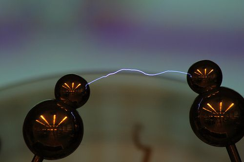

An electrostatic spark between two objects.

Sparks can be harmless, but they can also be very dangerous. Sparks can cause **flammable** materials to **ignite**. You will probably have noticed that you may not smoke cigarettes or have open flames near petrol tanks at petrol stations. This is because petrol fumes are very explosive and only need a small amount of heat to start them burning. A small electrostatic spark is enough to ignite flammable petrol fumes.

<Callout type="note" title="Note">
A video showing the dangers of sparks of static electricity at a petrol station.
</Callout>

This video in the Visit box shows how static electricity from the flowing petrol causes a spark which ignites the petrol fumes and leads to a large fire. It is an illustration of one of the dangers of static electricity.

Electrostatic discharge can also cause **electric shocks**. Have you ever been shocked by a shopping trolley while you are pushing it around a shop? Or have you walked across a carpeted room and then shocked yourself when you touch the door handle to leave the room? You have experienced an electric discharge. Electrons move from the door handle onto your skin and the movement of the electrons causes a small electric shock. Small electric shocks can be uncomfortable but mostly harmless. Large electric shocks are extremely dangerous and can cause injury and death.

<Callout type="note" title="Note">
A simulation on friction between a carpet and John Travolta's foot.[http://phet.colorado.edu/en/simulation/travoltage](http://phet.colorado.edu/en/simulation/travoltage)
</Callout>

<Callout type="note" title="Note">
The discharge of electrons from charged objects happens much more easily when the air is dry, which is why you are more likely to experience electrostatic sparks or shocks in dry weather. This is because when the weather is humid, the moisture in the air can collect on the surface of objects, and prevent the build-up of electrical charge. The charge dissipates through the moisture, which is a better conductor than air.
</Callout>

Do you know where else we can see sparks due to static electricity? Look at the photo for a clue!

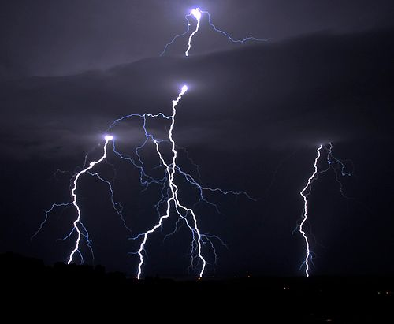

Lightning is a huge electrostatic discharge.

During a thunderstorm, there is friction in the atmosphere between the particles that make up clouds, causing the build-up of regions of charge. Once the difference in charge between two regions becomes great enough, electrostatic discharge becomes possible. A lightning flash is a massive discharge between charged regions within clouds, or between clouds and the Earth.

<Callout type="note" title="Note">
Lightning bolts can travel at about 210 000 km/h and get as hot as 30 000 °C.
</Callout>

<Callout type="note" title="Note">
How to survive a lightning strike.
</Callout>

In order to discharge extra electrons safely from an object we must earth it. **Earthing** means that we connect the charged object to the ground (the Earth) with an electrical conductor. The extra electrons travel along the conductor and enter the ground without causing any harm. The Earth is so large that the extra charge does not have any overall effect.

For example, think of the metal trolleys in shopping centres. Have you ever noticed that they normally have a metal chain hanging at the bottom which drags along the floor? This is to earth the trolley if it gets a charge so that charge cannot build up on the trolley. This protects the person pushing the trolley from getting a shock.

# Research the practical applications of static electricity

**INSTRUCTIONS:**

2. Use the internet or your school or community library to find information about the practical applications of static electricity.
4. Research one useful effect of static electricity and one problem caused by static electricity.
6. Write a short paragraph explaining your research.

There are many different useful and damaging effects of static electricity. Here are some examples.

- useful: air filters remove smoke particles; spray painting; photocopying
- problems: dust on TV and computer screens; damage to electronic equipment

We are now going to look at two instruments which demonstrate static electricity.

### Van de Graaff generator

If you do not have a Van de Graaff generator then you can use some of the videos provided here which show and explain how the generator works. If you do have a generator then allowing the learners to "play" with it will give them a good insight into the effects of static electricity. Allow learners to perform different activities, such as having their hair stand on end.

Let the learners hold onto the dome and then run the generator until their hair stands on end.

Tear up small pieces of paper and place them on the top of the uncharged dome, run the generator and the pieces will become charged and then fly off the generator. This is a good example of the pieces of paper becoming charged and then, because they all have the same charge, repelling each other.

The Van de Graaff generator is a machine which uses friction to generate a large build-up of electric charge on a metal dome.

<Callout type="note" title="Note">
Should a person touch 20 000 Volts? Visit this link to find out!
</Callout>

<Callout type="note" title="Note">
The fundamental idea of using friction in a machine to generate a charge dates back to the 17th century, but the generator was only invented by Robert Van de Graaff in 1929 at Princeton University.
</Callout>

The Van de Graaff generator can be used to demonstrate the effects of an electrostatic charge. The big metal dome at the top becomes positively charged when the generator is turned on. When the dome is charged it can be discharged by bringing another insulated metal sphere close to the dome. The electrons will jump to the dome from the metal sphere and cause a spark.

<Callout type="note" title="Note">
Watch this video so see how a Van de Graaff generator works
</Callout>

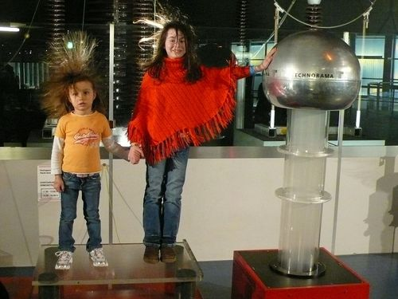

These girls are touching the large dome of a Van de Graaff generator.

You can also touch the dome and your hair will rise. Why do you think this happens?

When you touch the positively charged dome, electrons are transferred from you to the dome to discharge it. This causes you and your hair to become positively charged. The individual hair strands are then positively charged so they repel each other and stand on end.

### Electroscope

An electroscope is an early scientific instrument used to identify the presence of a charged object or it can be used to identify the type of charge on a charged object.

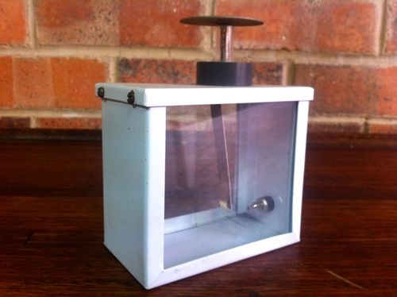

An electroscope used in a laboratory.

The following images show some drawings of different types of electroscopes.

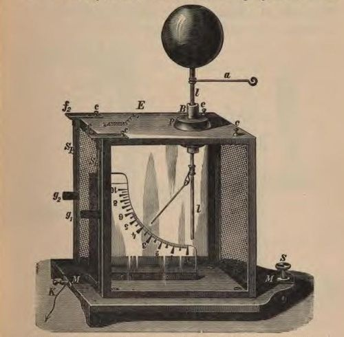

An early example of an electroscope with one gold strip at the bottom and a ball at the top.

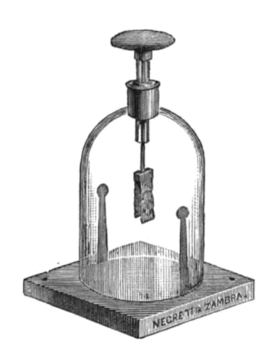

Another example of an electroscope with a disc at the top and two gold foil strips at the bottom.

The electroscope is made up of an earthed metal box with glass windows. There is a metal rod hanging down and at the end are two strips of thin gold foil attached to it. A disc or ball is attached to the top of the metal rod, as seen in the illustrations above. When the metal ball or disc at the top is touched with a charged object, or a charged object is brought near to it, the gold foil strips spread apart, indicating that the object has a charge.

Look at the next illustration which shows how this works.

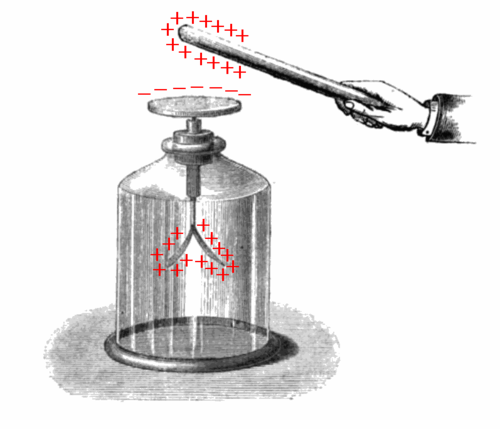

The positively charged rod attracts electrons to the disc from the gold foil strips. The disc at the top becomes negatively charged and the gold foil strips at the bottom become positively charged. Why do the gold foil strips move apart?

They move apart as they now both have a positive charge and positive charges repel.

You can make a simple electroscope with everyday items. Let's try.

# Making a simple electroscope

If you cannot find glass jars with lids then it is possible to make lids. Use old plastic tub lids and cut out a circle the same size as the opening of the glass jar. Then use electrical tape (or even masking tape) to hold the plastic lid in place over the jar opening.

The copper does not have to be 14 gauge but the thicker the piece the better it holds it's shape.

Detailed instructions and videos can be found on the internet. Try video in the Visit box for an excellent description of the method.

<Callout type="note" title="Note">
Make your own electroscope (video)
</Callout>

**MATERIALS:**

- glass jar, with lid
- 14 gauge copper wire, about 12 cm in length
- plastic straw or plastic tubing
- 2 small pieces of aluminium foil
- piece of wool cloth
- plastic ruler
- glass rod

**INSTRUCTIONS:**

2. Twist one end of the copper wire into a spiral shape. This will increase its surface area.
4. Make a hole in the jar lid and push a small piece of the plastic tubing through the hole.
6. Put the other end of the copper wire through the straw so that the spiral end is on the outside of the lid.
8. Make a hook out of the pointed end of the copper wire.
10. Cut two rectangular strips of aluminium foil.
12. Put each piece of aluminium foil onto the hook. Make a small hole in the aluminium foil to allow it to hang from the hook.
14. Carefully put the hook end of the copper wire into the glass jar and close the jar.
16. Rub the ruler with the wool cloth for a minute.
18. Bring the ruler close to the spiral end of the copper wire.

**QUESTIONS:**

**Problem:**
What did you observe when you brought the ruler close to the copper wire?

**Solution:**
The two pieces of aluminium foil moved apart.

**Problem:**
What happens if you move the ruler away from the copper wire?

**Solution:**
The aluminium foil pieces move back together.

Why do the pieces of aluminium foil move apart? When you rubbed the plastic ruler with the wool cloth, the ruler became negatively charged. When the negatively charged ruler is brought close to the copper wire, the electrons on the wire are repelled downwards towards the aluminium foil. The pieces of aluminium foil then have extra electrons on them and they both become negatively charged. Two objects which are negatively charged will repel each other and so the pieces of aluminium foil move away from each other.

This next question is a test of the learners' understanding of the fact that positive charges do not move to cause charging, only electrons can move. But, a positively charged object can move. Learners often get confused with this. Give them a chance to reason out the answer themselves. Allow them to bring a positively charged object close to the electroscope to observe what happens and then try to figure out why the effect is seemingly the same. Rubbing a glass rod with the wool cloth will cause a positive charge to develop on the glass rod.

**Problem:**
Write a short paragraph to explain what would happen if you brought a positively charged object close to your electroscope.

**Solution:**
When a positively charged object is brought close to the electroscope the negative electrons are attracted towards the positively charged object and move up through the copper wire. This means that the pieces of aluminium have lost some electrons and so have an overall positive charge. Both pieces of aluminium foil are then positively charged. Like charges repel each other and so the pieces of aluminium foil move apart from each other.
