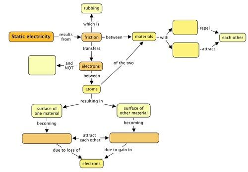
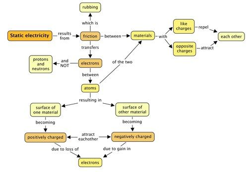
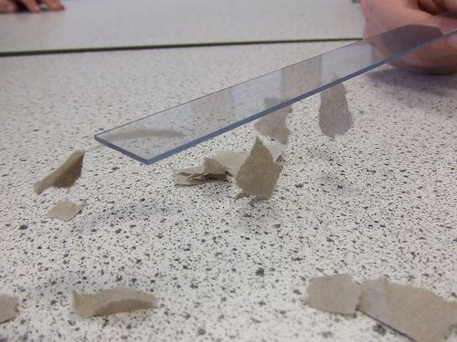
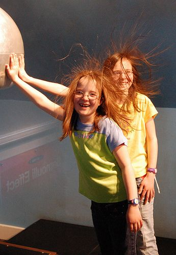

## Summary

<Callout type="note" title="Note">
- Objects are usually neutral because they have the same number of positive and negative charges.
- Objects can become negatively or positively charged when friction (rubbing) results in the transfer of electrons between objects.
- Protons and neutrons cannot be transferred, only electrons can be transferred by friction.
- If an object has more electrons than protons, then it is negatively charged.
- If an object has fewer electrons than protons, then it is positively charged.
- Like charges repel each other, i.e. negative repels negative; positive repels positive.
- Opposite charges attract each other, i.e. negative attracts positive; positive attracts negative.
- A discharge of the electrons from a charged object can cause sparks or shocks of static electricity, especially when the air is dry.
</Callout>

**Concept map**

Complete the following concept map to summarise what you have learned in this chapter about charge and static electricity.

Teacher's version

**Problem:**
Complete the following sentences. Just write the missing word on the line below.

2. An object which has a **negative** charge is said to have _________electrons than protons. [1 mark]

**Solution:**
An object which has a **negative** charge is said to have more electrons than protons.

**Problem:**
An object which has a **positive** charge is said to have _________electrons than protons. [1 mark]

**Solution:**
An object which has a **positive** charge is said to have fewer electrons than protons.

**Problem:**
Sarah uses a plastic comb to comb her hair. The comb becomes negatively charged. The comb is negatively charged because the comb has: [1 mark]

2. gained electrons
4. gained protons
6. lost electrons
8. lost protons

**Solution:**
Answer a.

**Problem:**
A perspex strip was rubbed with a cloth and became positively charged. The correct explanation for why the perspex rod becomes positively charged is that: [1 mark]

2. the perspex rod got extra protons from the cloth.
4. the perspex rod got extra protons due to friction.
6. protons were created as the result of friction.
8. the perspex rod lost electrons to the cloth due to friction.

**Solution:**
Answer d.

**Problem:**
Look at the following images in the table. Redraw the images in the second column to show how the spheres will move because of the nature of the charges. Write an explanation in the last column. [6 marks]

| Charged spheres | Draw how the y will move | Explanation |
| --- | --- | --- |

**Solution:**
3 marks for each of the scenarios, 1 mark is awarded to the drawing and 2 marks to the explanation.

| Charged spheres | Draw how the y will move | Explanation |
| --- | --- | --- |
|  | Learners must draw the spheres moving towards each other. | The spheres have opposite charges, which attract, so they move towards each other. |
|  | Learners must draw the spheres moving away from each other. | The spheres have the same, positive charge and like charges repel, so they move away from each other. |

**Problem:**
Complete the table by working out the overall charge on each object. Show your calculations. State whether the object is positively charged, negatively charged or neutral and why. [9 marks]

| Object | Overall charge | Why is it positive, negative or neutral? |
| --- | --- | --- |

**Solution:**
3 marks for each of the objects, 1 mark is awarded to the calculation and 2 marks to the explanation.

| Object | Overall charge | Why is it positive, negative or neutral? |
| --- | --- | --- |
|  | Charge = 4 + (-4) = 0 | It is neutral as there are equal numbers of positive and negative charges. |
|  | Charge = 3 + (-6) = -3 | It is negatively charged as there are 3 more negative than positive charges. |
|  | Charge = 7 + (-3) = 4 | It is positively charged as there are 4 more positive charges than negative charges. |

**Problem:**
The ruler in this photo has been rubbed with a cloth. Describe what is happening in this photo and why. [4 marks]

What is happening?

**Solution:**
Rubbing the ruler with a cloth transfers electrons from the cloth to the ruler so the ruler now has an excess of electrons and it is negatively charged. The pieces of paper are neutral. When the negatively charged ruler is brought near to the paper pieces, they are attracted to the ruler as the the electrons move around on the paper because of the large charge on the ruler. Electrons will move away from the ruler leaving a positive charge on the paper near the ruler, so they are attracted.

**Problem:**
Sometimes, when you are pushing a trolley, you can get a small shock. Explain why this would happen. [2 mark]

**Solution:**
Friction between the floor and the trolley wheels causes a build-up of charge on the trolley. The charge is earthed by your body, causing the shock.

**Problem:**
Why does your jersey make a crackling sound when you pull it over your head? [2 mark]

**Solution:**
When you pull the jersey over your head the friction causes the jersey and your hair to become charged. The movement of electrons from your hair to the jersey releases energy in the form of light and sound.

**Problem:**
Why do trucks transporting petrol drag a short length of metal chain on the road as they drive? [2 mark]

**Solution:**
When the truck is driving the movement of the petrol in the tank causes a build-up of charge which could cause a dangerous spark when the fuel is off-loaded. The chain earths the tank. The excess charge on the tank is allowed to dissipate to the road.

**Problem:**
What do you think these two girls are touching on the left of the photo? Explain your answer and what is happening to them. [3 marks]

What is happening in this photo?

**Solution:**
The girls are touching the hollow dome of a Van de Graaff generator. The dome is positively charged so electrons are transferred from their bodies to the dome to discharge it. This causes their bodies and hair to become positively charged. Their hair strands now repel each other as they are all positive (like charges repel) and they rise up.

Total [32 marks]
