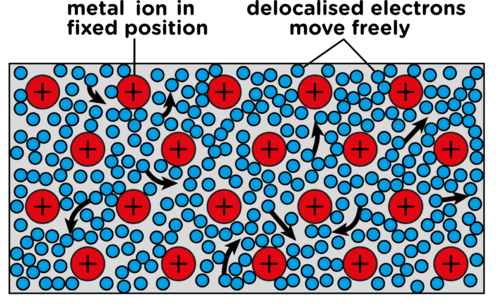
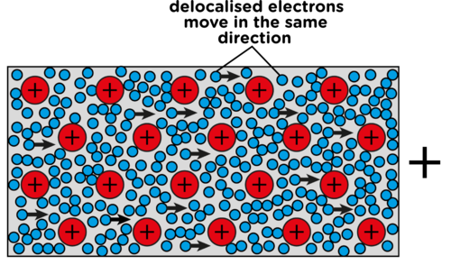

## Circuits and current electricity

<Callout type="note" title="Note">
- delocalised
- component
- conductor
- electric circuit
- electric current
- qualitative
- resistor
- switch
</Callout>

### What is an electric current?

There is no need at this level to discuss the idea of conventional current. The idea of conventional current (the movement of positive charges) was developed prior to the discovery of electron movement. It was adopted as a convention so that all scientists working with electricity could communicate and compare research with ease. The mathematical models of electricity are also simpler when considering conventional current. The idea of conventional current and SI units and their importance will only be discussed in Grade 9.

<Callout type="note" title="Note">
Revise a simple circuit. [video)
</Callout>

An electric current is the movement of charge in a closed, conducting circuit. As we know from Chapter 1, and also from Matter and Materials, the electrons in an atom are arranged in the outer space around the central nucleus. We saw in the last chapter how electrons can be transferred between objects resulting in a charge on the object. In metals, the electrons are able to move freely within the metal. The electrons are not associated with a particular atom in the metal. We say electrons in a metal are **delocalised**. Have a look at the following diagram which shows this.

<Callout type="note" title="Note">
An ion is an atom that has a charge due to the loss or gain of electrons. Here the metal ions are positive as the electrons are delocalised.
</Callout>

Conducting wire in an electric circuit is made of metal. If we supply it with a source of energy and a complete circuit, then the electrons will all move in the same general direction through the wire. This movement of electrons through a conductor is **electric current**.

Do you remember what you learned in Grade 6 and 7 about circuits? Let's revise briefly:

- An electric circuit needs a **source of energy** (a cell or battery).
- Cells have positive and negative terminals.
- A circuit is a **complete pathway** for electricity.
- The circuit must be **closed** in order for a device to work, such as a bulb which lights up.
- We can say that an electric circuit is a **closed system** which transfers electrical energy.
- A circuit is made up of various **components**, which we will look at in more detail.

<Callout type="note" title="Note">
Electricity and circuits (video)
</Callout>

# A simple circuit

**INSTRUCTIONS:**

2. Look at the example of a simple circuit.
4. Answer the questions which follow.

**QUESTIONS:**

Some of these questions are revision of what learners should have covered in Gr 7 CAPS about energy transfers within a system. This acts as a revision exercise and to links back to prior knowledge to reinforce learning.

**Problem:**
What are the parts that make up this system for transferring electrical energy?

**Solution:**
They are the battery, conducting wires, light bulb and switch.

**Problem:**
Do you think this is an open or closed circuit? Explain your answer.

**Solution:**
It is closed as the switch is closed so it is a complete, unbroken pathway.

**Problem:**
Which part is providing the source of energy?

**Solution:**
The battery.

**Problem:**
What is the conducting material?

**Solution:**
The wires, made of metal.

**Problem:**
What type of energy does the battery have?

**Solution:**
Chemical potential energy.

**Problem:**
What is this energy transferred to when the circuit is closed and the electrons **move** through the wires?

**Solution:**
Potential energy is transferred to kinetic energy of the electrons.

**Problem:**
What is the output of this system?

**Solution:**
The bulb lights up, so it is light (and also heat).

**Problem:**
In most systems, the input energy is more than the useful output energy as some of the input energy is transferred to wasted output energy. In this simple circuit with a light bulb, what is the wasted output energy?

**Solution:**
The wasted energy is heat.

A complete circuit is a complete conducting pathway for electricity. It goes from one terminal of a cell along conducting material, through a device and back to the other terminal of the cell. Let's look at the components of a circuit.
