## Components of a circuit

<Callout type="note" title="Note">
- ammeter
- cell
</Callout>

You are probably already familiar with the components of an electric circuit from previous grades. Do you remember that we have a specific way of drawing the components in a circuit in an electric circuit diagram? Each component has a different symbol.

# Components in an electric circuit

Complete the following table. List the function of the component and draw the circuit symbol. The last two rows have been filled in for you as you may not yet know these symbols, but we will be using them in this chapter.

| Component | Function | Symbol |
| --- | --- | --- |
| Cell |  |  |
| Torch bulb |  |  |
| Open switch |  |  |
| Closed switch |  |  |
| Electrical wire |  |  |
| Resistor | A component that opposes or inhibits electrical current in a circuit. It can also convert electrical energy to heat or light. | or |
| Variable resistor | A resistor whose resistance can be adjusted higher or lower. |  |

| Component | Function | Symbol |
| --- | --- | --- |
| Cell | Energy source for a circuit. |  |
| Torch bulb | Provides a light source. |  |
| Open switch | An open switch breaks the circuit and prevents current in the circuit. |  |
| Closed switch | A closed switch completes the circuit and allows current to move in the circuit. |  |
| Electrical wire | Conducts electricity in the circuit. Provides a pathway. |  |
| Resistor | A component that opposes or inhibits electrical current in a circuit. It can also convert electrical energy to heat or light. | or |
| Variable resistor | A resistor whose resistance can be adjusted higher or lower. |  |

Let's now practice drawing some simple circuit diagrams. Draw the following circuit diagrams.

**Problem:**
A closed circuit with one cell, two light bulbs and a switch.

**Solution:**
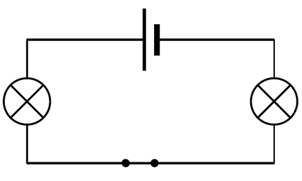

**Problem:**
An open circuit with two cells, two light bulbs and a switch.

**Solution:**
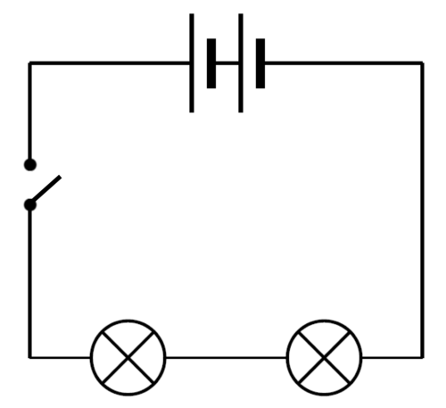

**Problem:**
A closed circuit with 4 cells and one light bulb.

**Solution:**
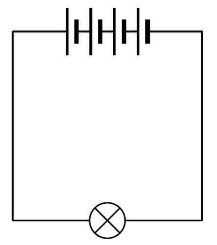

**Problem:**
Look at the following circuit diagram. Identify the number of bulbs, switches and cells in this circuit.

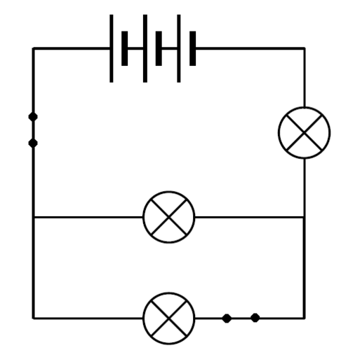

**Solution:**
There are 3 cells, 3 bulbs and 2 switches.

**Problem:**
What is wrong with the following circuit diagram? Does it represent a closed circuit? Explain your answer.

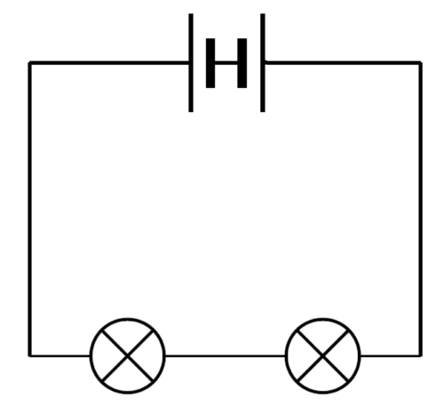

**Solution:**
The one cell is in the wrong position as the two negative terminal are facing each other, instead of the negative terminal of one cell being connected to the positive terminal of the next cell.

**Problem:**
Why do you think it is useful to have a switch in a circuit?

**Solution:**
A switch provides an easy way of opening or closing the circuit and therefore controlling the electric circuit.

**Problem:**
Why are conducting wires made out of metal?

**Solution:**
This is because metals are good conductors of electricity.

<Callout type="note" title="Note">
Build you own electric circuits with this simulation.[http://phet.colorado.edu/en/simulation/circuit-construction-kit-dc](http://phet.colorado.edu/en/simulation/circuit-construction-kit-dc)
</Callout>

Let's take a closer look at the source of energy in electric circuits.

<Callout type="note" title="Note">
All muscles in our bodies move in response to electrical impulses generated naturally in our bodies.
</Callout>

### Cells

Electrical cells are the source of energy for the electric circuit. Where does that energy come from?

Inside the cell are a number of of chemicals. These chemicals store **potential energy**. When a cell is in a complete circuit, the chemicals react with each other. As a result, electrons are given the potential energy they need to start moving through the circuit. When the electrons move they have both potential and kinetic energy. The **electric current** is the movement of electrons through the conducting wires.

Cells come in many different sizes. Different sized cells provide different amounts of energy to the electrical circuit. The types of cells you would use in toys, torches and other small appliances range in size from AAA, AA, C, D, and 9-volt sizes. AAA, AA, C and D cells usually have a rating of 1,5V, but the larger cells have a larger capacity. This means that the larger cells will last longer before going 'flat'. A cell goes flat when it is no longer able to supply energy through its chemical reactions.

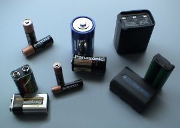

Different sized batteries.

When we buy cells in the shop they are usually referred to as batteries. This can be a bit confusing because a battery is really two or more cells connected together. So when we refer to a battery in circuit diagrams we need to draw two or more cells connected together.

# Recycling of batteries

This activity is a good opportunity for both group work and individual work. The learners can do the research in a group but then write their paragraphs individually. Different learners in the same group may have different recycling centres closest to where they live. You can assess both the quality of their written response as well as the accuracy of their information.

Batteries which no longer work must not be thrown away in dustbins. They need to be recycled.

**INSTRUCTIONS:**

**Problem:**
Work in small groups.

**Solution:**

**Problem:**
Find out why batteries should not be thrown away in normal dustbins. Write a paragraph to explain why.

**Solution:**
Batteries contain toxic chemicals which can leak into the soil and contaminate the environment. Different batteries contain different substances. Lead-acid batteries, used in motor cars and other vehicles, are particularly damaging to the environment.

**Problem:**
Find out where you can recycle batteries in your community. Write down the details of the centre(s) closest to where you live.

**Solution:**
This answer will depend entirely on where the learner lives. Some areas will have little to no access to specialised collection points but most Pick 'n Pay, Spar and Woolworths stores now have battery recycling collection bins and there are various companies in the country which also offer this service. Most municipal dumps also recycle batteries separately.

<Callout type="note" title="Note">
A guide to recycling in South Africa.[http://treevolution.co.za/guide-to-recycling-in-sa/](http://treevolution.co.za/guide-to-recycling-in-sa/)
</Callout>

### Resistors

What are resistors? In order to work out what they are, let's first remind ourselves about conductors and insulators.

We are specifically looking at electricity so we can now talk about **electrical conductors and insulators**. An electrical conductor is a substance which allows electric charge to move through it. An insulator is a substance which does not allow electric charge to move through it.

Think back to our model of a metal wire and how the electrons are able to move through the wire. The metal wire is a conductor of electricity. Write down some materials which do not conduct electricity.

Some materials which do not conduct electricity are plastics, glass and ceramics.

Why do you think most conducting wires are surrounded with plastic?

This is because plastic is an electrical insulator and therefore insulates the wire.

**Resistors** are a bit of both. They allow electrons to move through them, but do not make it easy. They are said to **resist** the movement of electrons. Resistors therefore influence the electric current in a circuit.

Bring a kettle to school so that the learners can see the element inside the kettle. Also use a large, incandescent light bulb to show them the filament wire in the bulb as examples of resistors.

But, why would we want to resist the movement of electrons? Resistors can be extremely useful. Think about a kettle. If you look inside you will see a large metal coil.

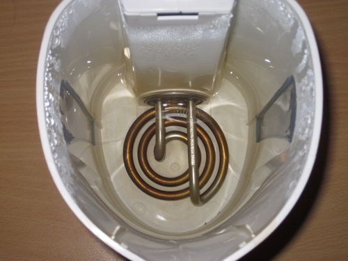

Looking inside a kettle.

This metal coil is the heating element. If you plug in and switch on the kettle, the element heats up and heats the water. The element is a large resistor. When the electrons move through the resistor they expend a lot of energy in overcoming the resistance. This energy is transferred to the surroundings in the form of heat. This heat is useful to us as it heats our water.

<Callout type="note" title="Note">
The first electric light was made in 1800 by a man called Humphry Davy. He invented an electric battery, and when he connected wires to it and a piece of carbon, the carbon glowed as the carbon is a resistor, producing light.
</Callout>

<Callout type="note" title="Note">
The inventor, Thomas Edison, experimented with thousands of different resistor materials until he eventually found the right material so that the bulb would glow for over 1500 hours.
</Callout>

A good example of where resistors are used is in light bulbs. Let's take a closer look at the different parts of a light bulb to see how it works.

# Resistance in a light bulb

Try to have some incandescent light bulbs for the learners to hold and to look at. For extension you could ask the learners to research the use of argon gas rather than normal air for the gas inside the light bulb. Argon is used because it is an inert gas and will prevent oxidation of the filament, therefore lengthening the lifespan of the filament.

The questions in this activity would be discussed and answered as you go through it in class. Learners might not know the answers,but after discussing how a light bulb works with them, they should then write their own answers.

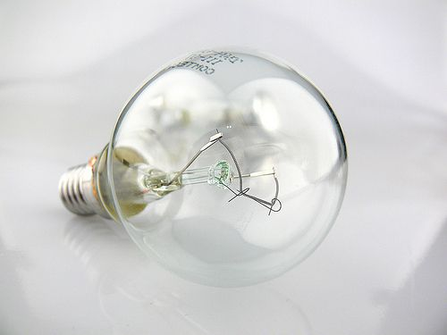

An incandescent light bulb.

**MATERIALS:**

- light bulb
- lamp

**INSTRUCTIONS:**

2. If you have light bulbs available, have a close look at the different parts, otherwise have a look at the photos provided here.
4. Read the information about how a light bulb works and identify the parts that have been numbered.
6. Answer the questions that follow.

<Callout type="note" title="Note">
Incandescent means to emit light as a result of being heated.
</Callout>

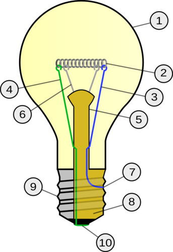

Diagram of the parts of a light bulb.

<Callout type="note" title="Note">
How a light bulb works.
</Callout>

A light bulb consists of an air-tight enclosed glass case (number 1). At the base of the bulb are two metal contacts (numbers 7 and 10), which connect to the ends of an electrical circuit. The metal contacts are attached to two stiff wires, (numbers 3 and 4).

These wires are attached to a thin metal filament. Have a look at a light bulb. Can you identify the filament? This is number 2 in the diagram. The filament is made from tungsten wire. This is an element with high resistance.

**QUESTIONS:**

**Problem:**
When the electrons move through the filament they experience high resistance. This means that they transfer a lot of their energy to the filament when they pass through. The energy is transferred to the surroundings in the form of heat and bright light. Describe the transfer of energy in this light bulb.

**Solution:**
Electrical energy is transferred to heat and light.

**Problem:**
What is the useful energy output and what is the wasted energy output in this light bulb?

**Solution:**
Light is the useful output and heat is the wasted output.

**Problem:**
Can you see the filament is coiled? Why do you think this is so? Discuss this with your class and teacher.

**Solution:**
**NOTE:** This is an extension question as learners will only cover factors affecting resistance later so discuss this as a class. This is to fit a longer length of tungsten within a small space to increase the resistance, and therefore brightness of the bulb.

**Problem:**
The filament is mounted on a glass stem (number 5). There are two small support wires to hold the filament up (number 6). Why do you think the stem is made of glass?

**Solution:**
Glass is an electrical insulator so it will not conduct electricity and all the current will pass through the filament.

**Problem:**
The inside of the base of the bulb is made from an insulating material.This is the yellow part labeled number 8. On the outside of this is a metal conducting cap to which the wire is attached at number 7. Why is the wire attached at 7 making contact with the metal conducting cap?

**Solution:**
This is so that the electrical current can pass in through the electrical contact at number 10 and then through to the wire at number 7, which is touching the inside of the metal insulating cap.

**Problem:**
If you have a lamp in the classroom, screw the bulb into the lamp and turn it on to observe the filament glow and also getting hot.

**Solution:**

<Callout type="note" title="Note">
A fun game about electric circuits.[http://www.andythelwell.com/blobz/guide.html](http://www.andythelwell.com/blobz/guide.html)
</Callout>

The link in the Visit box is an interactive tutorial and set of activities and quizzes to revise electric circuits and circuit diagrams.

<Callout type="note" title="Note">
If you want to revise some of the concepts from previous years, you can discover more online at[[link]](http://www.curious.org.za)[www.curious.org.za](http://www.curious.org.za)
</Callout>

The amount of resistance a substance offers to the circuit is measured in ohms (Ω). If we want to use resistors to control the current flow, then we need to know the amount of resistance. There are some common resistors shown in the photo.

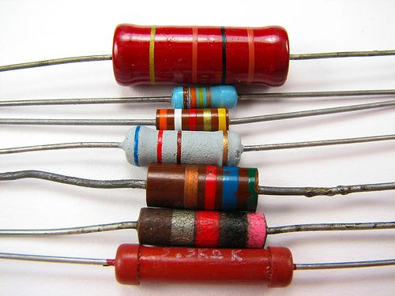

Some common resistors.

Can you see that there are different coloured bands on the resistors? This isn't just to make them look pleasing to the eye. The coloured bands are actually a code that tells us the resistance of the resistor. We also get resistors where we can adjust the resistance ourselves. This is called a variable resistor. You have already seen the symbol for drawing a resistor in a circuit diagram. Draw a circuit diagram in the space below with two bulbs, two cells, an open switch and a resistor.

Learner's diagram should look as follows:

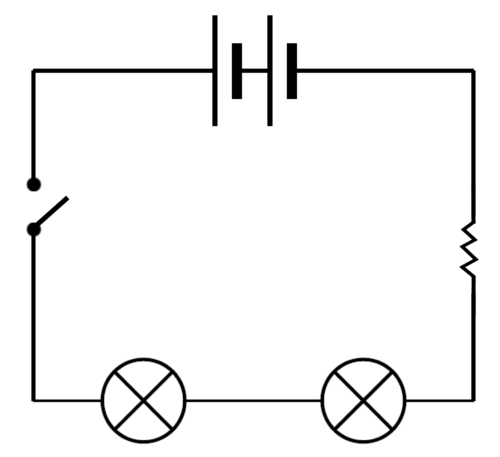

An electric current can have various effects. Let's find out more about what these are.
