## Effects of an electric current

<Callout type="note" title="Note">
- variable
- fuse
- electromagnet
- electric current
</Callout>

We are going to look at the effects of an electric current, and specifically how we use these effects. An electric current can:

- generate heat in a resistor;
- generate a magnetic field; and
- cause a chemical reaction in a solution.

### Heating effect

As electrons move through a resistor they encounter resistance and they transfer some of their energy to the resistor itself. We saw this in the last section where we looked at the filament in a light bulb and the element in a kettle.

A useful video on heat for extra, background information

# Heating a wire in a circuit

This activity is to demonstrate that an electric current travelling through a resistor will cause the resistor's temperature to increase.

**MATERIALS:**

- 1,5 V cell
- conducting wires
- switch
- block of wood
- 2 nails
- hammer
- 10 cm of nichrome wire

Nichrome wire can be bought at any hardware store. Do not leave the circuit on for too long. You want the learners to feel the warmth from the wire, not to burn themselves. This experiment can also be performed with the graphite from a pencil which will emit light as well as heat.

<Callout type="note" title="Note">
You can easily make your own switch by sticking two metal drawing pins into a piece of wood with a metal paper clip in between, as shown in the diagram.
</Callout>

**INSTRUCTIONS:**

**Problem:**
Hammer the two nails into the block of wood and attach the nichrome wire between the nails.

**Solution:**

**Problem:**
Build the following circuit and keep the switch open.

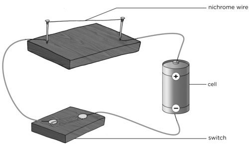

**Solution:**

**Problem:**
Feel the nichrome wire. Is it hot or cold?

**Solution:**
The wire should be cold

**Problem:**
Close the switch. Leave it on for a minute.

**Solution:**

**Problem:**
Open the switch again.

**Solution:**

**Problem:**
Feel the wire, briefly. Is it hot or cold?

**Solution:**
The wire should be hotter than when they first touched it.

**QUESTIONS:**

<Callout type="note" title="Note">
Remember that heat and temperature are not the same thing. Temperature is a measure of how hot or cold something is (measured in °C) whereas heat is the transfer of thermal energy from a hotter object to a colder object (measured in J).
</Callout>

These questions can be used to assess whether learners have grasped the concept. They can be completed after the activity, or the next day in the following lesson as a revision of what was done, or as a homework task.

**Problem:**
When you felt the nichrome wire after the circuit had been on for a while, you felt an increase in **temperature** in your skin as **thermal energy,** which was transferred from the wire to your skin. Explain the heating effect of the electric current in the resistance wire.

**Solution:**
When the circuit is complete, there is a flow of charge (electric current). The electrons moving through the wire transferred energy to the wire in the form of heat. The particles in the wire therefore have more kinetic energy and so the temperature increases.

**Problem:**
List 2 useful applications of the heating effect of an electric current.

**Solution:**
Examples include: iron, kettle, heater, geyser, toaster.

**Problem:**
Choose one of the applications you listed in question 2 and explain how the heating effect of the electric current is used.

**Solution:**
Iron: The metal part of the iron has a high resistance and so it gets hot. This allows us to smooth out the creases in material.

Kettle: The element of the kettle has a high resistance and so it gets hot enough to boil the water.

Heater: The element in a heater has a very high resistance and so it gets very hot. The element heats the air around the heater.

**Problem:**
Look at the following photo of a toaster.

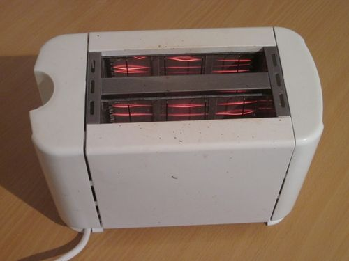

An electric toaster.

Can you see the glowing filament inside? Why does the element glow?

**Solution:**
The electric current passes through the toaster and the element has a high resistance. Energy is transferred to the particles in the element so that they gain kinetic energy and the temperature of the wire increases. Some of the energy is also transferred as light to the surroundings and the wire glows.

So now we know that an electric current can cause objects to heat up. Let's look at a useful application of the heating effect.

# Melting metal

Fuses are a practical application of the heating effect of an electric current. In this activity the learners will see that an electric current can melt a metal, not just warm it up. If you have enough equipment you could allow small groups of learners to complete this activity. Otherwise, use it as a demonstration.

**MATERIALS:**

The light bulb is included to show that the current is flowing while the steel wool is in place but not flowing when the steel wool melts. The variable resistor is used to show that when the resistance is high, the current is low enough that the fuse warms up but doesn't melt. When the resistance is lowered, the current increases until it melts the steel wool.

If you are demonstrating and you want to make the activity more exciting then you can use a small ball of steel wool instead of a wire. This should make the steel wool spark and burn. This should be done behind a screen as the sparks could land on a learner.

If you do not have a variable resistor then leave it out of the circuit and rather explain the concept. An ammeter is also not crucial in doing this activity as the light bulb can be used to indicate whether there is current or not.

- three 1,5 V cells
- copper conducting wires with crocodile clips
- steel wool
- heat resistant mat or piece of wood
- torch light bulb
- variable resistor
- ammeter

<Callout type="note" title="Note">
An ammeter is used to measure the electric current in a circuit.
</Callout>

**INSTRUCTIONS**

**Problem:**
Set up a circuit according to the following picture.

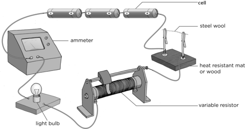

**Solution:**

**Problem:**
Twist a few strands of steel wool into a wire.

**Solution:**
This must not be very thick. Just a few strands will do.

**Problem:**
Use the steel wool to complete the circuit.

**Solution:**

**Problem:**
Set the variable resistor to its highest resistance.

**Solution:**

**Problem:**
Close the switch. What do you observe?

**Solution:**
The light bulb should glow and the steel wool should warm up but not melt.

**Problem:**
Take note of the reading on the ammeter which measures the current in the circuit.

**Solution:**

**Problem:**
Open the switch.

**Solution:**

**Problem:**
Set the variable resistance to its lowest resistance.

**Solution:**

**Problem:**
Close the switch. What do you observe?

**Solution:**
The steel wool melts/burns and breaks up and the light bulb stops glowing.

**QUESTIONS:**

**Problem:**
Draw a circuit diagram for your circuit.

This is the symbol for an ammeter.

**Solution:**
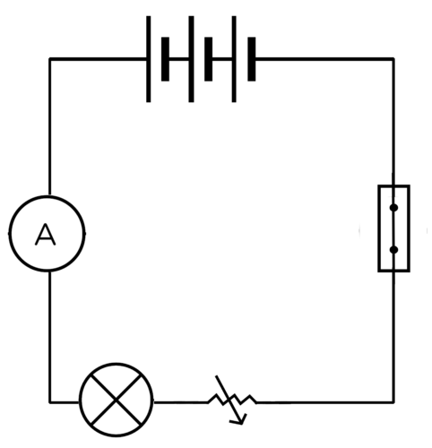

**Problem:**
Why is the light bulb included in the circuit?

**Solution:**
The light bulb is a good indicator of whether or not there is a current in the circuit. If the light bulb glows it means there is electric current. If the light does not glow it means that there is no current (or there is a very small current).

**NOTE:** Sometimes though there might still be a very small electric current, but it does not provide enough energy to cause the light bulb to glow. This is why the light bulb gives a good indication, but an ammeter will provide the most definitive indication of whether there is a current or not.

**Problem:**
When you decreased the resistance, what happened to the current? In other words, what happened to the reading on the ammeter?

**Solution:**
The current increases when the resistance decreased. The ammeter reading increases.

**Problem:**
What do you think happens to the electric current when the steel wool has burnt? Explain your answer.

**Solution:**
The current stops because the circuit has been broken. There is no longer a complete pathway for the electrons to move.

In this activity, we just demonstrated how a **fuse** works. The steel wool acted as a fuse. When the current was too high, the steel wool melted and prevented any further current in the circuit.

### What are fuses?

The heating effect of an electric current can be dangerous. If a circuit overheats it could cause a fire. To avoid overheating, circuits often contain a fuse. Fuses contain a low resistance wire made of a metal with a low melting point. Therefore, the piece of wire melt if it gets too hot, just like the steel wool in our activity.

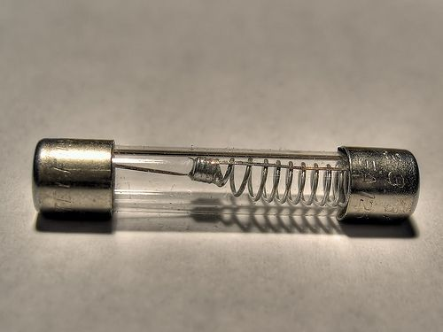

An example of a fuse. Can you see the low melting point wire inside?

Different circuits need different strength currents and so we need different types of fuses. Some fuses can only handle a little bit of heat, some can handle a lot. We choose the fuse that suits the safety needs of our circuit. If the circuit overheats, the fuse will melt and break the circuit to reduce the danger of fire as well as protect electronic equipment.

How did you draw the fuse that we made using steel wool in the last activity? The conventional symbol for drawing a fuse in a circuit diagram is shown here:

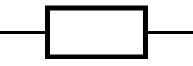

A fuse.

<Callout type="note" title="Note">
It is important to never remove a fuse from a circuit without first switching off the current. You could get a nasty shock if you do.
</Callout>

### What is a short circuit?

Have you ever heard that something broke because it **short circuited**? A short circuit happens when another, easier path is accidently made in an electric circuit. What do we mean by *easier*?

We mean that the path offers very little resistance to the electric current. As there is so little resistance the current flows along the short circuit and doesn't pass through the main circuit. Short circuits can be dangerous and cause a lot of damage to appliances.

Have you ever had a piece of toast get stuck in a toaster? It's a real nuisance. Lots of people are tempted to use their butter knife to unhook the bread. Don't be tempted. Your knife is a conductor and can act as a short circuit. All the electric current will flow through your knife and, because you are touching it, through you. What would be the safe way to unhook your toast?

Either switch off the toaster and then unhook the toast (safest idea!) or use an insulator (plastic) utensil to unhook the toast.

# How are fuses used in everyday circuits?

This activity is an opportunity for individual research. There will be other opportunities for group research. It is important that each learner is able to do basic research so that they are able to contribute effectively to a group research task. The learner should write a short paragraph detailing their research. There are many different household appliances which use fuses. Learners may choose any of them. Remember to make sure that all learners include references for any research they do. They need to learn from an early age to credit sources of information.

**INSTRUCTIONS:**

2. Find out about common household appliances which use fuses. Choose one of these appliances on which to focus your research.
4. Write a short paragraph describing the appliance and explaining why a fuse is necessary for that appliance.

This answer will depend on the appliance chosen. Ensure that the paragraph doesn't only describe the appliance but also explains why the fuse is necessary to prevent accidents.

<Callout type="note" title="Note">
There are different types of fuses. The ones we have investigated so far require you to replace the fuse if the wire melts. However, some fuses work differently to break the circuit and can just be reset once the problem in the circuit is fixed.
</Callout>

Most modern homes have **circuit breakers** instead of fuses. A circuit breaker is similar to a fuse in that it is designed to protect an electric circuit from damage, due to overload or a short circuit, by stopping the current flow. However, unlike a fuse which melts and must then be replaced, a circuit breaker can be reset to start operating again. This can be done manually or take place automatically.

### Magnetic effect

Before we look at how a current produces a magnetic field, let us first learn more about magnets. A magnet is a piece of material which produces a magnetic field. A magnet has a north pole and a south pole. Opposite poles will attract each other and the same poles will repel each other. A magnet has a magnetic field around it.

<Callout type="note" title="Note">
Some fun tricks with magnets. (video)
</Callout>

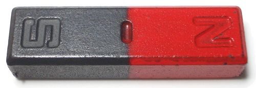

A bar magnet.

Did you know that the Earth is like a bar magnet with a North and a South Pole? The Earth has a magnetic field. This is why we can use compasses to tell direction. A plotting compass has a needle with a small magnet. The needle points to magnetic north because the small magnet is attracted to the opposite magnetic pole and can be used to determine direction.

Earth has a magnetic field, as though there is a big bar magnet running through the core, with its South Pole under Earth's magnetic North pole.

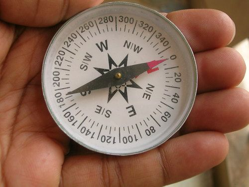

A compass with the needle pointing North.

<Callout type="note" title="Note">
What is the magnetic field?
</Callout>

# Playing with plotting compasses and magnets

This activity allows the learners to see that a plotting compass will respond to a magnetic field. It will allow them to visualise the lines of the magnetic field around a bar magnet. Once the learners are convinced that the plotting compass can model a magnetic field, you can use the compasses to show them that there is a magnetic field around a current-carrying conductor.

**MATERIALS:**

- plotting compasses
- bar magnets
- piece of white paper
- iron filings

**INSTRUCTIONS:**

**Problem:**
Hold the plotting compass in your hand. The north end of the needle should point to magnetic north.

**Solution:**

**Problem:**
Put the bar magnet flat on the desk. Make sure you know which end is north and which is south. If you are not sure, ask your teacher.

**Solution:**

**Problem:**
Put plotting compasses in a circle around the bar magnet. Draw what you see.

**Solution:**
Do not assess drawing skills but make sure that the drawing clearly shows that the plotting compass needles have "lined" up and make a discernable pattern. It is not necessary at this stage to explain the pattern. It is just important that the learners realise that a plotting compass will respond to a magnetic field.

**Problem:**
Next, place a white sheet of paper over the bar magnet and sprinkle iron filings over the sheet of paper over the magnet.

Observe what happens to the iron filings. Did you see something similar to what is shown in the photograph below? Describe what you see.

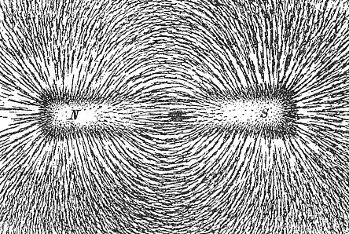

Iron filings on a piece of paper over a bar magnet.

**Solution:**
Learners should describe how they see the iron filings clump together into long lines indicating the magnetic field at each point.

As an extension to indicate to learners how two like poles repel each other, but two opposite poles attract each other, place two bar magnets on a surface with two like poles facing each other and sprinkle iron filings over the piece of paper. You should observe something similar to the photo below.

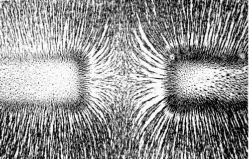

Magnetic field of bar magnets repelling.

Next, turn one magnet around so that opposite poles are now facing each other and sprinkle the filings over the paper again. You should observe a pattern similar to the photo below.

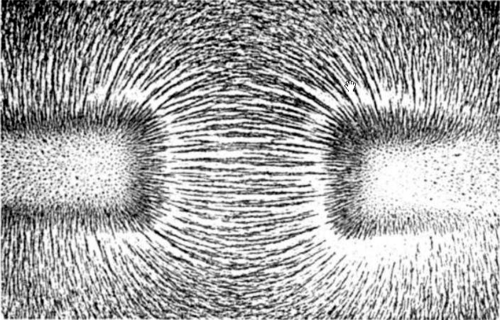

Magnetic field of bar magnets attracting.

<Callout type="note" title="Note">
Explore the interactions between a compass and bar magnet with this simulation.[http://phet.colorado.edu/en/simulation/magnet-and-compass](http://phet.colorado.edu/en/simulation/magnet-and-compass)
</Callout>

So now we know that there is a magnetic field around a magnet and that plotting compasses and iron filings can be used to visualise that field. Is there anything else that has a magnetic field around it?

# Magnetic field around a conductor

This activity will show the learners that the plotting compasses align with a magnetic field around a current-carrying conductor. It is important to make sure that the learners realise that it is a 3D magnetic field and that it surrounds the conducting wire. Learners often assume that the magnetic field only exists where the plotting compasses are placed.

**MATERIALS:**

- plotting compasses
- three 1,5 V cells
- insulated copper conducting wires
- switch

**INSTRUCTIONS:**

**Problem:**
Construct a circuit which contains the batteries, copper wires and the switch.

**Solution:**

**Problem:**
Put the plotting compasses on either side of the conducting wire as shown in the diagram, as well as below and above the conducting wire.

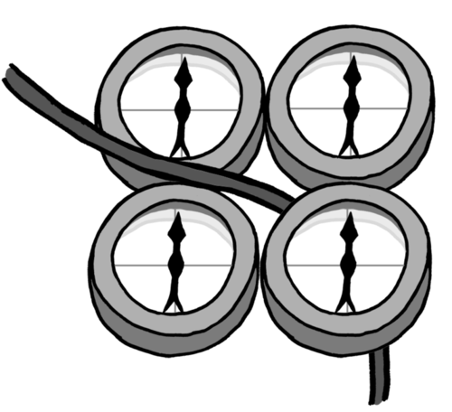

Plotting compasses placed around a conducting wire.

**Solution:**

**Problem:**
Keep the switch open. What do you notice about the needles of the plotting compasses?

**Solution:**
The needles should point to magnetic north.

**Problem:**
Close the switch and observe what happens to the needles.

**Solution:**

**Problem:**
Draw a picture of the wire and plotting compasses in the space below:

**Solution:**
The drawing does not need to be assessed according to the learners drawing skills. What is important is that they see that the compass needles are aligned in a circle when the switch is closed.

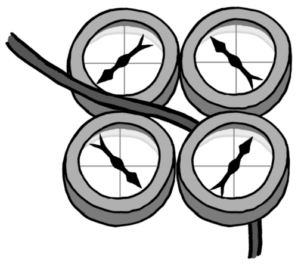

**Problem:**
What does the pattern of the compasses tell us?

**Solution:**
That there is a magnetic field around the wire.

We saw from our first activity that plotting compasses react to magnetic fields. The plotting compasses changed direction when the current was switched on. This means there is a magnetic field around the wire. Was it there when the current was switched off? No, it was not. That means that the presence of the electric current in the wire must have produced a magnetic field.

<Callout type="note" title="Note">
Discover how the Earth is a magnet that protects us from damaging radiation from the sun!
</Callout>

The magnetic effect of an electric current has many useful applications.

# Making an electromagnet

<Callout type="note" title="Note">
How to make an electromagnet (video)
</Callout>

If the learners' electromagnets are not strong enough to pick up the paperclips, suggest they use more batteries or add more coils of wire to the nail. Make sure that their coils are tightly packed, all in the same direction and do not overlap anywhere.

**MATERIALS:**

- one iron nail (approximately 15 cm long)
- 3 metres of 22 gauge insulated copper wire
- two D cell batteries
- paper clips
- iron filings

**INSTRUCTIONS:**

Iron filings can be bought

2. Wrap the insulated copper wire tightly around the nail. Make sure that you wrap the wire in the same direction.
4. Strip some of the insulation off each end of the insulated copper wire.
6. Attach the ends of the insulated copper wire to the terminals of the battery.
8. Hold the wrapped nail above the paper clips.
10. Disconnect the wire from the battery.
12. Hold the wrapped nail above the paper clips.
14. If you have iron filings, place some on a piece of paper around the electromagnet you have made and observe the magnetic field.

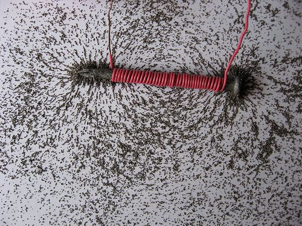

The magnetic field around an electromagnet.

**QUESTIONS:**

**Problem:**
What happened when you held the nail over the paper clips?

**Solution:**
The paper clips should be attracted to the nail.

**Problem:**
Why were the paper clips attracted to the nail?

**Solution:**
The electrical current in the coiled wire caused a magnetic field to form. The magnetic field attracted the metal in the paper clips.

**Problem:**
Did the disconnected nail attract the paper clips? Why?

**Solution:**
The disconnected nail didn't attract the paper clips because there was no current in the wire and so there was no magnetic field.

<Callout type="note" title="Note">
Discover how you can use a battery and wire to make a magnet with this simulation.[http://phet.colorado.edu/en/simulation/magnets-and-electromagnets](http://phet.colorado.edu/en/simulation/magnets-and-electromagnets)
</Callout>

Electromagnets can be used in all sorts of practical applications, including speaker and electric bells, as you can see in the photo.

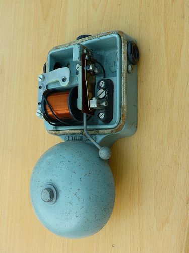

An electromagnet in a bell.

<Callout type="note" title="Note">
Electromagnets in a speaker.[http://electronics.howstuffworks.com/speaker5.htm](http://electronics.howstuffworks.com/speaker5.htm)
</Callout>

# Research the use of electromagnets

Assign different applications to different groups so that you cover a range in the class.

**INSTRUCTIONS:**

2. Work in groups of 2 or 3.
4. Research one of the following applications of the magnetic effect of an electric current to explain how the device works:
   2. speakers
   4. electric bells
   6. telephones
   8. magnetic trains
   10. industrial lifters and separators
6. Write a short paragraph showing what you've learned. Remember to note down from where you got your information.
8. Share your paragraph with the rest of the class.

Here is a general description of each application.

**Speakers:**

The voice coil of a speaker is an electromagnet. The power to the electromagnet is switched on and off in the same sequence as the incoming sound wave signal. This causes the magnetic field to switch on and off. When the magnetic field switches on and off the electromagnet moves backwards and forwards. This movement moves the diaphragm of the speaker and causes the air in front of the speaker to vibrate, causing a sound wave.

**Electric bells:**

The electric bell uses an electromagnet to move the striker backwards and forwards onto the bell itself. As the striker hits the bell the circuit is broken and the electromagnet switches off, a spring pulls the striker back into position, completing the circuit. When the circuit is complete the electromagnet switches back on and is attracted to the other magnet on the bell. The striker is then pulled to the bell. This process is completed until the bell is switched off.

**Telephones:**

The input sound from the person speaking is converted into an electrical signal which travels to the listener's device. The electrical signal has the same fluctuations and frequency as the speaker's voice. This current flows through a solenoid and causes an electromagnet to switch on and off. This causes the diaphragm to move in and out which causes a sound wave.

**Magnetic trains (MAGLEV):**

MAGLEV trains use the fact that magnets repel each other to power the trains. There are magnets on the track and on the bottom of the train. By alternating the current in the rails the train can be pulled forward by attraction between unlike poles and propelled forward by the repulsion of like poles. This website provides a good description: [http://science.howstuffworks.com/transport/engines-equipment/maglev-train.htm](http://science.howstuffworks.com/transport/engines-equipment/maglev-train.htm)

**Industrial lifters and separators :**

Electromagnets can be used to separate ferromagnetic materials from non-magnetic materials. When the electromagnets are switched on they attract the magnetic materials but leave the non-magnetic materials behind. When the electromagnet is switched off, it releases the magnetic materials.

<Callout type="note" title="Note">
Discover how to generate electricity using bar magnets with this simulation.[http://phet.colorado.edu/en/simulation/generator](http://phet.colorado.edu/en/simulation/generator)
</Callout>

<Callout type="note" title="Note">
How to build a simple electric motor.
</Callout>

### Chemical effect

<Callout type="note" title="Note">
- electrolysis
- electrodes
- electroplating
</Callout>

The last effect of an electric current that we are going to look at is how an electric current can cause a chemical reaction in a solution.

# Electrolysis

This activity will demonstrate the chemical effect of electricity. There is no need to explain the mechanism of the chemical reactions which occur. You might have already done this as a demonstration in Matter and Materials in Chapter 1 (Atoms). If you want to revise what you did then, you can explain why copper forms on the negative electrode and chlorine gas forms at the positive electrode.

You might already have done this activity in Matter and Materials when we investigated the decomposition of copper chloride. We are going to perform it again, this time focussing on the effects of an electric current.

**MATERIALS**

- 250 ml beaker
- 2 carbon electrodes
- sandpaper
- 3 copper conducting wires (with crocodile clips)
- copper chloride solution
- torch bulb
- power pack

If you don't have carbon electrodes then you can strip the wood from an HB pencil. Do this carefully so that the carbon rod in the centre doesn't break. You don't have to strip all the wood off the pencil. Strip off some from the bottom to allow it to make contact with the copper sulphate solution and enough wood off the top to allow the crocodile clip to grip the carbon. The pencil carbon is not pure and so won't work quite as effectively as pure carbon electrodes.

To make a copper chloride solution, dissolve 15 g of copper chloride in 100 ml of warm water.

This torch bulb is not strictly necessary. It is just to show that there is a current in the circuit and that there is still a complete pathway.

**INSTRUCTIONS**

**Problem:**
Sand down the electrodes with the sandpaper to make sure they are clean.

**Solution:**

**Problem:**
Connect the conducting wire from one electrode to the torch bulb and another wire from the torch bulb to the negative terminal of the power source.

**Solution:**

**Problem:**
Connect the crocodile clip from the second electrode to the positive terminal of the power source.

**Solution:**

**Problem:**
Pour 100 ml copper chloride solution into the beaker.

**Solution:**

**Problem:**
Put the electrodes into the beaker. Make sure that they do not touch each other.

**Solution:**

**Problem:**
Look at the electrodes. What do you observe?

**Solution:**
Nothing is happening at either electrode. This is because the current is not flowing.

**Problem:**
Turn on the power source. Leave it on for a few minutes.

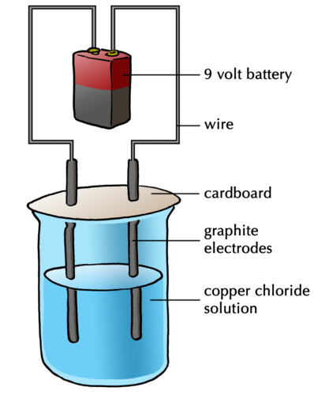

The setup might look something like this, which you have seen before. You might also have a light bulb connected in the circuit.

**Solution:**

**QUESTIONS**

**Problem:**
When you switch on the power source, does the torch bulb glow?

**Solution:**
Yes.

**NOTE:** If the torch bulb does not glow then there is no current in the circuit. Make sure that the electrodes are not touching each other and neither are the crocodile clips. The crocodile clips must not be touching the solution either.

**Problem:**
What do you observe happening at the two different electrodes?

**Solution:**
One of the electrodes should be developing a layer of copper and there should be bubbles developing at the other electrode.

**Problem:**
Can you smell anything? What do you think this is?

**Solution:**
Learners should be able to smell the chlorine gas.

**Problem:**
What is happening to the copper chloride solution when the electric current is passed through it?

**Solution:**
The copper chloride solution is being chemically separated into pure, solid copper and chlorine gas.

**Problem:**
If you switch off the power source, what happens?

**Solution:**
Bubbles are no longer forming at the electrode because the reaction has stopped.

**Problem:**
What is causing the separation of the copper chloride?

**Solution:**
The electric current is separating the copper chloride.

**Problem:**
Why is it important that you do not let the carbon electrodes touch each other while the current is flowing?

**Solution:**
It would cause a short circuit. The electrical current will then not move through the copper chloride and no separation will occur.

The separation of the copper chloride means that an electric current can cause chemical reactions to occur. There are many ways in which we can harness this chemical effect for practical uses.

**Electrolysis** is the breaking down of a substance into its component elements by passing an electric current through a liquid or solution. We can also use electrolysis to purify substances.

Impure copper can be purified using electrolysis. Instead of using carbon electrodes in a copper sulphate solution we can use copper electrodes. If one of the copper electrodes is pure copper and the other is impure copper, then the impure electrode will break down and deposit pure copper on to the already pure copper electrode.

<Callout type="note" title="Note">
Silver refining through electrolysis.
</Callout>

One of the most important uses of electrolysis is **electroplating**.

Electrolysis is used to electroplate metals. In the last activity, one of the carbon electrodes was coated with an even layer of pure copper. We say that the carbon electrode was electroplated with copper.

Why do we electroplate? An example is in the making of jewellery where an inexpensive metal is made into a ring, for example, and then coated with gold by electroplating. This makes it less expensive than if it were made from pure gold. Iron rusts easily and so it is useful to coat it with a layer of a zinc to protect it from corrosion. Many car parts, bathroom taps and wheel rims are electroplated with chromium.

<Callout type="note" title="Note">
The process of electroplating (video)
</Callout>

<Callout type="note" title="Note">
- A circuit is a system for transferring electrical energy.
- For a circuit to function there must be a complete, unbroken pathway for the electrons to follow, a source of energy (cell or cells) and a load (lightbulb or any other resistor).
- We use symbols to represent components of an electric circuit so that everyone can interpret the diagrams.
- A resistor is a component in a circuit which resists the movement of electrons through the circuit.
- An electric current can heat a resistance wire. This heating effect is used in many everyday appliances, such as kettles and irons.
- An electric current causes a magnetic field. This magnetic effect is used in electromagnets.
- An electric current can cause a chemical reaction in solutions. This is called electrolysis, and is used to electroplate objects.
</Callout>

**Concept map**

Complete the concept map to summarise what you have learned about electric circuits and the effects of an electric current in this chapter.

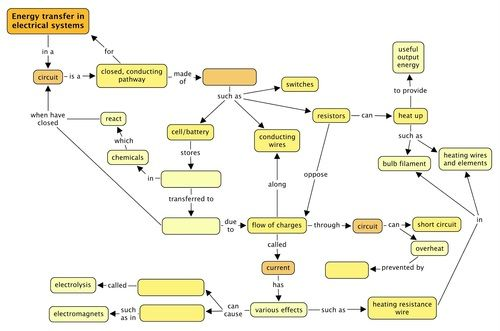

Teacher's version:

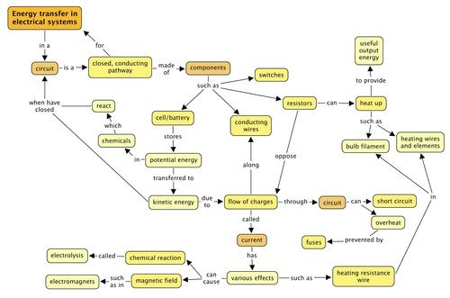

**Problem:**
Write your own definition for an electric circuit. [2 marks]

**Solution:**
An electric circuit is a closed, complete electric pathway or system for transferring electrical energy.

**Problem:**
What type of energy does a battery have? [1 mark]

**Solution:**
It has potential energy.

**Problem:**
When a battery is connected to a circuit, it causes an electric current in the circuit. Explain what an electric current is and why it is possible in metals. Use the word 'delocalised' in your explanation. [3 marks]

**Solution:**
An electric current is the movement of charge/electrons. It is possible in metals as the electrons are delocalised, meaning they are not associated with an atom and are free to move through the wire.

**Problem:**
List 3 materials which conduct electricity. [3 marks]

**Solution:**
There are many different materials which conduct electricity, any 3 can be listed, such as various metals.

**Problem:**
List 3 materials that do not conduct electricity. [3 marks]

**Solution:**
There are many different materials which are insulators, any 3 can be listed, such as plastics, glass, ceramics.

**Problem:**
You have a battery, insulated copper conducting wires and a light bulb. Draw a setup which would allow you to test whether the materials you listed in questions 1 and 2 are conductors or not. [4 marks]

**Solution:**
This diagram should have the components connected in series with each other. There should be a gap in the circuit which can be filled by the different materials to be tested. A possible diagram is given here:

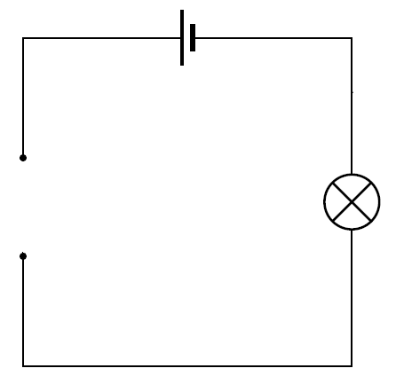

**Problem:**
Draw the symbols for the following components. [6 marks]

| A cell | A light bulb |
| --- | --- |
| A conducting wire | An open switch |
| A resistor | A variable resistor |

**Solution:**
| A cell | A light bulb |
| --- | --- |
| A conducting wire | An open switch |
| A resistor | A variable resistor |

**Problem:**
Look at the circuits below. If the bulb(s) will glow, place a tick next to the picture and explain why it will glow. If the bulb(s) will not glow, place a cross next to the picture and explain why it will not glow. [10 marks]

| Circuit | Glow/Not Glow | Explanation |
| --- | --- | --- |

**Solution:**
| Circuit | Glow/Not Glow | Explanation |
| --- | --- | --- |
|  | Will not glow. | The switch is open so the circuit is broken. |
|  | Will glow. | The switch is closed and there is a complete circuit. |
|  | Will not glow. | There is a closed circuit but the two negative terminals of the cells are connected, rather than a negative connected to a positive terminal. |
|  | Will glow. | There is a complete circuit with an energy source. |
|  | Will not glow. | There is a complete circuit but no energy source. |

**Problem:**
Which of the following setups shows the correct way to connect a light bulb to a battery? Explain your answer. [2 marks]

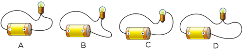

**Solution:**
Setup B is the correct connection as there is one electrical contact point in the tip of the bulb and the other point of contact is the metal casing.

**Problem:**
Draw a circuit diagram to illustrate the following circuit: (3 marks)

| Image | Circuit diagram |
| --- | --- |

**Solution:**
| Image | Circuit diagram |
| --- | --- |

**Problem:**
An electrician wants to replace a faulty fuse with a normal piece of conducting wire. Should you let him? Why or why not? [3 marks]

**Solution:**
A fuse is a safety device to prevent overheating in the circuit. A normal wire would not melt if overheated and so would not prevent damage or fires. You should not let him.

**Problem:**
A child, while inserting an electric plug into the socket, did not see that there was a thin piece of aluminium foil stuck between the pins of the plug. When he turned the switch on, he noticed a spark at the plug, and at the same time, the lights went out. What could have happened to cause the spark and to make the lights go out? [4 marks]

**Solution:**
The aluminium foil can conduct electricity. This means that a short circuit has been created. The short circuit caused a large current which would have melted a fuse and broken the electric circuit. This would have caused the electricity to switch off.

**Problem:**
What is the benefit of using a circuit breaker rather than a fuse? [2 marks]

**Solution:**
A circuit breaker is advantageous to use over a fuse as a fuse needs to be replaced once the metal wire melts, whereas a circuit breaker automatically detects the fault in the circuit, breaks it, and can then be reset to start operating again, either manually or automatically once the fault has been repaired.

**Problem:**
Look at the following photo of a light bulb. Label the filament and explain why it glows. [4 marks]

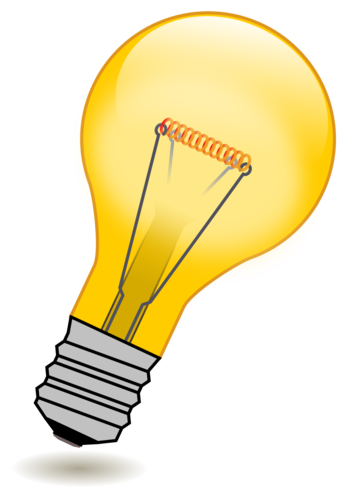

**Solution:**
NOTE: 1 mark is for labeling the filament and 3 marks for the explanation.

When an electric current passes through the tungsten filament, it experiences resistance as the tungsten has a high resistance. The tungsten wire therefore heats up as energy is transferred from the moving electrons to the wire. The wire heats up and also emits light.

**Problem:**
You place some plotting compasses around an electric wire and observe the following.

2. Is there are current in the conducting wire? [1 mark]
4. Explain your answer. [2 marks]

**Solution:**
2. Yes, there is.
4. We know this because when there is current in an electric wire, it generates a magnetic field around it. The plotting compasses respond to the magnetic field as the arrows are all pointing around in a circle and not all the same way as they would do if there was no current.

**Problem:**
Give two advantages of electroplating iron metal. [2 marks]

**Solution:**
To prevent corrosion and enhance its value.

Total [55 marks]
