## Series circuits

<Callout type="note" title="Note">
- series
- ammeter
- ampere
- resistance
</Callout>

A **series circuit** is one in which there is only one pathway for the electric current to follow. The components are arranged one after another in a single pathway. When we connect the components we say that they are **connected in series**. We have already seen examples of series circuits in the last chapter.

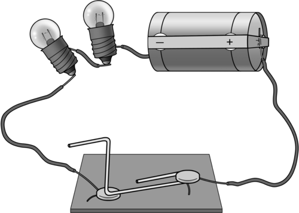

A series circuit with one pathway for the current, from the negative to the positive terminal of the battery.

### Ammeter

An ammeter is a measuring device used to measure the electric current in the circuit. It is connected into the circuit in series. The current is measured in **amperes** (A).

<Callout type="note" title="Note">
The ampere is named after André-Marie Ampère (1775-1836), a French mathematician and physicist. He is considered the father of electrodynamics, which is the study of the effect of electromagnetic forces between electric charges and currents.
</Callout>

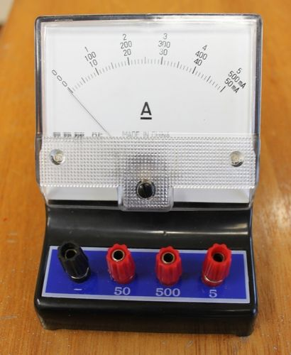

An ammeter.

What is the symbol for an ammeter? Draw it here.

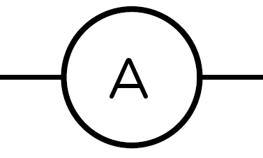

Do you think that an ammeter would have a high resistance or a low resistance to the current? Explain your choice.

Ammeters have an extremely low resistance because they must not alter the current they are measuring in any way.

<Callout type="note" title="Note">
The ampere is often shortened to 'amp'.
</Callout>

A series circuit only provides one pathway for the electrons to follow. Let's investigate what happens when we increase the resistance in a series circuit.

# What happens when we add more resistors in series?

The aim of this investigation is to show the learners that adding more resistors in series causes the overall resistance of the circuit to increase and that this reduces the current strength.

**AIM:** To investigate the effect of adding resistors to a series circuit.

This is a good opportunity for group work if you have enough equipment, but make sure that each learner is able to connect an ammeter correctly and is able to read the ammeter scale accurately. If you do not have sufficient equipment for all the learners, you can do this experiment as a demonstration. Perhaps give several learners an opportunity to come up to the front and help to connect the ammeters. If you do not have any ammeters then you can use the brightness of the bulbs to indicate current strength. The larger the current, the brighter the bulb will glow. This means that if the bulb glows brightly, it must have a large current moving through it. If the bulb is dimmer, it means that there is a smaller current flowing through it.

If you do not have the physical apparatus for this investigation but you do have internet access, use the PhET simulations found here: [http://phet.colorado.edu/en/simulation/circuit-construction-kit-dc](http://phet.colorado.edu/en/simulation/circuit-construction-kit-dc)

The simulations are also useful because the ammeters (and voltmeters) commonly used in school laboratories are often not calibrated correctly or not serviced regularly and so often give slightly inaccurate results.

**HYPOTHESIS:** Write a hypothesis for this investigation.

This is a learner-dependent answer. The hypothesis should relate the dependent and independent variables and make a prediction. The dependent variable will change as the independent variable is changed. Here is an example of a possible answer:

As the number of resistors increases, the current strength decreases.

**MATERIALS AND APPARATUS:**

- 1,5 V cells
- 3 torch bulbs
- insulated copper conducting wires
- switch
- ammeter

It is important that the torch bulbs have the same resistance and are not randomly selected. The switch is not an essential part of this investigation. It can be left out of the circuit.

**METHOD:**

**Problem:**
Construct the circuit with the cell, the ammeter, 1 bulb and the switch in series.

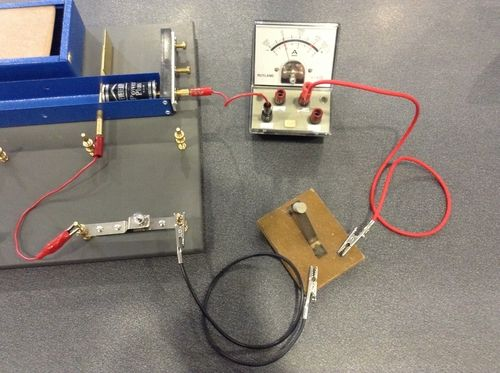

A photo showing the setup.

**Solution:**

**Problem:**
Close the switch, or the circuit if you are not using a switch.

**Solution:**

**Problem:**
Note how brightly the bulb is shining and write down the ammeter reading. Draw a circuit diagram.

**Solution:**
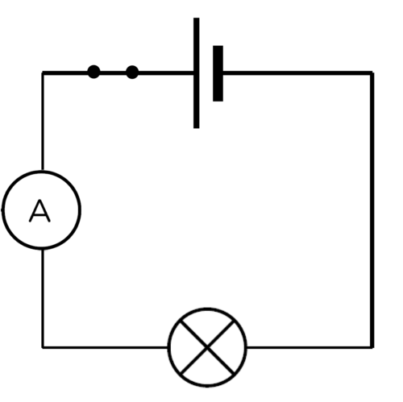

Circuit 1

**Problem:**
Open the switch.

**Solution:**

**Problem:**
Add another light bulb into the circuit.

**Solution:**

**Problem:**
Close the switch.

**Solution:**

**Problem:**
Note how brightly the bulbs are shining and write down the ammeter reading. Draw a circuit diagram.

**Solution:**
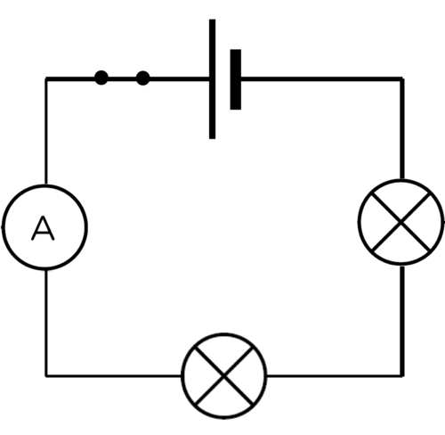

Circuit 2.

**Problem:**
Open the switch.

**Solution:**

**Problem:**
Add the third light bulb into the circuit.

**Solution:**

**Problem:**
Close the switch.

**Solution:**

**Problem:**
Note how brightly the bulbs are shining and write down the ammeter reading. Draw a circuit diagram for the last circuit you built.

**Solution:**
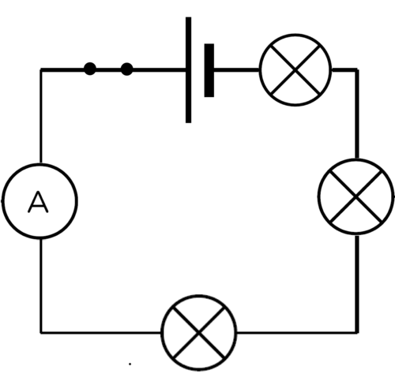

Circuit 3.

**RESULTS:**

Complete the table:

| Number of bulbs in series | Brightness of bulbs | Reading on ammeter (A) |
| --- | --- | --- |
| 1 |  |  |
| 2 |  |  |
| 3 |  |  |

The brightness of the bulbs is a qualitative comparison. Learners should use "bright, brighter, brightest" as a way to describe the glowing bulbs. The graph should show the quantitative data of the ammeter reading and the number of bulbs. If you do not have an ammeter to take readings, either do not draw a graph, or change the graph to a bar graph which has bright, brighter, brightest as the values on the y-axis. This is not a particularly useful graph but will give the learners a chance to practice drawing a bar graph and give them a visual representation of the decrease in current strength as the number of bulbs increases.

Draw a graph to show the relationship between the number of bulbs and the current.

These results are an example of possible results. The actual results obtained by the learners will differ but the trend should be similar. As the number of bulbs in series increases, both the ammeter reading and bulb brightness should decrease.

| Number of bulbs in series | Brightness of bulbs | Reading on ammeter (A) |
| --- | --- | --- |
| 1 | brightest | 0,15 |
| 2 | bright | 0,07 |
| 3 | dimmest | 0,05 |

Using standard ammeters may not give perfect results and if the bulbs are allowed to heat up too much in between adding more bulbs, their resistance will be higher. It is important that the learners see a downward trend.

**ANALYSIS:**

**Problem:**
What happened to the brightness of the bulbs as the number of bulbs increased?

**Solution:**
The bulbs got dimmer as more bulbs were added.

**Problem:**
When you had two bulbs, did they glow with the same brightness, or was one brighter than the other?

**Solution:**
The bulbs glowed with the same brightness.

**Problem:**
When you had three bulbs, did they glow the same as each other or was one brighter than the others?

**Solution:**
The bulbs glowed with the same brightness.

**Problem:**
What do your answers to the previous questions tell you about the current in the series circuit?

**Solution:**
If all the bulbs glow the same, it means that they all experience the same current. This means that the current is the same everywhere in a series circuit.

**Problem:**
What happened to the reading on the ammeter as you added more bulbs in series?

**Solution:**
The ammeter reading decreased.

**CONCLUSION:**

**Problem:**
Based on your answers, what happened to the current when more bulbs were added in series?

**Solution:**
As more bulbs were added, the current decreased.

**Problem:**
Is your hypothesis accepted or rejected?

**Solution:**
This answer will depend on the hypothesis written by the learner at the start of the investigation.

As more resistors are added in series, the total resistance of the circuit increases. As the total resistance increases, the current strength decreases. What would happen if we increased the number of cells connected in series? Would the current become larger or smaller? Let's investigate.

# How does adding more cells in series affect the current?

This investigation will show that adding more cells in series increases the current strength. Be careful with this activity because if you do not have enough resistance in your circuit, you can damage the torch light bulbs. Use at least two torch light bulbs or a torch light bulb and a resistor in order to keep the resistance high enough. If you have ammeters, you can use quantitative data to show that adding more cells in series increases the current strength. If you do not have ammeters, then use the brightness of the bulbs as qualitative data. Use terms such as dim, bright, brightest. The learners will not be able to draw effective graphs with the qualitative data but you could give them the example data in the teacher's guide and ask them to draw a line graph if they need practice.

**AIM:** To investigate the effect of increasing the number of cells connected in series on the electric current strength.

**HYPOTHESIS:** Write a hypothesis for this investigation. Remember to mention how the increase in the number of cells will affect the current strength.

This answer is learner-dependant. They must mention how the dependent variable will be affected by the independent variable. Remember that the hypothesis does not need to be factually correct. They will prove or disprove it by completing the investigation. Here is an example of a possible hypothesis: As the number of cells connected in series increases, the current strength increases.

**MATERIALS AND APPARATUS**

- three 1,5 V cells
- insulated copper conducting wires
- ammeter
- 2 torch light bulbs (or 1 torch light bulb and one resistor)

**METHOD:**

**Problem:**
Construct a circuit with 1 cell, the ammeter and the two torch light bulbs.

**Solution:**

**Problem:**
Observe the brightness of the bulbs and record the ammeter reading in the table of results. Draw a circuit diagram.

**Solution:**
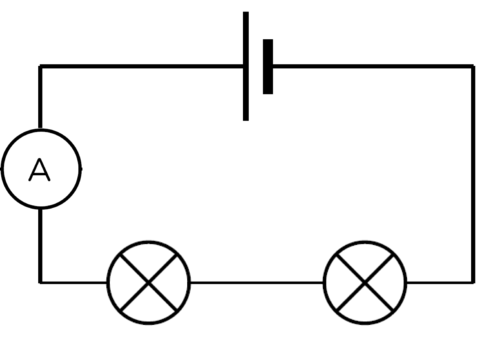

Circuit 1.

**Problem:**
Add a second cell in series and observe the brightness of the bulbs. Draw a circuit diagram of your circuit.

**Solution:**

**Problem:**
Record the ammeter reading in the table of results. Draw a circuit diagram.

**Solution:**
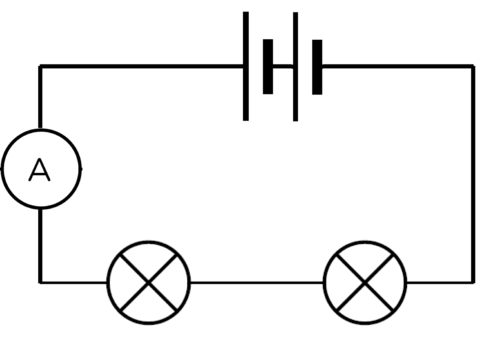

Circuit 2.

**Problem:**
Add a third cell in series and observe the brightness of the bulbs. Draw a circuit diagram of your circuit.

**Solution:**

**Problem:**
Record the ammeter reading in the table of results. Draw a circuit diagram.

**Solution:**
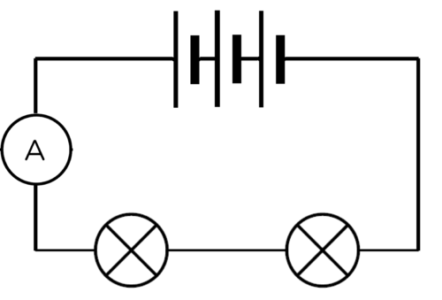

Circuit 3.

**RESULTS:**

Complete the table:

| Number of cells in series | Brightness of bulbs | Reading on a mmeter (A) |
| --- | --- | --- |
| 1 |  |  |
| 2 |  |  |
| 3 |  |  |

These results are example results. The actual results obtained by the learners will differ but the trend should be similar. As the number of cells increases, both the ammeter reading and the bulb brightness should increase.

| Number of cells in series | Brightness of bulbs | Reading on ammeter (A) |
| --- | --- | --- |
| 1 | dimmest | 0.07 |
| 2 | bright | 0.15 |
| 3 | brightest | 0.22 |

**CONCLUSION:**

**Problem:**
What can you conclude from the shape of the graph?

**Solution:**
As the number of cells connected in series increases, so does the current strength.

**Problem:**
Is your hypothesis true or false?

**Solution:**
This answer depends on the learner's original hypothesis.

We have seen that increasing the number of cells in series increases the current, but increasing the number of resistors decreases the current.

We will now investigate the current strength at different points in a series circuit.

# Testing the current strength

The first investigation looked at the decrease in current strength when more resistors were connected in series. This investigation confirms that the current strength is the same at all points in a series circuit. This is an optional investigation. This can be a demonstration if your equipment is limited. This is a good opportunity for group work, but make sure that each learner is able to connect an ammeter correctly and understands the ammeter scale.

**INVESTIGATIVE QUESTION:**Is the current strength the same at all points in a series circuit?

**HYPOTHESIS:** Write a hypothesis for this investigation. What do you think will happen in this investigation?

This is a learner-dependant answer. Learners need to mention the independent and dependent variables. The dependent variable will change as the independent variable is changed.

Here are two examples of an acceptable hypothesis:

- The current will be different at different points in the circuit OR
- The current will be the same at different points in the circuit.

**MATERIALS AND APPARATUS:**

- insulated copper connecting wires.
- two 1,5V cells
- two torch light bulbs
- ammeter

**METHOD:**

**Problem:**
Set up a series circuit with two cells and two torch light bulbs in series with each other.

**Solution:**

**Problem:**
Insert an ammeter in series between the positive terminal of the battery and the first torch bulb.

**Solution:**

**Problem:**
Measure the current strength using the ammeter. Draw a circuit diagram of this set up.

**Solution:**

Circuit 1.

**Problem:**
Remove the ammeter and close the circuit again.

**Solution:**

**Problem:**
Insert the ammeter in series between the two torch bulbs.

**Solution:**

**Problem:**
Measure the current strength using the ammeter. Draw a circuit diagram of this set up.

**Solution:**
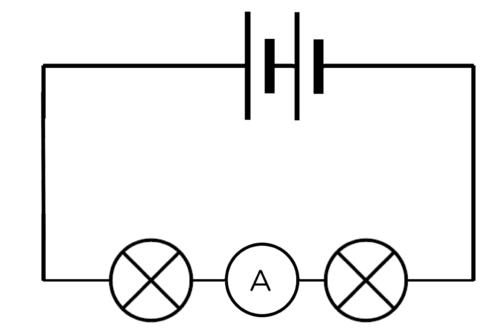

Circuit 2.

**Problem:**
Remove the ammeter and close the circuit again.

**Solution:**

**Problem:**
Insert the ammeter in series between the last torch bulb and the negative terminal of the batteries.

**Solution:**

**Problem:**
Measure the current strength using the ammeter. Draw a circuit diagram of this set up.

**Solution:**
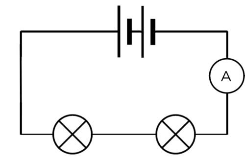

Circuit 3.

**RESULTS:**

Complete the following table:

| Position of ammeter in circuit | Ammeter reading (A) |
| --- | --- |
| Between positive terminal of cell and first bulb |  |
| Between two bulbs |  |
| Between negative terminal of cell and last bulb |  |

The ammeter readings should be the same at any point in the series circuit.

**CONCLUSIONS:**

**Problem:**
Write a conclusion based on your results.

**Solution:**
The current strength is the same at any point in a series circuit.

**Problem:**
Is your hypothesis true or false?

**Solution:**
This answer will depend on the hypothesis written by the learner at the start of the investigation.

In a series circuit, there is only one pathway for the electrons to move through. The current strength is the same everywhere in that pathway.

What have we learned about series circuits?

- There is only **one** pathway for the electrons to follow.
- The current flows at the**samestrength**everywhere in a series circuit, because there is only one pathway. We say that the current is the same at all points in the circuit.
- If you add more resistors in series, the current in the whole circuit **decreases**.

Why does the current stay the same at all points? Let's think about how electric current moves through a circuit. Do you remember that we spoke about the delocalised electrons in metals in the last chapter?

<Callout type="note" title="Note">
Animation showing the movement of electrons.[http://www.schoolphysics.co.uk/animations/Electric_current/index.html](http://www.schoolphysics.co.uk/animations/Electric_current/index.html)
</Callout>

The electrons in a conductor normally drift in various different directions within a metal, as shown in the diagram.

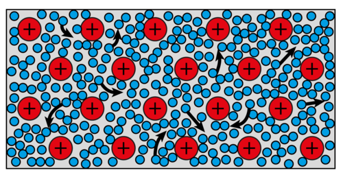

Delocalised electrons move freely in a conducting wire.

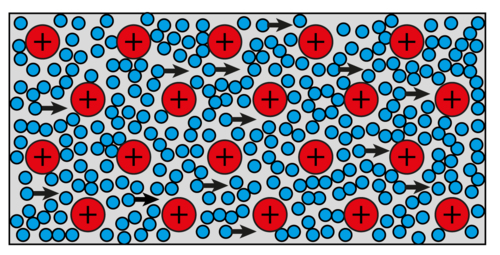

When the wire is connected in a closed circuit, the electrons move towards the positive terminal of the battery.

When we build a closed circuit with a cell as an energy source, the electrons will all begin to move towards the positive side of the cell. The rate at which the electrons move, is determined by the resistance of the conductor.

There are electrons everywhere in the conducting wires and electrical components. When the circuit is closed, all the electrons start moving in the same general direction **at the same time**. This is why a light bulb turns on immediately when you close the switch.

<Callout type="note" title="Note">
Flip the switch and watch the electrons with this simulation.[[link]](http://phet.colorado.edu/en/simulation/signal-circuit)[http://phet.colorado.edu/en/simulation/signal-circuit](http://phet.colorado.edu/en/simulation/signal-circuit)
</Callout>

[[link]](http://phet.colorado.edu/en/simulation/signal-circuit)

The simulation identified in the visit box helps to demonstrate how a light bulb turns on immediately when the switch is turned on.

In a series circuit, all the electrons travel through every component and wire as they travel through the circuit. All the electrons experience the same resistance and so they all move at the same rate.

This means that in the diagram below, the readings on all three ammeters will be the same, so: **A****1****= A****2****= A****3**

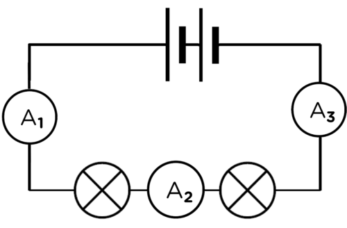
