## Parallel circuits

<Callout type="note" title="Note">
- parallel circuit
</Callout>

Parallel circuits offer more than one pathway for the electrons to follow. When constructing a parallel circuit, we say that components are connected **in parallel**.

Look at the diagram which shows how two light bulbs are connected in parallel.

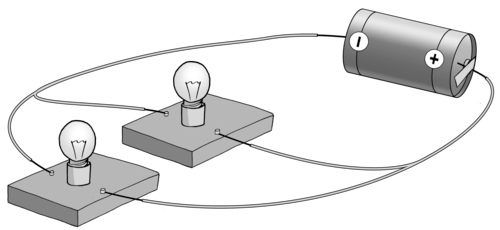

There are two paths for the current in this parallel circuit, one path through each of the bulbs.

How can you tell whether or not a circuit is connected in series or in parallel? Let's look at some circuit diagrams to tell the difference.

<Callout type="note" title="Note">
Watch a video that explains the difference between series and parallel circuits
</Callout>

# Series or parallel?

**INSTRUCTIONS:**

Look at the following circuits and decide which are in series and which are in parallel. The series circuits will only offer one pathway, but the parallel circuits will have more than one pathway for the electrons to follow.

| series | parallel |
| parallel | series |

Let's investigate how parallel circuits work.

# How does adding resistors in parallel affect the current strength?

This investigation will show the learners that increasing the number of resistors in parallel to each other, causes the overall resistance of the circuit to decrease and the current strength to increase. There is no need to discuss how to calculate the effective resistance of a parallel circuit. The learners just need a qualitative understanding.

**AIM:** To investigate the effect of adding resistors in parallel on the current strength.

If you do not have physical apparatus for this investigation but you do have internet access, use the PhET simulations found here: [http://phet.colorado.edu/en/simulation/circuit-construction-kit-dc](http://phet.colorado.edu/en/simulation/circuit-construction-kit-dc)

**HYPOTHESIS:** Write a hypothesis for this investigation.

This is a learner dependant answer. Learners need to mention the independent and dependent variables. The dependent variable will change as the independent variable is changed.

Here are two examples of an acceptable hypothesis:

- As more bulbs are added in parallel, the current strength will decrease OR
- As more bulbs are added in parallel, the current strength will increase.

**MATERIALS AND APPARATUS:**

- 1,5 V cell
- three identical torch bulbs
- insulated copper conducting wires
- switch
- ammeter

It is important that the torch bulbs are the same resistance and not randomly selected. The switch and ammeter are not strictly necessary for this experiment. They can be left out if you don't have enough switches or ammeters.

**METHOD:**

**Problem:**
Construct the circuit with the cell, ammeter, one bulb and the switch in series.

**Solution:**

**Problem:**
Close the switch.

**Solution:**

**Problem:**
Note how brightly the bulb is shining and record the ammeter reading. Draw a diagram of your circuit.

**Solution:**
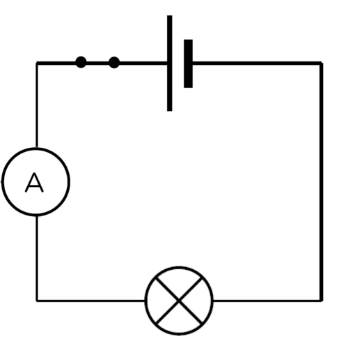

**Problem:**
Open the switch.

**Solution:**

**Problem:**
Add another light bulb, in parallel to the first, into the circuit.

**Solution:**

**Problem:**
Close the switch.

**Solution:**

**Problem:**
Note how brightly the bulbs are shining and record the ammeter reading.

**Solution:**
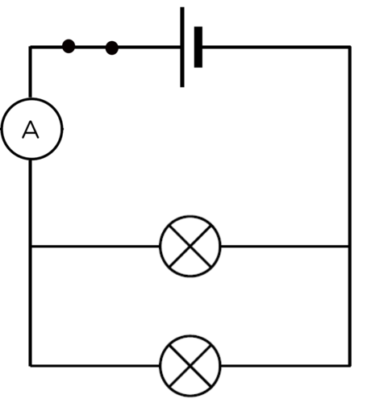

**Problem:**
Open the switch.

**Solution:**

**Problem:**
Add the third light bulb, in parallel to the first two, into the circuit.

**Solution:**

**Problem:**
Close the switch.

**Solution:**

**Problem:**
Note how brightly the bulbs are shining and record the ammeter reading.

**Solution:**
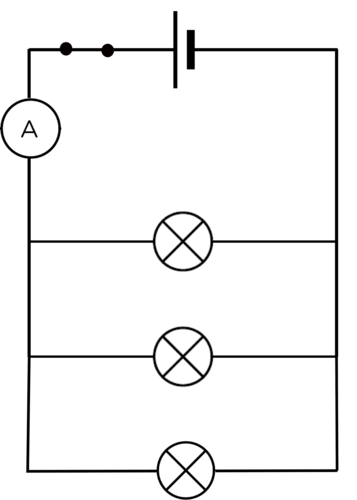

**RESULTS:**

Complete the table:

The brightness of the bulbs is a qualitative description. The learners should use "bright, brighter, brightest" in order to describe the glowing bulbs.

| Number of bulbs in parallel | Brightness of bulbs | Reading on ammeter (A) |
| --- | --- | --- |
| 1 |  |  |
| 2 |  |  |
| 3 |  |  |

Draw a graph to show the relationship between the number of bulbs and the current.

The graph will show the relationship between the main current (reading on the ammeter) and the number of bulbs connected in parallel. As more bulbs are connected in parallel, the current strength should increase because the overall resistance of the circuit decreases. This means that the graph should be a straight line with an increasing trend. Standard ammeters may not be accurate enough to produce a perfectly straight line. This is not as important as seeing the upward trend.

These results are just an example. The actual results will depend on the circuit set up by the learner.

| Number of bulbs in parallel | Brightness of bulbs | Reading on ammeter (A) |
| --- | --- | --- |
| 1 | dimmest | 0.15 |
| 2 | brighter | 0.3 |
| 3 | brightest | 0.45 |

**ANALYSIS:**

**Problem:**
What happened to the brightness of the bulbs as the number of bulbs increased?

**Solution:**
The bulbs got brighter as more bulbs were added.

**Problem:**
When you had two bulbs, did they glow with the same brightness or was one brighter than the other?

**Solution:**
The bulbs glowed with the same brightness.

**Problem:**
When you had three bulbs, did they glow the same brightness or was one brighter than the others?

**Solution:**
The bulbs glowed with the same brightness.

**Problem:**
What do your answers to the previous questions tell you about the current in the parallel branches of the circuit?

**Solution:**
As all the bulbs are identical, if they all glow the same brightness, then they all experience the same current. This means that the current is the same in each branch.

**Problem:**
What happened to the reading on the ammeter as you added more bulbs in parallel?

**Solution:**
The ammeter reading increased.

**CONCLUSION:**

**Problem:**
Based on your answers, what happened to the current when more bulbs were added in parallel?

**Solution:**
As more bulbs were added, the current increased.

**Problem:**
Is your hypothesis true or false?

**Solution:**
This answer will depend on the hypothesis written by the learner at the start of the investigation.

As more resistors are added in parallel, the total current strength increases. The overall resistance of the circuit must therefore have decreased. The current in each light bulb was the same because all the bulbs glowed with the same brightness. This tells us that the current of electrons must have split up and moved through each of the branches.

We can also connect cells in parallel. What would happen if we increased the number of cells connected in parallel? Would the current get stronger or weaker?

# What happens to the current strength when cells are connected in parallel?

**AIM**: To investigate how increasing the number of cells connected in parallel affects the current strength in a circuit.

**HYPOTHESIS:** Write a hypothesis for this investigation.

This is a learner-dependent answer. Learners need to identify the independent and dependent variables. The dependent variable will change as the independent variable is changed.

Here are two examples of an acceptable hypothesis:

- As more cells are added in parallel, the current strength will decrease OR
- As more cells are added in parallel, the current strength will increase.

**MATERIALS AND APPARATUS**

- three 1,5V cells
- one torch light bulb
- insulated copper conducting wires
- ammeter

The ammeter is not essential to the experiment. The brightness of the bulb can serve as a qualitative measure.

**METHOD:**

**Problem:**
Set up a circuit which has one cell, the ammeter and the torch light bulb in series with each other. Draw a circuit diagram of your circuit.

**Solution:**
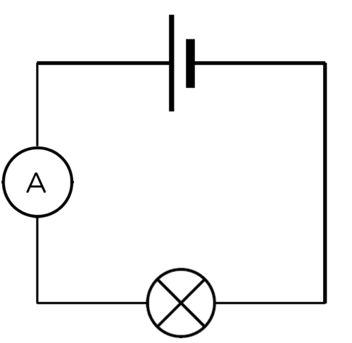

**Problem:**
Observe the brightness of the bulb and record the ammeter reading.

**Solution:**

**Problem:**
Connect another cell in parallel with the first cell. To connect the second cell in parallel, connect a wire from the positive terminal of the first cell to the positive terminal of the second cell. Connect another wire between the negative terminal of the first battery and the negative terminal of the second battery. Draw a circuit diagram of your circuit.

**Solution:**
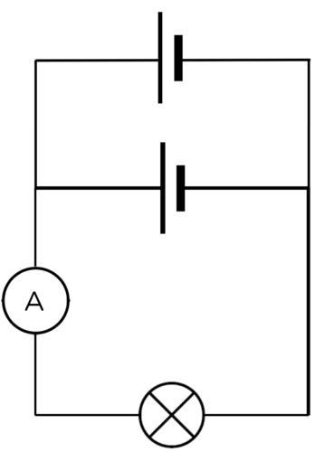

**Problem:**
Observe the brightness of the bulb and record the ammeter reading.

**Solution:**

**Problem:**
Connect a third cell in parallel to the other two cells. Draw a circuit diagram of your circuit.

**Solution:**
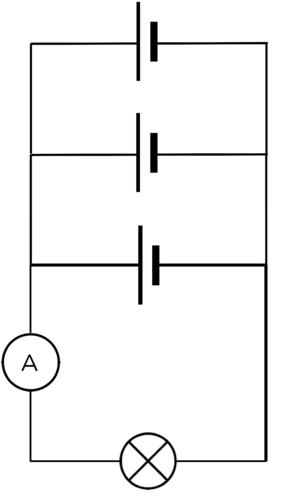

**Problem:**
Observe the brightness of the bulb and record the ammeter reading.

**Solution:**

**RESULTS:**

Complete the table:

The brightness of the bulbs is a qualitative description. The learners should use "bright, brighter, brightest" in order to describe the glowing bulbs. The ammeter readings should stay the same.

| Number of cells in parallel | Brightness of bulb | Reading on ammeter (A) |
| --- | --- | --- |
| 1 |  |  |
| 2 |  |  |
| 3 |  |  |

**CONCLUSION:**

**Problem:**
What did you notice about the brightness of the bulbs?

**Solution:**
The brightness of the bulbs should not change.

**Problem:**
What did you notice about the ammeter readings?

**Solution:**
The ammeter readings are the same.

**Problem:**
What conclusion can you draw from your results?

**Solution:**
Adding cells in parallel does not change the overall current strength.

Adding cells in parallel has no overall effect on the current strength. The current strength stays the same if you add cells in parallel.

We saw that the current strength increased when bulbs were connected in parallel. However, we were only testing the current strength at one point in the parallel circuit. How does the current compare in the different pathways of the circuit? Let's do an investigation to find out.

# Testing the current strength

The first investigation looked at the increase in current strength when more resistors were connected in parallel. This investigation confirms that the current strength is not the same at all points in a parallel circuit. This is a good opportunity for group work, but make sure that each learner is able to connect and read an ammeter correctly. If you do not have enough equipment to allow for small groups to build the circuits, you can rather use this investigation as a demonstration. Perhaps give several learners an opportunity to come up to the front and help to connect the ammeters.

**INVESTIGATIVE QUESTION:** Is the current strength equal at all points in a parallel circuit?

**MATERIALS AND APPARATUS:**

- insulated copper connecting wires.
- two 1,5V cells
- three identical torch light bulbs
- ammeter

**METHOD:**

2. Set up a parallel circuit with two cells in series with each other and three torch light bulbs in parallel with each other.
4. Insert an ammeter in series between the cells and the first pathway, as shown in the diagram.

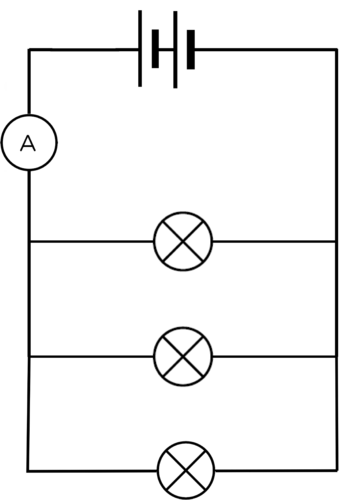

2. Measure the current strength using the ammeter.
4. Remove the ammeter and close the circuit again.
6. Insert the ammeter in series in the first pathway.

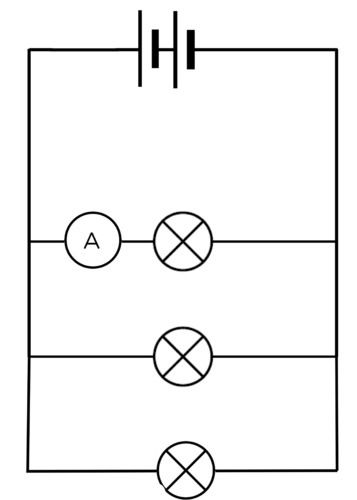

2. Measure the current strength using the ammeter.
4. Remove the ammeter and close the circuit again.
6. Insert the ammeter in series in the second pathway.

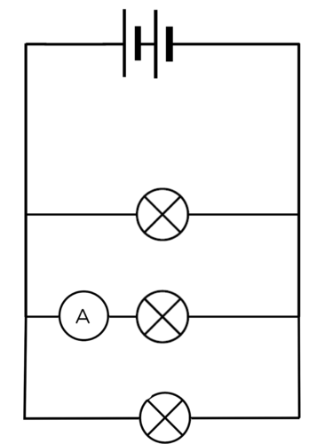

2. Measure the current strength using the ammeter.
4. Remove the ammeter and close the circuit again.
6. Insert the ammeter, in series, in the third pathway.

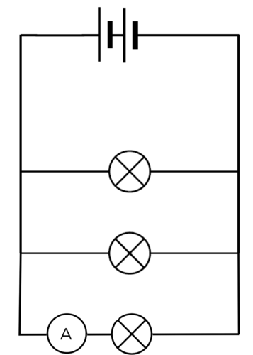

2. Measure the current strength using the ammeter.
4. Remove the ammeter and close the circuit again.
6. Insert the ammeter in series between the first pathway and the cells on the opposite side to the first reading.

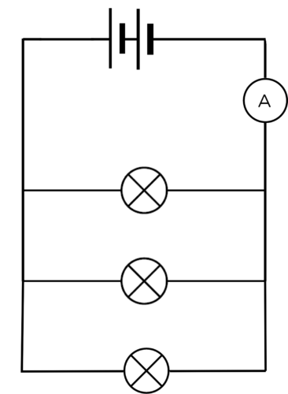

2. Measure the current strength using the ammeter.

**RESULTS:**

| Position of ammeter in circuit | Ammeter reading (A) |
| --- | --- |
| between the cell and first pathway |  |
| in the first pathway |  |
| in the second pathway |  |
| in the third pathway |  |
| between the cell and the first pathway |  |

These are some example readings to show the trend:

| Position of ammeter in circuit | Ammeter reading (A) |
| --- | --- |
| between cell and first pathway | 0.9 |
| in the first pathway | 0.3 |
| in the second pathway | 0.3 |
| in the third pathway | 0.3 |
| between the cell and the first pathway | 0.9 |

If you do not use identical bulbs, then the readings in each of the branches will not be identical, but they will add up to reading in the main branch. If possible, it is worthwhile to demonstrate this to learners.

**CONCLUSION:**

**Problem:**
Write a conclusion based on your results.

**Solution:**
The current strength is not the same at all points in a parallel circuit. If the bulbs are identical, then the current is the same in the three branches, however the current in the main part of the circuit is greater than that in the individual pathways. The current in the main part of the circuit is the sum of the currents in the pathways.

**Problem:**
Is your hypothesis true or false?

**Solution:**
This answer will depend on the hypothesis written by the learner at the start of the investigation.

What have we learned about parallel circuits?

- There is **more than one **pathway for the current to follow.
- The current divides between the different branches so that each branch gets some of the current. As the torch bulbs in each branch in our example were identical, the current divided equally between them.
- If you add more resistors in parallel, the total current supplied by the cell in the circuit **increases**.

Why does the current divide when offered an alternative pathway?

Imagine that you are sitting in a school hall during assembly. You are bored and waiting for it to end so that you can go out to break to chat to your friends. There is only one exit from the hall. When you are dismissed, everyone has to exit through the same door. It takes a while because only some learners can leave at a time.

Now imagine that there is a second door that is the same as the first door. Now you and your friends have a choice of which door to go through. The speed at which the learners exit the hall will increase and some of you will exit through the first door while others will exit through the second door. No one can go through both doors at the same time.

This is similar to the way current behaves when in a parallel circuit. As the electrons approach the branch in the circuit, some electrons will take the first path and others will take the other path. The current is divided between the two pathways.

In the following circuit A1 = A4 and A1 = A2 + A3 and A4 = A2 + A3

We have looked at how resistors and cells behave in series and parallel circuits. Let's look at how different metals conduct electricity. All conductors have some resistance in a circuit. Are some metals better conductors of electricity than others?

Let's have a look at which metals offer more resistance than others to the flow of charge (current) through an electric circuit .

# Which metals offer the most resistance?

This activity only compares the effect of the type of material on resistance. The other factors that affect resistance will be covered in the Grade 9 Energy and Change syllabus.

Each metal will have a particular resistance based on the resistivity. You do not need to measure the resistance of each metal, all that is required is a qualitative description of the light bulb. The brighter the light bulb, the higher the current. If there is a high current it means that there is little resistance. So the brighter the bulb glows, the less resistance offered by the metal wire. The learners may make small mistakes if the brightness of the bulbs is difficult to distinguish.

Use whichever metal wires you have available. Try to get copper and nickel. You could twist aluminium foil into a wire (just make sure it is the same length and approximate thickness as the other metals). Aluminium wire will often ignite if placed in a circuit so test it beforehand and make sure that it does not get too hot. If you use the materials listed below, then nichrome will have the highest resistance, followed by zinc, then aluminium and copper has the lowest resistance of the four.

**MATERIALS:**

- a cell
- torch light bulb
- insulated copper wires
- lengths of copper, aluminium, zinc and nichrome wire
- crocodile clips (if available)

The actual length of wire that you use is not important, but they should all be the same length and thickness. If you cannot find these metals, any other combination of metals can be successfully used.

**INSTRUCTIONS**

2. Build a circuit with the cell and the torch light bulb and leave a gap for the metal to be tested. You can use crocodile clips at the end of each piece of metal for easy insertion.
4. Insert each metal into the circuit (one at a time).

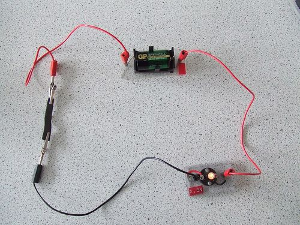

An example circuit with a cell, a light bulb and the piece of metal being tested.[[link]](http://www.flickr.com/photos/tessawatson/405902162/)

Observe the brightness of the bulb.

**QUESTIONS:**

**Problem:**
Draw a circuit diagram of your apparatus.

**Solution:**
An example circuit diagram with the break in the circuit where metals are to be tested shown on the left.

**Problem:**
Why can we use the brightness of the bulb to qualitatively measure resistance?

**Solution:**
High resistance opposes the movement of electrons, decreasing the current so there is less energy for the light bulb. The higher resistance wire will cause the bulb to be dimmer than the lower resistance wire.

**Problem:**
List the metals in order of increasing resistance.

**Solution:**
Copper, aluminium, zinc and nichrome.

**Problem:**
Why do you think copper is used for connecting wires in electrical circuits?

**Solution:**
Copper has an extremely low resistance, and so has a minimal effect on the overall resistance of the circuit. Other materials would add to the overall resistance of the circuit, decreasing the maximum possible current in that circuit.

There are several factors which influence the amount of resistance a material offers to an electric current. We have seen that the type of material is one of those factors.

<Callout type="note" title="Note">
In Gr 9 we will look at the other factors that influence resistance. If you want to see the content in other grades, remember that you can visit [www.curious.org.za](http://www.curious.org.za)
</Callout>
