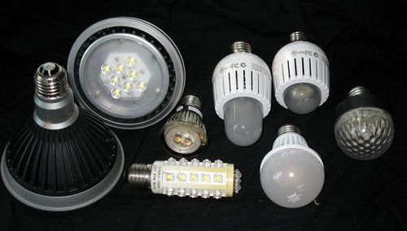
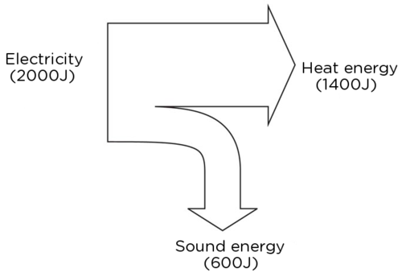
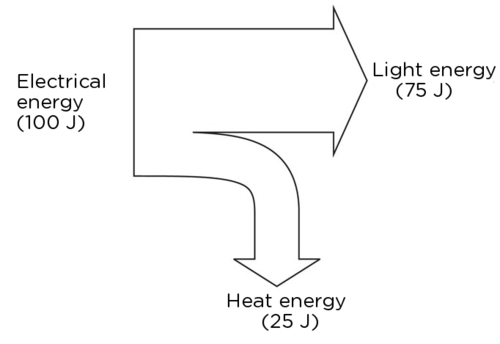
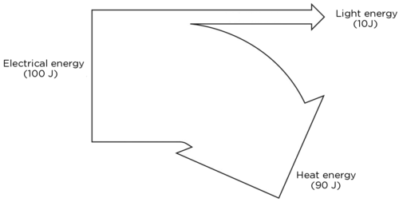
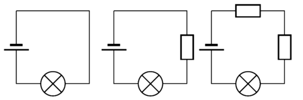
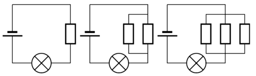
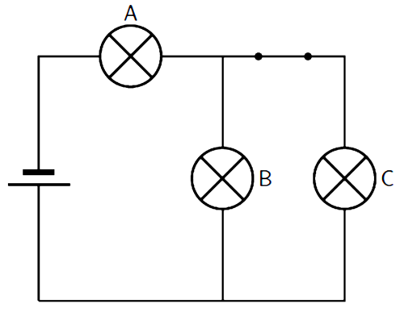
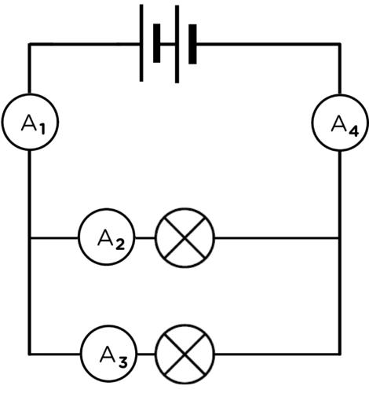

## Other output devices

Light bulbs are not the only devices used in electrical circuits. Devices that use electrical energy to function, including light bulbs, are called output devices. Let's look at some other common examples of output devices.

### LEDs (Light-Emitting Diodes)

LEDs are widely used electronic devices. They are small lights but they do not have a filament like an incandescent bulb has. They therefore cannot burn out, as there is no filament to wear out, and they do not get as hot. LEDs are used in electronic timepieces, high definition televisions and many other applications. Larger LEDs are also replacing traditional light bulbs in many homes because they do not use as much electricity. They last longer than incandescent bulbs and are more efficient.

<Callout type="note" title="Note">
Watch this video about the history of the LED
</Callout>

Different LED bulbs.

In the last chapter, we looked at the energy transfers in an electrical system. We will now represent energy transfer within electrical systems in a different way. We will apply this new representation to the difference between energy outputs in an LED and an incandescent light bulb.

<Callout type="note" title="Note">
Video on drawing a basic Sankey diagram.
</Callout>

# Sankey diagrams

Sankey diagrams were first introduced in the Gr 7 CAPS workbook as a way of representing the transfers of energy within a system, specifically focusing on the transfer of input energy to useful and wasted output energy. They provide a very clear illustration of the process. This links back to the previous chapter to reinforce learning.

You might have drawn Sankey diagrams in Grade 7. If not, here is some quick revision.

In an energy system, input energy is transferred to useful output energy and wasted output energy. A Sankey diagram is a visual and proportional representation of the energy transfers that happen in a system.

For example, a kettle uses about 2000 J of input energy, but only about 1400 J is used to heat the water. The remaining 600 J is wasted as sound. Here is the Sankey diagram to represent the energy transfer.

<Callout type="note" title="Note">
Remember that energy is measured in joules (J).
</Callout>

**QUESTIONS:**

We will now compare an LED with an incandescent light bulb.

**Problem:**
Draw a Sankey diagram for an LED if the input energy is 100 J, 75 J of energy is used to produce light and the rest is lost as heat.

**Solution:**

**Problem:**
Draw a Sankey diagram for a filament light bulb if the input energy is 100 J, the wasted heat energy is 80 J and the rest produces light.

**Solution:**

**Problem:**
Which bulb do you think is more efficient? Explain your answer.

**Solution:**
The LED bulb is more efficient as more of the input energy is transferred to useful output (light) than is wasted as heat. In the filament light bulb, much more energy is wasted as heat.

Can you think of any other output devices? Make a list of as many as you can.

Some are: motors, buzzers, beepers.

# History of electricity production

**INSTRUCTIONS:**

2. Work in groups of three or four.
4. Research the history of electricity production: How was electricity discovered and how did electricity become widely used?
6. Create a basic timeline for the discovery of electricity and it's production.

The timeline does not need to be too specific. We want learners to realise that this was not an overnight discovery, but involved many people over a significant time. Here are some pertinent facts. This list is not complete and not all of the dates are necessary. Another useful resource is available here: [http://www.timetoast.com/timelines/118814](http://www.timetoast.com/timelines/118814)

- 600 BC - Discovery that amber, rubbed with silk, would attract light objects such as feathers
- 1600 AD - William Gerbert coined the term electricity. He was the first to make a link between magnetism and electricity
- 1700s - Wimshurst machine, used to generate static electricity
- 1752 - Benjamin Franklin proved that lightning was a form of electricity
- 1800s - Sir Humphrey Davey discovered electrolysis; Volta created the first simple cell
- 1831 - Michael Faraday demonstrated electromagnetic induction
- 1825 - Ampere published his theories on electricity and magnetism. The unit of current, the ampere, is named after him
- 1827 - George Ohm published his study of electricity. The unit of resistance, the ohm, is named after him
- 1831 - Charles Wheatstone and William Fothergill created the telegraph machine
- 1870 - Thomas Edison built a DC generator
- 1876 - Alexander Graham Bell invented the telephone which uses electricity to transfer speech
- 1878 - Joseph Swan demonstrated an electric light bulb
- 1880s - Nikola Tesla developed an AC generator
- 1881 - The first British public electricity generator was built in Surrey
- 1883 - Magnus Volk built the first electric train line
- 1896 - Nikola Tesla established hydroelectric power plants in America
- 1905 - Albert Einstein demonstrated the photoelectric effect which led to the production of photovoltaic cells

<Callout type="note" title="Note">
An electricity timeline animation.[http://resources.schoolscience.co.uk/britishenergy/14-16/index.htm](http://resources.schoolscience.co.uk/britishenergy/14-16/index.htm)
</Callout>

# Careers

**INSTRUCTIONS:**

**Problem:**
Choose a career related to electricity production.

**Solution:**

**Problem:**
Write a short paragraph describing the career. Include information on how one can study or prepare for your chosen career.

**Solution:**
The Eskom website has information regarding various careers and the internet has many different sources.

<Callout type="note" title="Note">
- A series circuit has only one pathway for the electrons to travel through.
- A parallel circuit has more than one pathway for the electrons to travel through.
- In a series circuit, the current is the same at all points in the circuit.
- In a series circuit, the resistance increases as more resistors are added in series.
- In a parallel circuit, the current splits between the available paths.
- In a parallel circuit, the resistance decreases as more resistors are added in parallel.
</Callout>

# Revision questions

**Problem:**
Look at the following circuit diagrams and decide whether they are series circuits or parallel circuits. Write the correct answer in the space below each diagram. [6 marks]

**Solution:**
| Series | Parallel | Series |
| Parallel | Series | Parallel |

**Problem:**
Look at the three circuit diagrams. Rank the circuits from brightest bulb to dimmest bulbs. [3 marks]

**Solution:**
Brightest, bright, dim

**Problem:**
Explain your choices in the previous question. [5 marks]

**Solution:**
The first circuit has the brightest bulb because it has the least resistance and so it has the highest current. The third circuit has the highest resistance because it has two resistors connected in series with the light bulb. The more resistors connected in series, the higher the resistance and the lower the current.

**Problem:**
Look at the three circuit diagrams. Rank the circuits from brightest bulb(s) to dimmest bulb(s). [3 marks]

**Solution:**
Dimmest, bright, brightest

**Problem:**
Explain your choices in the previous question. [5 marks]

**Solution:**
The third circuit will have the brightest bulb because adding resistors in parallel lowers the overall resistance in the circuit. The current is therefore greater and the bulb shines brighter. The first circuit is the dimmest because it has no parallel branches, and so offers the highest resistance.

**Problem:**
Look at the circuit diagram below. Each light bulb is identical.

2. Is this a series or parallel circuit? Explain your answer. [2 mark]
4. How do the brightness of bulbs A, B and C compare? (which is the brightest?) [3 marks]
6. What would happen to the brightness of the bulbs if the switch was opened? Explain your answer. [5 marks]

**Solution:**
2. This circuit has both series components (the cell and bulb A are in series) and a parallel branch consisting of bulb B and C.
4. Bulb A is the brightest, Bulbs B and C would have the same brightness as each other.
6. If switch S is opened, then bulb C will not glow. Bulbs A and B would now have equal brightness but they would be dimmer than when the switch was closed. A and B would now be in series with each other and there is no parallel branch. The overall resistance of the circuit would therefore be higher, resulting in a smaller current.

**Problem:**
Study the following diagram.

2. What is the relationship between the ammeter readings on A1 and A4? In other words, how do the current strengths compare at these points in the circuit? Explain your answer. [3 marks]
4. What is the relationship between the ammeter readings on A1, A2 and A3? In other words, how do the current strengths compare at these points in the circuit? Explain your answer. [3 marks]

**Solution:**
2. A1 = A4. The total current flows through the circuit at both of these points.
4. A1 = A2 + A3. The current splits between parallel branches in a circuit.

Total [38 marks]
