## Radiation of light

<Callout type="note" title="Note">
- luminous
- radiation
- rectilinear
- propagation
</Callout>

Where does light come from? Natural light comes from luminous objects such as the Sun and light bulbs. We say that these objects emit light.

<Callout type="note" title="Note">
The Moon is NOT a luminous object as it does not emit its own light light. It reflects the light from the Sun.
</Callout>

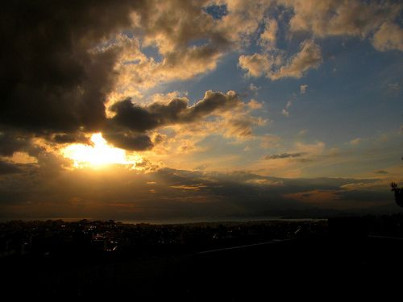

The Sun is our main source of light on Earth.

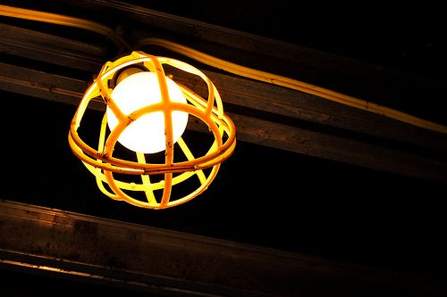

A light bulb is a luminous object as it emits light.

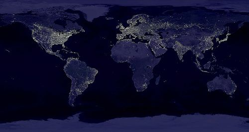

This image from NASA shows the Earth's lights at night. You can see how much we rely on light nowadays.

<Callout type="note" title="Note">
If you could travel at the speed of light you could travel around the equator 7,5 times in 1 second!
</Callout>

<Callout type="note" title="Note">
The speed of light (video)
</Callout>

Light travels through space at a speed of 300 000 kilometers per second. We say that energy is transferred by radiation. The energy of the light is transferred through space as **electromagnetic waves** in straight lines.

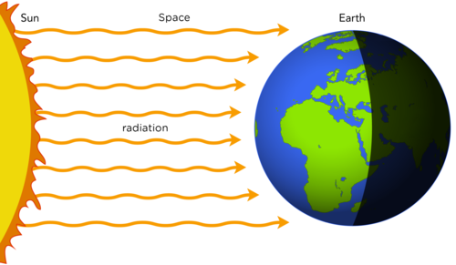

Light and heat are transferred to Earth through space from the Sun by radiation.

<Callout type="note" title="Note">
The Sun emits radiation in**all directions**, but in the diagram here, only the radiation which reaches Earth has been shown.
</Callout>

<Callout type="note" title="Note">
It takes light 8 minutes to travel from the Sun to the Earth.
</Callout>

An exciting way to introduce this section is to turn your classroom into a *camera obscura*. Use black paper to cover all the windows and tape to block out any light coming in from under any doors. On one window, leave a small area of the window uncovered. Hang a white sheet in the centre of the room opposite to the exposed window. The view from outside should be projected onto the sheet. The image will be upside down. This is an inexpensive way to give the learners an opportunity to understand the rectilinear propagation of light.

Let's look at how light travels. We will make a simple camera to investigate how light travels.

# Make a pinhole camera

This activity allows the learners to produce images on a screen. The images formed by a pinhole camera can be used to explain and demonstrate that light travels in straight lines.

The Pringles chip can is the perfect shape for this activity. You could use any cardboard tube. Instead of the lid from the Pringles can you can use a piece of wax paper as the screen. This pinhole camera is essentially a miniature camera obscura.

If you are struggling with time, you could make one of these and demonstrate it to the learners instead of having each learner produce one.

**MATERIALS:**

- Pringles chip can
- craft knife
- aluminium foil
- tape
- ruler
- drawing pin

You can also use black paper if you do not have aluminium foil. The foil is useful because it molds to the shape of the tube and helps prevent ambient light from entering.

**INSTRUCTIONS:**

2. Measure 5 cm from the bottom of the can (opposite end to the plastic lid) and make a mark all around the can.
4. Cut through the can along the line so that you have cut the can into 2 pieces.
   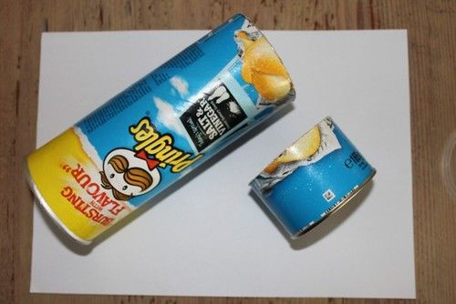
6. If you have a clear lid, put a piece of wax paper on top of the lid before sticking everything together.
   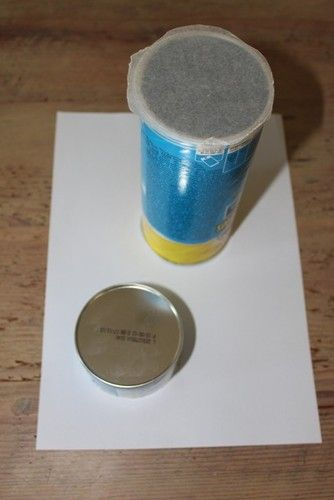
8. Place the lid between the 2 pieces and stick it all together using tape.
   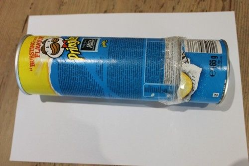
10. Wrap the aluminium foil around the can to prevent any light from coming in from the sides.
   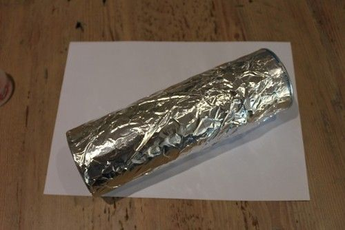
12. Use a drawing pin to make a hole in the centre of the metal base of the can.
14. Go outside with your pinhole camera.
16. Point the metal end with the hole at an object which is in bright sunlight.
18. Cup your hands around the other end and look through the open end.

**QUESTIONS:**

**Problem:**
What did you see when you looked through the open end of the tube?

**Solution:**
Learners should see an image on the "screen". The lid/wax paper is the screen. The learners should notice that the image is upside down.

**Problem:**
What happens when you move closer or further away from an object?

**Solution:**
When you move closer to the object, the image appears bigger than when you move further away.

Did you see an upside down image? Why is it upside down?

We see objects because light reflects off them and enters our eyes. If the image is upside down it means that the light from the bottom of the object has arrived at the top of the screen and the light from the top of the object has reached the bottom of the screen, as shown in the following diagram.

<Callout type="note" title="Note">
Light travels in a straight line? (video) and
</Callout>

When you moved closer to the object, the image appeared bigger, as shown in the following diagram.

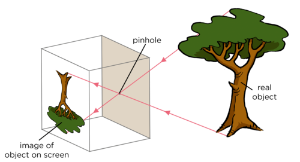

What does this mean? It means that light must be travelling in straight lines. This is called the **rectilinear propagation** of light.

<Callout type="note" title="Note">
Can you use what you have learnt to understand how this shadow illusion works?
</Callout>

### Ray diagrams

A ray diagram is a drawing that shows the path of light. Light rays are drawn using straight lines and arrowheads, because light travels in straight lines. The figure below shows some examples of ray diagrams.

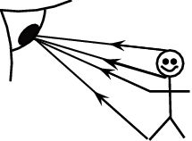

A ray diagram showing how you see another person.

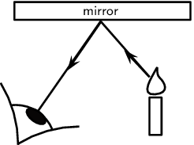

A ray diagram showing how you see a reflection in a mirror.
