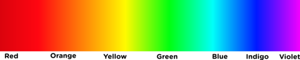
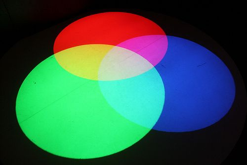
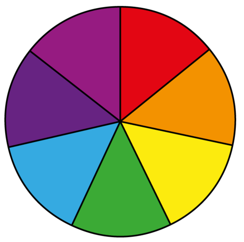
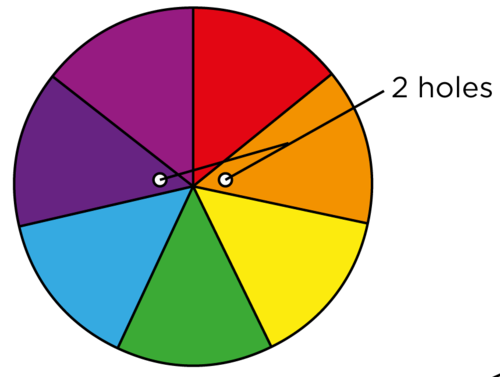
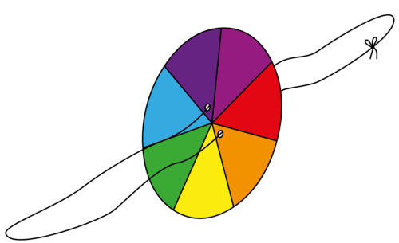
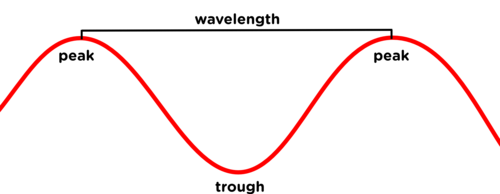
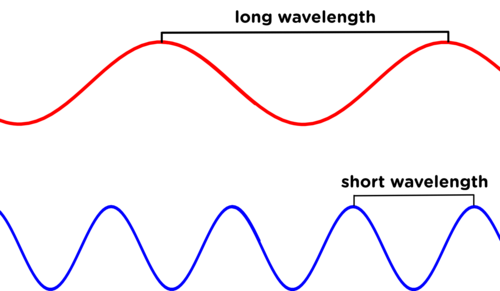
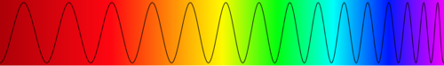

## Spectrum of visible light

<Callout type="note" title="Note">
- composition
- visible spectrum
- dispersion
</Callout>

The visible light spectrum is the light that we are able to see with our naked eyes. Have you ever wondered why everything is colourful and not just black and white? Have you ever seen a rainbow and wondered where the colours have come from? The colours that we see everyday are part of the visible light spectrum. Let's investigate the visible light spectrum.

# Splitting white light

This activity is very simple and usually gives clear results. Try to darken the room as much as possible in order to get clear spectra. A ray box and power source are not essential for this activity. You can make your own simple ray box by using a piece of cardboard with a small slit cut into it. Hold the cardboard in front of a light bulb and the light will shine through the slit in a single beam of light. Use a table lamp or set up a circuit with a high wattage light bulb as a source of light.

**MATERIALS:**

- triangular perspex prism
- ray box and power source

**INSTRUCTIONS:**

**Problem:**
Connect the ray box to the power source. If you do not have a ray box, your teacher will show you how to use a piece of cardboard with a slit cut into it.

**Solution:**
Remember that if you do not have a ray box then you can use a light bulb with a cardboard screen to produce a coherent beam of light.

**Problem:**
Place the triangular prism on a white background.

**Solution:**

**Problem:**
Shine a beam of white light through the side of the prism.

**Solution:**
Make sure that the learners rotate the prism until they get it at the right angle to refract the light and see the colours.

**QUESTIONS:**

**Problem:**
Draw a picture showing what you observe.

**Solution:**
The drawing should show the beam of white light entering the prism, passing through and emerging on the other side as the 7 colours of the visible spectrum. This is a typical image, which learners will see later in the chapter when we discuss refraction of light. They must note the relative bending of red versus blue light.

**Problem:**
Write a description of what you observed.

**Solution:**
The white light enters the prism, passes through it and emerges on the other side as a beam of 7 colours (a rainbow).

**Problem:**
Write down the order in which the colours appear.

**Solution:**
Red, orange, yellow, green, blue, indigo, violet.

**Problem:**
If you repeat the experiment, does the order of the colours change?

**Solution:**
No, the order is always the same.

**Problem:**
What do the different colours we see tell us about the composition of white light?

**Solution:**
They tell us that white light is a mixture/blend/combination of the 7 colours of the visible spectrum.

There are actually a large range of colours, but our eyes allow us to distinguish 7 colours.

So, what have we learned so far? Light radiates from luminous objects and always travels in straight lines. The white light that we see is made up of the 7 different colours of the spectrum. When the 7 colours are travelling together we see them as white light.

The 7 colours of the visible spectrum are **R**ed, **O**range, **Y**ellow, **G**reen, **B**lue, **I**ndigo and **V**iolet. Each colour has a different wavelength and frequency. Have a look at the following image which shows the spectrum of visible light.

<Callout type="note" title="Note">
You can use the abbreviation ROYGBIV to remember the order of the colours.
</Callout>

The colours combine to form white light.

<Callout type="note" title="Note">
The primary colours of light are red, green and blue.
</Callout>

<Callout type="note" title="Note">
An artist might tell you that the primary colours of paint are red, yellow and blue. This is different to the primary colours of light. This is because the pigments yellow, blue and red cannot be mixed from other pigments. In printing, the primary colours are magenta, yellow and cyan.
</Callout>

# Colour spinning wheels

This is a very simple, fun activity to show that the 7 colours combine to make white light. You can either get learners to each make their own, or else make a couple before class yourself and hand them out for learners to experiment with.

**MATERIALS:**

- white cardboard
- coloured pens or pencils (red, orange, yellow, green, blue, indigo, violet)
- string
- scissors
- round object

**INSTRUCTIONS:**

To do this accurately, find the centre of the circle and mark a dot there. Then draw a straight line from the centre to the edge of the circle. Next, align the straight edge of a protractor with the line you just drew, placing the end of the protractor right on the center of your circle. Look for 52 degrees and make a dot to mark this angle. Draw a line from the centre dot to this dot on the edge. The angle you drew is 1/7 of the circle. Repeat this until you have measured and drawn all segments. A complete rotation is 360 degrees and 360/7 = 51.4 which is why each segment you draw should be about 52 degrees. The correct angle for 6 segments would be 60 degrees.

**Problem:**
Draw a circle on the cardboard. You can trace around a round object such as a cup or saucer to do this. Cut out the circle.

**Solution:**

**Problem:**
Now divide the circle into 7 equal segments. If you do not have indigo and violet colours, but just one purple pen or crayon, then you can divide the circle into 6 equal segments rather.

**Solution:**

**Problem:**
Shade in each segment a different colour, in the order red, orange, yellow, green, blue, indigo, violet (or just purple if you do not have indigo and violet).

**Solution:**

**Problem:**
Next, make two holes, one on either side of the centre as shown below.

**Solution:**

**Problem:**
Thread the string through the holes and tie it in a loop.

**Solution:**

**Problem:**
You are now ready to spin the wheel. Holding the ends of the loop in each hand, twirl the string over, like you would a skipping rope, so that the string twists. Once the string is tightly twisted, pull your hands apart, then bring them back together. Continue bringing your hands in and out and watch the circle spin.

**Solution:**

**Problem:**
What do you observe about the colour of the wheel as it spins faster?

**Solution:**
Learners should observe that the colours appear to 'mix'. Depending on the quality of the pens or pencils used, you should see a light grey. The goal is to see white, but this might take some more experimenting.

<Callout type="note" title="Note">
There is no pink light.
</Callout>

So far we have been talking about the **visible** light spectrum. As we mentioned in the beginning, this is the light that we can see. We also spoke about how light travels in **electromagnetic waves.** We can only see light with a certain range of **wavelengths**. What does this mean?

The size of a wave is measured in wavelengths. A wavelength is the distance between two corresponding points on two consecutive waves. Normally this is done by measuring from peak to peak or from trough to trough. Have a look at the following diagram which illustrates a wavelength.

The wavelengths of the different colours of visible light are different lengths, as shown in the following diagram.

We can also talk about the frequency of a wave. If a wave has a long wavelength, then it has a low frequency; if it has a short wavelength, then it has a high frequency.

Of visible light, orange and red light have the longest wavelengths (and lowest frequency) and violet, indigo and blue have the shorter wavelengths (and highest frequency).

When it comes to visible light, we only see wavelengths of 400 to 700 billionths of a meter. This is called the visible spectrum. But, light waves are just part of the wave spectrum. There is invisible light with shorter wavelengths, such as ultraviolet light, and there are longer wavelengths, such as infrared light.

<Callout type="note" title="Note">
Wavelengths can be as small as one billionth of a meter, as with gamma rays. Wavelengths can even be as long as meters, for example in radio waves.
</Callout>

<Callout type="note" title="Note">
In police forensics, ultraviolet light can be used along with a special powder to detect finger and shoe prints that can help solve crimes.
</Callout>

Have you ever looked through a window and wondered why it is made of glass? Let's find out how light behaves when it strikes the surface of different types of materials in the next section.
