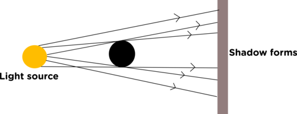
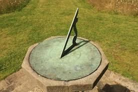
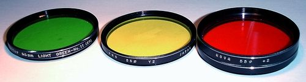

## Opaque and transparent substances

<Callout type="note" title="Note">
- opaque
- transparent
- translucent
- transmit
</Callout>

Three different things happen when light hits a surface, it can be **reflected** (bounce off), **absorbed** or **transmitted** (pass through). Glass reflects some light but most of the light is transmitted straight through. That's why we can see objects on the other side of a closed window.

We say that glass is **transparent**. Let's find out more about what this means. If a substance is not transparent, it is **opaque**.

# Shadow Play

This activity will show learners that opaque objects cast shadows. You can give them specific shapes to cut out from cardboard or allow them to be creative with their designs. Have them cut out various shapes of different sizes from cardboard. This will allow them to see that larger objects cast larger shadows. The learners can use a white piece of paper as a screen or use the wall of the classroom. If they hold the shape on the desk then the shadow would be cast on the desk but a screen would be more useful. The classroom should not be brightly lit when doing this activity as overhead lights may affect the shadows.

**MATERIALS:**

- cardboard
- clear plastic
- plastic shopping bag
- scissors
- light source (ray box or light bulb)

**INSTRUCTIONS:**

**Problem:**
Cut out three shapes from your cardboard. All of the shapes should be similar but three different sizes: small, medium and large.

**Solution:**

**Problem:**
Switch on the light source.

**Solution:**

**Problem:**
Hold your first shape a short distance in front of the light source.

**Solution:**

**Problem:**
Look at the shadow that forms. Write down what you observe.

**Solution:**
The shadow forms on the side of the shape which is furthest from the light. It is a dark colour.

**Problem:**
Hold your second shape the same distance in front of the light source.

**Solution:**

**Problem:**
Look at the shadow that forms. Write down what you observe.

**Solution:**
The shadow is formed on the side furthest from the light source. It is dark in colour and larger than the first shadow.

**Problem:**
Hold your third shape the same distance in front of the light source.

**Solution:**

**Problem:**
Look at the shadow that forms. Write down what you observe.

**Solution:**

**Problem:**
The shadow is formed on the side furthest from the light source. It is dark in colour and larger than the first and second shadows.

**Solution:**

**Problem:**
Use your first cardboard shape as a template and cut the shape from the clear plastic and the plastic shopping bag.

**Solution:**

**Problem:**
Hold the clear plastic shape the same distance from the light source. Write down what you observe.

**Solution:**
No shadow is formed by the clear plastic shape. There may be a slight outline of the shape as a shadow. This sometimes happens if the cut edges of the shape have curled over, the double thickness reduces the transparency. If any of the learners notice this you should explain it to them.

**Problem:**
Hold the plastic shopping bag shape the same distance from the light source. Write down what you observe.

**Solution:**
The shadow that forms is on the side opposite the light source but it is significantly lighter than the cardboard shadows. It has a darker outline and a lighter centre.

**QUESTIONS**

**Problem:**
When you held the cardboard up to the light, did it allow light to pass through it? How do you know this?

**Solution:**
No, light did not pass through as it forms a shadow on the opposite wall.

**Problem:**
Is the cardboard shape opaque or transparent?

**Solution:**
It is opaque.

**Problem:**
What did you notice about the shadows formed by the different size cardboard shapes?

**Solution:**
The larger the shape, the larger the shadow.

**Problem:**
Draw a diagram to show how the shadow is formed behind the opaque shape. Use straight lines with arrowheads to represent the rays of light.

**Solution:**
This is an example of the type of diagram the learners may draw. They need to show the opaque object between the light source and a screen. They need to show rays of light leaving the light source and moving in straight lines on either side of the shape.

**Problem:**
The distance between the shape and the light source was kept the same. What do you think would have happened to the shadow if the distance was increased?

**Solution:**
The answer calls for learners to predict something they have not tested. The shadow should become larger if the object is closer to the light source and smaller if the object is further from the light source.

**Problem:**
Test your idea from question 5 by moving your cardboard shapes closer to and further away from the light source. What do you see? Were you correct in your prediction?

**Solution:**
This answer is learner dependant because it depends on their prediction for question 5. Learners should describe seeing that the size of the shadow decreased as the distance increased or that the size of the shadow increased as the distance decreased.

**Problem:**
Is the clear plastic shape opaque or transparent?

**Solution:**
The clear plastic is transparent.

**Problem:**
Did the clear plastic cast a shadow?

**Solution:**
No

**Problem:**
Explain why the cardboard casts a shadow but the clear plastic does not.

**Solution:**
Light travels in straight lines. It cannot bend around an object. Light cannot pass through the cardboard and so a shadow is formed. Light can pass through the clear plastic and so the area behind the plastic is bright.

**Problem:**
Is the plastic shopping bag shape opaque or transparent?

**Solution:**
It is neither completely transparent or completely opaque. The shopping bag is translucent or semi-transparent.

**Problem:**
Explain why the shopping bag casts a lighter shadow.

**Solution:**
Some of the light can pass through the translucent plastic but not all of it, this means that the shadow is not as dark.

What have we learned? Shadows are formed because light travels in straight lines and cannot pass through opaque objects.

Substances which transmit most of the light and only absorb or reflect a little bit are called **transparent**. Can you list some everyday objects which are transparent?

Glass, some plastics, cellophane, water etc.

Substances which completely reflect or absorb light without transmitting any are called **opaque**. Can you list some everyday objects which are opaque?

Bricks, wood, walls, skin etc.

Some substances, such as the plastic shopping bag, allow some light to pass through, but not all of it. This substance is **translucent**, or **semi-transparent.**

Shadows can be useful. Sundials have been used since ancient times as a time-keeping device, like a watch or a clock. As the Sun moves across the sky, the shadow cast by the style moves across the surface of the sundial. The surface is marked with numbers, allowing the shadow to indicate time of day.

We can use transparent objects to make filters. If we want red light we use a red glass bulb or a red plastic film placed in front of the light. Only red light is able to transmit through the red glass or plastic. The other colours are absorbed by the filter.

These are different colour filters for a camera. The red filter will only allow red light through and so the photograph will have a red effect applied to it. The other colours of light are absorbed by the filter.

Now that we have seen some examples of transparent and opaque substances, let's take a closer look at what it means to absorb or reflect light.
