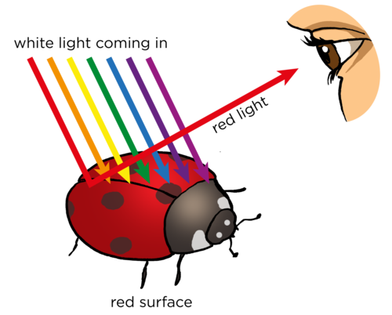
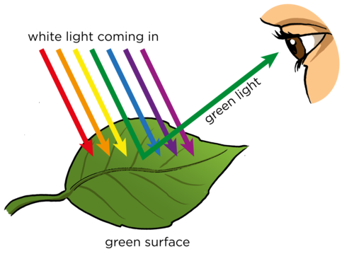

## Absorption of light

The absorption of the different colours of light links back to Grade 7 Energy and Change. Learners will have learnt that matt black surfaces absorb heat from the Sun and that white and silver objects reflect the heat from the Sun. The energy which is reflected from surfaces can be seen as different colours. This is because each colour has its own frequency which is determined by the amount of energy of the released photons.

Look at this picture of a ladybird. Why is it red and black? And why is the leaf so green? How do we see the different colours? It all has to do with what happens when light hits a surface.

A ladybird.

When light hits a surface, some of the light is absorbed and the rest is reflected. It is the reflected light that reaches our eyes and allows us to see the object. Previously, we learned that white light is a mixture of different colours. When white light from the Sun hits the red shell of the ladybird all of the colours are absorbed, except red. Red light is reflected back to our eyes and so we see a red ladybird.

We see the red shell of the ladybird as red light is reflected and the other colours are absorbed.

The green leaf absorbs all the colours except green which it reflects back into our eyes.

We see a green leaf as green light is reflected and the other colours are absorbed by the leaf's surface.

What about the black spots of the ladybird? Is black a colour? The black spots on the ladybird absorb **all** the colours and no light is reflected. That is why they appear black.

<Callout type="note" title="Note">
Although we can get black paint as a pigment, black is not a colour of light. Black is the result of the complete absorption of light.
</Callout>

Do you remember learning about heat as energy transfer in Gr 7? We looked at the absorption of heat. We saw that black, matt objects absorbed all of the light energy, while white objects reflected all of it. Black, matt (not shiny) objects absorb all of the colours of light and reflect none and so appear black to our eyes.

What about a white object? Why do you think white objects look white? Have a look at the following diagram for a clue.

White objects do not absorb any of the colours but reflect all of them together and so the object appear white to our eyes.

# Why do objects look red under red light?

Try to use a dimly lit classroom for this activity so that the main source of light is the torch or light bulb.

**MATERIALS:**

- piece of red plastic to act as a filter
- light source (light bulb or torch)
- white object

**INSTRUCTIONS:**

2. Place a white object on the desk.
4. Switch on your light source and place the red plastic in front of the light.
6. Shine the light (with the red plastic in front) onto the piece of white paper.

**QUESTIONS:**

**Problem:**
What colour was the page under normal light?

**Solution:**
White.

**Problem:**
Why does the page appear white in normal light?

**Solution:**
The normal light contains all 7 colours of the visible spectrum mixed together. All the colours are reflected from the page and enter our eyes. We see a white page.

**Problem:**
What did you see when the red plastic filter shone on the white page?

**Solution:**
The page looked red instead of white.

**Problem:**
Explain why the paper changed colour.

**Solution:**
The red plastic only allowed red light to pass through it. Red light was reflected off the paper and so that is the only colour that reached the eye. The paper appears to be red.

Let's now look more at what we mean by reflection of light.
