## Reflection of light

<Callout type="note" title="Note">
- reflect
- incident ray
- reflected ray
- normal line
- angle of incidence
- angle of reflection
- perpendicular
</Callout>

When light hits a surface it is often reflected off the surface. This photograph shows how light is reflected off a still lake, creating a mirror image of the tree. The still, flat surface of the lake has acted as a mirror.

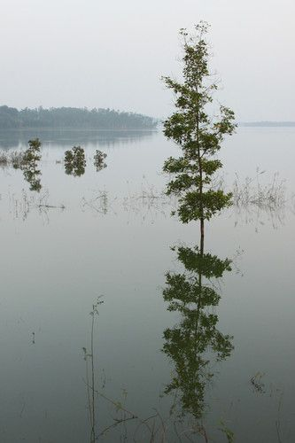

A tree reflection.

Have some fun with these photos of reflections in water. One photograph is the right way up and the other one is upside down! Which one is which?

The photograph of the bridge in Italy is upside down.

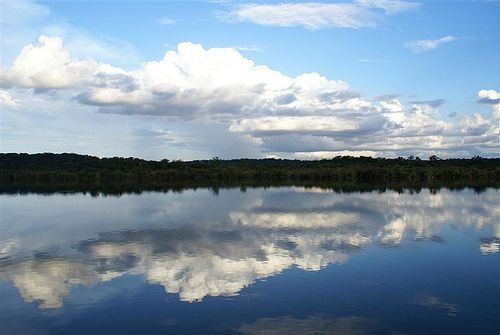

Reflections on the Negro River in the Amazon.

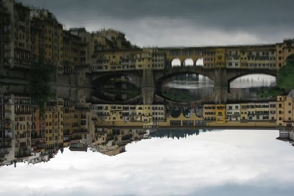

Reflections in the Arno River in Italy.

Most surfaces reflect light. When light strikes a reflective surface, it can change direction. Let's look at how this happens.

When light reflects off a surface the ray which hits the surface, it is called the **incident ray**. The ray of light which is reflected from the surface is called the **reflected ray.** When we draw diagrams of reflection we also draw in an imaginary line to help us measure different angles. This line is called the **normal**. The normal line is always drawn perpendicular to the surface.

Between the normal line and the incident and reflected rays, there are two angles. These are:

- **angle of incidence** - the angle between the incident ray and normal line
- **angle of reflection** - the angle between the reflected ray and normal line

The following diagram explains these concepts.

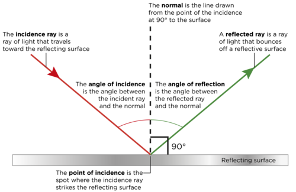

Let's investigate the relationship between the angle of incidence and the angle of reflection.

# Is there a relationship between the angles of incidence and reflections?

Learners will see that the angle of reflection is equal to the angle of incidence. Learners must save some of the sheets for the next activity where you will use a piece of crumpled aluminium foil instead of the mirror.

Another way to do this investigation is to use a sheet of corrugated cardboard instead of paper. Learners can then stick pins into the cardboard along the light ray and then draw in the lines later.

**AIM:** To investigate the reflection of light from a surface.

**INVESTIGATIVE QUESTION:**

Look at the diagram above and try to formulate an investigative question for this investigation.

Learners will have their own versions. An example of an appropriate question would be: 'How is the angle of reflection related to the angle of incidence of the incident ray?' It is important that the question relates the two angles in some way.

**HYPOTHESIS:** The angle of incidence is equal to the angle of reflection

**MATERIA LS AND APPARATUS:**

- mirror
- white paper
- pencil
- protractor
- ruler
- ray box

A laser pointer also works very well instead of a ray box.

**METHOD:**

2. Put a white piece of paper on the desk.
4. Use your ruler to draw a straight line near the top of the white paper.
6. Use your protractor to make a right angle in the middle of your pencil line. This is the **normal** line.

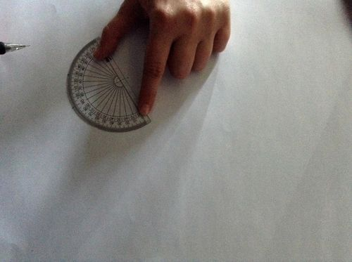

Marking a right angle with a protractor.

2. Place your mirror upright along the first line.
4. Shine a light from the ray box along the paper so that it "hits" the mirror where your normal line and your mirror meet.

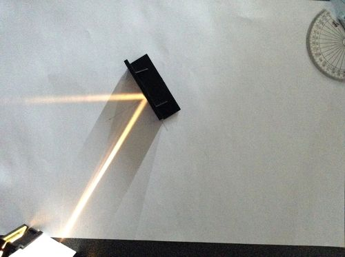

A mirror is placed on the line and a ray shone to strike the mirror at the normal line.

2. Use a pencil to mark the incident light ray.

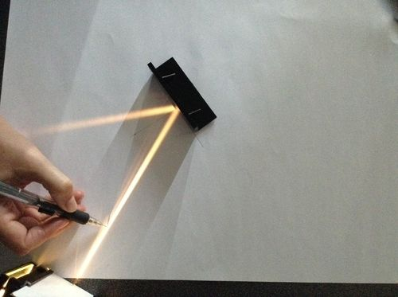

Marking the incident light ray.

2. Use a pencil to mark the reflected light ray.

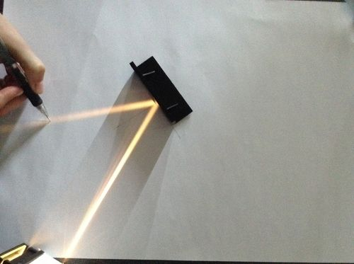

Marking the reflected ray.

2. Remove the mirror and switch off the ray box.
4. Use a ruler and pencil to draw a line from the points you have marked on each ray to the normal line.

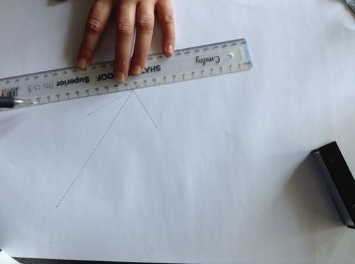

Drawing in the rays.

2. Mark the angle of incidence (i) and angle of reflection (r).

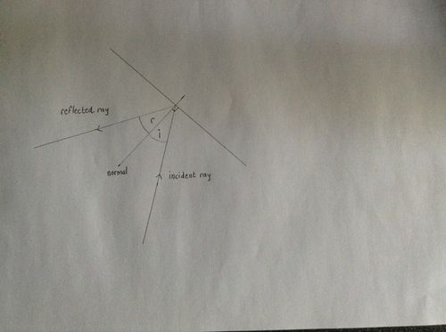

Your ray diagram should look similar to this.

2. Turn the ray box on again to confirm that your pencil lines follow the rays.

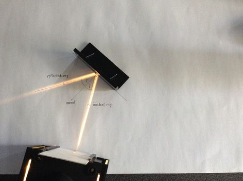

The ray diagram overlaps the actual rays.

2. Use a protractor and measure the angle of incidence and the angle of reflection and record your results in the table.
4. Repeat this method 3 more times, each time using a different angle of incidence.

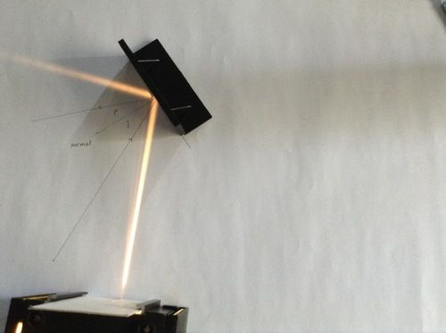

A different angle of incidence.

<Callout type="note" title="Note">
Keep one of the sheets with your drawn ray diagram for the next activity.
</Callout>

**RESULTS:**

Fill your results into the following table.

| Repeat | Angle of Incidence | Angle of Reflection |
| --- | --- | --- |
| 1 |  |  |
| 2 |  |  |
| 3 |  |  |
| 4 |  |  |

The answers in the table will depend on the angles of incidence which the learners use for their investigation. It is important that they see that the angles of incidence and reflection are equal to each other in each repetition.

**ANALYSIS:**

**Problem:**
Has your investigation provided everything you need to answer your investigative question?

**Solution:**
This answer would be learner-dependent as it would depend on the investigative question they chose.

**Problem:**
How could you improve this investigation to get more accurate results?

**Solution:**
This answer is learner dependent. An example of an improvement could be to use a protractor printed on the page already in order to measure the angles accurately.

**CONCLUSION:**

What can you conclude based on your results?

In reflection, the angle of reflection is always equal to the angle of incidence.

<Callout type="note" title="Note">
In reflection, not only is the angle of incidence equal to the angle of reflection, but the incident ray and reflection ray are also in the same**plane**.
</Callout>

Whenever light is reflected from a surface, the angle of incidence to equal to the angle of reflection. On a smooth surface all the light rays are reflected in the same way and so the image is clear and focused.

A mirror is an example of a smooth surface. The image you see is focused and clear. As you can see in the photograph, the scientists and engineers are clear and focused in the mirror image.

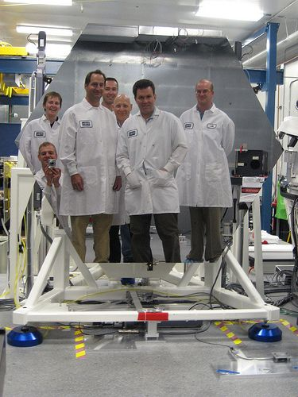

A mirror segment from one of NASA's telescopes provides a clear and focused reflection.

<Callout type="note" title="Note">
What colour is a mirror? (video)
</Callout>

What happens when we do not have a smooth surface? Have a look at the photo.

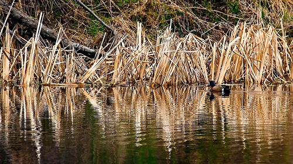

Why is the reflection of the grass and reeds not clear, but rather blurred? [http://www.flickr.com/photos/chefranden/3507963245/](http://www.flickr.com/photos/chefranden/3507963245/)

# Light reflection off aluminium foil

**MATERIALS:**

- aluminium foil
- white paper
- ray box

**INSTRUCTIONS:**

2. If possible, use the white sheets of paper from the last investigation where you drew your ray diagrams.
4. Similar to what you did in the last investigation, set up a ray box and direct the ray along the line of incidence which you drew.
6. Crumple a piece of aluminium foil and place this in the spot instead of the mirror.
8. Observe the reflected ray.

**QUESTIONS:**

**Problem:**
Describe the reflected ray off the aluminium foil and how this compares to the reflected ray off the mirror.

**Solution:**
Learners should note that the reflected ray off the aluminium foil is scattered and does not provide one clear ray, as the mirror does.

**Problem:**
Why do you think you observed these differences?

**Solution:**
This is because the aluminium foil is crinkled and provides a rough surface whereas the mirror is a smooth surface.

Can you now see why reflections off rippled water are not clear, but rather blurred? This is because the light rays have not reflected parallel to each other as they do from a smooth surface, but have scattered in different directions.

<Callout type="note" title="Note">
Watch a video about the creative way that scientists have tried to answer the question: "What is light?"
</Callout>

The following table shows the difference between a smooth surface and a rough surface. Straight parallel rays are approaching the surface. You need to draw in the reflected rays to show specular (clear) reflection from a smooth surface and diffuse (unclear) reflection from a rough surface.

<Callout type="note" title="Note">
'Diffuse' can mean unclear as well as spread out. In this example, the reflection is unclear because the rays are spread out or diffuse.
</Callout>

| Specular diffusion from a smooth surface | Diffuse reflection from a rough surface. |
| --- | --- |

Here are the answers for what learners should draw.

| Specular diffusion from a smooth surface | Diffuse reflection from a rough surface. |
| --- | --- |

Visible light is the range of frequencies of light that are visible to the human eye, and is responsible for the sense of sight. Are you curious to find out how we actually see light? Let's discover more in the next section.
