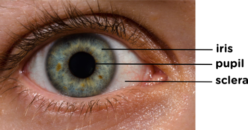
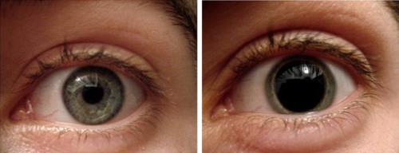
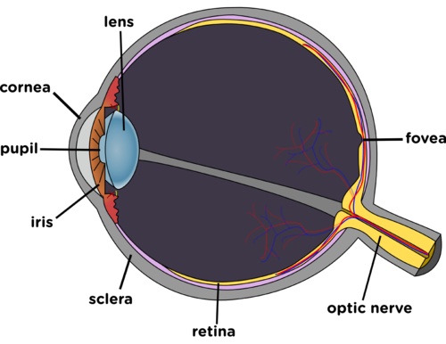
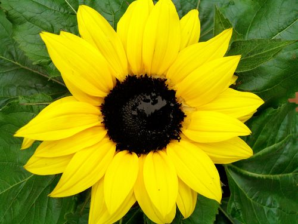
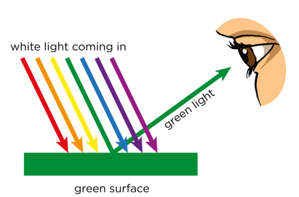
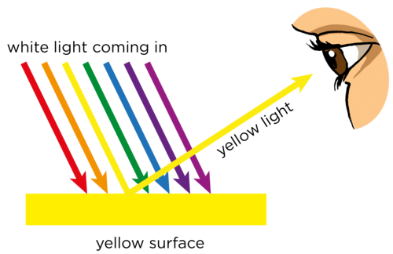
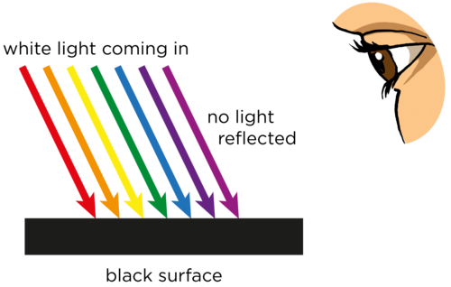
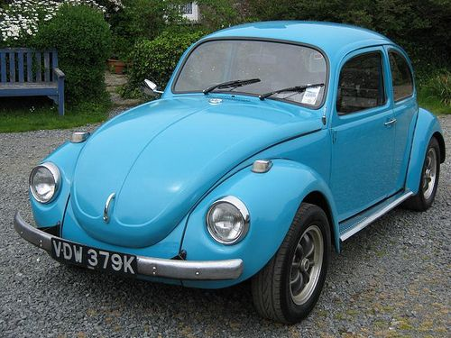
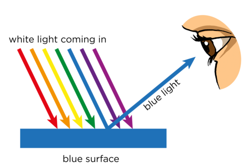

## How do we see light?

<Callout type="note" title="Note">
- retina
- stimulate
</Callout>

<Callout type="note" title="Note">
2012 Nobel Prize: How do we see light?
</Callout>

How is it that we are able to see light? Light that is absorbed by objects does not enter the eye. Only reflected light or direct light from luminous objects can enter the eye and be interpreted. Have a look at the following image which shows the outer structure of the eye.

We can see the iris, the pupil and the sclera. The sclera is a the tough white, outer part of the eye, which acts as protection. The iris is the coloured part of the eye which differs from person to person. It is circular and surrounds the pupil. Light enters the eye through the pupil.

<Callout type="note" title="Note">
You blink about 12 times every minute, and the average blink lasts 1/10th of a second.
</Callout>

The size of your pupil changes in different light conditions. In bright light, the pupil contracts (gets smaller) to let less light through (as on the left), and in low light your pupil dilates (gets bigger) to let more light through (as on the right).

Let's take a look at the internal structure of the human eye. The following diagram shows a cross section through the eye. The eye is actually a large ball, and only a small part is visible on the outside. Covering the iris is a tough, transparent layer called the cornea. Behind the iris is the lens. Both the cornea and the lens help you to focus the light entering your eyes, as we will learn about in the next section.

<Callout type="note" title="Note">
The fovea is the part of the eye located in the centre of the retina where the clearest image is formed.
</Callout>

A diagram of the eye.

The light travels through the eye and hits the retina at the back of the eyeball. The retina is a layer of tissue lining the back of the eyeball, as indicated in the diagram, it is the yellow layer. The retina consists of cells which are sensitive to light. Light enters the eye and forms an image on the back of the eyeball. Light hitting the retina is similar to light hitting the screen in the pinhole camera. The receptor cells convert the light energy into electrical nerve impulses. These impulses travel out of the eye through the optic nerve and to the brain where they are interpreted as sight.

<Callout type="note" title="Note">
The cell is the basic structural and functional unit of all living things. We will be learning more about the cell next year in Gr 9 Life and Living.
</Callout>

<Callout type="note" title="Note">
Each of your eyes has a small blind spot at the back of the retina where the optic nerve attaches. You do not normally notice the hole in your vision because your eyes work together to fill in each other's blind spot.
</Callout>

<Callout type="note" title="Note">
Find your blind spot with this optical illusion.[http://www.moillusions.com/2012/03/find-your-blind-spot-trick.html](http://www.moillusions.com/2012/03/find-your-blind-spot-trick.html)
</Callout>

So how do we see colour? Do you remember when we spoke about why the ladybird appears red and black? Look at the following diagram again.

The white light hits the ladybird's surface. The white light has all the colours of light, but when it hits the red surface, only the red light is reflected. The other colours are absorbed by the red surface. This means that when we look at the red parts of the ladybird, we only get red light reflected into our eyes. Therefore, when this reflected light hits our retina and the electrical impulse is sent to our brains, we see the red colour.

<Callout type="note" title="Note">
The cells in your eye come in different shapes. Rod-shaped cells allow you to see shapes, and cone-shaped cells allow you to see colour.
</Callout>

# Seeing colours

**MATERIALS:**

- coloured pens or pencils

**INSTRUCTIONS:**

2. Answer the following questions about how we see objects.
4. Draw a ray diagram to accompany your written answer.
6. An example has been done for you.

Look at the picture of a sunflower.

A black and yellow sunflower.

We can draw a ray diagram to show why we see the green leaves as green, as shown below. The green surface of the leaves absorb all the colours of white light except green light which is reflected into our eyes.

Now explain why the petals appear yellow and the centre appears black. Use the concepts of absorption and reflection in your explanation. Draw diagrams to support your answer.

Light striking the yellow petals.

Light striking the black centre.

The white light that strikes the sunflower has all the colours. The yellow petals absorb all the colours of the spectrum except yellow which is reflected into our eyes. The black centre absorbs all of the colours of the spectrum and does not reflect any light into our eyes, hence our brain interprets a lack of light/colour as black.

Heath has bought himself a blue car. Explain why we see the car as blue by using the absorption and reflection of light. Draw a diagram to support your answer.

Heath's blue car.

Light striking the blue car.

White light from the Sun hits the car. All of the colours of light, except blue, are absorbed by the surface of the car. Only blue light is reflected from the surface of the car and enters our eyes. Our brain can only see the blue light and so we perceive that the car is blue.

<Callout type="note" title="Note">
A simulation on colour vision.[http://phet.colorado.edu/en/simulation/color-vision](http://phet.colorado.edu/en/simulation/color-vision)
</Callout>

We have looked at opaque and transparent substances, absorption of light, reflection of light and how we see light. We are now going to go back to transparent substances and see how light can interact with these materials.
