## Refraction of light

<Callout type="note" title="Note">
- refraction
- medium
- optical density
</Callout>

Do you remember the last time you drank a cold drink with a straw? Did you notice that the straw did not look straight anymore once it was in the water or cool drink?

You should do this in front of the class, or else put a glass of water in front of each learner. It is a really easy demonstration. All you need is a glass of water and a straw. If you do not have a straw, a pencil works really well.

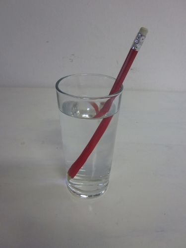

Why does the pencil in this glass of water look bent?

Let's investigate this by examining what happens to light when it passes through a glass block.

# What happens to light when it passes through a glass block

You do not need a ray-box for this investigation. A laser, such as those found on keyrings, or a light bulb can be used. If you use a light bulb, you need to make a cardboard screen. Cut a thin slit into the cardboard and hold it in front of the light bulb, this will create a ray of light suitable for the investigation.

We are going to investigate what happens to a ray of light when it passes from air and into a glass block and then from the glass block back into air. We are going to use a glass block with parallel sides.

Before we start the investigation, we need to think about how we are going to determine if light changes direction or not. Do you remember in the investigation on reflection where we measured the angle of incidence and the angle of reflection? What did we find in this investigation?

The angle of incidence equals the angle of reflection.

When light passes through a transparent substance, we can also measure the angles. Look at the following diagram. The angle of incidence (i) is measured between the incident light ray and the normal line. As the light passes through the transparent substance, the angle of refraction (r) is the angle between the refracted light ray and the normal.

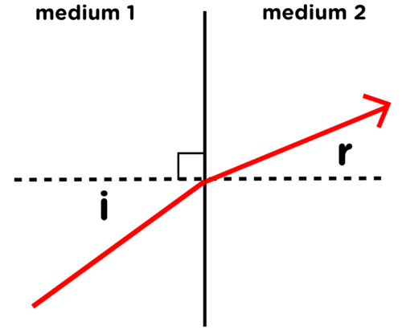

A light ray passing from one medium to another.

Learners can come back to this diagram and mark in which is the more dense medium (glass) and which is the less dense medium (air). In this diagram, medium 1 is air and medium 2 is glass.

In the diagram above, you can see that the angle of refraction is smaller than the angle of incidence. Therefore, the refracted light ray changed direction when it entered the transparent medium. We can also say something about which direction it bent towards. Did the light ray bend towards or away from the normal line?

The refracted ray bent **towards**the normal line.

The next diagram shows another outcome.

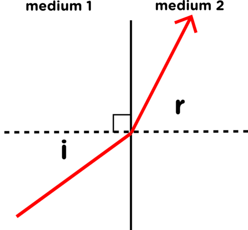

A light ray passing from one medium to another.

Learners can come back to this diagram and mark in which is the more dense medium (glass) and which is the less dense medium (air). In this diagram, medium 1 is now the glass and medium 2 is air.

In the diagram above, does the refracted ray change direction when it enters the transparent medium? Give a reason for your answer.

Yes, it changes direction as the angle of incidence is not equal to the angle of refraction. The angle of incidence is smaller than the angle of refraction.

In which direction did the refracted ray change?

The refracted ray bent **away** from the normal line.

We are now ready to start our investigation.

**AIM:** To determine whether light changes direction when it passes through a parallel-sided glass block.

**HYPOTHESIS:** Write a hypothesis for this investigation.

Learners must hypothesize about whether they think the light ray will change direction or not when it passes through the glass block.

**MATERIALS AND APPARATUS:**

- glass block
- ray box, laser pointer or other light source
- protractor

**METHOD:**

2. Put the glass block in the centre of a piece of white paper and trace around it.
4. Shine a ray of light into the glass block. The ray should be at an angle to the surface of the block.

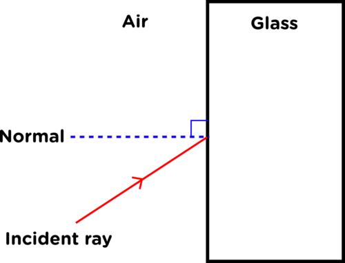

2. Trace the light ray with pencil and mark the point at which it enters the glass block.
4. The light ray emerges on the other side of the glass block. Mark the point at which it emerges with a pencil and trace the emergent ray.

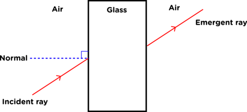

2. Remove the glass block. Your diagram should look similar to the one above.
4. Draw a line joining the incident ray and emergent ray. You have traced the refracted ray through the glass block.
6. Draw the normal lines where the incident ray meets the block and where the emergent ray leaves the block.

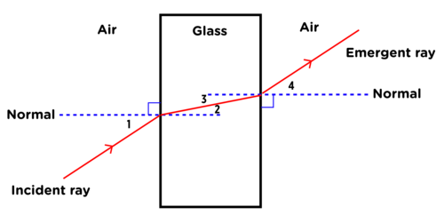

2. Measure the angles labelled 1, 2, 3 and 4 as shown on the diagram with a protractor.
4. Fill in the measurements in the table.
6. Repeat the steps above three times using different angles of incidence (angle 1).

<Callout type="note" title="Note">
The emergent ray from a parallel sided block is parallel to the incident ray.
</Callout>

**RESULTS AND OBSERVATIONS:**

Fill your results into the following table.

| Experimental repeat | Angle 1 | Angle 2 | Angle 3 | Angle 4 |
| --- | --- | --- | --- | --- |
| 1 |  |  |  |  |
| 2 |  |  |  |  |
| 3 |  |  |  |  |
| 4 |  |  |  |  |

**Problem:**
Which pairs of angles are equal in the measurements you have taken?

**Solution:**
Learners should note that angle 1 is equal to angle 4 and angle 2 is equal to angle 3 in all the sets of measurements.

**NOTE:** Discuss this with your learners as to why angles 2 and 3 are equal. The explanation for this is to do with parallel lines and alternate angles. This links well with what learners would have covered in Mathematics in the beginning of the year. The normal lines are parallel and so the alternate angles between them are equal. You can draw this on the board to explain it in more detail and show that the normal lines are parallel as the corresponding angles are equal (they are 90o).

**Problem:**
Which of the angles you measured are the angles of incidence and which are the angles of refraction? Write this down below and mark them on the diagram above.

**Solution:**
Angles 1 and 4 are the angles of incidence and angles 2 and 3 are the angles of refraction.

**Problem:**
What do you notice about the angle of incidence and angle of refraction for each of your sets of measurements?

**Solution:**
The angle of incidence is always different to the angle of refraction.

**Problem:**
Did the light entering the glass block bend towards or away from the normal line?

**Solution:**
The light bends towards the normal line. **NOTE:** This is because the light is moving from a less dense to a more dense medium, which will be discussed later on.

**Problem:**
Make the angle of incidence zero (make the light ray enter the block perpendicular to the surface). What is the angle of refraction?

**Solution:**
Zero.

**CONCLUSION:**

What can you conclude from your results?

The angle of incidence is not equal to the angle of refraction. This means that the light ray changes direction when it passes from the air into the glass block, and again when it passes from the glass block back out into the air.

<Callout type="note" title="Note">
Learn more about refraction with this simulation.[http://phet.colorado.edu/en/simulation/bending-light](http://phet.colorado.edu/en/simulation/bending-light)
</Callout>

**Investigation: The refraction of light as it enters water ( PhET simulation)**

This investigation requires the use of the PhET simulation listed in the visit box. This can be used as an alternative to the previous investigation if you would prefer to run the simulation, otherwise learners can discover more by experimenting with different mediums and playing with prisms to make a rainbow. On the webpage given here you can download a pdf file which gives you tips on how to manipulate the simulation [http://phet.colorado.edu/en/simulation/bending-light](http://phet.colorado.edu/en/simulation/bending-light)

Familiarise yourself with the use of the simulation before getting your learners to use it. That way you can help learners with any problems they might encounter.

**INSTRUCTIONS:**

2. Open the simulation. You should be on the introductory page.
4. Click the red light on the laser.
6. Use the protractor to measure the angles of incidence, reflection and refraction. Fill in those angles in the table below. The angle of refraction is between the normal line and the refracted ray of light.
8. Move the laser so that the angle of incidence changes.
10. Use the protractor to measure the angles of incidence, reflection and refraction. Fill in those angles in the table below.
12. Change the angle of incidence and reflection three more times and complete the table.

**RESULTS:**

| Experimental repeat | Angle of incidence | Angle of reflection | Angle of refraction |
| --- | --- | --- | --- |
| 1 |  |  |  |
| 2 |  |  |  |
| 3 |  |  |  |
| 4 |  |  |  |

**CONCLUSIONS:**

2. Compare the angles of incidence and reflection. What do you notice?

*The angle of incidence is always equal to the angle of reflection.*

2. Compare the angles of incidence and refraction. What do you notice?

*The angle of refraction is not equal to the angle of incidence.*

<Callout type="note" title="Note">
The speed of light in glass.
</Callout>

The angle of incidence is not equal to the angle of refraction because the light has changed direction as it enters the glass. Therefore, when light travels from one medium to another, it bends, or changes direction. This is called **refraction**. When light enters a different medium at right angles then it does not change direction.

So why does the light refract? Light behaves as a wave does and waves travel at different speeds in different media. For example, light travels faster in air than it does in water. When light enters a different medium, it changes speed, and if it entered at an angle other than 90o, then it also changes direction. The more dense the medium, the slower the light moves.

Do you remember learning about density last term in Matter and Materials? Write down your own definition for density in the space below.

This question is included to check what learners remember from the previous term and to reinforce learning. We also need to show that although we learn about Natural Sciences within the four Knowledge Strands, many concepts are integrated and linked across the strands. Density is a measure of how much mass of a material fits into a given volume. We say density is the ratio of mass to volume, or mass per unit volume. We can write a mathematical relationship to show this ratio as follows: density = mass/volume.

<Callout type="note" title="Note">
Remember that although we learn about Natural Sciences in 4 strands throughout the year, there are many connections and links between the strands.
</Callout>

If light moves from a less dense medium, like air, into a denser medium, like glass, then the light slows down. The light will bend towards the normal line.

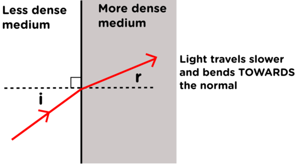

If light moves from a more dense medium to a less dense medium then the light speeds up and moves away from the normal.

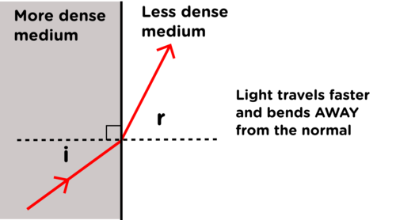

When light refracts and changes direction as it passes through different mediums, it can distort what we see. Think back to the pencil or straw in a glass of water at the start of the section. We can now explain why a drinking straw or pencil in a glass of water looks bent. The light bends when it moves from one medium to another. Light moves from the air to glass to water, and therefore changes direction.

If you have stood in a pool of water before and looked down, have you noticed how short your legs appear to be? Let's have a look at this a bit more in the next activity.

# Magic coin trick

This activity will show the learners that bending of light will affect what we are able to see. The coin is not visible until the water is added. The water causes the light rays from the coin to refract (bend) towards the learner's eye. This allows the learner to see the coin.

<Callout type="note" title="Note">
Watch a video that shows and explains the coin activity.
</Callout>

**MATERIALS:**

- coin
- prestik
- opaque bowl or cup
- water

**INSTRUCTIONS:**

2. Work in pairs for this activity.
4. Put a small amount of prestik onto the bottom of the bowl.
6. Stick the coin to the bottom of the bowl.
8. Take small steps back from the desk/table until you cannot see the coin over the lip of the bowl.
10. Ask your partner to slowly pour water into the bowl and observe.

The learners should stick the coin to the bowl in order to keep the coin still when water is poured into the bowl. Often learners do not pour the water in gently and if the coin moves then it will affect the results.

**QUESTIONS:**

**Problem:**
What happened when your partner poured the water into the bowl?

**Solution:**
Learners responses may vary slightly but they should all have seen the coin "appear" when the water was deep enough. When more water is added the entire coin can be seen.

**Problem:**
Where does the coin appear to be?

**Solution:**
The coin appears to be higher than it actually is.

**Problem:**
Explain why the coin can be seen when the water is added, but not before. The diagrams below will help you explain what is happening in words.

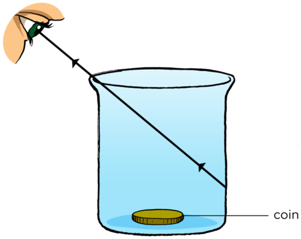

Empty container.

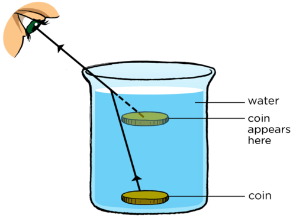

Container with water.

**Solution:**
When there is no water in the bowl there is no direct line of sight from the learner's eye to the coin. When water is added the light from the coin leaves the water and is refracted. The learner's brain detects the refracted light and as the brain knows light travels in straight lines, the coin appears to be higher in the water.

<Callout type="note" title="Note">
The diagrams used here show the container as transparent so that you can see the coin inside, whereas you will actually be using an opaque container.
</Callout>

Refraction can be used to explain why images appear to be distorted when we view them through transparent mediums. For example, if you are looking at your legs or hands through some water, they will appear closer than they actually are as the light is refracted. Look at the photograph of the glass with water in it in front of diagonal lines. Can you see how the lines are distorted when the light travels through the water and glass compared to when it does not?

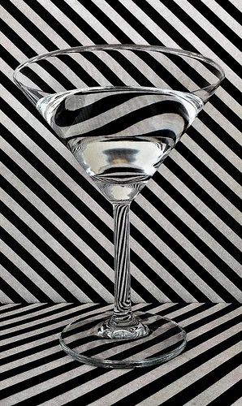

Light refraction through glass and water.

Can you remember how we split white light into the separate colours of the visible spectrum in the beginning of this chapter? What did we use to do this in the activity?

We used a triangular prism. Learners have already experimented with this to show that white light is actually composed of 7 different colours. However, you can repeat this activity again to explain why this happens in terms of refraction.

We can do this because the different colours of light bend by different amounts. The amount of refraction depends on the type of light entering the medium. Different colours of light will slow down to different speeds.

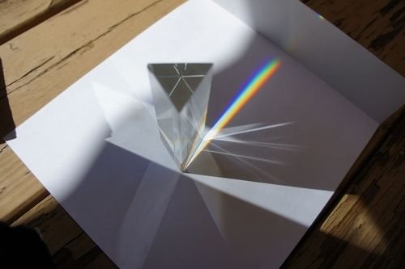

Refraction through a triangular prism.

When the white light entered the prism it refracted. The different colours of light travel at different speeds in the prism so they refracted at different angles and split up. Red light refracts the least and the blue light refracts the most as you can see in the following diagram.

Prisms are not the only objects that can split white light into separate colours. In fact, a rainbow is a good example of white light splitting up.

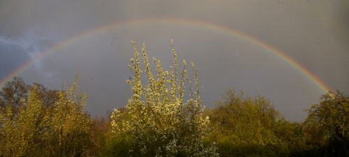

A rainbow.

Light from the Sun enters the raindrops and refracts. The light is then reflected off the back of the raindrop. When the light passes out of the raindrop it is refracted again and the colours split up even more as shown in the diagram.

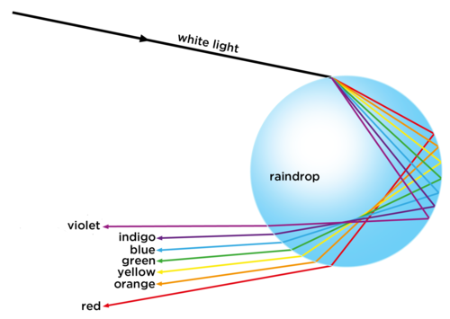

A raindrop refracts and reflects light, dispersing white light into the colours of the visible spectrum.

What colour is at the top of a rainbow and which colour is at the bottom?

Red is at the top and violet is at the bottom.

Does this match the order which we see in the diagram showing how light is refracted and reflected in a raindrop?

No, it does not. It is the reverse order.

How does this happen? When we see a rainbow, we see a combination of millions of raindrops. Although each raindrop refracts and reflects all 7 colours, we only see only colour of light reflected from each particular raindrop. This depends on the angle of the raindrop from our position. Therefore, the raindrops higher up in the sky reflect red light to us and the rain drops lower down reflect violet light to us. This is shown in the following diagram.

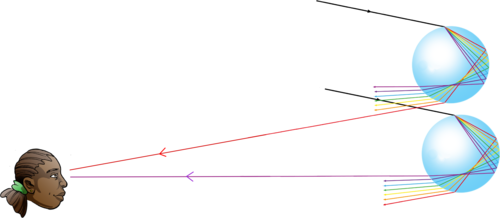

We see rainbows with red at the top and violet at the bottom due to the combination of millions of raindrops. We only see one colour reflected from a particular raindrop, depending on its position in the sky.

We are now going to look at an application of the refraction of light.

### Lenses

<Callout type="note" title="Note">
- diverge
- converge
- focus
</Callout>

Do you remember when we spoke about how we see light and the structure of the eye, we mentioned that there is a lens just behind the iris? Another place where you may have seen lenses before are in reading glasses which some people wear to correct their vision. Or, have you seen how a magnifying glass makes things appear bigger. What are lenses and how do they work?

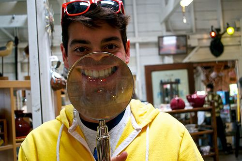

A magnifying glass makes things look bigger.

A lens is a transparent object which focuses or refracts light. When light is spread out, we say it has **diverged**. Some lenses will diverge light while others will **converge** light, bringing the light rays together. When light rays are all brought to the same point, we say they have been **focused**. Let's have a look at this more closely.

# Diverging and converging light with lenses

You will need a ray box or light source which lets at least two rays of light through so that learners can observe how they are either focused or dispersed. In the absence of a ray box, you can use any light source and use a piece of cardboard with two slits cut into it to let the light through.

If you are not able to do this activity as you do not have lenses, photographs have been provided so that learners can still answer the questions and see what happens.

**MATERIALS:**

- ray box or light source
- concave lens
- convex lens
- piece of paper
- pencil

Before we start, it is important that you know the difference between a convex and a concave lens.

| Convex lens | Concave lens |
| --- | --- |
| A convex lens has one side which curves or bulges outwards. A convex lens converges light. | A concave lens has one side which curves or is hollowed inwards. A concave lens diverges light. |

<Callout type="note" title="Note">
A lens can have two sides which are concave and it is then called a biconcave lens or two sides which are convex and it is then called a biconvex lens.
</Callout>

**INSTRUCTIONS:**

**Problem:**
Place a ray box or light source on one side of a piece of paper and turn it on. Observe the light rays. You might see something as shown in the photograph here.

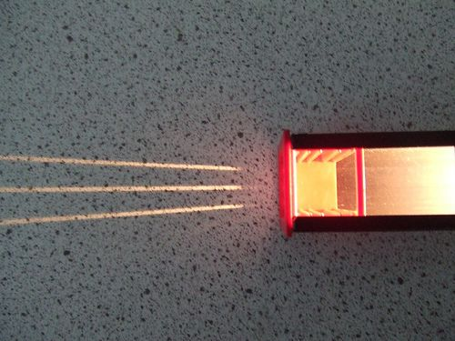

Three rays coming out of a ray box.

**Solution:**

**Problem:**
Turn the ray box off.

**Solution:**

**Problem:**
Place the convex lens (with the rounded surface) on the piece of paper where the light rays will pass through it. Trace around it.

**Solution:**

**Problem:**
Turn on the ray box or light source and observe what happens to the rays when they pass through the lens.

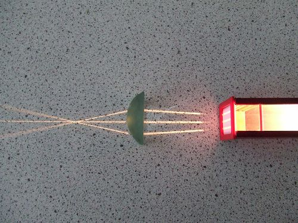

Light rays passing through a convex lens.

**Solution:**

**Problem:**
Trace the path of the light rays on your piece of paper.

**Solution:**

**Problem:**
Describe what has happened to the light rays.

**Solution:**
The light rays have been focused as they come to a point.

**Problem:**
Mark the point where the light rays cross. This is called the **focal point** of a convex lens.

**Solution:**

**Problem:**
Turn off the ray box or light source and place a new piece of paper in front of it.

**Solution:**

**Problem:**
Now place the concave lens in the path of the light rays and trace around the lens.

**Solution:**

**Problem:**
Turn on the light source and observe what happens to the rays.

**Solution:**

**Problem:**
Trace the path of the rays on the piece of paper.

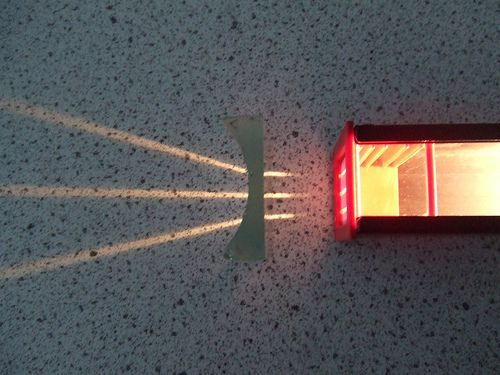

A concave lens in front of the rays of light.

**Solution:**

**Problem:**
Describe what has happened to the light rays.

**Solution:**
The light rays have diverged as they spread out after passing through the lens.

**Problem:**
Turn off the light rays and extend the rays you have drawn until they meet at a point in front of the lens. This is the **focal point** of a concave lens.

**Solution:**

**Problem:**
If you still have your pin hole cameras, place a convex and concave lens in front of the camera and observe the image that forms.

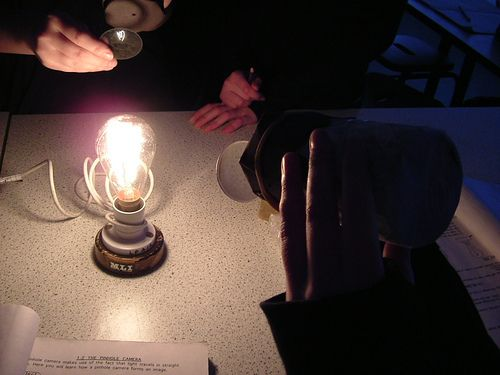

Viewing a light source through a pinhole camera with different lenses.

**Solution:**

**Problem:**
Is the image larger or smaller when you observe through a concave lens?

**Solution:**
The image will be larger.

**Problem:**
Is the image larger or smaller when you observe through a convex lens?

**Solution:**
The image will be smaller.

We have now seen how lenses can disperse or focus light. Have a look at the following diagrams which show how a biconvex lens converges light and a biconcave lens diverges light.

| Converging lens | Diverging lens |
| --- | --- |
| A converging lens refracts the light entering it and bends the light rays to a focal point on the other side of the lens. | A diverging lens refracts the light entering it and bends the light rays away from each other. The light rays can be traced back to a focal point in front of the lens. |

What do we use lenses for? Think of a magnifying glass. If you hold a magnifying glass over a picture or words then it enlarges the image. Is a magnifying glass an example of a diverging or converging lens?

A magnifying glass is an example of a converging lens.

Let's think about how this works. Imagine you are looking at the ladybird from the beginning of the chapter through a magnifying glass. The ladybird looks bigger than what it actually is. When the object you are viewing is **closer** to the lens than the focal point, you see a virtual image of the ladybird that is **larger** than the object.

Have a look at the first diagram below. Can you see that the ladybird is between the focal point and the lens? The rays reflected from the ladybird are refracted by the magnifying glass and enter the person's eye.

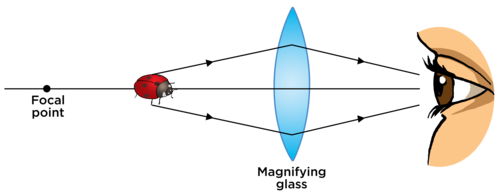

In the next diagram you can see how your eyes see a virtual image of the ladybird which is bigger than the object. The more curved the convex lens is in a magnifying glass, the greater its ability to magnify objects.

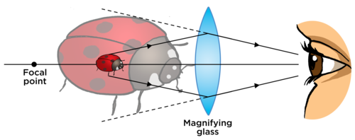

<Callout type="note" title="Note">
When you hold a magnifying glass up and view a distant object, the object appears smaller and upside down. Unlike when viewing the ladybird close up, the distant object is**beyond** the focal point of the lens, which results in this effect.
</Callout>

<Callout type="note" title="Note">
How do lenses work?
</Callout>

Do you remember what the human eye looks like? We have lenses in our eyes to allow us to see. The light enters the eye and passes through the lens. The lens focuses the light onto the back of our retina so that a clear image is formed. What type of lens do we have in our eyes? Give a reason for your answer.

A biconvex (converging) lens as it needs to focus the light rays onto the back of the retina.

<Callout type="note" title="Note">
A contact lens is designed to rest on the cornea of the eye and correct vision. Leonardo da Vinci was the first to come up with the idea in the 16th century to help prevent eye infection.
</Callout>

In order for a clear image to form, the lens in our eye needs to focus the light rays coming into our eyes so that the focal point falls on the retina. This depends on the shape of the lens in our eyes. Sometimes, people have lenses in their eyes that cannot focus properly. Have a look at the following diagram which shows a normal eye and then an eye which focuses before the retina (near-sighted) and behind the retina (far-sighted).

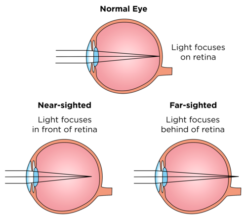

Optical glasses, or spectacles, are used to correct near or far-sightedness.

If you are near-sighted you need a diverging lens. Would this be a biconcave or biconvex lens?

You would need a biconcave lens.

If you are far-sighted you need a converging lens. Would this be a biconcave or biconvex lens?

You would need a biconvex lens.

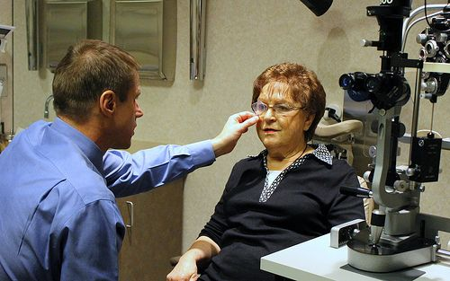

An optometrist holds a lens in front of a patient's eye to correct her vision.

The following image shows how lenses can be used to correct far and near-sightedness.

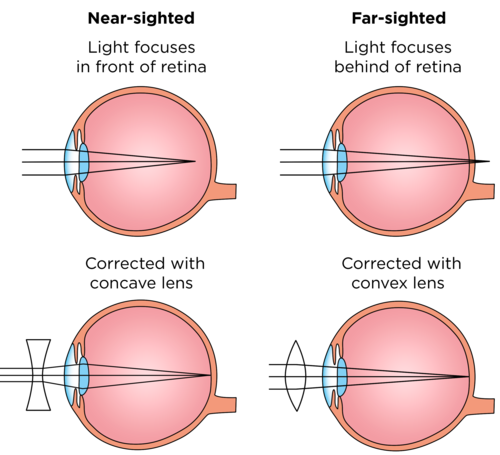

<Callout type="note" title="Note">
A**microscope** makes a tiny, nearby object look much bigger. A **telescope** makes a large, distant object look much closer and brighter. In both, light from the object passes through two or more lenses to form an image. The lens shapes and distances between them determine how the image is produced.
</Callout>

<Callout type="note" title="Note">
Next term in Planet Earth and Beyond we will look at how lenses are used in optical telescopes to view objects in space.
</Callout>

### Careers in optics

<Callout type="note" title="Note">
- optics
</Callout>

<Callout type="note" title="Note">
Peer through the bionic contact lenses (video)
</Callout>

<Callout type="note" title="Note">
Have you noticed that many of the words relating to vision start with or have 'op' as part of the word. These words are derived from the Greek word*opsis* which means 'vision'. For example, optics, optical, optometrist, myopia and optometer.
</Callout>

# Research careers in optics

<Callout type="note" title="Note">
An interview conducted with an optometrist.[http://www.clubx.co.za/careers/so-you-want-to-be-an-optometrist/](http://www.clubx.co.za/careers/so-you-want-to-be-an-optometrist/)
</Callout>

There are many different careers in the field of geometric optics.

**INSTRUCTIONS:**

2. Work in groups of 3.
4. Interview someone in the field of geometric optics and find out how they chose their career and what and where they studied.
6. Write a paragraph explaining the career and the study options available in order to qualify for that career.
8. Here are some examples of careers in geometric optics.
   2. Optometry
   4. Ophthalmology
   6. Optoelectronics
   8. Illumination engineering

Here is some information about each of these careers:

**
Optometry
**

Optometrists measure the efficiency of the patient's eyes. They examine eyes for vision problems, disease and other abnormal conditions. They test for proper depth and colour perception and the ability to focus and coordinate the eyes. They specialize in visual defects They are able to prescribe spectacles or contact lenses to rectify or alleviate visual defects such as far-sightedness, short-sightedness, astigmatism (image distortion) and presbyopia (far-sightedness as the result of age).

**School Subjects**

National Senior Certificate meeting degree requirements for a degree course

National Senior Certificate meeting diploma requirements for a diploma course

Each institution will have its own minimum entry requirements.

Compulsory Subjects: Mathematics, Physical Sciences

Recommended Subjects: Life Sciences

**Training**

Degree: BOptometry - UJ, UFS, UL. The duration of the course is 4 years of full-time study. After the completion of the degree course, students may be expected to complete a one-year internship before registration as professional optometrists.

Diploma: N.Dip: Optical Dispensing and B.Tech - CPUT. The duration of the course is three years. A fourth year of study culminates in the BTech Optometry. During their third and fourth year, students have contact with patients. Students are required to complete a one-year internship.

Optometrists are required to register with the Interim National Medical and Dental Council (INMDC) of SA before they may practise.

**
Ophthalmology
**

Ophthalmologists diagnose and treat diseases of the eye, including glaucoma and cataracts, vision problems, such as near-sightedness, and eye injuries. Most ophthalmologists practice a combination of medicine and surgery, ranging from lens prescription and standard medical treatment to the most delicate and precise surgical manipulations.

**School Subjects**

National Senior Certificate meeting degree requirements for a degree course

Each institution will have its own minimum entry requirements.

Compulsory Subjects: Mathematics, Physical Sciences

Recommended Subjects: Life Sciences

Note: Competition to enter medical studies is stiff and there are usually many applicants with excellent grades who naturally would be given preference.

**Training**

MBChB degree at UP, UCT, UFS, Wits, US, UL, UKZN:

- Theoretical training: 6 years
- Student internship: 1 year
- Practical work at a hospital: 1 year (also known as the house doctor year).
- Post-graduate study for specialisation as an ophthalmologist: 3 - 5 years.

Registration: on successful completion of the examination to qualify as a specialist, the candidate must register with the International Medical and diagnostic Centre as an ophthalmologist.

A useful website: [http://sun025.sun.ac.za/portal/page/portal/Health_Sciences/English/Departments/Surgical_Sciences/Ophthalmology/General](http://sun025.sun.ac.za/portal/page/portal/Health_Sciences/English/Departments/Surgical_Sciences/Ophthalmology/General)

**
Optoelectronics
**

Optoelectronics is the study and application of[electronic](http://en.wikipedia.org/wiki/Electronics) devices that source, detect and control[light](http://en.wikipedia.org/wiki/Light), usually considered a sub-field of[[link]](http://en.wikipedia.org/wiki/Photonics)[photonics](http://en.wikipedia.org/wiki/Photonics).

This career would require a degree in electrical engineering which could be obtained at any South African university. Entry requirements will depend on the institution involved.

**
Illumination engineering
**

illumination engineering is the study and use of lighting in various situations, buildings and community spaces, such as sports and recreational lighting, lighting industrial facilities, roadway lighting, museum lighting. Illumination engineering can be studied at university by pursuing a degree in electrical engineering. The Illumination Engineering Society of South Africa also offers courses, details are on their website.

The Zooniverse website provides a great overview of the various citizen science projects that learners can get involved in. There is a huge variety of projects, including helping to identify possible planets around stars, analysing real life cancer data, looking at tropical cyclone data and listening to the calls from whales or bats.

Citizen science is scientific research that is conducted in whole or in part by nonprofessional scientists, specifically the general public. Encouraging learners to get involved in some of these projects will open their eyes to the possibilities out there, and also add meaning and value to what they learn within the Natural Sciences classroom. [https://www.zooniverse.org/](https://www.zooniverse.org/)

<Callout type="note" title="Note">
'Citizen science' is when the general public takes part in and conducts scientific research.
</Callout>

<Callout type="note" title="Note">
Want to take part in some real science research? Check out these citizen science projects to get involved easily.[https://www.zooniverse.org/](https://www.zooniverse.org/)
</Callout>

Remember to discover more online by visiting [www.curious.org.za](http://www.curious.org.za) and by typing the links in the Visit margin boxes into your internet browser to watch any videos, play with simulations or read an interesting article.

Type the bit.ly link for the video or site that you want to visit into the address bar of your browser on your computer, tablet or mobile phone.

<Callout type="note" title="Note">
- Light travels in straight lines.
- White light consists of all the colours of the visible spectrum.
- The colour spectrum can be seen when white light is dispersed by a prism or a raindrop (rainbow).
- Light cannot pass through opaque objects.
- Light can pass through transparent objects.
- Light is absorbed by some materials.
- A material appears to be a certain colour because it reflects that part of the colour spectrum. Other wavelengths of light are absorbed.
- In reflection, the angle of incidence is equal to the angle of reflection.
- On a smooth surface, parallel rays of light are all reflected at the same angle.
- On rough surfaces, the light is scattered and the image produced is not clear.
- The human eye has specialised cells in the retina which convert light into electrical nerve impulses. The nerve impulses are transmitted to the brain via the optic nerve, where they are interpreted.
- Light travels at different speeds in different media.
- When light enters a different medium at an angle, the light is refracted.
- If the light slows down, the light bends towards the normal line.
- If the light speeds up, the light bends away from the normal line.
- Converging lenses refract and focus light.
- Diverging lenses and triangular prisms refract and disperse light.
- Lenses have many applications, for example, in glasses to correct vision, microscopes, telescopes and magnifying glasses.
</Callout>

**Concept map**

The concept map on the next page shows how all the concepts relating to visible light link together. Complete the map to reinforce what you have learned in this chapter.

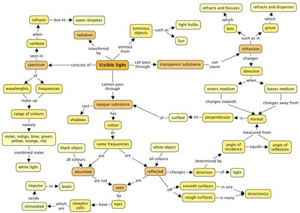

**Problem:**
Match the correct definitions to the terms in the following table. Write the letter of the definition next to the correct number below. [12 marks]

| Term | Definition |
| --- | --- |
| 1. Radiation | A. Light cannot pass through. |
| 2. Visible light | B. The angle of incidence equals the angle of reflection when a ray is reflected off a smooth surface. |
| 3. Opaque | C. One of the ways in which energy is transferred, specifically through a vacuum |
| 4. Transparent | D. When light enters a transparent medium it can change direction. |
| 5. Absorption | E. Curved inwards. |
| 6. Reflection | F. The spectrum of light which we are able to see. |
| 7. Retina | G. Bulging outwards. |
| 8. Refraction | H. A transparent object able to refract and focus light. |
| 9. Diverging | I. Light can pass through. |
| 10. Lens | J. When light rays are spread out from a point. |
| 11. Concave | K. A layer of tissue at the back of the eye which is sensitive to light. |
| 12. Convex | L. When the surface of a substance absorbs certain colours of light. |

| Answers: 1: 2: 3: 4: 5: 6: 7: 8: 9: 10: 11: 12: |
| --- |

**Solution:**
| Answers: 1: C 2: F 3: A 4: I 5: L 6: B 7: K 8: D 9: J 10: H 11: E 12: G |
| --- |

**Problem:**
A beam of white light is shone through a glass prism. It splits up into seven colours which are shone on a screen. A learner took a photograph which is shown below and drew a ray diagram to show the prism. The colours are marked 1 to 7 in the diagram.

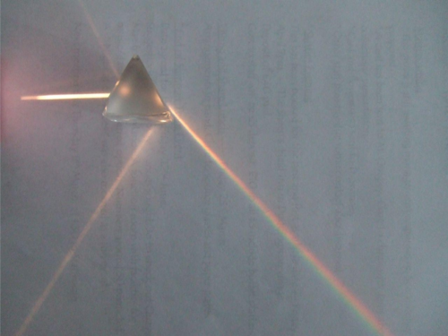

A photograph of the prism.

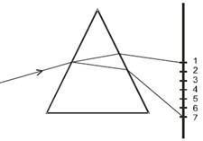

A diagram drawn by the learner.

2. What does this tell us about white light? [1 mark]
4. Why does the light do this when it passes through the prism? [3 marks]
6. What colour is at label 1 and what colour is at label 7? Explain your answer. [3 marks]
8. What label corresponds to the colour of grass? [1 mark]
10. Can you see there are two other lighter, white rays emerging from the prism? What do you think this is the result of? [2 marks]

**Solution:**
2. White light is made up of a spectrum of 7 colours.
4. When the light passes from the air into the glass at an angle, it refracts and bends. The colours of the spectrum bend by different amounts causing the light to disperse. When the light leaves the other side of the prism, it refracts again and the colours bend even more and split up showing the seven colours.
6. Colour 1 is red and colour 7 is violet as red light bends the least and violet light bends the most.
8. Label 4, green.
10. These rays are the result of some reflection off the inner surfaces of the prism as not all the light passes directly through.
   **Note:**This is an extension question.

**Problem:**
Why does an opaque object cast a shadow? [2 marks]

**Solution:**
An opaque object casts a shadow as it does not let any light pass through it. The light is either reflected or absorbed. There will be a shadow on the opposite side to the light source as the light cannot reach there due to the object.

**Problem:**
Look at the following photograph of water in a pond and answer the questions.

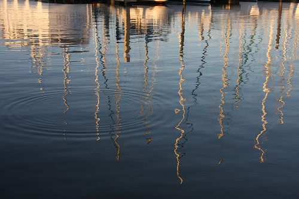

Water in a pond.

2. How are we able to see the image of the wooden poles sticking up on the edge of the pond? [2 marks]
4. Why is the image not clear, but blurred? [2 marks]

**Solution:**
2. The light is reflected off the poles and then it reflects off the surface of the water and into our eyes.
4. This is because the light rays are not reflected off a smooth surface, but rather an uneven surface, due to the ripples in the water. The light rays are scattered.

**Problem:**
Two learners are discussing the colours of light. They decide that white and black are not really colours of light. If they are not colours, then how can we see them? [5 marks]

**Solution:**
White is a combination of all of the colours in the visible spectrum. White objects reflect all the colours equally and so we see the mixture of colours as white. Black is an absence of colour. Black objects absorb all of the colours and reflect none. This means that we don't see any coloured light from that object.

**Problem:**
Explain how we are able to see the different colours on the South African flag. [6 marks]

**Solution:**
Black: All the colours are absorbed and none are reflected.

Yellow: All the colours except yellow are absorbed and the yellow is reflected.

Green: All the colours except green are absorbed and the green is reflected.

Blue: All the colours except blue are absorbed and the blue is reflected

Red: All the colours except red are absorbed and the red is reflected.

White: All the colours are reflected, none are absorbed and so the combined colours appear as white.

**Problem:**
Draw a ray diagram in the space provided to show how we see the green part of the flag. [5 marks]

**Solution:**

**Problem:**
Which diagram shown below correctly shows the path of a ray of light through a triangular piece of glass? [2 marks]

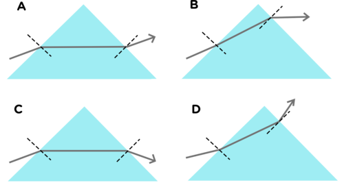

**Solution:**
C

**Problem:**
Complete the following sentence and write it out in full on the lines provided: When light travels from a less dense into a more dense transparent medium, it refracts and bends _____5 the normal line. When light travels from more dense to a less dense medium, it refracts and bends _____5 from the normal line. [2 marks]

**Solution:**
When light travels from a less dense into a more dense transparent medium, the light refracts and bends towards the normal line. When light travels from more dense to a less dense medium, it refracts and bends away from the normal line.

**Problem:**
Draw a diagram to show what is meant by 'when the refracted ray bends towards the normal'. Mark the angle of incidence and angle of refraction. Indicate which medium is denser [4 marks]

**Solution:**
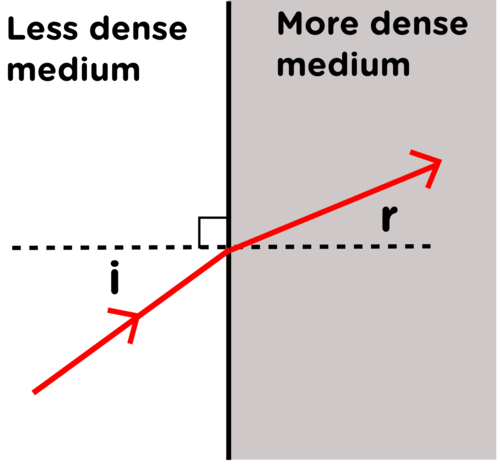

**Problem:**
Study the following diagram and answer the questions that follow.

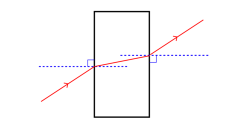

2. This diagram is a drawing that a learner made during an investigation into the refraction of light. What does the red line represent in this diagram? [1 mark]
4. What do the blue lines represent? Label this on the diagram. [1 mark]
6. The light passes from the air and into a block of another medium. Is this medium more or less dense than air? Give a reason for your answer. [2 marks]
8. What type of medium could the block be made from? [1 mark]
10. Label the incident ray and the emergent ray on the diagram. [2 marks]
12. Label the angles of incidence (i) and angles of refraction ® on the diagram. [2 marks]

**Solution:**
2. The ray of light.
4.
6. The block is more dense than air as when the light enters the block, the ray bends towards the normal line indicating that it travels more slowly. The ray then bends away from the normal line when it leaves the block and enters a less dense medium (the air) and travels faster.
8. It must be a transparent medium, such as glass.
10.
12. 0.5 marks for each label. The learner's completed diagram with labels should look as follows:
   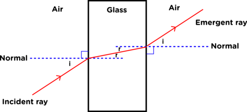

**Problem:**
Which diagram shown below shows the path of a light beam passing through a rectangular glass prism correctly? [2 marks]

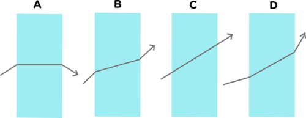

**Solution:**
C

**Problem:**
Why does it look like the tree trunk in the photograph is skew? [2 marks]

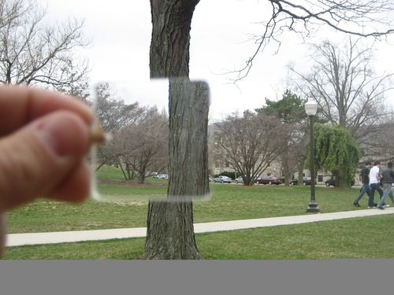

**Solution:**
This is due to refraction. The light that passes through the piece of glass is bent and so the image becomes distorted and looks as though the trunk is skew.

**Problem:**
What shape does a lens have to have in order to focus the light? [1 mark]

**Solution:**
It must be convex.

**Problem:**
Draw a ray diagram to show how a converging lens focuses light to a point. [4 marks]

**Solution:**
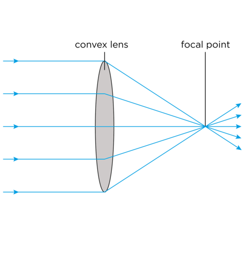

**Problem:**
Which eyesight defect can be fixed by using a converging lens? Explain what this defect is and why it can be corrected. [4 mark]

**Solution:**
Far-sightedness can be corrected using a convex lens. This is when the light focuses on a point behind the retina so the image is blurred. A convex lens is used to bend the light rays before they enter the eye so that when they do pass through the lens in the eye they are focused clearly on the retina.

Total [74 marks]
