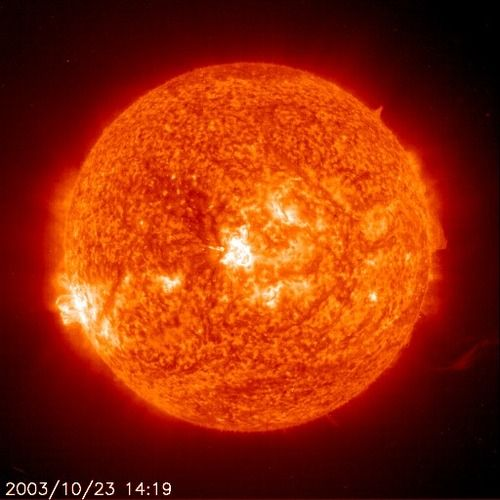
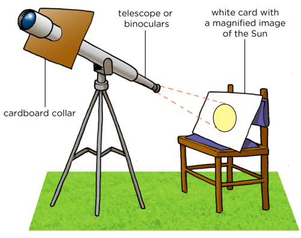
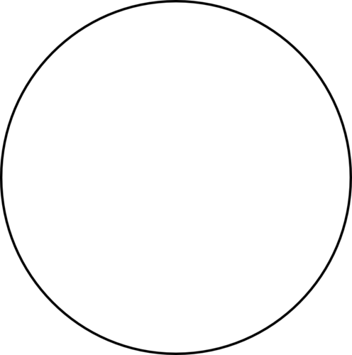
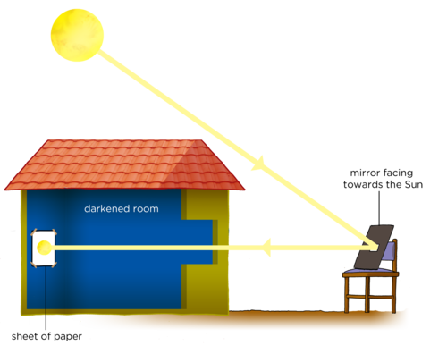
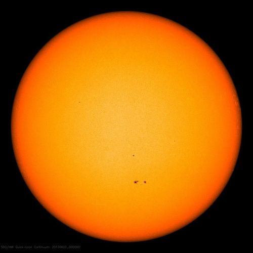
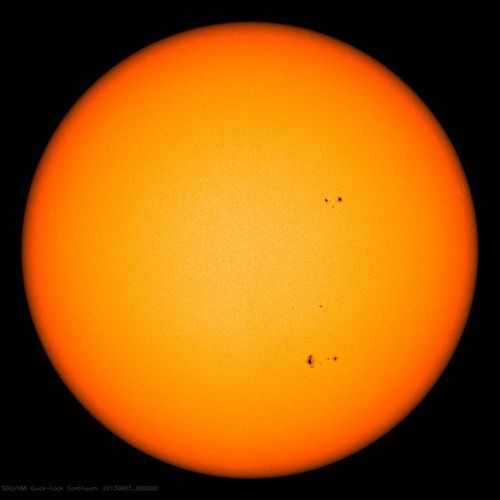
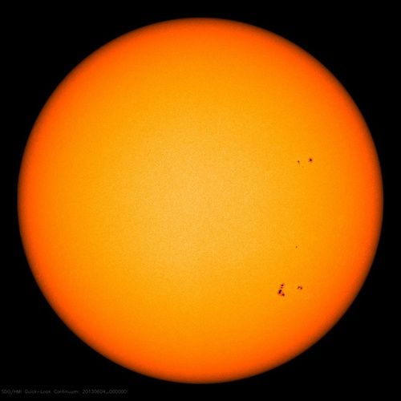
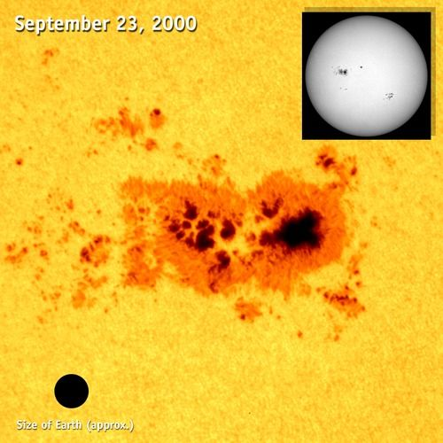
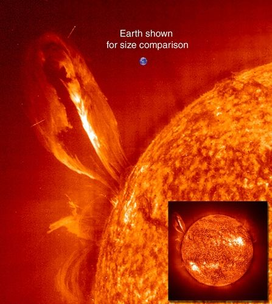

## The Sun

<Callout type="note" title="Note">
- solar system
- star
- nuclear fusion
- convection
- sunspot
- solar wind
</Callout>

In this section students learn how the Sun produces its energy in its core and how this energy is transported to the surface and then into space. The effect that the Sun has on the Earth is also briefly mentioned. This section focuses on conducting observations of the Sun and looking at images of the Sun to study the surface features, including sunspots.

There are two activities in this section which involve observations of the Sun. It is very important that learners DO NOT LOOK DIRECTLY AT THE SUN, even with sunglasses on, as they may permanently damage their eyes.

<Callout type="note" title="Note">
The birth of the solar system (video)
</Callout>

Before we look at the Sun close up, let's summarise what you learned about the Sun in Grades 6 and 7:

2. The Sun is our closest star and is very important for life on Earth as it provides us with light and heat.
4. The Sun is located at the very centre of our solar system.
6. The Earth and other planets all orbit around the Sun, held in orbit by the force of gravity.

<Callout type="note" title="Note">
Interact with this simulation to visualize the effects of gravity on orbital paths of the Sun, Earth and Moon.[http://phet.colorado.edu/en/simulation/gravity-and-orbits](http://phet.colorado.edu/en/simulation/gravity-and-orbits)
</Callout>

What do you think the Sun would look like if it was further away, like the other stars we see at night?

Although the Sun is the brightest object in our sky, this is only because it is so close to us. The Sun is actually a medium sized star of average brightness compared with other stars. If the sun were farther away, it would look like a small point of light like the other stars in the sky.

Let's look at the Sun in more detail.

An image of the Sun taken with the SOHO space satellite.

<Callout type="note" title="Note">
Secrets of a dynamic Sun (video)
</Callout>

<Callout type="note" title="Note">
How the Sun works.
</Callout>

Do you know what the Sun is made of? The Sun is mostly made up of hydrogen gas (about 71%), and also helium gas (about 27%) with a tiny amount of other gases. The temperature at the Sun's surface is very high, around 5500 °C. However, that is nothing compared to deep inside the Sun. At the Sun's centre, or core, it is about 15 million °C. It is so hot at the Sun's centre that **nuclear reactions** can occur, which change atoms from one element to another. In the Sun's case, four hydrogen nuclei are squeezed or fused together to form a new helium nucleus. This process is called **nuclear fusion**.

At the temperatures encountered at the centre of the Sun the atoms are ionized and so nuclear fusion involves the merging of atomic nuclei rather than atoms.

<Callout type="note" title="Note">
Revise the model of the atom that you learned about in Matter and Materials if you are unsure of some of the terms used here, such as nucleus, which is at the centre of an atom, and consists of protons and neutrons.
</Callout>

This nuclear fusion reaction releases energy because the new helium nuclei produced have very slightly less mass than the four hydrogen nuclei used to make them. How can this be? Well, according to the famous scientist Albert Einstein, energy and mass are equivalent. Some of the mass in the hydrogen nuclei is converted and released as energy when the nuclei fuse to make helium. A very large amount of energy is released. This energy travels outwards from the Sun's core towards its surface. The energy eventually reaches the Sun's surface somewhere between 17,000 and 100,000 years later! The Sun's energy then spreads out into the solar system in the form of heat and light.

<Callout type="note" title="Note">
Albert Einstein explained the mass-energy equivalence with the famous equation E = mc2.
</Callout>

<Callout type="note" title="Note">
E = mc2 explained (video).
</Callout>

Different studies of the transport of photons within the Sun estimate different travel times to reach the surface. Much older studies reported times of order of millions of years, but these have now all been revised downwards to either tens or hundreds of thousands of years.

Although we often say that the Sun "burns" its hydrogen fuel into helium, the Sun does not burn in the same way that a fire does, because it is not on fire. The energy generated from the Sun comes from fusing atomic nuclei together to form a new atomic nucleus. As a result of the extreme temperatures throughout the Sun, its gas glows, giving off light. Our usual experience of burning (or fire) is actually a chemical reaction where atoms combine to form molecules, e.g. when oxygen combines with carbon to form carbon dioxide.

<Callout type="note" title="Note">
The word fuse means to join together, so nuclear fusion reactions occur when lighter atoms join together into heavier atoms.
</Callout>

You are now going to observe the Sun to look at its surface features. **Remember, you should never look directly at the Sun as it can permanently damage your eyes*****.*** You can use either a telescope with a filter on it or a pinhole to project an image of the Sun onto a screen to safely view the Sun's image.

# Observing the Sun using a telescope

This is an outdoors activity. You will need a telescope or binoculars for this activity. **An alternative activity is included after this,which does not need a telescope or binoculars.**You will be projecting an image of the Sun onto a white card or screen for your learners to observe.

If you do not have access to a telescope or binoculars it could be worth contacting a local amateur astronomy club as they are often keen to get involved in educational activities. *It is vital that learners do not look directly at the Sun, with or without sunglasses.* The projection method used in this activity is safe and also has the bonus that any sunspots on the Sun's surface can also be seen. Sunspots are regions of slightly lower temperature on the Sun's surface, and therefore appear darker. If you do not have access to a telescope, but do have internet access, then an image of the Sun is posted daily at [http://sohowww.nascom.nasa.gov/data/realtime-images.html](http://sohowww.nascom.nasa.gov/data/realtime-images.html)

It is assumed that this will be a teacher-led demonstration, however, there is no reason why learners cannot contribute by building the shade collar and setting up the white card. If you are using binoculars instead of a telescope, be sure to cover one of the lenses so that only one side of the binoculars is used. When trying to point the telescope at the Sun, a useful trick is to watch the shadow of the telescope tube: if pointed directly toward the Sun, then the sides of the tube will cast no shadows. Preparing for the activity can sometimes take a bit of fiddling, so it is a good idea for you to set your learners a short task to do while you set up if you have not had the opportunity to set up ahead of time.

Sunspots are sometimes (not always) visible on the Sun's surface. You are more likely to see sunspots when the Sun is most active during solar maximum. The Sun's activity varies over an 11 year cycle. Solar maximum is currently predicted to be in 2013. Solar minimum is currently predicted to be in 2019. As an extension you could repeat this activity over the course of several days to see if any sunspots or sunspot groups change shape, size, or position over time.

**MATERIALS:**

- telescope
- white card
- chair to rest the card on
- cardboard to make a shade collar
- pair of scissors
- pencil

<Callout type="note" title="Note">
NEVER look directly at the Sun, even with sunglasses on as you can permanently damage your eyes.
</Callout>

**INSTRUCTIONS:**

2. Take a piece of cardboard and place it up against the narrowest end of the telescope.
4. Draw an outline around the edge of the telescope on the card to use as a guide for cutting to make the collar.
6. Cut out inside the circle you just drew so that the cardboard can fit over the telescope as shown in the figure above. You can cut a single slit into the circle from the edge of the card as shown in the diagram
8. Place the collar on the telescope. Adjust the size of the cut out circle if necessary (for example if your telescope is slightly wider in the middle than at the end, you may want to make your circle slightly larger). This collar shades the area, where the image will fall, from stray light.
10. Select the lowest magnification eyepiece lens you have and insert it into the telescope's eyepiece.
12. Focus the telescope by looking at a distant object (NOT the Sun).
14. Point the telescope at the Sun (do NOT look through the telescope to do this).
16. Place a chair behind the telescope and rest a white piece of card on it. The card should be tilted towards the telescope.
18. Adjust the direction in which the telescope is pointing until the image of the Sun appears on the white paper card. This may take some time.
20. Keeping the telescope still, move the white card toward or away from the eyepiece until the image of the Sun fits neatly in the middle of the card. Adjust the chair's position as needed.
22. Adjust the tilt of the white card until the Sun's image is circular.

Ask the learners to point out any interesting features they notice about the image. There may be sunspots (dark spots) visible. Also you should see that the image is brighter in the middle of the Sun's disc than at the edges. This is because when we look at the middle of the Sun's disc we can see deeper into the Sun than when we look towards the edge. The temperature of the Sun increases with increasing depth. At the centre of the Sun's disc we are seeing a hotter region. As the intensity of light is proportional to the temperature, the Sun looks brighter in the centre.

**QUESTIONS:**

**Problem:**
Looking carefully you should see that the Sun's image moves slowly across the white card. What causes this motion?

**Solution:**
The spin of the Earth on its axis.

**Problem:**
Draw a picture of what the surface of the Sun looks like on the white card in the circle below.

**Solution:**
Learner-dependent answer.

<Callout type="note" title="Note">
Where does the Sun get its energy?
</Callout>

<Callout type="note" title="Note">
Three years of the Sun in three minutes.
</Callout>

Alternatively, if you do not have access to a telescope or binoculars, you can perform the following activity to view the Sun.

# Observing the Sun with a pinhole camera

In this activity you will reflect an image of the Sun onto a white card or screen for your learners to observe. This method has the advantage of not needing a telescope or binoculars, however, the solar image produced will be a bit fuzzy. However, it should be good enough to show large sunspots. This activity is designed as a teacher-led demonstration. If you have a sunlit window or door to your class you can do this activity in the classroom. If you do not have a classroom with a sunlit window, or if your class is very small, you can do the activity outdoors, reflecting the Sun's image onto a shaded wall or back into a darkened classroom.

As a rough guide, begin with a distance of around 8 m between the white card and the mirror. The further away you place the mirror from the white screen the fainter and larger the image will appear. At closer distances the image will be brighter but it may not be in very good focus.

As mentioned in the previous activity, sunspots are sometimes (not always) visible on the Sun's surface. Therefore, you could repeat this activity over the course of several days to see if any sunspots or sunspot groups change shape, size, or position over time.

**MATERIALS:**

- small pocket mirror or hand mirror
- piece of plain cardboard (or paper) to fit over the mirror (or alternatively tape)
- white cardboard screen
- bin bags or curtains for darkening the classroom

**METHOD:**

2. Cut the plain cardboard or paper so it fits over the mirror.
4. Cut or punch a very small hole, about 5 mm, in the middle of the plain cardboard.
6. If you do not have cardboard, you can use tape to cover all but a small portion of the surface of the mirror.
8. Place the mirror on a window sill in the Sun and tilt it so that it catches the sunlight and reflects it into the classroom. If your classroom is very small, placing the mirror outside on a chair may be a better option in order to get a larger image.
10. Darken the classroom using curtains or bin bags, excluding where the mirror is.
12. Reflect the sunlight from the mirror onto a wall of the darkened room.
14. Put the white cardboard or paper on the wall where the reflected light showing the Sun's image falls.
16. Observe the image of the Sun.
18. Remove the white cardboard from the wall and take three steps towards the mirror with the cardboard still facing the mirror. Note what happens to the image of the Sun on the cardboard.

**QUESTIONS:**

**Problem:**
As you moved the white cardboard screen closer towards the mirror, what did you notice happened to the image of the Sun?

**Solution:**
The image should get smaller and brighter.

**Problem:**
Draw a picture of what the surface of the Sun looks like on the white card in the circle below.

**Solution:**
Learner-dependent answer.

**Problem:**
When the Sun reflects off the surface of the mirror, what can you say about the angle of incidence and the angle of reflection of the ray?

**Solution:**
The angles are equal. This links back to what learners covered last term in Energy and Change.

Did you notice any features on the Sun's surface when you viewed it in class? Let's find out what some of these surface features could have been in the next activity.

<Callout type="note" title="Note">
Fiery looping rain on the Sun (video)
</Callout>

# Observing sunspots on the Sun's surface

This is an **additional, extension** activity. In this activity learners will look at images taken over three consecutive days in 2013. The images were taken using the Helioseismic and Magnetic Imager instrument on board the Solar Dynamics Observatory space satellite. In the images two major sunspot groups are visible, one in the Sun's northern hemisphere and one in the Sun's southern hemisphere. Learners should identify the two groups and observe that they move across the Sun from left to right in each successive image. The sunspots move like this because the Sun is rotating on its axis.

You could begin this activity by asking learners if they noticed any features on the Sun's surface when they observed it in class, before asking them to look at the pictures below.

**INSTRUCTIONS:**

2. Look at the images of the Sun which were taken in June 2013.
4. Answer the questions that follow.

A: DATE: 02.06.2013

B: DATE: 03.06.2013

C: DATE: 04.06.2013

**QUESTIONS:**

**Problem:**
How many groups of dark spots do you see in each image?

**Solution:**
There are two main groups, one in the top half of the Sun and the other group in the bottom half.

**Problem:**
What do you notice about the positions of the spots in each image?

**Solution:**
They are moving across the Sun's disc from left to right.

**Problem:**
Why do you think the spots have moved?

**Solution:**
The Sun is rotating on its own axis (once roughly every 25 days).

**Problem:**
What do you think these spots are?

**Solution:**
They are called Sunspots and they are regions where the temperature is cooler than the rest of the Sun's surface.

### Sunspots and the Sun's surface

This is enrichment material to extend learners' knowledge beyond what they have covered in previous grades about the Sun. Here is a link to a pdf download for an activity to track sunspots in real time, using data from SOHO: [http://sohowww.nascom.nasa.gov/classroom/docs/Spotexerweb.pdf](http://sohowww.nascom.nasa.gov/classroom/docs/Spotexerweb.pdf)

<Callout type="note" title="Note">
Learn more about the research that NASA is doing about our Sun with the Solar and Heliospheric Observatory (SOHO).[http://sohowww.nascom.nasa.gov/home.html](http://sohowww.nascom.nasa.gov/home.html)
</Callout>

The Sun's surface often has little blemishes on it. These dark spots on the Sun are called sunspots. They are areas that are slightly cooler than the rest of the Sun's surface. The Sun's surface is typically about 5500 °C and a typical sunspot has a temperature about 3900 °C.

<Callout type="note" title="Note">
This information about the Sun's surface and sunspots is additional information for your interest. Be curious and discover more!
</Callout>

Image of a sunspot. For perspective, take note of the size of the Earth in the lower left.

<Callout type="note" title="Note">
View real time images of the Sun and track sunspots.[http://sohowww.nascom.nasa.gov/sunspots/](http://sohowww.nascom.nasa.gov/sunspots/)
</Callout>

As the Sun is made up of gas, there is no solid surface like on Earth. So when one says that you are looking at the Sun's surface what are you actually looking at? Imagine that you are standing in thick fog (mist) with a friend. You can see things close to you, like your hand in front of you and your friend standing next to you. However, because the fog is so thick you cannot see far into the distance. Similarly, when we look at the Sun, we cannot see right into the centre of the Sun. As you go deeper and deeper in towards the centre of the Sun the gas begins to get thicker and thicker so that we cannot see through it. The deepest depth that we can see into the Sun's gas is what we call the Sun's surface.

Sunspots are areas that are slightly cooler, and therefore darker, than the rest of the Sun's surface. A typical sunspot only lasts a few days. When a sunspot lasts for several days you can observe it move across the Sun's disc. The sunspot appears to move across the Sun because the Sun is spinning slowly on its own axis.

<Callout type="note" title="Note">
The number of sunspots on the Sun increases and decreases in a regular pattern which repeats every 11 years. When there are more sunspots the Sun is more active and there are more solar storms and more of the Sun's energy reaches the Earth.
</Callout>

The outer atmosphere of the Sun is called the **corona**. Gas particles from the corona are constantly escaping into space, forming the **solar wind**. When the Sun is very active, violent eruptions called solar flares occur on its surface.

A large loop of gas extending over 35 Earth diameters out from the Sun's surface.
