## Objects around the Sun

This section covers all the objects in orbit around the Sun including the eight planets, dwarf planets, asteroids, Kuiper Belt and Oort Cloud and comets. Learners should be familiar with the eight planets in the solar system, which were covered in Gr 6, however it is very likely that they are unfamiliar with the remaining components of the solar system. The first half of this section is intended as revision, to remind learners about the properties of the eight planets. The two types of planets, the terrestrial (rocky) planets and gas giants are compared and contrasted in detail. The second half of this section covers the smaller bodies in the solar system such as dwarf planets, comets and asteroids. It should be stressed to learners that new discoveries are made all the time and so the numbers of moons discovered around planets and the number of dwarf planets in the solar system will change over time.

<Callout type="note" title="Note">
- terrestrial planet
- gas giant
- dwarf planet
</Callout>

<Callout type="note" title="Note">
Explore the solar system from your computer with this 3D environment[http://eyes.nasa.gov/](http://eyes.nasa.gov/) and view any objects in the solar system with this interactive simulator [http://space.jpl.nasa.gov/](http://space.jpl.nasa.gov/)
</Callout>

The Sun is by far the largest and most massive object in our solar system making up 98\% of the total mass of the solar system. Due to the Sun's massive size, its large gravitational pull causes the planets and other objects in the solar system to orbit around it.

In orbit around the Sun are the eight planets along with their moons, dwarf planets and many much smaller objects like asteroids, Kuiper belt objects and comets. You will learn all about these objects later on in this chapter.

<Callout type="note" title="Note">
'terra' is the Latin word for land or earth.
</Callout>

The four planets closest to the Sun are Mercury, Venus, Earth and Mars. These are called **terrestrial planets** because they have solid rocky surfaces. Further out, lie the **gas giants** Jupiter, Saturn, Uranus, and Neptune. These are much larger than the terrestrial planets and are mainly made of gas with small cores of rocky materials. In between the terrestrial planets and the gas giants lies the asteroid belt and out beyond the orbit of Neptune lies the Kuiper belt.

<Callout type="note" title="Note">
Is there gravity in space?
</Callout>

As you can see, there are lots of different types of objects orbiting the Sun, and not all of them are planets! To be classed as a planet, an object must:

2. orbit around the Sun
4. be large enough that its own gravity pulls it into a spherical shape
6. clear out smaller objects in its orbit, by either flinging them into another orbit or by attracting and then sticking them to itself (this means that there are no other similar sized objects orbiting in their vicinity)

<Callout type="note" title="Note">
Pluto was reclassified from planet to dwarf planet in 2006. Although Pluto orbits the Sun and is almost round, it has not cleared out other objects in its orbit, and so it cannot be classified as a planet. There are many more dwarf planets at similar distances from the Sun as Pluto.
</Callout>

<Callout type="note" title="Note">
Some older textbooks or websites that you visit may still refer to Pluto as a planet as they have not been updated.
</Callout>

You will learn about planets and the other objects orbiting the Sun in more detail later on in this chapter. Let's begin by learning more about the size and scale of the solar system.

<Callout type="note" title="Note">
Build your own solar system with this orbit simulator.[http://phet.colorado.edu/en/simulation/my-solar-system](http://phet.colorado.edu/en/simulation/my-solar-system)
</Callout>

# The scale of the solar system

In this activity learners will get a sense of the scale of the solar system. Using a model where the Sun is scaled to the size of a grapefruit, the other planets are also scaled down and are placed in orbit around the grapefruit Sun at the correctly scaled distance. This activity needs a lot of space. The distance you need from the Sun to Neptune is 321 m. The scaling used in this activity is 14 billion to one. You can change the scaling to suit the space you have available.

A summary table is included here with the scaled sizes and distances for the planets for your reference. Learners can use a measuring tape to measure out the distances. If no measuring tape is available then the approximate distance in strides is also given.

| Object | Actual diameter (D) or distance from the Sun (d) (km) | Measurements scaled to in model | Model suggestion |
| --- | --- | --- | --- |
| Sun | D = 1.4 x 106 | 10 cm | Grapefruit |
| Mercury | D = 4.9 x 103 d = 58 x 106 | 0.35 mm 4.2 m | Salt grain 4 big strides |
| Venus | D = 12 x 103 d = 108 x 106 | 0.86 mm 7.7 m | Poppy seed 8 big strides |
| Earth | D = 13 x 103 d = 150 x 106 | 0.91 mm 10.7 m | Poppy seed 11 big strides |
| Mars | D = 6.8 x 103 d = 228 x106 | 0.48 mm 16.3 m | Salt grain 16 big strides |
| Jupiter | D = 143 x 103 d = 778 x 106 | 10.0 mm 55.6 m | Small grape 55 big strides |
| Saturn | D = 128 x 103 d = 1426 x 106 | 8.57 mm 102 m | Pea 100 big strides |
| Uranus | D = 51 x 103 d = 2868 x 106 | 3.65 mm 205 m | Peppercorn 200 big strides About twice the length of a football pitch. |
| Neptune | D = 45 x 103 d= 4500 x 106 | 3.55 mm 321 m | Peppercorn 320 big strides About three times the length of a football pitch. |
| Alpha Centauri (nearest star) | d = 4.0 x 1013 | 2900 km | Cape Town to Lusaka! |

The orbits and planets in the solar system which we are going to model.

**MATERIALS:**

- grapefruit
- peppercorns
- salt grains
- poppy seeds
- pea
- grape
- measuring tape

**INSTRUCTIONS:**

2. Go outside to a large field for this activity. Start at one end of the field.
4. Put the grapefruit on the ground, this represents the Sun.
6. Measure 4.2 m away from the grapefruit and put a grain of salt on the ground. This represents Mercury. If you do not have a measuring tape then count four big strides away from the Sun instead.
8. Repeat this for each of the planets in the solar system. Your teacher will tell you the distance each planet lies from the Sun and will give you the appropriate object to represent your planet.
10. Guess how far away you think the next closest star after the Sun is.

See the table provided.

Let's now make a smaller model of the solar system.

<Callout type="note" title="Note">
Compare the planets using this tool from NASA.[http://solarsystem.nasa.gov/planets/compchart.cfm?Object1=Earth&Object2=Mars](http://solarsystem.nasa.gov/planets/compchart.cfm?Object1=Earth&Object2=Mars)
</Callout>

# Make a hanging solar system

In this activity learners will work individually to make a hanging model of the solar system.

**MATERIALS:**

- cardboard about 30 cm across
- paper
- string or thread
- pair of scissors
- tape
- string
- pencil, crayons, or markers
- compass (for drawing circles)
- nail (for making a hole in the cardboard)

**INFORMATION TABLE:**

| Object | Orbit radius (cm) | Object radius (cm) |
| --- | --- | --- |
| Sun | - | 5.0* - this is NOT to scale |
| Mercury | 0.4 | 0.2 |
| Venus | 0.7 | 0.8 |
| Earth | 1.0 | 0.8 |
| Mars | 1.5 | 0.4 |
| Jupiter | 5.0 | 5.1 |
| Saturn | 9.2 | 4.1 |
| Uranus | 18.6 | 1.6 |
| Neptune | 29.1 | 1.6 |

* Note that if the Sun were drawn at the same scale as the rest of the planets, its radius should be 50 cm rather than 5 cm!

<Callout type="note" title="Note">
The scale of the orbits differs from the scale of the object sizes in the table here. If they were on the same scale then the Sun and planets would be much much smaller.
</Callout>

**INSTRUCTIONS:**

2. Cut out the cardboard into a circle of radius 15 cm. Use a compass and pencil to mark out the circle for cutting.
4. Mark the centre of the circle. This will be the position of the Sun.
6. Using a compass, draw the orbits of the 8 planets on the card. The first four planets orbit relatively close to the Sun, then there is a gap (the asteroid belt), then the last five planets orbit very far from the Sun. The radius of each circle, representing each planet's orbit, is shown in the table above.
8. Using the sharp point of the scissors' blade, or a large nail, punch a hole in the centre of the card (this is where the Sun will hang).
10. Punch one hole on each circle (orbit); a planet will hang from each hole.
12. Cut out one circle from the paper to represent the Sun.
14. Repeat this for each of the planets. The range in size of the Sun and the planets is far too large to represent accurately, so as a rough representation use the radii listed in the table to make your circles. The sizes of Mercury and Mars are very small in relation to the other planets. If you are battling to cut circles this size, then make them slightly bigger.
16. Colour in each planet and the Sun according to the pictures later in this chapter.
18. Tape a length of string or thread to the Sun and each planet.
20. Lace the other end of each string or thread through the correct hole in the large cardboard circle.
22. Tape the end of the string to the top side of the cardboard.
24. After all the planets and the Sun are attached, adjust the length of the strings so that the planets and Sun all fall to the same depth when the circle is held up in the air.
26. To hang your model, tie three pieces of string to the top of the cardboard around the edge. Then tie these three together and tie them to a longer string (from which you'll hang your model).

**QUESTION:**

Why did you adjust the string lengths so that the Sun and all the planets hang at the same height?

The planets orbit the Sun in a flat plane that includes the Sun.

<Callout type="note" title="Note">
Read more about the current research taking place at NASA's Mars Science Laboratory.[http://mars.nasa.gov/msl/](http://mars.nasa.gov/msl/)
</Callout>

Now that you have an idea of the size and scale of the planets in our solar system, let's compare the two groups of planets, the inner worlds, Mercury, Venus, Earth and Mars with outer worlds, Jupiter, Saturn, Uranus and Neptune, in more detail. Look at the following pictures which compare the features of the two groups of planets.

The aim of this section is to remind learners about the two types of planets. They were introduced to the two planetary types, the inner rocky terrestrial planets and the outer gas giants in Grade 6. This section covers this information again and goes on to explain why there are two types of planets. For a summary of each planet's properties see [http://nssdc.gsfc.nasa.gov/planetary/factsheet/](http://nssdc.gsfc.nasa.gov/planetary/factsheet/)

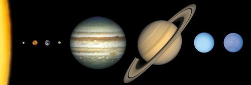

The relative sizes of the terrestrial planets and gas giants, from left to right: Mercury, Venus, Earth, Mars, Jupiter, Saturn, Uranus and Neptune. Note that the planets are not spaced at equal separations from each other, but are shown in this way to fit on the page.

How do the sizes of the terrestrial planets and gas giants compare with each other?

The gas giants are much larger than the terrestrial planets.

Let's now look at the compositions of the two types of planets.

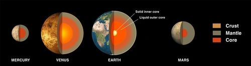

The above image shows the internal structure of the terrestrial planets. They all have a metal core, a rocky mantle and a thin outer crust. They also have a thin atmosphere (Mercury has an extremely thin atmosphere). The Earth's atmosphere is unique in the solar system in that it contains abundant oxygen, which is necessary to sustain life on Earth.

<Callout type="note" title="Note">
When it is winter on Mars you can see polar ice caps forming on the planet, like on Earth. However, unlike the Earth's polar ice caps which are made of frozen water, the ice caps on Mars are made of frozen carbon dioxide. This frozen carbon dioxide comes from Mars' atmosphere.
</Callout>

The image below shows the structure of the gas giants. They are mostly made of hydrogen and helium gases and are much less dense than the rocky terrestrial planets.

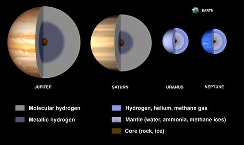

As you go deeper into the atmospheres of Saturn and Jupiter their atmospheres get denser and denser until they gradually become a liquid. This liquid hydrogen is called metallic hydrogen. Deeper down they have a solid core made of rocky materials.

<Callout type="note" title="Note">
Hydrogen is a liquid deep inside Jupiter and Saturn because the hydrogen molecules have been squeezed together due to the enormous pressure at those depths caused by the weight of the planet's atmosphere above.
</Callout>

Uranus and Neptune have thick atmospheres which have methane in addition to hydrogen and helium. The methane gives them their blue colour. Scientists think that below their atmospheres they have a slushy mantle made of water, ammonia and methane ices. At their centres they have a rocky-icy core.

<Callout type="note" title="Note">
Ice does not just refer to water ice, but other frozen elements and compounds too. Also, the rocky-ice materials do not resemble any rock or ice you would see on Earth, since the temperatures and pressures on these planets and gas giants are much, much higher.
</Callout>

Look at the pictures below. They show images of the gas giants. What features do you see that the gas giants all have in common?

They all have rings.

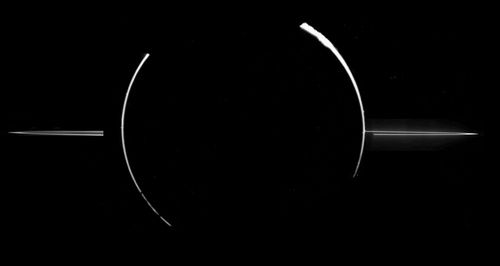

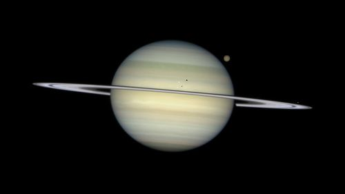

This image of Saturn was taken with the Hubble Space Telescope. Can you see some of its moons?

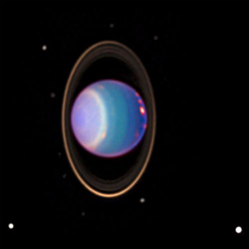

Uranus, taken with the Hubble Space Telescope. What do you notice that is strange about Uranus?

Uranus is on its side.

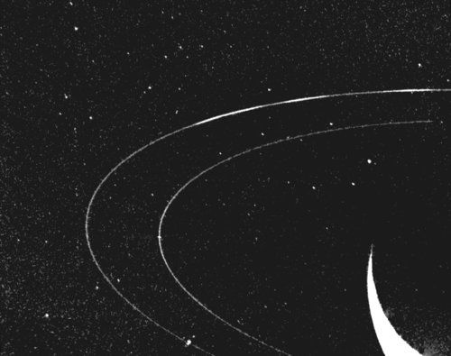

Neptune is to the bottom right of this picture, just out of view. This image was taken by the space probe Voyager 2 as it flew past Neptune in 1989.

<Callout type="note" title="Note">
Discover more online at NASA's Solar System Exploration site.[http://solarsystem.nasa.gov/index.cfm](http://solarsystem.nasa.gov/index.cfm)
</Callout>

You can see that *all* the gas giants have rings. None of the terrestrial planets have rings.

Another difference between the inner rocky and outer gas giant planets, are the number of moons orbiting each planet. Look at the table below which shows the number of moons each planet in our solar system has.

| Planet | Number of Moons |
| --- | --- |
| Mercury | 0 |
| Venus | 0 |
| Earth | 1 |
| Mars | 2 |
| Jupiter | 67 |
| Saturn | 62 |
| Uranus | 27 |
| Neptune | 13 |

<Callout type="note" title="Note">
New moons are discovered all the time, so these numbers may change over time.
</Callout>

What can you say in general about the number of moons that the two types of planet have?

The terrestrial planets have no or few moons whereas the gas giants have lots of moons.

The terrestrial planets are much closer to the Sun than the gas giants. Because of this, the terrestrial planets orbit the Sun in less time than the gas giants, because they have a shorter distance to cover.

Lets see how the distance from the Sun affects the planets' temperatures.

# Planetary Temperatures

In this activity learners will compare the temperatures of the different planets. Using the table provided they must label each planet on the thermometer drawn below. This activity therefore requires that learners can read information from a table and also from a graph.

**INSTRUCTIONS:**

2. Look at the table, it shows the surface temperatures of each of the planets.
4. Correctly label each of the planets on the thermometer using the temperature information provided in the table.

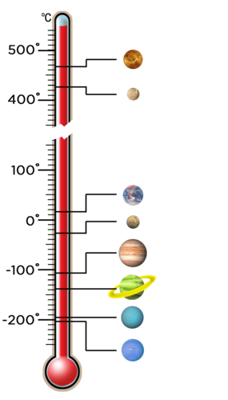

| Planet | Temperature (°C) |
| --- | --- |
| Mercury | 167 |
| Venus | 464 |
| Earth | 15 |
| Mars | -65 |
| Jupiter | -110 |
| Saturn | -140 |
| Uranus | -195 |
| Neptune | -200 |

The labeled image:

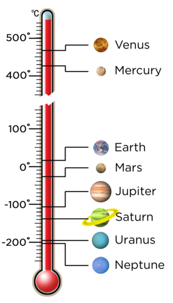

**QUESTIONS:**

**Problem:**
Which planet has the lowest average temperature?

**Solution:**
Neptune.

**Problem:**
Why do you think this is?

**Solution:**
It is the furthest planet from the Sun.

**Problem:**
What do you notice about the average temperatures of the terrestrial planets compared with the gas giants?

**Solution:**
The average temperatures of the terrestrial planets are much higher than the average temperatures of the gas giants.

**Problem:**
If you exclude Venus, how does the ordering of the planets from the Sun compare with their average temperature?

**Solution:**
In general, the further away from the Sun a planet is, the lower its temperature.

**NOTE:** Venus is the exception because it has a very thick atmosphere and is undergoing a runaway Greenhouse effect which learners will discover later on in this chapter.

Clearly the terrestrial planets and gas giants have very different properties. Let's compare them.

# Comparing terrestrial planets and gas giants

In this activity learners must compare and contrast the two types of planet using the information already provided in this section.

**INSTRUCTIONS:**

2. The table below compares the two types of planet. Fill in the missing gaps.

| Terrestrial Planets | Gas Giants |
| --- | --- |
| close to the Sun | __________ from the Sun |
| closely spaced orbits | widely spaced orbits |
| small masses | large masses |
| small radii | __________ radii |
| mainly rocky | mainly __________ |
| solid surface | __________ surface |
| high density | __________ density |
| slower rotation | faster rotation |
| __________ moons | many moons |
| __________ rings | many rings |
| thin atmosphere | __________ atmosphere |
| warm | __________ |

| Terrestrial Planets | Gas Giants |
| --- | --- |
| close to the Sun | far from the Sun |
| closely spaced orbits | widely spaced orbits |
| small masses | large masses |
| small radii | large radii |
| mainly rocky | mainly gaseous |
| solid surface | no solid surface |
| high density | low density |
| slower rotation | faster rotation |
| few or no moons | many moons |
| no rings | many rings |
| thin atmosphere | thick and dense atmosphere |
| warm | cold |

Why do you think the two types of planets are so different?

Learner-dependent answer. Answer in text below.

When the solar system was forming, the difference in temperature across the early solar system caused the inner planets to be rocky and the outer ones to be gaseous. Close to the Sun it was hot and only materials with very high melting points, such as metals, could remain solid and form planets. Further away from the Sun, where it was cold, compounds like water and methane were frozen. Astronomers call these frozen compounds *ices*. Therefore the cores of the gas giants contain rocky and icy compounds. As the abundance of metals in the universe is very small, the inner planets are much smaller than the gas giants. The gas giants could also attract large amounts of hydrogen and helium to their atmospheres due to their size.

Let's continue to compare the rocky planets and the gas giants.

# Comparing the inner and outer planets

In this activity learners will use the information provided in the table below to answer questions which compare the properties of the rocky planets and the gas giants. This is a good exercise to get learners to read information from tables and to look for patterns in data.

**INSTRUCTIONS:**

Use the information in the table below to answer the questions that follow.

| Planet | Density (kg/m 3 ) | Diameter (km) | Distance from the Sun (million km) | Day length (hours) | Year length (Earth days) |
| --- | --- | --- | --- | --- | --- |
| Mercury | 5427 | 4879 | 57.9 | 4222.6 | 88 |
| Venus | 5243 | 12104 | 108.2 | 2802.0 | 224.7 |
| Earth | 5514 | 12756 | 149.6 | 24.0 | 365.25 |
| Mars | 3933 | 6792 | 206.6 | 24.7 | 687.0 |
| Jupiter | 1326 | 142984 | 740.5 | 9.9 | 4331 |
| Saturn | 687 | 120536 | 1352.6 | 10.7 | 10747 |
| Uranus | 1271 | 51118 | 2741.3 | 17.2 | 30589 |
| Neptune | 1638 | 49528 | 4444.5 | 16.1 | 59800 |

The day length given here is the average time in hours for the Sun to move from the noon position in the sky at a point on the equator back to the same position. This is not the same as the time for the planet to complete one revolution on its axis with respect to the stars. For example the Earth completes one revolution on its axis with respect to the stars in 23.9 hours, however, because the Earth moves along in its orbit as it rotates, it actually takes 24 hours for the Sun to return to the same position in the sky again (which is how we conventionally define a day on Earth - from noon to noon).

**QUESTIONS:**

**Problem:**
Given that the density of water is 1000 kg/m3, which of the planets would float on water? Explain your answer.

**Solution:**
Saturn would float on water as its density is less than that of water.

**NOTE:** This links back to what learners covered in Term 2 in Matter and Materials on the Particle Model of Matter.

**Problem:**
Compare the densities of the rocky planets and the gas giants. Which type of planet tends to be more dense? Explain why.

**Solution:**
The inner rocky (terrestrial) planets are more dense than the outer gas giants, as the inner planets are made of solid rock, which is denser than gas.

**Problem:**
Which planet has the shortest day?

**Solution:**
Jupiter.

**Problem:**
Compare the day length for the rocky planets and the gas giants. Which type of planet tends to have the shortest day? What does this tell you about how fast the two types of planet rotate on their axis?

**Solution:**
The gas giants tend to have the shortest days which means that these planets must spin on their axes faster than the terrestrial planets.

**Problem:**
Which planet orbits around the Sun the fastest? Why is this?

**Solution:**
Mercury, because it is the closest planet to the Sun and has the least distance to cover.

**Problem:**
Which planet's year is shorter than its day?

**Solution:**
Mercury.

**Problem:**
Plot a bar graph to show the distance each planet is from the Sun. Use the following space for your graph.

**Solution:**
An example graph is given below. You can use Assessment Rubric 3 at the back of your teachers guide if you would like to assess this translation task.

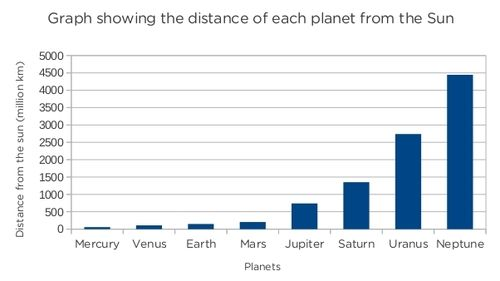

<Callout type="note" title="Note">
Solar System 101: NASA's 'Homework helper' can show you where to look to find out more.[http://solarsystem.nasa.gov/kids/index.cfm?Filename=homework&Target=SolarSys#](http://solarsystem.nasa.gov/kids/index.cfm?Filename=homework&Target=SolarSys#)
</Callout>

### Mercury

<Callout type="note" title="Note">
The following pages provide some interesting, extra information about the planets in our solar system.
</Callout>

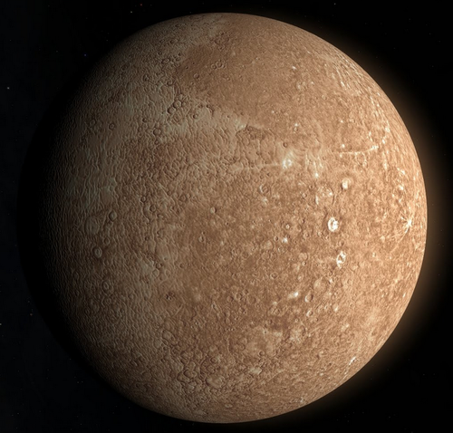

Mercury, imaged by the Messenger spacecraft, is covered with craters like our Moon.

- Mercury's atmosphere is very thin and constantly being lost into space because the planet's gravity is too small to hold onto it.
- Mercury has the most extreme temperatures in the solar system, reaching 426 °C during the day and -173 °C during the night.

### Venus

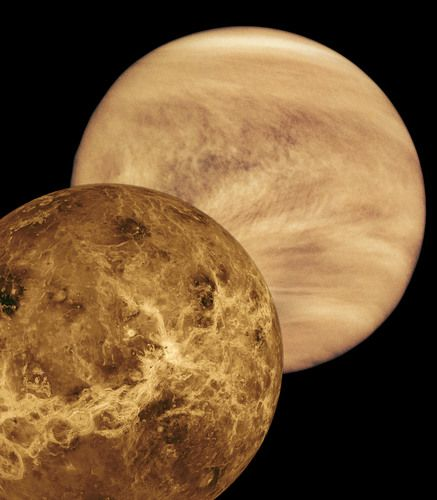

The surface of Venus in false colour (bottom left) and the top of the atmosphere (top left) as seen with the Magellan spacecraft.

<Callout type="note" title="Note">
Venus has a thick dense atmosphere mostly made up of carbon dioxide which is an effective greenhouse gas. This is why Venus has the highest surface temperature, as you saw in the activity of Planetary Temperatures.
</Callout>

- Venus is the hottest planet in the solar system, the temperature is hot enough to melt lead!
- Venus has clouds of sulphuric acid.
- Venus rotates in the opposite direction to all the other planets.

<Callout type="note" title="Note">
Venus has mountains, volcanoes and sand dunes just like Earth.
</Callout>

### Earth

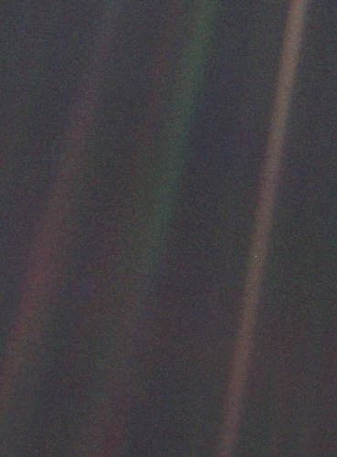

This famous image is a photograph taken of Earth in 1990 by Voyager 1 from 6 billion kilometers away. Earth appears as a tiny dot (the blueish-white speck approximately halfway down the brown band to the right). The coloured bands are scattered light rays from the Sun.

<Callout type="note" title="Note">
As voyager 1 was leaving the solar system, Carl Sagan, a famous astronomer, requested that they turn the camera around to take a photograph of Earth across a great expanse of space.
</Callout>

<Callout type="note" title="Note">
Carl Sagan - Pale Blue Dot (video)
</Callout>

<Callout type="note" title="Note">
A cartoon of Carl Sagan's famous speech about the Pale Blue Dot.[http://zenpencils.com/comic/100-carl-sagan-pale-blue-dot/](http://zenpencils.com/comic/100-carl-sagan-pale-blue-dot/)
</Callout>

- To date, Earth is the only planet in the universe known to harbour life.
- The average distance between the Sun and Earth is called an *astronomical unit* (AU) and is equivalent to 150 million kilometres.

### Mars

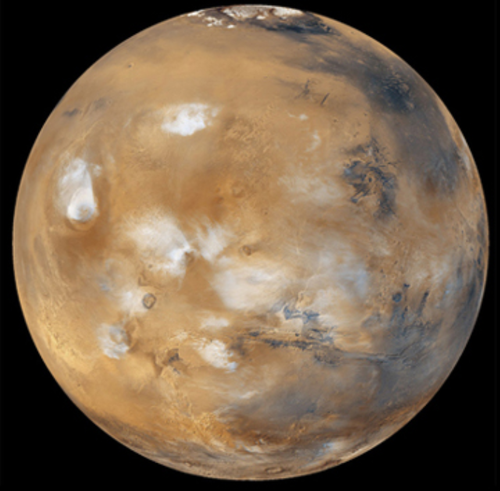

Mars is nicknamed the Red Planet because of its red surface, as the rocks on are rich in iron. The white smudges in the middle are water-ice clouds.

- Mars' surface is like a dry red desert. Mars has mountains, volcanoes and valleys just like Earth.
- Mars is home to the deepest and longest valley in the solar system, *Valles Marineris*, which is almost as wide as Australia!

<Callout type="note" title="Note">
The largest volcano in the solar system, Olympus Mons, is on Mars and is three times taller than Mount Everest.
</Callout>

| Mars and the Search for Life Scientists are interested in Mars because they think that Mars might have once had liquid water on its surface, and perhaps life. Channels, valleys, and gullies are found all over Mars, suggesting that liquid water might have once flowed through them. Although there is no liquid water on the planet's surface now, scientists think that there may still be some water in cracks and tiny holes in underground rock. Mars has been visited many times by robotic landers. The first lander, NASA's Viking 1, landed on Mars in 1976, a long time before you were born! It took the first close-up pictures of the Martian surface but found no evidence of life. Water ice has been discovered below the planet's surface, and minerals indicating that liquid water was once present have also been found by Mars landers. The latest lander currently exploring Mars is NASA's Mars Science Laboratory mission, with its rover named Curiosity. Curiosity landed on Mars in August 2012 and is busy investigating the planet's rocks near a giant crater called the Gale crater. One of the main aims of the Mars Science Laboratory is to determine whether Mars ever had an environment capable of supporting life. The Curiosity rover. One of the first colour images of Mars' surface taken by the Curiosity rover. You can see part of the rover at the bottom of the photograph. |
| --- |

<Callout type="note" title="Note">
Watch the first 12 month's of Curiosity's explorations in 2 minutes.
</Callout>

<Callout type="note" title="Note">
NASA's curiosity finds water in Martian soil in 2013.
</Callout>

### Jupiter

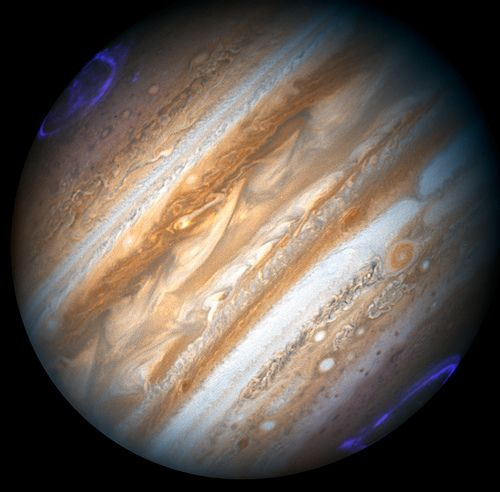

Magnetic storms cause the aurorae seen on Jupiter near its poles.

- Jupiter's diameter is over ten times the Earth's diameter.
- Jupiter rotates slightly faster at the equator (remember it is not a solid object, but a large ball of gas).
- Jupiter's famous great red spot, is a giant hurricane that has been raging for at least 300 years. This storm's area is larger than the Earth.

### Saturn

<Callout type="note" title="Note">
Saturn close-up (video).
</Callout>

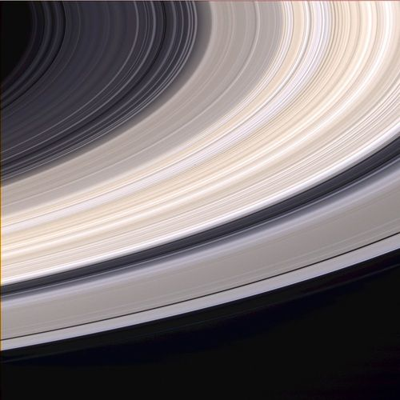

Saturn's beautiful rings, imaged with the Cassini spacecraft.

- Saturn would float on water if you had an ocean large enough.
- Saturn is famous for its rings. The rings are over 200 000 km wide and only a few tens of metres thick.

### Uranus

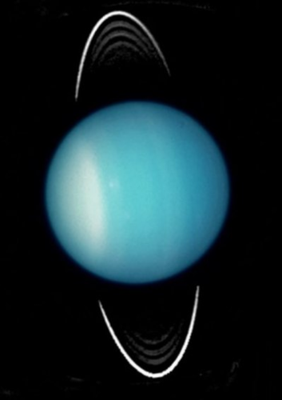

Uranus spins on its side. Scientists think Uranus may have been knocked on its side by a collision with a large object early in its history.

- Uranus is believed to have an ocean of liquid water, ammonia, and methane above a rocky core.
- Uranus was the first planet discovered using a telescope.

<Callout type="note" title="Note">
Take a virtual ride with Voyager 1 and 2 past Jupiter, Saturn, Uranus, and Neptune.
</Callout>

### Neptune

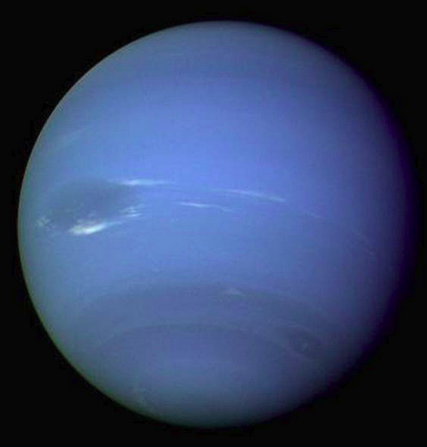

Neptune and its "Great Dark Spot" (middle left). This is a giant storm that was raging on the planet until very recently. The winds reached nearly 1931 km/hour.

- Neptune has the strongest winds in the solar system. With storm winds recorded at over 10 times that of hurricanes on Earth.
- Neptune has the most methane in its atmosphere out of all the gas giants, which gives it its blue colour.

# Planetary holidays

This is a creative writing activity for learners to explore the solar system in an imaginative way. Learners will play the role of cosmic travel agents and will write a travel brochure for one of the planets in the solar system (not Earth!). This activity can be done as a team or individually. Encourage learners to research information about their chosen planet at the school or local library or on the internet. Alternatively, they can use the information provided in this chapter. You could also provide some examples of travel brochures for them to look at as a guide. These are available free at travel agents. You could also ask the learners to present their work in class.

In this activity you will write a travel brochure for a trip to your favourite planet.

**MATERIALS:**

- information about the planets
- pictures of the planets
- example travel brochures

**INSTRUCTIONS:**

2. Research information about your chosen planet.
4. Write a travel brochure for a trip to your chosen planet. Include real facts about the planet and think about what unusual things you could see and do on the planet.

# Planet fact sheet

In this activity learners must summarise all the information they know about a particular planet on a one page fact sheet. This activity is easier than the *Planetary holidays* activity as it requires less imagination, and can therefore be done as an alternative activity.

In this activity you will make a one page fact sheet about your chosen planet.

**MATERIALS:**

- information about the planets
- pictures of the planets

**INSTRUCTIONS:**

2. Research information about your chosen planet.
4. Write a one page fact sheet about your chosen planet.

Let's now look at some of the other objects that we find in our solar system.

### Asteroids

<Callout type="note" title="Note">
- asteroid
- asteroid belt
</Callout>

Asteroids are small rocky objects that are believed to be left over from the formation of our solar system 4.6 billion years ago. They range in size from tens of metres across to several hundred kilometres across and come in a variety of shapes. Most asteroids are found in the **asteroid belt**, which lies between the orbits of Mars and Jupiter. More than 100,000 asteroids lie in the asteroid belt and several thousand of the largest ones have been named.

<Callout type="note" title="Note">
A record close asteroid fly-by past Earth.
</Callout>

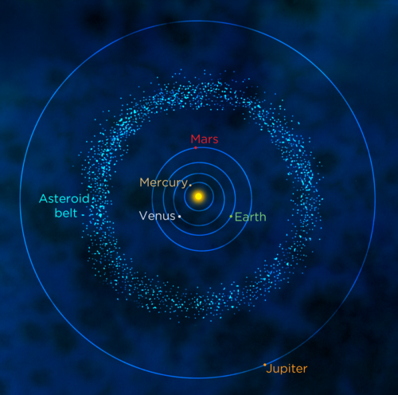

<Callout type="note" title="Note">
In the region of the asteroid belt closest to the Sun, the asteroids are mainly metallic objects. Those further away are rocky objects. Rocky asteroids appear darker than metallic asteroids.
</Callout>

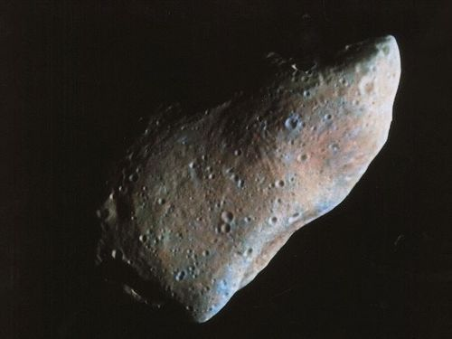

An image of asteroid 951 Gaspra taken with the Galileo spacecraft 5300 kilometres away. Gaspra is 19 x 12 x 11 km. Notice how the asteroid's surface has many craters.

Although science fiction movies give the impression that the asteroid belt is a tightly packed region of dangerous rocks, in reality the asteroids are separated from each other by millions of kilometres. However, very rarely, collisions between asteroids do occur which is why asteroids are covered with impact craters. We will look at impact craters more closely in the following activity.

<Callout type="note" title="Note">
Join NASA on an underwater mission, called NEEMO, which is actually about practicing exploration to an asteroid. Help the crew prepare by classifying the underwater images.[http://neemo.zooniverse.org/](http://neemo.zooniverse.org/)
</Callout>

# Impact craters

In this activity learners will investigate how craters are formed by dropping balls into a tray of sand. Although you can do this activity with flour, it works best with sand. There are two parts to this experiment. In the first part learners will investigate how the mass of an object affects the crater size formed. In the second part, learners will investigate how the height at which an object is dropped affects the size of the crater it leaves. You can use more objects in the investigation if you have time, and as an extension you can examine the effect of impact angle on the shape of the crater formed.

You will need to experiment beforehand with the type of sand that you are using. Before your class performs this investigation, drop marbles into the sand that you have, to observe what kinds of craters the marbles leave. Experiment with the best possible option, for example, you might need to add some moisture to the sand so that you are able to see the craters.

**INVESTIGATIVE QUESTIONS:** How does the mass of an object affect the size of the crater it leaves? How does the height at which an object is dropped affect the size of the crater it leaves?

**HYPOTHESIS:**

What do you think will happen?

Learner-dependent answer. Learners should give reasons for their answers.

**IDENTIFY VARIABLES:**

**Problem:**
What are you keeping constant in this experiment?

**Solution:**
While investigating the effect of object mass, the height that the objects are dropped from should remain constant.

While investigating the effect of dropping height, the mass of the object being dropped should be kept constant.

**Problem:**
What are you changing in this experiment?

**Solution:**
In the first case - the mass of the object being dropped.

In the second case - the height from which the object is dropped.

**MATERIALS:**

- deep tray or large plastic container
- measuring scales
- ruler
- sand
- a marble
- a ball bearing
- chair or step ladder
- measuring tape (at least 2 m long)

**METHOD:**

2. Fill the tray or plastic container with sand to a depth of 10 cm.
4. Smooth the surface of the sand using the long edge of a ruler.
6. Measure the mass of the marble and record it in the table below.
8. Drop the marble from a height of 1 m into the tray of sand and observe the crater that forms.
10. Carefully remove the marble, without disturbing the shape of the crater and measure the diameter of the crater using the ruler.
12. Record the diameter of the crater in the table below.
14. Smooth the sand.
16. Repeat steps 3-7
18. Measure the mass of the ball bearing and record it in the table below.
20. Drop the ball bearing from a height of 1 m into the tray of sand and observe the crater that forms.
22. Carefully remove the ball bearing and measure the diameter of the crater using the ruler.
24. Record the diameter of the crater in the table below.
26. Smooth the sand.
28. Repeat steps 9 -13.
30. Drop the ball bearing into the sand from a height of 2 m. You may need to stand on a chair or step ladder to do this.
32. Record the size of the crater formed in the table below.
34. Smooth the sand.
36. Repeat steps 15-17, dropping the ball bearing from heights of 1.5m, 0.5m and 0.25m. Record all your measurements in the table below.
38. If you have time you can make repeated measurements.

**RESULTS AND OBSERVATIONS:**

Record your results and observations in the following table.

| Object | Mass (kg) | Drop Height (m) | Crater diameter - reading 1 (cm) | Crater diameter - reading 2 (cm) | Average crater diameter (cm) |
| --- | --- | --- | --- | --- | --- |
| marble |  | 1 |  |  |  |
| ball bearing |  | 1 |  |  |  |
| ball bearing |  | 2 |  |  |  |
| ball bearing |  | 1.5 |  |  |  |
| ball bearing |  | 0.5 |  |  |  |
| ball bearing |  | 0.25 |  |  |  |

**EVALUATION:**

How reliable was your experiment? How could it be improved?

Learner-dependent answer. Answers might include conducting more measurements.

**CONCLUSIONS:**

Write a conclusion for this investigation based on your results.

Learner dependent answer. Learners should summarise their results and provide a reason why they think they got the results they did.

**QUESTIONS:**

**Problem:**
How did the mass of the object affect the size of the crater?

**Solution:**
The larger the mass of the impacting object, the larger the diameter of the crater.

**Problem:**
How did the height at which the object was dropped affect the size of the crater?

**Solution:**
The greater the height at which the object was dropped, the larger the size of the crater.

**Problem:**
Why do you think the drop height affected the size of the crater?

**Solution:**
Objects dropped from greater heights hit the sand with a higher speed and therefore have greater energy (kinetic energy). As they have more energy they make a larger impact crater.

**Problem:**
What does this investigation tell us about craters on the surfaces of planets?

**Solution:**
It tells us that craters on the surfaces of other planets are formed due to impacts. The impacting objects must have been travelling very fast or have been very massive, because the craters we observe on other planets are much larger than the craters made in this experiment.

<Callout type="note" title="Note">
As Jupiter is more massive than all the other planets in the solar system, its large gravity attracts many asteroids and comets travelling in towards the inner solar system that would otherwise potentially crash into the Earth.
</Callout>

### Kuiper Belt objects

<Callout type="note" title="Note">
- Kuiper Belt
- Kuiper Belt object
- dwarf planet
- comet
- Oort Cloud
</Callout>

<Callout type="note" title="Note">
Gerard Kuiper (1905 - 1973) is regarded by many as the father of modern planetary science. He is well known for his many discoveries. Read more about them here.[http://solarsystem.nasa.gov/people/profile.cfm?Code=KuiperG](http://solarsystem.nasa.gov/people/profile.cfm?Code=KuiperG)
</Callout>

The Kuiper belt is a region of space filled with trillions of small objects that lies in the outer reaches of the solar system, past the orbit of Neptune. The Kuiper belt is a region between 30 and 50 times the Earth's distance from the Sun. This belt is similar to the closer asteroid belt, except that the objects are not made of rock, but rather of frozen ices. These icy objects can range in size from a fraction of a kilometre to more than a 1000 km across and are called Kuiper belt objects. The two largest known members of the Kuiper Belt are Eris and Pluto, both dwarf planets.

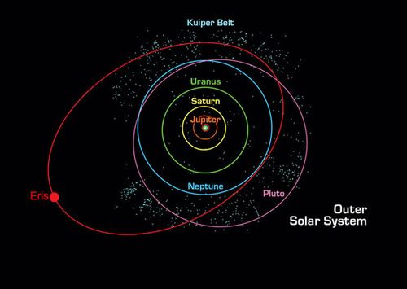

The Kuiper belt (the pale blue dot dots) is shown beyond the orbit of Neptune. Its members include the dwarf planets Pluto and Eris.

What keeps the objects in the Kuiper Belt in orbit around the Sun?

Gravity (the gravitational pull of the Sun).

<Callout type="note" title="Note">
NASA launched a space probe called New Horizons to study Pluto and other Kuiper Belt objects in more detail in 2006. It will arrive at Pluto in 2015.
</Callout>

### Dwarf planets

Dwarf planets are objects that orbit the Sun, just like the planets. However, they are smaller than planets. Due to their small size, they are unable to meet the official definition of a planet. Can you remember what the three criteria are to be classed as a planet? List them below.

To be classed as a planet an object must:

2. orbit around the Sun.
4. be large enough that its own gravity pulls it into a spherical shape.
6. clear out smaller objects in its orbit, by either flinging them into another orbit or by attracting and then sticking them to itself.

<Callout type="note" title="Note">
Why Pluto is not a planet anymore (video).
</Callout>

Asteroids are clearly not planets as they have irregular shapes and they are not spherical. Some dwarf planets are spherical, but they do not meet the third criterion. With their weak gravities they are unable to clear out other objects from their orbits. Which famous ex-planet is now considered a dwarf planet because it failed to meet the third criterion?

Pluto.

For many years the object Pluto was considered to be a planet. However, since the 1990s many more objects very similar to Pluto have been discovered orbiting the Sun out past Neptune's orbit. This resulted in new criteria to be drawn up to be considered a planet and Pluto was demoted to dwarf planet status

<Callout type="note" title="Note">
Pluto was named by Venetia Burney, an 11 year old from Oxford, England, in 1930. She suggested that the planet be named after the Roman god of the underworld, Pluto.
</Callout>

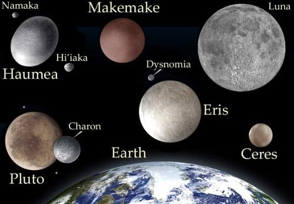

This image shows the five dwarf planets that have been discovered to date, Pluto, Haumea, Makemake, Eris and Ceres in relation to the size of the Earth. Some even have their own moons, which are shown. Ceres is in the asteroid belt and the other four are in the Kuiper Belt.

<Callout type="note" title="Note">
Read more about dwarf planets.[http://solarsystem.nasa.gov/planets/profile.cfm?Object=Dwarf](http://solarsystem.nasa.gov/planets/profile.cfm?Object=Dwarf)
</Callout>

<Callout type="note" title="Note">
Scientists estimate that there might be 200 or more dwarf planets in the Kuiper Belt, and thousands more beyond the Kuiper Belt.
</Callout>

### Comets and the Oort Cloud

The Oort Cloud has not been observed. At this point, it is purely hypothetical although very likely. Its existence cannot be stated as fact since it has not yet been confirmed to exist. We therefore refer to the Oort Cloud as hypothetical or predicted.

**Comets** are icy, dusty objects, orbiting around the Sun at great distances. Comets are found in the Kuiper Belt and in the predicted **Oort Cloud**. The Oort Cloud is thought to be a huge cloud of icy objects surrounding the Sun at the very edge of our solar system at a distance between 5,000 and 100,000 times the Earth's distance from the Sun!

<Callout type="note" title="Note">
The word comet comes from the Greek word*kome*, meaning 'hairy'!
</Callout>

<Callout type="note" title="Note">
In 2013, South African researchers found the first evidence of a comet hitting Earth. Read more about it.[http://mg.co.za/article/2013-10-08-sa-researchers-find-first-evidence-of-comet-hitting-earth](http://mg.co.za/article/2013-10-08-sa-researchers-find-first-evidence-of-comet-hitting-earth)
</Callout>

A comet will remain in the Kuiper Belt or Oort Cloud unless it is disturbed by another comet. If this happens, then the comet's orbit changes and occasionally the comet will come into the inner solar system for us to see.

<Callout type="note" title="Note">
Comets that come from the Kuiper Belt tend to have orbits around the Sun of 200 years or less. Comets originating in the Oort Cloud take even longer to orbit the Sun.
</Callout>

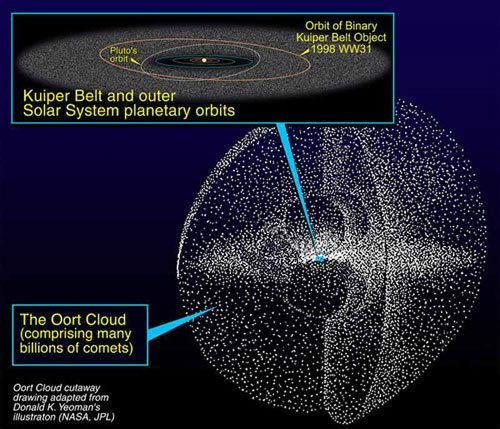

The hypothetical Oort Cloud is a huge cloud of icy objects or comets surrounding the outer reaches of our solar system.

We can only see comets directly when they come into the inner solar system because they are small and only visible by reflected sunlight. As a comet approaches the Sun, the Sun's heat evaporates the dust and ices it consists of, forming a bright dust tail which is visible from Earth. Some comet dust tails can be millions of kilometres long. The dust tail usually points back along the path of the comet.

Comets often have a second tail called an ion tail. The ion tail is made of ions that are pushed away from the comet's head by particles emitted from the Sun's atmosphere, called the solar wind. Let's find out more about this type of tail.

<Callout type="note" title="Note">
An **ion** is an atom with an electrical charge due to the gain or loss of electrons.
</Callout>

# A comet's ion tail

In this activity learners will discover that a comet's ion tail always points away from the Sun, no matter which way the comet is travelling! You can either get learners to make their own comet tails or if you do not have many materials you can make one comet yourself and pass it around for the learners to see.

In this activity you will make your own comet and explore how a comet's ion tail moves.

**MATERIALS:**

- table tennis ball
- sellotape
- tissue paper or crepe paper
- scissors

**INSTRUCTIONS:**

2. Cut the tissue paper or crepe papers into several strips (at least 4) about 1 cm wide by about 15 cm long.
4. Attach the paper strips to the ping pong ball, evenly spread around the equator of the ball using the sellotape. Wrap the sellotape around the ball a few times if needed to secure the paper in place. You have now made your comet and ion tail.
6. Hold out your comet in front of you and blow on the ball hard so that the ion tail is blown away from you. You are representing the Sun and your breath represents the solar wind, blowing on the comet's ion tail.
8. Continuing to blow fairly hard on the ball, move the ball from left to right and observe which way the paper moves.

**QUESTIONS:**

**Problem:**
Which direction did the ion tail move when you held up the comet in front of you and blew on the comet?

**Solution:**
Directly away from you (as it is blown away by your breath).

**Problem:**
Which direction did the ion tail move when you moved the ball left and right while still blowing?

**Solution:**
It still moves directly away from you as it is blown away by your breath. It does not follow the direction of movement of the comet.

In a similar way, a comet's ion tail always points away from the Sun.

<Callout type="note" title="Note">
Learn more about comets with this interactive website.[http://solarsystem.nasa.gov/cometinteractive/index.html](http://solarsystem.nasa.gov/cometinteractive/index.html)
</Callout>

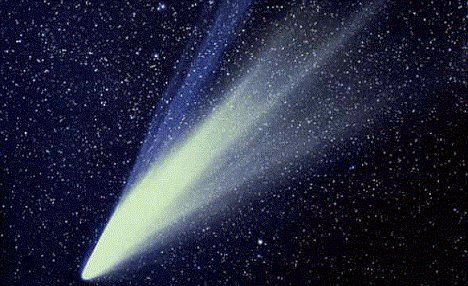

Comet West, photographed in 1995. Here you can see that the comet actually has two tails. The white tail is the dust tail and the blue tail is the ion tail made of charged particles evaporated from the comet's surface.

<Callout type="note" title="Note">
Halley's comet is visible from Earth every 75 to 76 years.
</Callout>

Comets that come into the inner solar system do not live forever. The Sun's heat melts comets, just like a snowman melts out in the Sun. After several thousand years the remains are so small that they no longer form a tail. Some comets completely melt away.

<Callout type="note" title="Note">
It is completely safe to fly through a comet's tail. The only thing that would hit your space ship would be microscopic pieces of dust.
</Callout>

At the time of producing these workbooks, comet ISON was approaching very near to the Sun. Astronomers did not know if it would break up or not. Read more about it here [http://solarsystem.nasa.gov/news/display.cfm?News_ID=44309](http://solarsystem.nasa.gov/news/display.cfm?News_ID=44309) and here [http://solarsystem.nasa.gov/smallworlds/cometison.cfm](http://solarsystem.nasa.gov/smallworlds/cometison.cfm)

See if you can find out what happened to comet ISON in the beginning of 2014, and tell your learners about this, or set it as a fun, small homework task.
