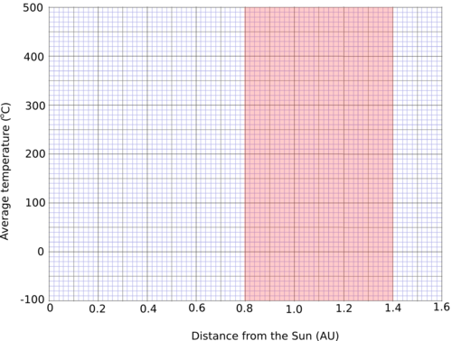
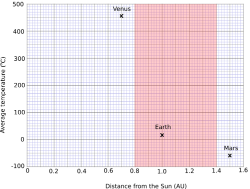
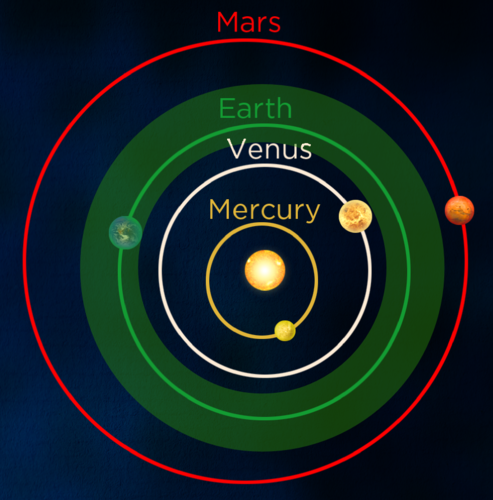
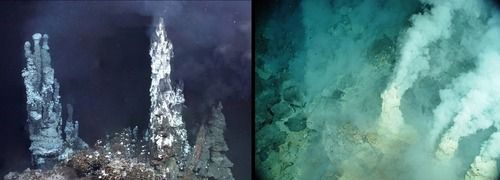
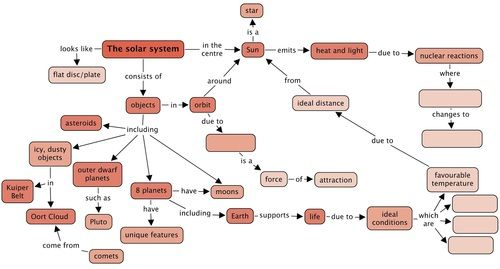
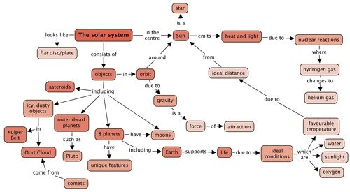
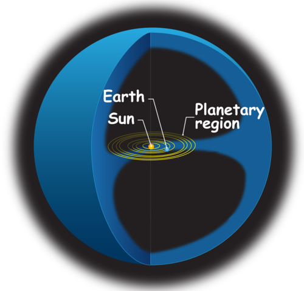
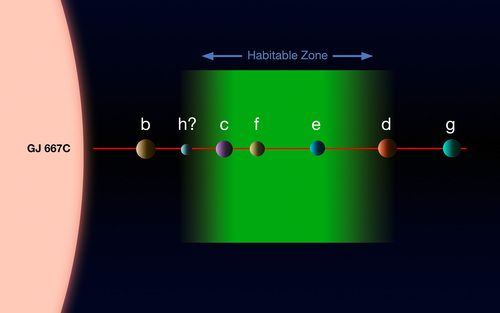

## Earth's position in the solar system

In this section learners will discover just how fortunate they are to be on Earth, which is currently the only planet known to harbour life. They will consider the conditions thought necessary for life and compare those with the conditions found on Earth and on Earth's neighbours. A nice way to introduce this topic is to have a class discussion about whether learners think aliens exist on other planets and, if so, what they might be like. This could then lead into a discussion about what conditions learners think are necessary for life. Talking about aliens usually excites learners!

<Callout type="note" title="Note">
- astronomical unit (AU)
- habitable zone
- photosynthesis
</Callout>

As you discovered in the last section, the Earth, along with the other planets, orbits around the Sun. The Earth is the third most distant planet from the Sun, lying in between Venus and Mars. Let's compare the Earth and its two neighbours in more detail.

<Callout type="note" title="Note">
Citizen science: Help search for planets orbiting other stars.[http://www.planethunters.org/](http://www.planethunters.org/)
</Callout>

# The Sun's Habitable Zone

In this activity learners will plot a graph of distance versus temperature for the planets Venus, Earth and Mars. They will also be provided with information regarding the habitable zone around the Sun. Using this information learners will have to decide which of the three planets lie within the Sun's habitable zone.

| Property | Venus | Earth | Mars |
| --- | --- | --- | --- |
| Distance from Sun (AU) | 0.7 | 1.0 | 1.5 |
| Average Temperature (°C) | 464 | 15 | -63 |

**MATERIALS:**

- pencil
- ruler

**INSTRUCTIONS:**

2. Look at the data provided in the table. It shows the distance from the Sun for three planets (in units of one Earth-Sun distance or Astronomical Unit). It also shows the average temperature on each planet in degrees Celsius.
4. Plot a graph to show the data in the table. Mark each point with an X.
6. The Sun's habitable zone extends from 0.8 to 1.4 AU and is shaded in red in the graph paper. This is the region where scientists think a planet has to lie in order for there to be life on the planet.

Graph showing the average temperature and the distance from the Sun of Venus, Earth and Mars.

Learners should plot the following points:

**QUESTIONS:**

**Problem:**
What is the average temperature on Venus?

**Solution:**
464 °C.

**Problem:**
Can liquid water exist on Venus? Why?

**Solution:**
No, it is too hot. Water boils at 100 °C.

**Problem:**
What is the average temperature on Mars?

**Solution:**
-63 °C.

**Problem:**
Is liquid water likely to be found on Mars? Why?

**Solution:**
No, it is too cold. Water freezes at 0 °C.

**Problem:**
What is the average temperature on Earth?

**Solution:**
15 °C.

**Problem:**
Can liquid water exist on Earth? Why?

**Solution:**
Yes, because the temperature on Earth is between water's melting and boiling points.

**Problem:**
Which planet/s lie within the Sun's habitable zone (the red shaded region in the graph)?

**Solution:**
Only Earth.

<Callout type="note" title="Note">
Our solar system's habitable zone (video)
</Callout>

The average temperature on Earth is a moderate 15 °C. Because of this, water can exist in liquid form on Earth. *This is important because scientists think that liquid water is one of the key things needed for life.* Venus has an average temperature of 464 °C and no liquid water exists on Venus because it is too hot. On Mars, the opposite is true. The average temperature on Mars is -63 °C and any water on Mars would be frozen. Earth is unique in our solar system as it is the only planet known to have liquid water on its surface and to harbour life.

If the Earth were too close to the Sun it would be too hot and all the water would evaporate from the oceans, like it has on Venus. If the Earth were too far from the Sun it would be too cold, and all the water would be frozen, like on Mars. Earth is at just the right distance from the Sun to have liquid water on its surface. The other planets in the solar system are either too close or too far from the Sun. The range of distances that a planet can lie from the Sun and still have liquid water on the planet's surface is called the **habitable zone***.* Estimates for the habitable zone in our solar system range from 0.8 - 1.4 astronomical units (AU).

<Callout type="note" title="Note">
An astronomical unit corresponds to the average distance between the Earth and the Sun.
</Callout>

You will probably find different quoted ranges for the habitable zone from different sources. This is because different scientists have used slightly different criteria to define what "habitable" means. Many studies focus on how life on Earth would be affected if the Earth were closer to or farther from the Sun. However, the point at which life can no longer exist on Earth is uncertain.

Our Sun's habitable zone (light green). The Earth is the only planet in our solar system which lies within our Sun's habitable zone. It is just the right distance from the Sun for liquid water to remain on the planet, something which scientists think is essential for life.

<Callout type="note" title="Note">
The habitable zone is sometimes called the Goldilocks zone after the famous children's story where Goldilocks eats the porridge that is neither too hot nor too cold.
</Callout>

What other conditions do you think are necessary for life on Earth or other planets? List your answers in the space below.

Learner-dependent answer. This is also an ideal opportunity for a class discussion. Answers could include, sunlight for energy, oxygen, carbon (we are carbon based), liquid water. Note that other life forms might not be carbon based and that life comes in many forms like bacteria, animals and plants. Scientists are looking for more than just human-like beings and other forms of life that we find on Earth. Also, we are likely to be biased in what we think the conditions are that are needed for life, because we only know about life on Earth.

<Callout type="note" title="Note">
Other stars also have habitable zones. Scientists believe that planets orbiting other stars within the habitable zone could support life forms.
</Callout>

<Callout type="note" title="Note">
Kepler Mission: A search for habitable planets.
</Callout>

Scientists think that in order for life to arise and survive on a planet:

- there must be sunlight for plants to grow.
- the planet must be located in the habitable zone of a star so that there are moderate temperatures and liquid water.
- there must be oxygen for respiration.

Which of the planets in the solar system receive light from the Sun?

All the planets in the solar system receive light from the Sun.

Which of the planets in the solar system have moderate temperatures and liquid water on their surface?

Only Earth.

Which of the planets in the solar system have significant amounts of oxygen in their atmosphere or oceans?

Only Earth.

As you can see the Earth is very fortunate, because it lies at just the right distance from the Sun to have moderate temperatures and abundant liquid water. The Sun provides the energy for plants to grow. There is plenty of oxygen in Earth's present day atmosphere and oceans, which means that life can survive on land and in the Earth's oceans. The Earth is unique in that it is the only planet we know of that has life.

<Callout type="note" title="Note">
The moons Europa (orbiting Jupiter) and Titan (orbiting Saturn) are considered to be places where life may exist. Europa's surface is covered in smooth water ice and scientists think that there might be a water ocean beneath the icy surface. Titan has liquid lakes and seas on its surface, although they are not made of water, but rather liquid methane and ethane. Some scientists think that life may be able to survive in these lakes.
</Callout>

### The greenhouse effect

<Callout type="note" title="Note">
You may have heard a lot about global warming and the greenhouse effect in the news and in our studies in Energy and Change.
</Callout>

During the day, the Sun shines through the atmosphere heating the Earth's surface. At night, the Earth's surface cools, releasing the heat back into space. Some of the heat is trapped by greenhouse gases in the air like carbon dioxide, which causes the Earth to remain warmer than it would have otherwise. This is called the **greenhouse effect**.

Scientists think that due to human activities, like cutting down forests and burning fossil fuels, the greenhouse effect is now too strong. Scientists are more than 90 % certain that the increase in greenhouse gases has caused the average temperature on Earth to rise. This is known as global warming.

<Callout type="note" title="Note">
Global warming: How humans are affecting our planet.
</Callout>

<Callout type="note" title="Note">
Average temperatures on Earth have increased by 0.8°C around the world since 1880, with the biggest increase in the last few decades. The rate of warming is also increasing.
</Callout>

Venus provides us with a clue as to what might happen to the Earth if global warming continues. Venus' thick atmosphere has led to a runaway greenhouse effect on the planet, heating it to 462 °C. Venus's oceans have boiled away leaving behind a hot, inhospitable planet. We should therefore try our best to look after our precious planet!

### The beginnings of life

Scientists do not know how life began on Earth, but they estimate that the early ancestor of modern bacteria was alive on Earth 3.5 billion years ago. The early Earth's atmosphere had almost no oxygen. Instead, it was composed mainly of carbon dioxide, nitrogen and water vapour with some methane and ammonia. Carbon dioxide and water vapour were pumped into the atmosphere during volcanic eruptions, which caused the atmosphere to change over time. Eventually the water vapour in the atmosphere condensed to form rain, forming the first oceans. Eventually living organisms (bacteria) appeared in the oceans. These simple organisms used sunlight, water and carbon dioxide in the oceans to produce sugars and oxygen. What is this process called?

This process is called photosynthesis.

This is where the first oxygen in the ocean and atmosphere came from. That oxygen made it possible for other organisms to develop and flourish and is the reason that you are here today.

Scientists are busy exploring the possible locations for the origin of life, including hot springs and tidal pools. Recently, some scientists have started to support the hypothesis that life originated in deep sea hydrothermal vents, as shown in the image. These vents are like underwater volcanoes. The investigation continues to try to understand how life originated on Earth.

<Callout type="note" title="Note">
Do you enjoy English and Science? Read more about a career as a science writer.[http://solarsystem.nasa.gov/people/profile.cfm?Code=HarveyS](http://solarsystem.nasa.gov/people/profile.cfm?Code=HarveyS)
</Callout>

<Callout type="note" title="Note">
- The Sun produces its energy at its centre via nuclear fusion reactions, where hydrogen nuclei are squeezed together to form helium nuclei.
- The Sun's energy is transported to the surface and radiates equally in all directions.
- Our solar system consists of the Sun and all the objects that are held in orbit around the Sun by gravity.
- Objects such as planets, dwarf planets, asteroids, comets and Kuiper Belt objects orbit around the Sun.
- The 8 planets in our solar system have their own properties and characteristics.
- The planets can be split into two groups, the inner small rocky terrestrial planets and the outer large gas giants.
- The asteroid belt is the area where most asteroids are found in our solar system, lying between the orbits of Mars and Jupiter
- The Oort Cloud is a hypothetical huge cloud of icy objects (comets) surrounding the Sun at the very edge of our solar system.
- Sometimes, comets from the Oort Cloud come close to the sun. We can only see them when they come into the inner solar system because they are small and only visible by reflected sunlight.
- Scientists think that some of the conditions necessary for sustained life include moderate temperatures, liquid water, sunlight (energy) and oxygen.
- The Earth is the third planet from the Sun and the only planet in the solar system known to harbour life.
- The Earth lies within the Sun's habitable zone; the range of distances that a planet can lie from a star and still have liquid water on the planet's surface.
</Callout>

**Concept Map**

Complete the concept map which summarises the key concepts from this chapter about our solar system.

Teacher's version

**Problem:**
How does the Sun produce its energy? [2 marks]

**Solution:**
By nuclear fusion reactions, where hydrogen is converted to helium.

**Problem:**
Why do sunspots look darker than the rest of the surface of the sun? [2 marks]

**Solution:**
They are much cooler than the rest of the surface. A typical sunspot temperature is around 3900 °C whereas the rest of the surface is around 5500 °C. (Intensity is proportional to temperature).

**Problem:**
What keeps the planets and other bodies in our solar system in orbit? [1 mark]

**Solution:**
The gravity between these objects and the sun.

**Problem:**
Name the terrestrial planets. [4 marks]

**Solution:**
Mercury, Venus, Earth and Mars.

**Problem:**
Name the gas giants. [4 marks]

**Solution:**
Jupiter, Saturn, Uranus, Neptune.

**Problem:**
Where is the asteroid belt located? [1 mark]

**Solution:**
In between the orbits of Mars and Jupiter.

**Problem:**
Where is the Kuiper belt located? [1 mark]

**Solution:**
Out beyond the orbit of Neptune.

**Problem:**
Why are the gas giants so much larger than the terrestrial planets? [2 marks]

**Solution:**
They are mostly made of hydrogen and helium which are the most abundant elements in the universe.

**Problem:**
List the planets in increasing distance from the Sun. [4 marks]

**Solution:**
Mercury, Venus, Earth, Mars, Jupiter, Saturn, Uranus, Neptune.

**Problem:**
Which planets have rings? [4 marks]

**Solution:**
Jupiter, Saturn, Uranus, Neptune.

**Problem:**
Why is Venus so hot? [2 marks]

**Solution:**
Its atmosphere is so thick, there is a runaway greenhouse effect on the planet heating the planet to high temperatures.

**Problem:**
On which planet have landers found frozen water in the rocks under the planet's surface? [1 mark]

**Solution:**
Mars.

**Problem:**
The following diagram shows the solar system at the centre.

2. What does the blue space represent? [1 mark]
4. What is mostly found in this space? [1 mark]

**Solution:**
2. The hypothetical Oort Cloud.
4. Comets and icy objects.

**Problem:**
Why can we only see comets as they come close to the Sun? [3 marks]

**Solution:**
As comets come close to the Sun, the Sun's heat evaporates their surface, resulting in long bright tails which we can see. Far from the Sun it is too cold for the tails to form, so we have to wait until the comet is close enough to the Sun for it to form a tail before we can see it.

**Problem:**
What is the official definition of a planet and why was Pluto downgraded to a dwarf planet? [4 marks]

**Solution:**
The official definition of a planet states that a planet must orbit the Sun, be large enough so that its own gravity squashes it into a spherical shape and that it has cleared out other objects from its orbital path. Pluto has not swept out other objects from its orbit and so it was downgraded from planet to dwarf planet status.

**Problem:**
Why can the Earth support life? [4 marks]

**Solution:**
Earth has a moderate temperature, with liquid water on its surface. There is also abundant oxygen for respiration and plenty of sunlight (energy) for plants to grow.

**Problem:**
What would happen to the Earth if it warmed significantly, like Venus has in the past? [2 marks]

**Solution:**
It would eventually lose all its liquid water and therefore would not be able to sustain life.

**Problem:**
The following diagram shows the system of planets around the star Gliese 667C.

The planets around another star.

2. Which of these planets are possible candidates for life? [1 mark]
4. Explain your answer above. [2 marks]

**Solution:**
2. Planets c, f and e.
4. The orbits of these three planets lie within the habitable zone around the star. This is the zone which is the right distance from the star for water to exist as a liquid, making these planets possible candidates to support life.

Total [46 marks]
